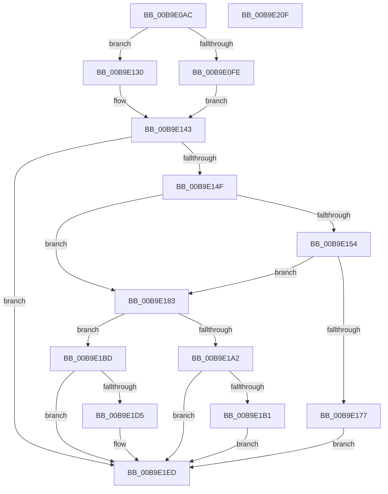

# ViIrpAllocateLockedPacket

- RVA: `0x00B9E0AC`–`0x00B9E210` (길이 `356` bytes)
- VA: `0x0000000140B9E0AC`
- 실행 섹션: `PAGEVRFY`
- PDB 이름 있음: `예`; PDB Function 태그: `아니요`
- unwind 정보 RVA: `0x0008A668`
- 디코드: `97`개 명령, `356/356` bytes 표시
- 미해석 바이트: `0` (있으면 어셈블리에 `.byte`로 보존)

> 이 문서는 커널 이미지의 기계어와 PDB 기호를 분석해 생성했습니다. 4번과 5번은 함수 원형과 자료형을 바이너리 사용 방식에서 추정한 C 해석이며 원본 소스 복구 결과는 아닙니다.

## 1. Dependencies

- 직접 호출 지점: **9**; 고유 호출 대상: **8**
- 직접 호출자로 확인된 함수: **1**
- RIP 상대 이미지 참조: **2**

### Outgoing calls
- `0x00B9E129` → [VfHandlePoolAlloc](../BB/VfHandlePoolAlloc_function_00BB8A90.md) (function, `0x00BB8A90`)
- `0x00B9E13E` → [ExAllocatePool2](../../poolcode/B8/ExAllocatePool2_function_00B820F0.md) (function, `0x00B820F0`)
- `0x00B9E16E` → [PsChargeProcessNonPagedPoolQuota](../../text/2A/PsChargeProcessNonPagedPoolQuota_function_002A7B80.md) (function, `0x002A7B80`)
- `0x00B9E17C` → [ExFreePoolWithTag](../../poolcode/B8/ExFreePoolWithTag_function_00B82870.md) (function, `0x00B82870`)
- `0x00B9E18D` → [IoInitializeIrp](../../text/44/IoInitializeIrp_function_00445050.md) (function, `0x00445050`)
- `0x00B9E195` → [VfPacketCreateAndLock](../BA/VfPacketCreateAndLock_function_00BAB420.md) (function, `0x00BAB420`)
- `0x00B9E1A7` → [ExFreePoolWithTag](../../poolcode/B8/ExFreePoolWithTag_function_00B82870.md) (function, `0x00B82870`)
- `0x00B9E1B6` → [PsReturnProcessNonPagedPoolQuota](../../text/41/PsReturnProcessNonPagedPoolQuota_function_0041C200.md) (function, `0x0041C200`)
- `0x00B9E1E8` → [ObfReferenceObjectWithTag](../../text/21/ObfReferenceObjectWithTag_function_00210710.md) (function, `0x00210710`)

### Direct callers
- [VfIoAllocateIrp1](VfIoAllocateIrp1_function_00B9DD94.md) at `0x00B9DDAD`

### Static image references
- `0x00B9E0F0` → RVA `0x00E681A0` (`.data`; read)
- `0x00B9E102` → RVA `0x00E681B0` (`.data`; read)

## 2. Other-region calls and transfers

- 다른 실행 섹션으로 향하는 call: **7**
  - `0x00B9E13E` → [ExAllocatePool2](../../poolcode/B8/ExAllocatePool2_function_00B820F0.md) (`PAGEVRFY` → `POOLCODE`)
  - `0x00B9E16E` → [PsChargeProcessNonPagedPoolQuota](../../text/2A/PsChargeProcessNonPagedPoolQuota_function_002A7B80.md) (`PAGEVRFY` → `.text`)
  - `0x00B9E17C` → [ExFreePoolWithTag](../../poolcode/B8/ExFreePoolWithTag_function_00B82870.md) (`PAGEVRFY` → `POOLCODE`)
  - `0x00B9E18D` → [IoInitializeIrp](../../text/44/IoInitializeIrp_function_00445050.md) (`PAGEVRFY` → `.text`)
  - `0x00B9E1A7` → [ExFreePoolWithTag](../../poolcode/B8/ExFreePoolWithTag_function_00B82870.md) (`PAGEVRFY` → `POOLCODE`)
  - `0x00B9E1B6` → [PsReturnProcessNonPagedPoolQuota](../../text/41/PsReturnProcessNonPagedPoolQuota_function_0041C200.md) (`PAGEVRFY` → `.text`)
  - `0x00B9E1E8` → [ObfReferenceObjectWithTag](../../text/21/ObfReferenceObjectWithTag_function_00210710.md) (`PAGEVRFY` → `.text`)
- 별도 외부 분기/꼬리 이동을 확인하지 못했습니다.

## 3. Assembly (complete function range)

```asm
00B9E0AC  4C 8B DC                        mov r11, rsp
00B9E0AF  49 89 5B 08                     mov qword ptr [r11 + 8], rbx
00B9E0B3  49 89 6B 10                     mov qword ptr [r11 + 0x10], rbp
00B9E0B7  49 89 73 18                     mov qword ptr [r11 + 0x18], rsi
00B9E0BB  49 89 7B 20                     mov qword ptr [r11 + 0x20], rdi
00B9E0BF  41 54                           push r12
00B9E0C1  41 56                           push r14
00B9E0C3  41 57                           push r15
00B9E0C5  48 83 EC 40                     sub rsp, 0x40
00B9E0C9  44 0F BE E1                     movsx r12d, cl
00B9E0CD  33 DB                           xor ebx, ebx
00B9E0CF  41 0F B7 C4                     movzx eax, r12w
00B9E0D3  33 ED                           xor ebp, ebp
00B9E0D5  66 C1 E0 03                     shl ax, 3
00B9E0D9  33 F6                           xor esi, esi
00B9E0DB  44 8B F2                        mov r14d, edx
00B9E0DE  46 8D 0C 20                     lea r9d, [rax + r12]
00B9E0E2  B8 D0 00 00 00                  mov eax, 0xd0
00B9E0E7  66 41 C1 E1 03                  shl r9w, 3
00B9E0EC  66 44 03 C8                     add r9w, ax
00B9E0F0  8B 05 AA A0 2C 00               mov eax, dword ptr [rip + 0x2ca0aa]
00B9E0F6  45 0F B7 F9                     movzx r15d, r9w
00B9E0FA  A8 01                           test al, 1
00B9E0FC  74 32                           je 0x140b9e130
00B9E0FE  4D 89 43 E0                     mov qword ptr [r11 - 0x20], r8
00B9E102  48 8D 05 A7 A0 2C 00            lea rax, [rip + 0x2ca0a7]
00B9E109  C7 44 24 30 01 00 00 00         mov dword ptr [rsp + 0x30], 1
00B9E111  41 B9 49 72 70 2B               mov r9d, 0x2b707249
00B9E117  49 89 43 D0                     mov qword ptr [r11 - 0x30], rax
00B9E11B  45 8B C7                        mov r8d, r15d
00B9E11E  21 5C 24 20                     and dword ptr [rsp + 0x20], ebx
00B9E122  BA 40 02 00 00                  mov edx, 0x240
00B9E127  33 C9                           xor ecx, ecx
00B9E129  E8 62 A9 01 00                  call 0x140bb8a90
00B9E12E  EB 13                           jmp 0x140b9e143
00B9E130  41 B8 49 72 70 2B               mov r8d, 0x2b707249
00B9E136  49 8B D7                        mov rdx, r15
00B9E139  B9 40 00 00 00                  mov ecx, 0x40
00B9E13E  E8 AD 3F FE FF                  call 0x140b820f0
00B9E143  48 8B F8                        mov rdi, rax
00B9E146  48 85 C0                        test rax, rax
00B9E149  0F 84 9E 00 00 00               je 0x140b9e1ed
00B9E14F  45 85 F6                        test r14d, r14d
00B9E152  74 2F                           je 0x140b9e183
00B9E154  65 48 8B 04 25 88 01 00 00      mov rax, qword ptr gs:[0x188]
00B9E15D  BD 00 10 00 00                  mov ebp, 0x1000
00B9E162  8B D5                           mov edx, ebp
00B9E164  48 8B B0 B8 00 00 00            mov rsi, qword ptr [rax + 0xb8]
00B9E16B  48 8B CE                        mov rcx, rsi
00B9E16E  E8 0D 9A 70 FF                  call 0x1402a7b80
00B9E173  85 C0                           test eax, eax
00B9E175  79 0C                           jns 0x140b9e183
00B9E177  33 D2                           xor edx, edx
00B9E179  48 8B CF                        mov rcx, rdi
00B9E17C  E8 EF 46 FE FF                  call 0x140b82870
00B9E181  EB 6A                           jmp 0x140b9e1ed
00B9E183  45 8A C4                        mov r8b, r12b
00B9E186  41 0F B7 D7                     movzx edx, r15w
00B9E18A  48 8B CF                        mov rcx, rdi
00B9E18D  E8 BE 6E 8A FF                  call 0x140445050
00B9E192  48 8B CF                        mov rcx, rdi
00B9E195  E8 86 D2 00 00                  call 0x140bab420
00B9E19A  48 8B D8                        mov rbx, rax
00B9E19D  48 85 C0                        test rax, rax
00B9E1A0  75 1B                           jne 0x140b9e1bd
00B9E1A2  33 D2                           xor edx, edx
00B9E1A4  48 8B CF                        mov rcx, rdi
00B9E1A7  E8 C4 46 FE FF                  call 0x140b82870
00B9E1AC  45 85 F6                        test r14d, r14d
00B9E1AF  74 3C                           je 0x140b9e1ed
00B9E1B1  8B D5                           mov edx, ebp
00B9E1B3  48 8B CE                        mov rcx, rsi
00B9E1B6  E8 45 E0 87 FF                  call 0x14041c200
00B9E1BB  EB 30                           jmp 0x140b9e1ed
00B9E1BD  81 48 38 08 00 20 00            or dword ptr [rax + 0x38], 0x200008
00B9E1C4  F0 FF 40 14                     lock inc dword ptr [rax + 0x14]
00B9E1C8  FF 40 18                        inc dword ptr [rax + 0x18]
00B9E1CB  0F BA 6F 10 1E                  bts dword ptr [rdi + 0x10], 0x1e
00B9E1D0  45 85 F6                        test r14d, r14d
00B9E1D3  74 18                           je 0x140b9e1ed
00B9E1D5  80 4F 47 01                     or byte ptr [rdi + 0x47], 1
00B9E1D9  BA 56 72 66 49                  mov edx, 0x49667256
00B9E1DE  48 8B CE                        mov rcx, rsi
00B9E1E1  89 68 54                        mov dword ptr [rax + 0x54], ebp
00B9E1E4  48 89 70 58                     mov qword ptr [rax + 0x58], rsi
00B9E1E8  E8 23 25 67 FF                  call 0x140210710
00B9E1ED  48 8B 6C 24 68                  mov rbp, qword ptr [rsp + 0x68]
00B9E1F2  48 8B C3                        mov rax, rbx
00B9E1F5  48 8B 5C 24 60                  mov rbx, qword ptr [rsp + 0x60]
00B9E1FA  48 8B 74 24 70                  mov rsi, qword ptr [rsp + 0x70]
00B9E1FF  48 8B 7C 24 78                  mov rdi, qword ptr [rsp + 0x78]
00B9E204  48 83 C4 40                     add rsp, 0x40
00B9E208  41 5F                           pop r15
00B9E20A  41 5E                           pop r14
00B9E20C  41 5C                           pop r12
00B9E20E  C3                              ret
00B9E20F  CC                              int3
```

## 4. C-style interpretation (structured pseudocode)

```c
__int64 __fastcall ViIrpAllocateLockedPacket(int a1, int a2, __int64 a3)
{
    __int64 result;
    __int64 v_rbp;
    __int64 v_rbx;
    __int64 v_rsi;
    __int64 v_rsp;
    unsigned int v_stack_m28;
    unsigned int v_stack_m38;
    unsigned __int64 v_stack_p10;
    unsigned __int64 v_stack_p18;
    unsigned __int64 v_stack_p20;
    unsigned __int64 v_stack_p8;

    *(unsigned __int64 *)(v_rsp + 8) = v_rbx;
    *(unsigned __int64 *)(v_rsp + 16) = v_rbp;
    *(unsigned __int64 *)(v_rsp + 24) = v_rsi;
    *(unsigned __int64 *)(v_rsp + 32) = v_rdi;
    v_rsp = (v_rsp) - (64);
    v_rbx = 0;
    v_rbp = 0;
    result = (unsigned __int16)(((unsigned __int16)((__int8)((unsigned __int8)(a1)))) << (3));
    v_rsi = 0;
    a4 = (unsigned __int16)((result + (__int8)((unsigned __int8)(a1)) * 1) << (3));
    a4 = (unsigned __int16)((a4) + (208));
    if ((((unsigned __int8)((unsigned int)(*(unsigned int *)(v_rip + 2924714)))) & (1)) == 0) goto loc_00B9E130;
    *(unsigned __int64 *)(v_rsp - 32) = a3;
    v_stack_m28 = 1;
    *(unsigned __int64 *)(v_rsp - 48) = v_rip + 2924711;
    a1 = 0;
    result = VfHandlePoolAlloc(a1, 576, (unsigned int)((unsigned int)((unsigned __int16)(a4))), (unsigned int)(0x2B707249ULL));
    goto loc_00B9E143;
loc_00B9E130:
    result = ExAllocatePool2(64, (unsigned __int16)(a4), (unsigned int)(0x2B707249ULL), (unsigned int)(0x2B707249ULL));
loc_00B9E143:
    if (result == 0) goto loc_00B9E1ED;
    if ((unsigned int)((unsigned int)(a2)) == 0) goto loc_00B9E183;
    result = PsChargeProcessNonPagedPoolQuota(*(unsigned __int64 *)(*(unsigned __int64 *)(gs_base + (0 + 392)) + 184), (unsigned int)((unsigned int)((unsigned int)(0x1000ULL))), (unsigned int)(0x2B707249ULL), (unsigned int)(0x2B707249ULL));
    if (!sign_flag) goto loc_00B9E183;
    a2 = 0;
    result = ExFreePoolWithTag(result, a2, (unsigned int)(0x2B707249ULL), (unsigned int)(0x2B707249ULL));
    goto loc_00B9E1ED;
loc_00B9E183:
    result = IoInitializeIrp(result, (unsigned __int16)((unsigned __int16)(a4)), (unsigned __int8)((__int8)((unsigned __int8)(a1))), (unsigned int)(0x2B707249ULL));
    result = VfPacketCreateAndLock(result, (unsigned __int16)((unsigned __int16)(a4)), (unsigned __int8)((__int8)((unsigned __int8)(a1))), (unsigned int)(0x2B707249ULL));
    if (result != 0) goto loc_00B9E1BD;
    a2 = 0;
    result = ExFreePoolWithTag(result, a2, (unsigned __int8)((__int8)((unsigned __int8)(a1))), (unsigned int)(0x2B707249ULL));
    if ((unsigned int)((unsigned int)(a2)) == 0) goto loc_00B9E1ED;
    result = PsReturnProcessNonPagedPoolQuota(*(unsigned __int64 *)(*(unsigned __int64 *)(gs_base + (0 + 392)) + 184), (unsigned int)((unsigned int)((unsigned int)(0x1000ULL))), (unsigned __int8)((__int8)((unsigned __int8)(a1))), (unsigned int)(0x2B707249ULL));
    goto loc_00B9E1ED;
loc_00B9E1BD:
    if ((unsigned int)((unsigned int)(a2)) != 0) {
        a2 = 0x49667256ULL;
        a1 = *(unsigned __int64 *)(*(unsigned __int64 *)(gs_base + (0 + 392)) + 184);
        *(unsigned int *)(result + 84) = (unsigned int)((unsigned int)(0x1000ULL));
        *(unsigned __int64 *)(result + 88) = *(unsigned __int64 *)(*(unsigned __int64 *)(gs_base + (0 + 392)) + 184);
        result = ObfReferenceObjectWithTag(a1, a2, (unsigned __int8)((__int8)((unsigned __int8)(a1))), (unsigned int)(0x2B707249ULL));
    }
    v_rsp = (v_rsp) + (64);
    return result;
}
```

## 5. (Beta) C Style

```c
int64_t ViIrpAllocateLockedPacket(int32_t Arg1, int32_t Arg2, int64_t Arg3)
{
    int64_t result;
    int64_t local_rbp;
    int64_t local_rbx;
    int64_t local_rsi;
    int64_t local_rsp;
    uint32_t v_stack_m28;
    uint32_t v_stack_m38;
    uint64_t v_stack_p10;
    uint64_t v_stack_p18;
    uint64_t v_stack_p20;
    uint64_t v_stack_p8;

    *(uint64_t *)(local_rsp + 0x8) = local_rbx;
    *(uint64_t *)(local_rsp + 0x10) = local_rbp;
    *(uint64_t *)(local_rsp + 0x18) = local_rsi;
    *(uint64_t *)(local_rsp + 0x20) = local_rdi;
    local_rsp = (local_rsp) - (64);
    local_rbx = 0;
    local_rbp = 0;
    result = (uint16_t)(((uint16_t)((int8_t)((uint8_t)(Arg1)))) << (3));
    local_rsi = 0;
    a4 = (uint16_t)((result + (int8_t)((uint8_t)(Arg1)) * 1) << (3));
    a4 = (uint16_t)((a4) + (208));
    if ((((uint8_t)((uint32_t)(*(uint32_t *)(v_rip + 0x2CA0AA)))) & (1)) == 0) goto loc_00B9E130;
    *(uint64_t *)(local_rsp - 0x20) = Arg3;
    v_stack_m28 = 1;
    *(uint64_t *)(local_rsp - 0x30) = v_rip + 2924711;
    Arg1 = 0;
    result = VfHandlePoolAlloc(Arg1, 576, (uint32_t)((uint32_t)((uint16_t)(a4))), (uint32_t)(0x2B707249ULL));
    goto loc_00B9E143;
loc_00B9E130:
    result = ExAllocatePool2(64, (uint16_t)(a4), (uint32_t)(0x2B707249ULL), (uint32_t)(0x2B707249ULL));
loc_00B9E143:
    if (result == 0) goto loc_00B9E1ED;
    if ((uint32_t)((uint32_t)(Arg2)) == 0) goto loc_00B9E183;
    result = PsChargeProcessNonPagedPoolQuota(*(uint64_t *)(*(uint64_t *)(gs_base + (0 + 0x188)) + 0xB8), (uint32_t)((uint32_t)((uint32_t)(0x1000ULL))), (uint32_t)(0x2B707249ULL), (uint32_t)(0x2B707249ULL));
    if (!sign_flag) goto loc_00B9E183;
    Arg2 = 0;
    result = ExFreePoolWithTag(result, Arg2, (uint32_t)(0x2B707249ULL), (uint32_t)(0x2B707249ULL));
    goto loc_00B9E1ED;
loc_00B9E183:
    result = IoInitializeIrp(result, (uint16_t)((uint16_t)(a4)), (uint8_t)((int8_t)((uint8_t)(Arg1))), (uint32_t)(0x2B707249ULL));
    result = VfPacketCreateAndLock(result, (uint16_t)((uint16_t)(a4)), (uint8_t)((int8_t)((uint8_t)(Arg1))), (uint32_t)(0x2B707249ULL));
    if (result != 0) goto loc_00B9E1BD;
    Arg2 = 0;
    result = ExFreePoolWithTag(result, Arg2, (uint8_t)((int8_t)((uint8_t)(Arg1))), (uint32_t)(0x2B707249ULL));
    if ((uint32_t)((uint32_t)(Arg2)) == 0) goto loc_00B9E1ED;
    result = PsReturnProcessNonPagedPoolQuota(*(uint64_t *)(*(uint64_t *)(gs_base + (0 + 0x188)) + 0xB8), (uint32_t)((uint32_t)((uint32_t)(0x1000ULL))), (uint8_t)((int8_t)((uint8_t)(Arg1))), (uint32_t)(0x2B707249ULL));
    goto loc_00B9E1ED;
loc_00B9E1BD:
    if ((uint32_t)((uint32_t)(Arg2)) != 0) {
        Arg2 = 0x49667256ULL;
        Arg1 = *(uint64_t *)(*(uint64_t *)(gs_base + (0 + 0x188)) + 0xB8);
        *(uint32_t *)(result + 0x54) = (uint32_t)((uint32_t)(0x1000ULL));
        *(uint64_t *)(result + 0x58) = *(uint64_t *)(*(uint64_t *)(gs_base + (0 + 0x188)) + 0xB8);
        result = ObfReferenceObjectWithTag(Arg1, Arg2, (uint8_t)((int8_t)((uint8_t)(Arg1))), (uint32_t)(0x2B707249ULL));
    }
    local_rsp = (local_rsp) + (64);
    return result;
}
```

## 6. Execution-region graph

[열기: 2D/3D 그래프와 함수 탐색 컨트롤 패널](../../../control-panel.html?section=pagevrfy&rva=0x00B9E0AC&view=graph)

- 2D 그래프는 위에서 아래로 흐르고, 3D 그래프는 빈 공간을 드래그해 회전합니다. Shift+드래그는 이동, 휠은 확대·축소, 함수 노드 선택은 대상 보고서 이동입니다.

### Static fallback


