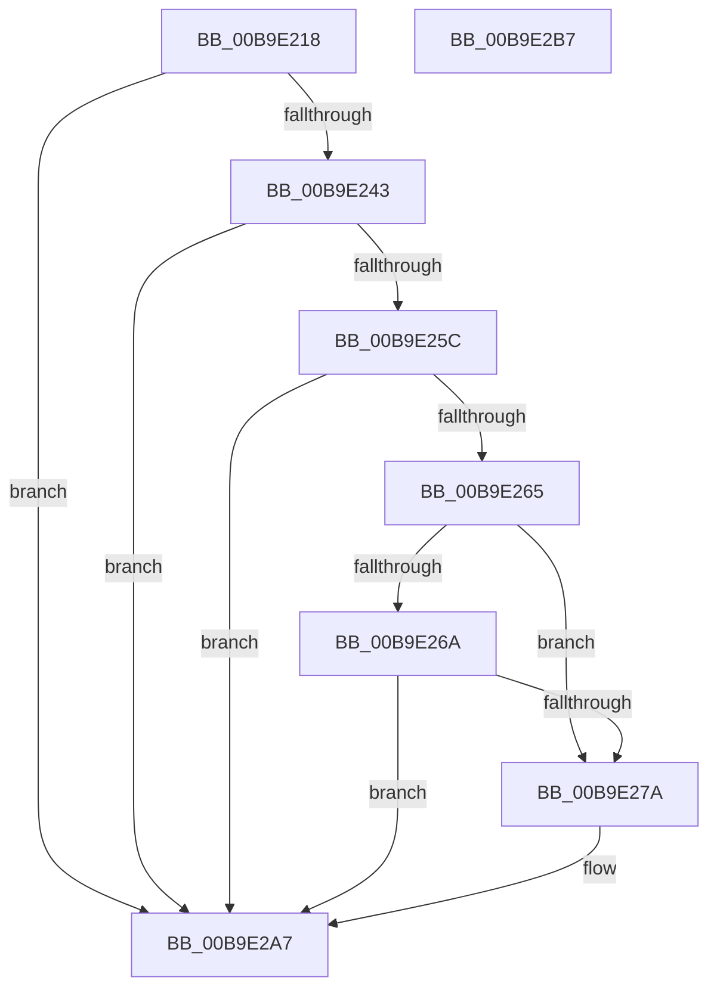

# ViIrpCheckKernelAddressForIrp

- RVA: `0x00B9E218`–`0x00B9E2B8` (길이 `160` bytes)
- VA: `0x0000000140B9E218`
- 실행 섹션: `PAGEVRFY`
- PDB 이름 있음: `예`; PDB Function 태그: `아니요`
- unwind 정보 RVA: `0x00086C28`
- 디코드: `38`개 명령, `160/160` bytes 표시
- 미해석 바이트: `0` (있으면 어셈블리에 `.byte`로 보존)

> 이 문서는 커널 이미지의 기계어와 PDB 기호를 분석해 생성했습니다. 4번과 5번은 함수 원형과 자료형을 바이너리 사용 방식에서 추정한 C 해석이며 원본 소스 복구 결과는 아닙니다.

## 1. Dependencies

- 직접 호출 지점: **2**; 고유 호출 대상: **2**
- 직접 호출자로 확인된 함수: **1**
- RIP 상대 이미지 참조: **2**

### Outgoing calls
- `0x00B9E271` → [VfTargetDriversIsEnabled](../BB/VfTargetDriversIsEnabled_function_00BB7F20.md) (function, `0x00BB7F20`)
- `0x00B9E2A2` → [CarReportRuleViolationFromNt](CarReportRuleViolationFromNt_function_00B9D904.md) (function, `0x00B9D904`)

### Direct callers
- [VfBeforeCallDriver](VfBeforeCallDriver_function_00B9DC58.md) at `0x00B9DC9D`

### Static image references
- `0x00B9E253` → RVA `0x00FC6AB0` (`ALMOSTRO`; read)
- `0x00B9E25C` → RVA `0x00FC6B70` (`ALMOSTRO`; read)

## 2. Other-region calls and transfers

- 다른 실행 섹션으로 향하는 call: **0**
- 별도 외부 분기/꼬리 이동을 확인하지 못했습니다.

## 3. Assembly (complete function range)

```asm
00B9E218  48 89 5C 24 08                  mov qword ptr [rsp + 8], rbx
00B9E21D  48 89 74 24 10                  mov qword ptr [rsp + 0x10], rsi
00B9E222  57                              push rdi
00B9E223  48 83 EC 40                     sub rsp, 0x40
00B9E227  48 8B F1                        mov rsi, rcx
00B9E22A  48 8D 42 FF                     lea rax, [rdx - 1]
00B9E22E  48 B9 FE FF FE FF FF 7F 00 00   movabs rcx, 0x7ffffffefffe
00B9E238  49 8B D8                        mov rbx, r8
00B9E23B  48 8B FA                        mov rdi, rdx
00B9E23E  48 3B C1                        cmp rax, rcx
00B9E241  77 64                           ja 0x140b9e2a7
00B9E243  65 48 8B 04 25 88 01 00 00      mov rax, qword ptr gs:[0x188]
00B9E24C  4C 8B 88 B8 00 00 00            mov r9, qword ptr [rax + 0xb8]
00B9E253  4C 3B 0D 56 88 42 00            cmp r9, qword ptr [rip + 0x428856]
00B9E25A  74 4B                           je 0x140b9e2a7
00B9E25C  4C 3B 0D 0D 89 42 00            cmp r9, qword ptr [rip + 0x42890d]
00B9E263  74 42                           je 0x140b9e2a7
00B9E265  48 85 DB                        test rbx, rbx
00B9E268  74 10                           je 0x140b9e27a
00B9E26A  49 8B 88 B0 00 00 00            mov rcx, qword ptr [r8 + 0xb0]
00B9E271  E8 AA 9C 01 00                  call 0x140bb7f20
00B9E276  85 C0                           test eax, eax
00B9E278  74 2D                           je 0x140b9e2a7
00B9E27A  48 8B 83 B0 00 00 00            mov rax, qword ptr [rbx + 0xb0]
00B9E281  BA E2 00 00 00                  mov edx, 0xe2
00B9E286  48 89 44 24 30                  mov qword ptr [rsp + 0x30], rax
00B9E28B  4C 8B CF                        mov r9, rdi
00B9E28E  C7 44 24 28 04 00 00 00         mov dword ptr [rsp + 0x28], 4
00B9E296  4C 8B C6                        mov r8, rsi
00B9E299  48 83 64 24 20 00               and qword ptr [rsp + 0x20], 0
00B9E29F  8D 4A E2                        lea ecx, [rdx - 0x1e]
00B9E2A2  E8 5D F6 FF FF                  call 0x140b9d904
00B9E2A7  48 8B 5C 24 50                  mov rbx, qword ptr [rsp + 0x50]
00B9E2AC  48 8B 74 24 58                  mov rsi, qword ptr [rsp + 0x58]
00B9E2B1  48 83 C4 40                     add rsp, 0x40
00B9E2B5  5F                              pop rdi
00B9E2B6  C3                              ret
00B9E2B7  CC                              int3
```

## 4. C-style interpretation (structured pseudocode)

```c
__int64 __fastcall ViIrpCheckKernelAddressForIrp(__int64 a1, __int64 a2, __int64 a3)
{
    __int64 result;
    __int64 v_rsp;
    unsigned __int64 v_stack_m18;
    unsigned int v_stack_m20;
    unsigned __int64 v_stack_m28;
    unsigned __int64 v_stack_p10;
    unsigned __int64 v_stack_p8;

    v_stack_p8 = v_rbx;
    v_stack_p10 = v_rsi;
    v_rsp = (v_rsp) - (64);
    if ((a2 - 1) > a1) goto loc_00B9E2A7;
    if ((*(unsigned __int64 *)(*(unsigned __int64 *)(gs_base + (0 + 392)) + 184)) == (*(unsigned __int64 *)(v_rip + 4360278))) goto loc_00B9E2A7;
    if ((*(unsigned __int64 *)(*(unsigned __int64 *)(gs_base + (0 + 392)) + 184)) == (*(unsigned __int64 *)(v_rip + 4360461))) goto loc_00B9E2A7;
    if (a3 == 0) goto loc_00B9E27A;
    result = VfTargetDriversIsEnabled(*(unsigned __int64 *)(a3 + 176), a2, a3, *(unsigned __int64 *)(*(unsigned __int64 *)(gs_base + (0 + 392)) + 184));
    if ((unsigned int)(result) != 0) {
        result = *(unsigned __int64 *)(a3 + 176);
        a2 = 226;
        v_stack_m18 = result;
        a4 = a2;
        v_stack_m20 = 4;
        a3 = a1;
        a1 = a2 - 30;
        result = CarReportRuleViolationFromNt(a1, a2, a3, a4);
    }
    v_rsp = (v_rsp) + (64);
    return result;
}
```

## 5. (Beta) C Style

```c
int64_t ViIrpCheckKernelAddressForIrp(int64_t Arg1, void *Arg2, void *Arg3)
{
    uint8_t *arg2 = (uint8_t *)Arg2;
    uint8_t *arg3 = (uint8_t *)Arg3;

    int64_t result;
    int64_t local_rsp;
    uint64_t v_stack_m18;
    uint32_t v_stack_m20;
    uint64_t v_stack_m28;
    uint64_t v_stack_p10;
    uint64_t v_stack_p8;

    v_stack_p8 = local_rbx;
    v_stack_p10 = local_rsi;
    local_rsp = (local_rsp) - (64);
    if ((Arg2 - 1) > Arg1) goto loc_00B9E2A7;
    if ((*(uint64_t *)(*(uint64_t *)(gs_base + (0 + 0x188)) + 0xB8)) == (*(uint64_t *)(v_rip + 0x428856))) goto loc_00B9E2A7;
    if ((*(uint64_t *)(*(uint64_t *)(gs_base + (0 + 0x188)) + 0xB8)) == (*(uint64_t *)(v_rip + 0x42890D))) goto loc_00B9E2A7;
    if (Arg3 == NULL) goto loc_00B9E27A;
    result = VfTargetDriversIsEnabled(*(uint64_t *)(arg3 + 0xB0), Arg2, Arg3, *(uint64_t *)(*(uint64_t *)(gs_base + (0 + 0x188)) + 0xB8));
    if ((uint32_t)(result) != 0) {
        result = *(uint64_t *)(arg3 + 0xB0);
        Arg2 = 226;
        v_stack_m18 = result;
        a4 = Arg2;
        v_stack_m20 = 4;
        Arg3 = Arg1;
        Arg1 = Arg2 - 30;
        result = CarReportRuleViolationFromNt(Arg1, Arg2, Arg3, a4);
    }
    local_rsp = (local_rsp) + (64);
    return result;
}
```

### 관측된 메모리 오프셋

구조체 형식이 확인되지 않은 접근은 인자 기준의 오프셋으로만 기록했습니다.

| 기준 인자 | 오프셋 표현 | 폭 (bit) | 접근 |
|---|---:|---:|---|
| `Arg2` | `- 0x1` | `64` | `R` |
| `Arg3` | `+ 0xB0` | `64` | `R` |

## 6. Execution-region graph

[열기: 2D/3D 그래프와 함수 탐색 컨트롤 패널](../../../control-panel.html?section=pagevrfy&rva=0x00B9E218&view=graph)

- 2D 그래프는 위에서 아래로 흐르고, 3D 그래프는 빈 공간을 드래그해 회전합니다. Shift+드래그는 이동, 휠은 확대·축소, 함수 노드 선택은 대상 보고서 이동입니다.

### Static fallback


