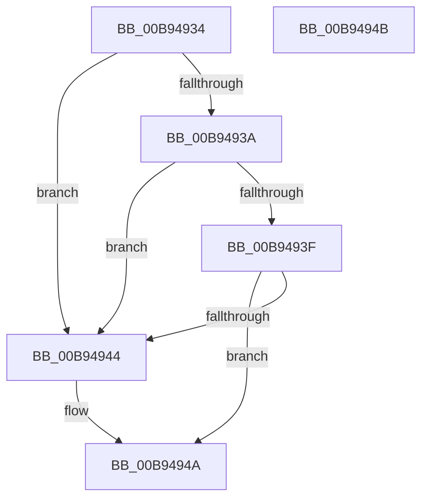

# ViIsContextIdValid

- RVA: `0x00B94934`–`0x00B9494C` (길이 `24` bytes)
- VA: `0x0000000140B94934`
- 실행 섹션: `PAGEVRFY`
- PDB 이름 있음: `예`; PDB Function 태그: `아니요`
- unwind 정보 RVA: `0x000DB714`
- 디코드: `11`개 명령, `24/24` bytes 표시
- 미해석 바이트: `0` (있으면 어셈블리에 `.byte`로 보존)

> 이 문서는 커널 이미지의 기계어와 PDB 기호를 분석해 생성했습니다. 4번과 5번은 함수 원형과 자료형을 바이너리 사용 방식에서 추정한 C 해석이며 원본 소스 복구 결과는 아닙니다.

## 1. Dependencies

- 직접 호출 지점: **0**; 고유 호출 대상: **0**
- 직접 호출자로 확인된 함수: **5**
- RIP 상대 이미지 참조: **0**

### Outgoing calls
- 직접 디코드된 call 명령이 없습니다.

### Direct callers
- [VfInsertContext](../../text/61/VfInsertContext_function_006127F0.md) at `0x00612821`
- [VfQueryDeviceContext](../../text/61/VfQueryDeviceContext_function_006128D0.md) at `0x006128E2`
- [VfQueryDriverContext](../../text/61/VfQueryDriverContext_function_00612910.md) at `0x00612929`
- [VfQueryIrpContext](../../text/61/VfQueryIrpContext_function_00612950.md) at `0x00612969`
- [VfRemoveContext](../../text/61/VfRemoveContext_function_00612990.md) at `0x006129CA`

### Static image references
- 디코드된 RIP-relative 메모리 참조가 없습니다.

## 2. Other-region calls and transfers

- 다른 실행 섹션으로 향하는 call: **0**
- 별도 외부 분기/꼬리 이동을 확인하지 못했습니다.

## 3. Assembly (complete function range)

```asm
00B94934  33 C0                           xor eax, eax
00B94936  85 C9                           test ecx, ecx
00B94938  74 0A                           je 0x140b94944
00B9493A  83 E9 01                        sub ecx, 1
00B9493D  74 05                           je 0x140b94944
00B9493F  83 F9 01                        cmp ecx, 1
00B94942  75 06                           jne 0x140b9494a
00B94944  83 FA 01                        cmp edx, 1
00B94947  0F 9C C0                        setl al
00B9494A  C3                              ret
00B9494B  CC                              int3
```

## 4. C-style interpretation (structured pseudocode)

```c
__int64 __fastcall ViIsContextIdValid(int a1, int a2)
{
    __int64 result;

    result = 0;
    if (a1 == 0) goto loc_00B94944;
    a1 = (unsigned int)((a1) - (1));
    if (condition_is_equal) goto loc_00B94944;
    if (a1 == 1) {
        result = (a2 < 1) ? 1 : 0;
    }
    return result;
}
```

## 5. (Beta) C Style

```c
int64_t ViIsContextIdValid(int32_t Arg1, int32_t Arg2)
{
    int64_t result;

    result = 0;
    if (Arg1 == 0) goto loc_00B94944;
    Arg1 = (uint32_t)((Arg1) - (1));
    if (condition_is_equal) goto loc_00B94944;
    if (Arg1 == 1) {
        result = (Arg2 < 1) ? 1 : 0;
    }
    return result;
}
```

## 6. Execution-region graph

[열기: 2D/3D 그래프와 함수 탐색 컨트롤 패널](../../../control-panel.html?section=pagevrfy&rva=0x00B94934&view=graph)

- 2D 그래프는 위에서 아래로 흐르고, 3D 그래프는 빈 공간을 드래그해 회전합니다. Shift+드래그는 이동, 휠은 확대·축소, 함수 노드 선택은 대상 보고서 이동입니다.

### Static fallback


