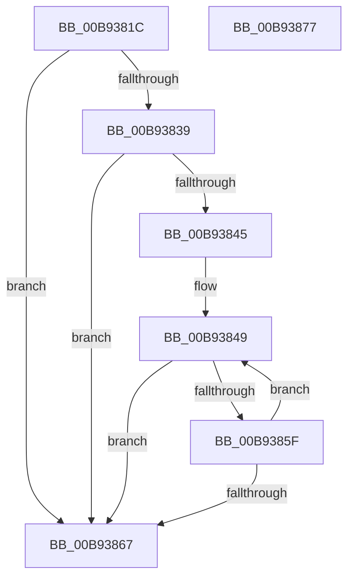

# ViIsDriverSuspectForVerifier

- RVA: `0x00B9381C`–`0x00B93878` (길이 `92` bytes)
- VA: `0x0000000140B9381C`
- 실행 섹션: `PAGEVRFY`
- PDB 이름 있음: `예`; PDB Function 태그: `아니요`
- unwind 정보 RVA: `0x00060BC4`
- 디코드: `28`개 명령, `92/92` bytes 표시
- 미해석 바이트: `0` (있으면 어셈블리에 `.byte`로 보존)

> 이 문서는 커널 이미지의 기계어와 PDB 기호를 분석해 생성했습니다. 4번과 5번은 함수 원형과 자료형을 바이너리 사용 방식에서 추정한 C 해석이며 원본 소스 복구 결과는 아닙니다.

## 1. Dependencies

- 직접 호출 지점: **1**; 고유 호출 대상: **1**
- 직접 호출자로 확인된 함수: **4**
- RIP 상대 이미지 참조: **1**

### Outgoing calls
- `0x00B93853` → [RtlEqualUnicodeString](../../page/93/RtlEqualUnicodeString_function_00932A20.md) (function, `0x00932A20`)

### Direct callers
- [VfIsVerificationEnabledForImage](../../text/61/VfIsVerificationEnabledForImage_function_006121D0.md) at `0x006121E1`
- [MmIsDriverSuspectForVerifier](MmIsDriverSuspectForVerifier_function_00B92CE0.md) at `0x00B92D05`
- [VfThunkApplyThunksCurrentSession](../BA/VfThunkApplyThunksCurrentSession_function_00BA719C.md) at `0x00BA7204`
- [ViThunkApplyWdmThunksCurrentSession](../BA/ViThunkApplyWdmThunksCurrentSession_function_00BA7414.md) at `0x00BA744C`

### Static image references
- `0x00B9382B` → RVA `0x00F049E0` (`.data`; read)

## 2. Other-region calls and transfers

- 다른 실행 섹션으로 향하는 call: **1**
  - `0x00B93853` → [RtlEqualUnicodeString](../../page/93/RtlEqualUnicodeString_function_00932A20.md) (`PAGEVRFY` → `PAGE`)
- 별도 외부 분기/꼬리 이동을 확인하지 못했습니다.

## 3. Assembly (complete function range)

```asm
00B9381C  48 89 5C 24 08                  mov qword ptr [rsp + 8], rbx
00B93821  48 89 74 24 10                  mov qword ptr [rsp + 0x10], rsi
00B93826  57                              push rdi
00B93827  48 83 EC 20                     sub rsp, 0x20
00B9382B  48 8B 1D AE 11 37 00            mov rbx, qword ptr [rip + 0x3711ae]
00B93832  33 C0                           xor eax, eax
00B93834  48 85 C9                        test rcx, rcx
00B93837  74 2E                           je 0x140b93867
00B93839  48 8D 35 A0 11 37 00            lea rsi, [rip + 0x3711a0]
00B93840  48 3B DE                        cmp rbx, rsi
00B93843  74 22                           je 0x140b93867
00B93845  48 8D 79 58                     lea rdi, [rcx + 0x58]
00B93849  48 8D 4B 28                     lea rcx, [rbx + 0x28]
00B9384D  41 B0 01                        mov r8b, 1
00B93850  48 8B D7                        mov rdx, rdi
00B93853  E8 C8 F1 D9 FF                  call 0x140932a20
00B93858  0F B6 C0                        movzx eax, al
00B9385B  85 C0                           test eax, eax
00B9385D  75 08                           jne 0x140b93867
00B9385F  48 8B 1B                        mov rbx, qword ptr [rbx]
00B93862  48 3B DE                        cmp rbx, rsi
00B93865  75 E2                           jne 0x140b93849
00B93867  48 8B 5C 24 30                  mov rbx, qword ptr [rsp + 0x30]
00B9386C  48 8B 74 24 38                  mov rsi, qword ptr [rsp + 0x38]
00B93871  48 83 C4 20                     add rsp, 0x20
00B93875  5F                              pop rdi
00B93876  C3                              ret
00B93877  CC                              int3
```

## 4. C-style interpretation (structured pseudocode)

```c
__int64 __fastcall ViIsDriverSuspectForVerifier(__int64 a1)
{
    __int64 result;
    __int64 v_rsp;
    unsigned __int64 v_stack_p10;
    unsigned __int64 v_stack_p8;

    v_stack_p8 = v_rbx;
    v_stack_p10 = v_rsi;
    v_rsp = (v_rsp) - (32);
    result = 0;
    if (a1 == 0) goto loc_00B93867;
    if ((*(unsigned __int64 *)(v_rip + 3609006)) == (v_rip + 3608992)) goto loc_00B93867;
loc_00B93849:
    result = RtlEqualUnicodeString(*(unsigned __int64 *)(v_rip + 3609006) + 40, a1 + 88, 1, a4);
    if ((unsigned int)((unsigned __int8)(result)) != 0) goto loc_00B93867;
    if ((*(unsigned __int64 *)(*(unsigned __int64 *)(v_rip + 3609006))) != (v_rip + 3608992)) goto loc_00B93849;
loc_00B93867:
    v_rsp = (v_rsp) + (32);
    return (unsigned __int8)(result);
}
```

## 5. (Beta) C Style

```c
int64_t ViIsDriverSuspectForVerifier(int64_t Arg1)
{
    int64_t result;
    int64_t local_rsp;
    uint64_t v_stack_p10;
    uint64_t v_stack_p8;

    v_stack_p8 = local_rbx;
    v_stack_p10 = local_rsi;
    local_rsp = (local_rsp) - (32);
    result = 0;
    if (Arg1 == 0) goto loc_00B93867;
    if ((*(uint64_t *)(v_rip + 0x3711AE)) == (v_rip + 3608992)) goto loc_00B93867;
loc_00B93849:
    result = RtlEqualUnicodeString(*(uint64_t *)(v_rip + 0x3711AE) + 40, Arg1 + 88, 1, a4);
    if ((uint32_t)((uint8_t)(result)) != 0) goto loc_00B93867;
    if ((*(uint64_t *)(*(uint64_t *)(v_rip + 0x3711AE))) != (v_rip + 3608992)) goto loc_00B93849;
loc_00B93867:
    local_rsp = (local_rsp) + (32);
    return (uint8_t)(result);
}
```

## 6. Execution-region graph

[열기: 2D/3D 그래프와 함수 탐색 컨트롤 패널](../../../control-panel.html?section=pagevrfy&rva=0x00B9381C&view=graph)

- 2D 그래프는 위에서 아래로 흐르고, 3D 그래프는 빈 공간을 드래그해 회전합니다. Shift+드래그는 이동, 휠은 확대·축소, 함수 노드 선택은 대상 보고서 이동입니다.

### Static fallback


