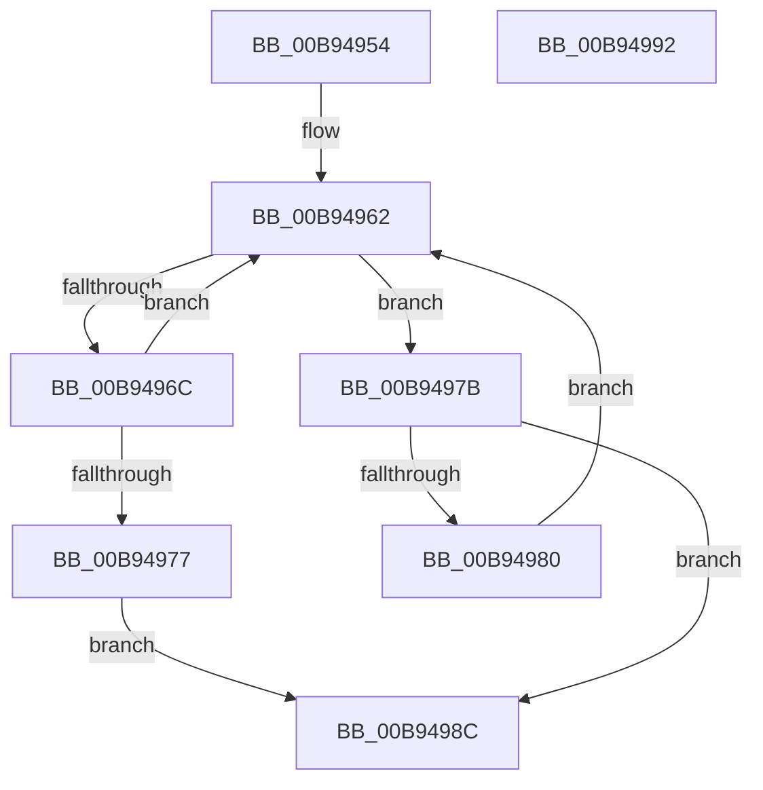

# ViLockContextPointer

- RVA: `0x00B94954`–`0x00B94993` (길이 `63` bytes)
- VA: `0x0000000140B94954`
- 실행 섹션: `PAGEVRFY`
- PDB 이름 있음: `예`; PDB Function 태그: `아니요`
- unwind 정보 RVA: `0x0005CF00`
- 디코드: `22`개 명령, `63/63` bytes 표시
- 미해석 바이트: `0` (있으면 어셈블리에 `.byte`로 보존)

> 이 문서는 커널 이미지의 기계어와 PDB 기호를 분석해 생성했습니다. 4번과 5번은 함수 원형과 자료형을 바이너리 사용 방식에서 추정한 C 해석이며 원본 소스 복구 결과는 아닙니다.

## 1. Dependencies

- 직접 호출 지점: **1**; 고유 호출 대상: **1**
- 직접 호출자로 확인된 함수: **3**
- RIP 상대 이미지 참조: **0**

### Outgoing calls
- `0x00B94985` → [KeYieldProcessorEx](../../text/3F/KeYieldProcessorEx_function_003FBD00.md) (function, `0x003FBD00`)

### Direct callers
- [VfInsertContext](../../text/61/VfInsertContext_function_006127F0.md) at `0x0061284F`
- [VfRemoveContext](../../text/61/VfRemoveContext_function_00612990.md) at `0x006129FB`
- [ViQueryObjectContext](ViQueryObjectContext_function_00B9499C.md) at `0x00B949C0`

### Static image references
- 디코드된 RIP-relative 메모리 참조가 없습니다.

## 2. Other-region calls and transfers

- 다른 실행 섹션으로 향하는 call: **1**
  - `0x00B94985` → [KeYieldProcessorEx](../../text/3F/KeYieldProcessorEx_function_003FBD00.md) (`PAGEVRFY` → `.text`)
- 별도 외부 분기/꼬리 이동을 확인하지 못했습니다.

## 3. Assembly (complete function range)

```asm
00B94954  40 53                           push rbx
00B94956  48 83 EC 20                     sub rsp, 0x20
00B9495A  83 64 24 30 00                  and dword ptr [rsp + 0x30], 0
00B9495F  48 8B D9                        mov rbx, rcx
00B94962  0F 0D 0B                        prefetchw byte ptr [rbx]
00B94965  48 8B 03                        mov rax, qword ptr [rbx]
00B94968  A8 01                           test al, 1
00B9496A  74 0F                           je 0x140b9497b
00B9496C  48 8D 48 FF                     lea rcx, [rax - 1]
00B94970  F0 48 0F B1 0B                  lock cmpxchg qword ptr [rbx], rcx
00B94975  75 EB                           jne 0x140b94962
00B94977  B0 01                           mov al, 1
00B94979  EB 11                           jmp 0x140b9498c
00B9497B  48 85 C0                        test rax, rax
00B9497E  74 0C                           je 0x140b9498c
00B94980  48 8D 4C 24 30                  lea rcx, [rsp + 0x30]
00B94985  E8 76 73 86 FF                  call 0x1403fbd00
00B9498A  EB D6                           jmp 0x140b94962
00B9498C  48 83 C4 20                     add rsp, 0x20
00B94990  5B                              pop rbx
00B94991  C3                              ret
00B94992  CC                              int3
```

## 4. C-style interpretation (structured pseudocode)

```c
__int64 __fastcall ViLockContextPointer(__int64 a1)
{
    __int64 result;
    __int64 v_rsp;
    unsigned int v_stack_p8;

    v_rsp = (v_rsp) - (32);
loc_00B94962:
    if ((((unsigned __int8)(*(unsigned __int64 *)(a1))) & (1)) == 0) goto loc_00B9497B;
    if ((((unsigned __int8)(*(unsigned __int64 *)(a1))) & (1)) != 0) goto loc_00B94962;
    goto loc_00B9498C;
loc_00B9497B:
    if (1 == 0) goto loc_00B9498C;
    result = KeYieldProcessorEx(v_stack_p8, a2, a3, a4);
    goto loc_00B94962;
loc_00B9498C:
    v_rsp = (v_rsp) + (32);
    return result;
}
```

## 5. (Beta) C Style

```c
int64_t ViLockContextPointer(void *Arg1)
{
    uint8_t *arg1 = (uint8_t *)Arg1;

    int64_t result;
    int64_t local_rsp;
    uint32_t v_stack_p8;

    local_rsp = (local_rsp) - (32);
loc_00B94962:
    if ((((uint8_t)(*(uint64_t *)(arg1))) & (1)) == 0) goto loc_00B9497B;
    if ((((uint8_t)(*(uint64_t *)(arg1))) & (1)) != 0) goto loc_00B94962;
    goto loc_00B9498C;
loc_00B9497B:
    if (1 == 0) goto loc_00B9498C;
    result = KeYieldProcessorEx(v_stack_p8, a2, a3, a4);
    goto loc_00B94962;
loc_00B9498C:
    local_rsp = (local_rsp) + (32);
    return result;
}
```

### 관측된 메모리 오프셋

구조체 형식이 확인되지 않은 접근은 인자 기준의 오프셋으로만 기록했습니다.

| 기준 인자 | 오프셋 표현 | 폭 (bit) | 접근 |
|---|---:|---:|---|
| `Arg1` | `+ 0x0` | `8` | `R` |
| `Arg1` | `+ 0x0` | `64` | `R` |

## 6. Execution-region graph

[열기: 2D/3D 그래프와 함수 탐색 컨트롤 패널](../../../control-panel.html?section=pagevrfy&rva=0x00B94954&view=graph)

- 2D 그래프는 위에서 아래로 흐르고, 3D 그래프는 빈 공간을 드래그해 회전합니다. Shift+드래그는 이동, 휠은 확대·축소, 함수 노드 선택은 대상 보고서 이동입니다.

### Static fallback


