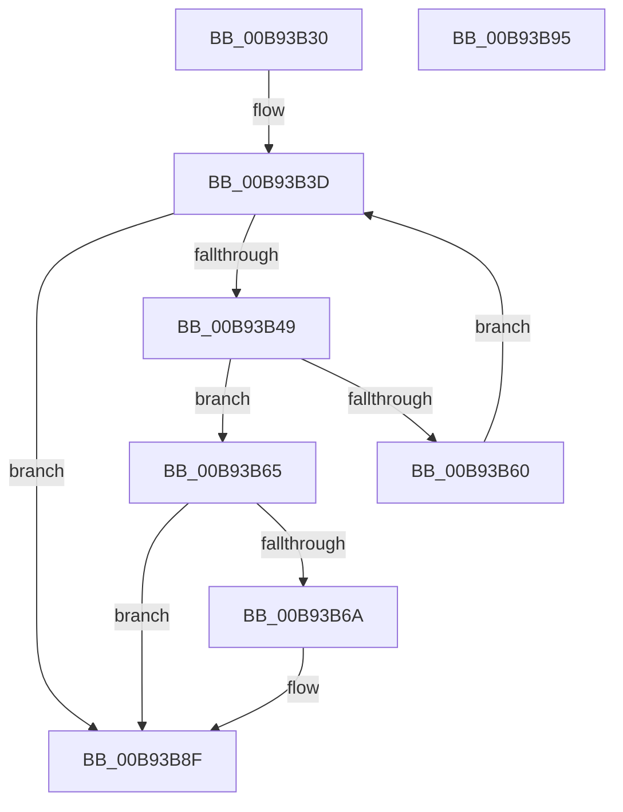

# ViLogAndLoadXdv

- RVA: `0x00B93B30`–`0x00B93B96` (길이 `102` bytes)
- VA: `0x0000000140B93B30`
- 실행 섹션: `PAGEVRFY`
- PDB 이름 있음: `예`; PDB Function 태그: `아니요`
- unwind 정보 RVA: `0x0005CF00`
- 디코드: `28`개 명령, `102/102` bytes 표시
- 미해석 바이트: `0` (있으면 어셈블리에 `.byte`로 보존)

> 이 문서는 커널 이미지의 기계어와 PDB 기호를 분석해 생성했습니다. 4번과 5번은 함수 원형과 자료형을 바이너리 사용 방식에서 추정한 C 해석이며 원본 소스 복구 결과는 아닙니다.

## 1. Dependencies

- 직접 호출 지점: **2**; 고유 호출 대상: **2**
- 직접 호출자로 확인된 함수: **1**
- RIP 상대 이미지 참조: **5**

### Outgoing calls
- `0x00B93B57` → [RtlEqualUnicodeString](../../page/93/RtlEqualUnicodeString_function_00932A20.md) (function, `0x00932A20`)
- `0x00B93B81` → [ViXdvDriverLoadImage](ViXdvDriverLoadImage_function_00B9A9A0.md) (function, `0x00B9A9A0`)

### Direct callers
- [VfInitBootDriversLoaded](../../init/C4/VfInitBootDriversLoaded_function_00C4BD0C.md) at `0x00C4BF83`

### Static image references
- `0x00B93B36` → RVA `0x00EF54C0` (`.data`; read)
- `0x00B93B50` → RVA `0x00FF4150` (`PAGEVRFD`; read)
- `0x00B93B71` → RVA `0x00F04370` (`.data`; write)
- `0x00B93B7B` → RVA `0x00F04378` (`.data`; write)
- `0x00B93B89` → RVA `0x00FFDA18` (`PAGEVRFD`; write)

## 2. Other-region calls and transfers

- 다른 실행 섹션으로 향하는 call: **1**
  - `0x00B93B57` → [RtlEqualUnicodeString](../../page/93/RtlEqualUnicodeString_function_00932A20.md) (`PAGEVRFY` → `PAGE`)
- 별도 외부 분기/꼬리 이동을 확인하지 못했습니다.

## 3. Assembly (complete function range)

```asm
00B93B30  40 53                           push rbx
00B93B32  48 83 EC 20                     sub rsp, 0x20
00B93B36  48 8B 1D 83 19 36 00            mov rbx, qword ptr [rip + 0x361983]
00B93B3D  48 8D 05 7C 19 36 00            lea rax, [rip + 0x36197c]
00B93B44  48 3B D8                        cmp rbx, rax
00B93B47  74 46                           je 0x140b93b8f
00B93B49  48 8D 4B 58                     lea rcx, [rbx + 0x58]
00B93B4D  41 B0 01                        mov r8b, 1
00B93B50  48 8D 15 F9 05 46 00            lea rdx, [rip + 0x4605f9]
00B93B57  E8 C4 EE D9 FF                  call 0x140932a20
00B93B5C  3C 01                           cmp al, 1
00B93B5E  74 05                           je 0x140b93b65
00B93B60  48 8B 1B                        mov rbx, qword ptr [rbx]
00B93B63  EB D8                           jmp 0x140b93b3d
00B93B65  48 85 DB                        test rbx, rbx
00B93B68  74 25                           je 0x140b93b8f
00B93B6A  48 8B 43 30                     mov rax, qword ptr [rbx + 0x30]
00B93B6E  48 8B CB                        mov rcx, rbx
00B93B71  48 89 05 F8 07 37 00            mov qword ptr [rip + 0x3707f8], rax
00B93B78  8B 43 40                        mov eax, dword ptr [rbx + 0x40]
00B93B7B  89 05 F7 07 37 00               mov dword ptr [rip + 0x3707f7], eax
00B93B81  E8 1A 6E 00 00                  call 0x140b9a9a0
00B93B86  0F B6 C0                        movzx eax, al
00B93B89  89 05 89 9E 46 00               mov dword ptr [rip + 0x469e89], eax
00B93B8F  48 83 C4 20                     add rsp, 0x20
00B93B93  5B                              pop rbx
00B93B94  C3                              ret
00B93B95  CC                              int3
```

## 4. C-style interpretation (structured pseudocode)

```c
__int64 __fastcall ViLogAndLoadXdv(void)
{
    __int64 result;
    __int64 v_rsp;

    v_rsp = (v_rsp) - (32);
loc_00B93B3D:
    if ((*(unsigned __int64 *)(v_rip + 3545475)) == (v_rip + 3545468)) goto loc_00B93B8F;
    result = RtlEqualUnicodeString(*(unsigned __int64 *)(v_rip + 3545475) + 88, v_rip + 4589049, 1, a4);
    if (((unsigned __int8)(result)) == 1) goto loc_00B93B65;
    goto loc_00B93B3D;
loc_00B93B65:
    if (*(unsigned __int64 *)(*(unsigned __int64 *)(v_rip + 3545475)) != 0) {
        result = *(unsigned __int64 *)(*(unsigned __int64 *)(*(unsigned __int64 *)(v_rip + 3545475)) + 48);
        a1 = *(unsigned __int64 *)(*(unsigned __int64 *)(v_rip + 3545475));
        *(unsigned __int64 *)(v_rip + 3606520) = result;
        result = *(unsigned int *)(*(unsigned __int64 *)(*(unsigned __int64 *)(v_rip + 3545475)) + 64);
        *(unsigned int *)(v_rip + 3606519) = (unsigned int)(result);
        result = ViXdvDriverLoadImage(a1, v_rip + 4589049, 1, a4);
        result = (unsigned __int8)(result);
        *(unsigned int *)(v_rip + 4628105) = (unsigned int)(result);
    }
    v_rsp = (v_rsp) + (32);
    return result;
}
```

## 5. (Beta) C Style

```c
void ViLogAndLoadXdv(void)
{
    int64_t result;
    int64_t local_rsp;

    local_rsp = (local_rsp) - (32);
loc_00B93B3D:
    if ((*(uint64_t *)(v_rip + 0x361983)) == (v_rip + 3545468)) goto loc_00B93B8F;
    result = RtlEqualUnicodeString(*(uint64_t *)(v_rip + 0x361983) + 88, v_rip + 4589049, 1, a4);
    if (((uint8_t)(result)) == 1) goto loc_00B93B65;
    goto loc_00B93B3D;
loc_00B93B65:
    if (*(uint64_t *)(*(uint64_t *)(v_rip + 0x361983)) != 0) {
        result = *(uint64_t *)(*(uint64_t *)(*(uint64_t *)(v_rip + 0x361983)) + 0x30);
        a1 = *(uint64_t *)(*(uint64_t *)(v_rip + 0x361983));
        *(uint64_t *)(v_rip + 0x3707F8) = result;
        result = *(uint32_t *)(*(uint64_t *)(*(uint64_t *)(v_rip + 0x361983)) + 0x40);
        *(uint32_t *)(v_rip + 0x3707F7) = (uint32_t)(result);
        result = ViXdvDriverLoadImage(a1, v_rip + 4589049, 1, a4);
        result = (uint8_t)(result);
        *(uint32_t *)(v_rip + 0x469E89) = (uint32_t)(result);
    }
    local_rsp = (local_rsp) + (32);
    return result;
}
```

## 6. Execution-region graph

[열기: 2D/3D 그래프와 함수 탐색 컨트롤 패널](../../../control-panel.html?section=pagevrfy&rva=0x00B93B30&view=graph)

- 2D 그래프는 위에서 아래로 흐르고, 3D 그래프는 빈 공간을 드래그해 회전합니다. Shift+드래그는 이동, 휠은 확대·축소, 함수 노드 선택은 대상 보고서 이동입니다.

### Static fallback


