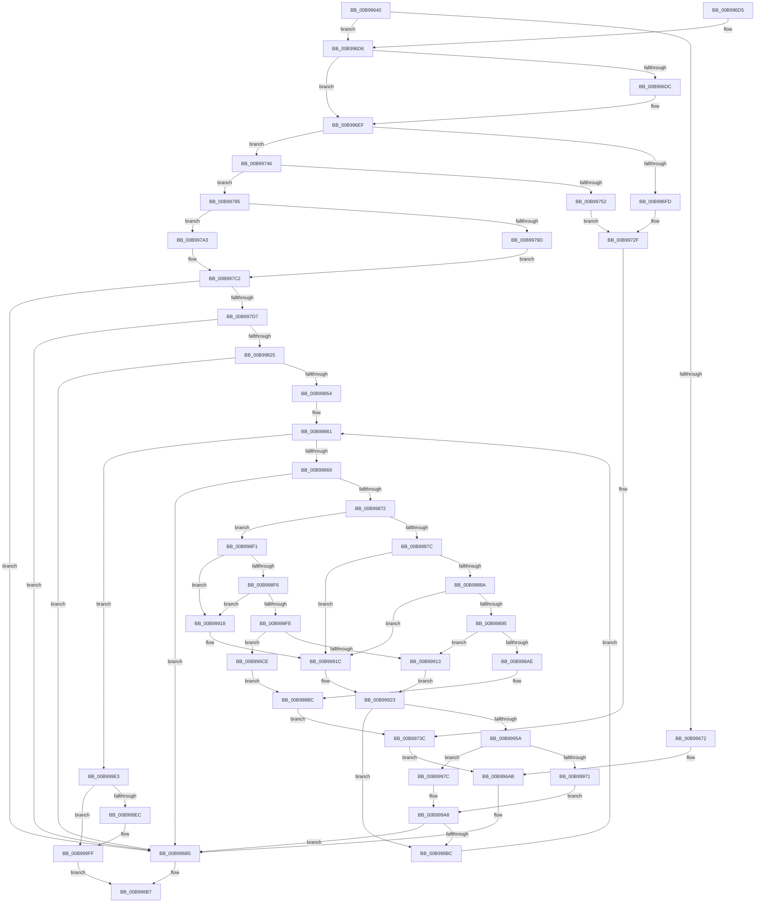

# ViMapDoubleBuffer

- RVA: `0x00B99640`–`0x00B99A06` (길이 `966` bytes)
- VA: `0x0000000140B99640`
- 실행 섹션: `PAGEVRFY`
- PDB 이름 있음: `예`; PDB Function 태그: `아니요`
- unwind 정보 RVA: `0x000D2294`
- 디코드: `250`개 명령, `966/966` bytes 표시
- 미해석 바이트: `0` (있으면 어셈블리에 `.byte`로 보존)

> 이 문서는 커널 이미지의 기계어와 PDB 기호를 분석해 생성했습니다. 4번과 5번은 함수 원형과 자료형을 바이너리 사용 방식에서 추정한 C 해석이며 원본 소스 복구 결과는 아닙니다.

## 1. Dependencies

- 직접 호출 지점: **15**; 고유 호출 대상: **8**
- 직접 호출자로 확인된 함수: **3**
- RIP 상대 이미지 참조: **10**

### Outgoing calls
- `0x00B99694` → [ViHalPreprocessOptions](ViHalPreprocessOptions_function_00B9920C.md) (function, `0x00B9920C`)
- `0x00B996B0` → [VfReportIssueWithOptions](../../text/61/VfReportIssueWithOptions_function_00614444.md) (function, `0x00614444`)
- `0x00B99727` → [ViHalPreprocessOptions](ViHalPreprocessOptions_function_00B9920C.md) (function, `0x00B9920C`)
- `0x00B9977B` → [ViHalPreprocessOptions](ViHalPreprocessOptions_function_00B9920C.md) (function, `0x00B9920C`)
- `0x00B99789` → [KeAcquireSpinLockRaiseToDpc](../../text/20/KeAcquireSpinLockRaiseToDpc_function_00208470.md) (function, `0x00208470`)
- `0x00B997BA` → [MmMapLockedPagesSpecifyCache](../../text/31/MmMapLockedPagesSpecifyCache_function_00318800.md) (function, `0x00318800`)
- `0x00B997C9` → [KeReleaseSpinLock](../../text/39/KeReleaseSpinLock_function_00392BA0.md) (function, `0x00392BA0`)
- `0x00B99818` → [ViAllocateMapRegistersFromFile](ViAllocateMapRegistersFromFile_function_00B980A8.md) (function, `0x00B980A8`)
- `0x00B998D7` → [ViHalPreprocessOptions](ViHalPreprocessOptions_function_00B9920C.md) (function, `0x00B9920C`)
- `0x00B99931` → [memcpy](../../text/6C/memcpy_function_006C6840.md) (function, `0x006C6840`)
- `0x00B99948` → [memcpy](../../text/6C/memcpy_function_006C6840.md) (function, `0x006C6840`)
- `0x00B9995E` → [KeAcquireSpinLockRaiseToDpc](../../text/20/KeAcquireSpinLockRaiseToDpc_function_00208470.md) (function, `0x00208470`)
- `0x00B99994` → [MmMapLockedPagesSpecifyCache](../../text/31/MmMapLockedPagesSpecifyCache_function_00318800.md) (function, `0x00318800`)
- `0x00B999AE` → [KeReleaseSpinLock](../../text/39/KeReleaseSpinLock_function_00392BA0.md) (function, `0x00392BA0`)
- `0x00B999FA` → [KeFlushIoBuffers](../../text/3D/KeFlushIoBuffers_function_003DA340.md) (function, `0x003DA340`)

### Direct callers
- [VfBuildScatterGatherList](VfBuildScatterGatherList_function_00B95AA0.md) at `0x00B95C4C`
- [VfGetScatterGatherList](VfGetScatterGatherList_function_00B96BD0.md) at `0x00B96DEB`
- [VfMapTransfer](VfMapTransfer_function_00B97300.md) at `0x00B97409`

### Static image references
- `0x00B99680` → RVA `0x00E0E9E4` (`.data`; read)
- `0x00B9968D` → RVA `0x00BBA100` (` ?? ::JKADOLAD::`string'`; read)
- `0x00B99708` → RVA `0x00E0EA00` (`.data`; read)
- `0x00B99717` → RVA `0x00BBA0D0` (` ?? ::JKADOLAD::`string'`; read)
- `0x00B9975C` → RVA `0x00E0E9FC` (`.data`; read)
- `0x00B9976B` → RVA `0x00BBA050` (` ?? ::JKADOLAD::`string'`; read)
- `0x00B998AE` → RVA `0x00BBA000` (` ?? ::JKADOLAD::`string'`; read)
- `0x00B998B5` → RVA `0x00E0EA08` (`.data`; read)
- `0x00B999D0` → RVA `0x00BBA080` (` ?? ::JKADOLAD::`string'`; read)
- `0x00B999D7` → RVA `0x00E0EA04` (`.data`; read)

## 2. Other-region calls and transfers

- 다른 실행 섹션으로 향하는 call: **10**
  - `0x00B996B0` → [VfReportIssueWithOptions](../../text/61/VfReportIssueWithOptions_function_00614444.md) (`PAGEVRFY` → `.text`)
  - `0x00B99789` → [KeAcquireSpinLockRaiseToDpc](../../text/20/KeAcquireSpinLockRaiseToDpc_function_00208470.md) (`PAGEVRFY` → `.text`)
  - `0x00B997BA` → [MmMapLockedPagesSpecifyCache](../../text/31/MmMapLockedPagesSpecifyCache_function_00318800.md) (`PAGEVRFY` → `.text`)
  - `0x00B997C9` → [KeReleaseSpinLock](../../text/39/KeReleaseSpinLock_function_00392BA0.md) (`PAGEVRFY` → `.text`)
  - `0x00B99931` → [memcpy](../../text/6C/memcpy_function_006C6840.md) (`PAGEVRFY` → `.text`)
  - `0x00B99948` → [memcpy](../../text/6C/memcpy_function_006C6840.md) (`PAGEVRFY` → `.text`)
  - `0x00B9995E` → [KeAcquireSpinLockRaiseToDpc](../../text/20/KeAcquireSpinLockRaiseToDpc_function_00208470.md) (`PAGEVRFY` → `.text`)
  - `0x00B99994` → [MmMapLockedPagesSpecifyCache](../../text/31/MmMapLockedPagesSpecifyCache_function_00318800.md) (`PAGEVRFY` → `.text`)
  - `0x00B999AE` → [KeReleaseSpinLock](../../text/39/KeReleaseSpinLock_function_00392BA0.md) (`PAGEVRFY` → `.text`)
  - `0x00B999FA` → [KeFlushIoBuffers](../../text/3D/KeFlushIoBuffers_function_003DA340.md) (`PAGEVRFY` → `.text`)
- 별도 외부 분기/꼬리 이동을 확인하지 못했습니다.

## 3. Assembly (complete function range)

```asm
00B99640  48 8B C4                        mov rax, rsp
00B99643  48 89 58 08                     mov qword ptr [rax + 8], rbx
00B99647  48 89 68 10                     mov qword ptr [rax + 0x10], rbp
00B9964B  48 89 70 18                     mov qword ptr [rax + 0x18], rsi
00B9964F  57                              push rdi
00B99650  41 54                           push r12
00B99652  41 55                           push r13
00B99654  41 56                           push r14
00B99656  41 57                           push r15
00B99658  48 83 EC 60                     sub rsp, 0x60
00B9965C  33 ED                           xor ebp, ebp
00B9965E  41 8B F1                        mov esi, r9d
00B99661  89 68 20                        mov dword ptr [rax + 0x20], ebp
00B99664  49 8B D8                        mov rbx, r8
00B99667  48 8B FA                        mov rdi, rdx
00B9966A  4C 8B E9                        mov r13, rcx
00B9966D  45 85 C9                        test r9d, r9d
00B99670  75 64                           jne 0x140b996d6
00B99672  4C 8B C9                        mov r9, rcx
00B99675  48 89 68 A0                     mov qword ptr [rax - 0x60], rbp
00B99679  8D 7E 21                        lea edi, [rsi + 0x21]
00B9967C  48 89 68 98                     mov qword ptr [rax - 0x68], rbp
00B99680  48 8D 1D 5D 53 27 00            lea rbx, [rip + 0x27535d]
00B99687  44 8B C7                        mov r8d, edi
00B9968A  48 8B CB                        mov rcx, rbx
00B9968D  48 8D 15 6C 0A 02 00            lea rdx, [rip + 0x20a6c]
00B99694  E8 73 FB FF FF                  call 0x140b9920c
00B99699  48 89 5C 24 28                  mov qword ptr [rsp + 0x28], rbx
00B9969E  45 33 C9                        xor r9d, r9d
00B996A1  48 89 6C 24 20                  mov qword ptr [rsp + 0x20], rbp
00B996A6  4D 8B C5                        mov r8, r13
00B996A9  8B D7                           mov edx, edi
00B996AB  B9 E6 00 00 00                  mov ecx, 0xe6
00B996B0  E8 8F AD A7 FF                  call 0x140614444
00B996B5  33 C0                           xor eax, eax
00B996B7  4C 8D 5C 24 60                  lea r11, [rsp + 0x60]
00B996BC  49 8B 5B 30                     mov rbx, qword ptr [r11 + 0x30]
00B996C0  49 8B 6B 38                     mov rbp, qword ptr [r11 + 0x38]
00B996C4  49 8B 73 40                     mov rsi, qword ptr [r11 + 0x40]
00B996C8  49 8B E3                        mov rsp, r11
00B996CB  41 5F                           pop r15
00B996CD  41 5E                           pop r14
00B996CF  41 5D                           pop r13
00B996D1  41 5C                           pop r12
00B996D3  5F                              pop rdi
00B996D4  C3                              ret
00B996D5  CC                              int3
00B996D6  40 38 69 19                     cmp byte ptr [rcx + 0x19], bpl
00B996DA  75 13                           jne 0x140b996ef
00B996DC  8B C3                           mov eax, ebx
00B996DE  B9 00 10 00 00                  mov ecx, 0x1000
00B996E3  25 FF 0F 00 00                  and eax, 0xfff
00B996E8  2B C8                           sub ecx, eax
00B996EA  3B F1                           cmp esi, ecx
00B996EC  0F 43 F1                        cmovae esi, ecx
00B996EF  8B 4A 2C                        mov ecx, dword ptr [rdx + 0x2c]
00B996F2  8B C1                           mov eax, ecx
00B996F4  48 03 42 20                     add rax, qword ptr [rdx + 0x20]
00B996F8  48 3B D8                        cmp rbx, rax
00B996FB  73 49                           jae 0x140b99746
00B996FD  41 BC 01 00 00 00               mov r12d, 1
00B99703  48 89 7C 24 28                  mov qword ptr [rsp + 0x28], rdi
00B99708  48 8D 35 F1 52 27 00            lea rsi, [rip + 0x2752f1]
00B9970F  48 89 5C 24 20                  mov qword ptr [rsp + 0x20], rbx
00B99714  45 8B CC                        mov r9d, r12d
00B99717  48 8D 15 B2 09 02 00            lea rdx, [rip + 0x209b2]
00B9971E  48 8B CE                        mov rcx, rsi
00B99721  41 B8 1F 00 00 10               mov r8d, 0x1000001f
00B99727  E8 E0 FA FF FF                  call 0x140b9920c
00B9972C  45 8B C4                        mov r8d, r12d
00B9972F  48 89 74 24 28                  mov qword ptr [rsp + 0x28], rsi
00B99734  4C 8B CB                        mov r9, rbx
00B99737  48 89 7C 24 20                  mov qword ptr [rsp + 0x20], rdi
00B9973C  BA 1F 00 00 00                  mov edx, 0x1f
00B99741  E9 65 FF FF FF                  jmp 0x140b996ab
00B99746  8B C3                           mov eax, ebx
00B99748  2B 42 20                        sub eax, dword ptr [rdx + 0x20]
00B9974B  2B C1                           sub eax, ecx
00B9974D  3B 42 28                        cmp eax, dword ptr [rdx + 0x28]
00B99750  72 33                           jb 0x140b99785
00B99752  BD 02 00 00 00                  mov ebp, 2
00B99757  48 89 7C 24 28                  mov qword ptr [rsp + 0x28], rdi
00B9975C  48 8D 35 99 52 27 00            lea rsi, [rip + 0x275299]
00B99763  48 89 5C 24 20                  mov qword ptr [rsp + 0x20], rbx
00B99768  44 8B CD                        mov r9d, ebp
00B9976B  48 8D 15 DE 08 02 00            lea rdx, [rip + 0x208de]
00B99772  48 8B CE                        mov rcx, rsi
00B99775  41 B8 1F 00 00 10               mov r8d, 0x1000001f
00B9977B  E8 8C FA FF FF                  call 0x140b9920c
00B99780  44 8B C5                        mov r8d, ebp
00B99783  EB AA                           jmp 0x140b9972f
00B99785  49 8D 4D 50                     lea rcx, [r13 + 0x50]
00B99789  E8 E2 EC 66 FF                  call 0x140208470
00B9978E  F6 47 0A 05                     test byte ptr [rdi + 0xa], 5
00B99792  44 8A F0                        mov r14b, al
00B99795  41 BC 01 00 00 00               mov r12d, 1
00B9979B  74 06                           je 0x140b997a3
00B9979D  48 8B 6F 18                     mov rbp, qword ptr [rdi + 0x18]
00B997A1  EB 1F                           jmp 0x140b997c2
00B997A3  C7 44 24 28 10 00 00 40         mov dword ptr [rsp + 0x28], 0x40000010
00B997AB  45 33 C9                        xor r9d, r9d
00B997AE  45 8B C4                        mov r8d, r12d
00B997B1  89 6C 24 20                     mov dword ptr [rsp + 0x20], ebp
00B997B5  33 D2                           xor edx, edx
00B997B7  48 8B CF                        mov rcx, rdi
00B997BA  E8 41 F0 77 FF                  call 0x140318800
00B997BF  48 8B E8                        mov rbp, rax
00B997C2  41 8A D6                        mov dl, r14b
00B997C5  49 8D 4D 50                     lea rcx, [r13 + 0x50]
00B997C9  E8 D2 93 7F FF                  call 0x140392ba0
00B997CE  48 85 ED                        test rbp, rbp
00B997D1  0F 84 DE FE FF FF               je 0x140b996b5
00B997D7  8B 4F 2C                        mov ecx, dword ptr [rdi + 0x2c]
00B997DA  48 8D 84 24 A8 00 00 00         lea rax, [rsp + 0xa8]
00B997E2  44 8B 77 28                     mov r14d, dword ptr [rdi + 0x28]
00B997E6  48 2B D9                        sub rbx, rcx
00B997E9  48 2B 5F 20                     sub rbx, qword ptr [rdi + 0x20]
00B997ED  44 8B C6                        mov r8d, esi
00B997F0  44 8A 8C 24 B0 00 00 00         mov r9b, byte ptr [rsp + 0xb0]
00B997F8  4C 2B F3                        sub r14, rbx
00B997FB  48 03 DD                        add rbx, rbp
00B997FE  44 89 64 24 30                  mov dword ptr [rsp + 0x30], r12d
00B99803  48 8B D3                        mov rdx, rbx
00B99806  4C 89 74 24 50                  mov qword ptr [rsp + 0x50], r14
00B9980B  49 8B CD                        mov rcx, r13
00B9980E  48 89 5C 24 38                  mov qword ptr [rsp + 0x38], rbx
00B99813  48 89 44 24 20                  mov qword ptr [rsp + 0x20], rax
00B99818  E8 8B E8 FF FF                  call 0x140b980a8
00B9981D  85 C0                           test eax, eax
00B9981F  0F 84 90 FE FF FF               je 0x140b996b5
00B99825  8B 84 24 A8 00 00 00            mov eax, dword ptr [rsp + 0xa8]
00B9982C  48 8B D3                        mov rdx, rbx
00B9982F  4D 8B 4D 40                     mov r9, qword ptr [r13 + 0x40]
00B99833  81 E2 FF 0F 00 00               and edx, 0xfff
00B99839  C1 E0 0C                        shl eax, 0xc
00B9983C  48 03 D0                        add rdx, rax
00B9983F  49 8B 45 48                     mov rax, qword ptr [r13 + 0x48]
00B99843  4C 03 CA                        add r9, rdx
00B99846  4C 89 4C 24 48                  mov qword ptr [rsp + 0x48], r9
00B9984B  48 85 C0                        test rax, rax
00B9984E  0F 84 61 FE FF FF               je 0x140b996b5
00B99854  48 03 C2                        add rax, rdx
00B99857  4C 8B FF                        mov r15, rdi
00B9985A  48 89 44 24 40                  mov qword ptr [rsp + 0x40], rax
00B9985F  8B EE                           mov ebp, esi
00B99861  85 ED                           test ebp, ebp
00B99863  0F 84 7A 01 00 00               je 0x140b999e3
00B99869  4D 85 FF                        test r15, r15
00B9986C  0F 84 43 FE FF FF               je 0x140b996b5
00B99872  83 7C 24 30 00                  cmp dword ptr [rsp + 0x30], 0
00B99877  49 8B 07                        mov rax, qword ptr [r15]
00B9987A  74 75                           je 0x140b998f1
00B9987C  83 64 24 30 00                  and dword ptr [rsp + 0x30], 0
00B99881  48 85 C0                        test rax, rax
00B99884  0F 85 92 00 00 00               jne 0x140b9991c
00B9988A  8B C5                           mov eax, ebp
00B9988C  49 3B C6                        cmp rax, r14
00B9988F  0F 86 87 00 00 00               jbe 0x140b9991c
00B99895  8B D6                           mov edx, esi
00B99897  8D 4E FF                        lea ecx, [rsi - 1]
00B9989A  48 2B D0                        sub rdx, rax
00B9989D  8B DE                           mov ebx, esi
00B9989F  49 03 D6                        add rdx, r14
00B998A2  48 33 D1                        xor rdx, rcx
00B998A5  48 F7 C2 00 F0 FF FF            test rdx, -0x1000
00B998AC  74 65                           je 0x140b99913
00B998AE  48 8D 15 4B 07 02 00            lea rdx, [rip + 0x2074b]
00B998B5  48 8D 2D 4C 51 27 00            lea rbp, [rip + 0x27514c]
00B998BC  BE 03 00 00 00                  mov esi, 3
00B998C1  48 89 5C 24 28                  mov qword ptr [rsp + 0x28], rbx
00B998C6  44 8B CE                        mov r9d, esi
00B998C9  48 89 7C 24 20                  mov qword ptr [rsp + 0x20], rdi
00B998CE  41 B8 1F 00 00 10               mov r8d, 0x1000001f
00B998D4  48 8B CD                        mov rcx, rbp
00B998D7  E8 30 F9 FF FF                  call 0x140b9920c
00B998DC  48 89 6C 24 28                  mov qword ptr [rsp + 0x28], rbp
00B998E1  4C 8B CF                        mov r9, rdi
00B998E4  48 89 5C 24 20                  mov qword ptr [rsp + 0x20], rbx
00B998E9  44 8B C6                        mov r8d, esi
00B998EC  E9 4B FE FF FF                  jmp 0x140b9973c
00B998F1  48 85 C0                        test rax, rax
00B998F4  75 22                           jne 0x140b99918
00B998F6  41 8B 4F 28                     mov ecx, dword ptr [r15 + 0x28]
00B998FA  3B E9                           cmp ebp, ecx
00B998FC  76 1A                           jbe 0x140b99918
00B998FE  2B CD                           sub ecx, ebp
00B99900  8D 46 FF                        lea eax, [rsi - 1]
00B99903  03 CE                           add ecx, esi
00B99905  33 C8                           xor ecx, eax
00B99907  F7 C1 00 F0 FF FF               test ecx, 0xfffff000
00B9990D  0F 85 BB 00 00 00               jne 0x140b999ce
00B99913  44 8B F5                        mov r14d, ebp
00B99916  EB 0B                           jmp 0x140b99923
00B99918  45 8B 77 28                     mov r14d, dword ptr [r15 + 0x28]
00B9991C  41 3B EE                        cmp ebp, r14d
00B9991F  44 0F 42 F5                     cmovb r14d, ebp
00B99923  48 8B 54 24 38                  mov rdx, qword ptr [rsp + 0x38]
00B99928  49 8B C9                        mov rcx, r9
00B9992B  45 8B C6                        mov r8d, r14d
00B9992E  41 8B DE                        mov ebx, r14d
00B99931  E8 0A CF B2 FF                  call 0x1406c6840
00B99936  48 8B 54 24 38                  mov rdx, qword ptr [rsp + 0x38]
00B9993B  48 8B 4C 24 40                  mov rcx, qword ptr [rsp + 0x40]
00B99940  48 01 5C 24 48                  add qword ptr [rsp + 0x48], rbx
00B99945  45 8B C6                        mov r8d, r14d
00B99948  E8 F3 CE B2 FF                  call 0x1406c6840
00B9994D  48 01 5C 24 40                  add qword ptr [rsp + 0x40], rbx
00B99952  4D 8B 3F                        mov r15, qword ptr [r15]
00B99955  4D 85 FF                        test r15, r15
00B99958  74 62                           je 0x140b999bc
00B9995A  49 8D 4D 50                     lea rcx, [r13 + 0x50]
00B9995E  E8 0D EB 66 FF                  call 0x140208470
00B99963  41 F6 47 0A 05                  test byte ptr [r15 + 0xa], 5
00B99968  88 84 24 A8 00 00 00            mov byte ptr [rsp + 0xa8], al
00B9996F  74 0B                           je 0x140b9997c
00B99971  49 8B 5F 18                     mov rbx, qword ptr [r15 + 0x18]
00B99975  48 89 5C 24 38                  mov qword ptr [rsp + 0x38], rbx
00B9997A  EB 2C                           jmp 0x140b999a8
00B9997C  C7 44 24 28 10 00 00 40         mov dword ptr [rsp + 0x28], 0x40000010
00B99984  45 33 C9                        xor r9d, r9d
00B99987  83 64 24 20 00                  and dword ptr [rsp + 0x20], 0
00B9998C  45 8B C4                        mov r8d, r12d
00B9998F  33 D2                           xor edx, edx
00B99991  49 8B CF                        mov rcx, r15
00B99994  E8 67 EE 77 FF                  call 0x140318800
00B99999  48 8B D8                        mov rbx, rax
00B9999C  48 89 44 24 38                  mov qword ptr [rsp + 0x38], rax
00B999A1  8A 84 24 A8 00 00 00            mov al, byte ptr [rsp + 0xa8]
00B999A8  8A D0                           mov dl, al
00B999AA  49 8D 4D 50                     lea rcx, [r13 + 0x50]
00B999AE  E8 ED 91 7F FF                  call 0x140392ba0
00B999B3  48 85 DB                        test rbx, rbx
00B999B6  0F 84 F9 FC FF FF               je 0x140b996b5
00B999BC  4C 8B 4C 24 48                  mov r9, qword ptr [rsp + 0x48]
00B999C1  41 2B EE                        sub ebp, r14d
00B999C4  4C 8B 74 24 50                  mov r14, qword ptr [rsp + 0x50]
00B999C9  E9 93 FE FF FF                  jmp 0x140b99861
00B999CE  8B DE                           mov ebx, esi
00B999D0  48 8D 15 A9 06 02 00            lea rdx, [rip + 0x206a9]
00B999D7  48 8D 2D 26 50 27 00            lea rbp, [rip + 0x275026]
00B999DE  E9 D9 FE FF FF                  jmp 0x140b998bc
00B999E3  49 8B 4D 38                     mov rcx, qword ptr [r13 + 0x38]
00B999E7  48 85 C9                        test rcx, rcx
00B999EA  74 13                           je 0x140b999ff
00B999EC  80 BC 24 B0 00 00 00 00         cmp byte ptr [rsp + 0xb0], 0
00B999F4  45 8A C4                        mov r8b, r12b
00B999F7  0F 94 C2                        sete dl
00B999FA  E8 41 09 84 FF                  call 0x1403da340
00B999FF  8B C6                           mov eax, esi
00B99A01  E9 B1 FC FF FF                  jmp 0x140b996b7
```

## 4. C-style interpretation (structured pseudocode)

```c
__int64 __fastcall ViMapDoubleBuffer(__int64 a1, __int64 a2, __int64 a3, int a4, unsigned __int8 a5)
{
    __int64 result;
    __int64 v_r14;
    __int64 v_rbp;
    __int64 v_rbx;
    __int64 v_rsi;
    __int64 v_rsp;
    unsigned __int64 v_stack_m10;
    unsigned __int64 v_stack_m18;
    unsigned __int64 v_stack_m20;
    unsigned __int64 v_stack_m28;
    unsigned int v_stack_m30;
    unsigned __int64 v_stack_m38;
    unsigned __int64 v_stack_m40;
    unsigned __int64 v_stack_m60;
    unsigned __int64 v_stack_m68;
    unsigned __int64 v_stack_p48;

    *(unsigned __int64 *)(v_rsp + 8) = v_rbx;
    *(unsigned __int64 *)(v_rsp + 16) = v_rbp;
    *(unsigned __int64 *)(v_rsp + 24) = v_rsi;
    v_rsp = (v_rsp) - (96);
    v_rbp = 0;
    *(unsigned int *)(v_rsp + 32) = 0;
    if (a4 != 0) goto loc_00B996D6;
    *(unsigned __int64 *)(v_rsp - 96) = 0;
    *(unsigned __int64 *)(v_rsp - 104) = 0;
    result = ViHalPreprocessOptions(v_rip + 2577245, v_rip + 133740, (unsigned int)((unsigned int)((unsigned int)(a4) + 33)), a1);
    v_stack_m60 = v_rip + 2577245;
    a4 = 0;
    v_stack_m68 = 0;
loc_00B996AB:
    result = VfReportIssueWithOptions(230, (unsigned int)((unsigned int)((unsigned int)(a4) + 33)), a1, a4);
loc_00B996B5:
    result = 0;
loc_00B996B7:
    return result;
loc_00B996D6:
    v_rsi = *(unsigned __int64 *)(v_stack_m28 + 64);
    if ((*(unsigned __int8 *)(230 + 25)) == ((unsigned __int8)(*(unsigned __int64 *)(v_stack_m28 + 56)))) {
        result = (unsigned int)(*(unsigned __int64 *)(v_stack_m28 + 48));
        a1 = 0x1000ULL;
        result = (unsigned int)((result) & (0xFFFULL));
        a1 = (unsigned int)((a1) - ((unsigned int)(result)));
        v_rsi = *(unsigned __int64 *)(v_stack_m28 + 64);
        if (((unsigned int)(*(unsigned __int64 *)(v_stack_m28 + 64))) >= ((unsigned int)(a1))) { v_rsi = (unsigned int)(a1); }
    }
    result = ((unsigned int)((unsigned int)((unsigned int)(*(unsigned int *)((unsigned int)((unsigned int)((unsigned int)(a4) + 33)) + 44))))) + (*(unsigned __int64 *)((unsigned int)((unsigned int)((unsigned int)(a4) + 33)) + 32));
    if ((*(unsigned __int64 *)(v_stack_m28 + 48)) >= result) goto loc_00B99746;
    v_stack_m38 = (unsigned int)(a4) + 33;
    v_stack_m40 = *(unsigned __int64 *)(v_stack_m28 + 48);
    result = ViHalPreprocessOptions(v_rip + 2577137, v_rip + 133554, (unsigned int)(0x1000001FULL), 1);
loc_00B9972F:
    v_stack_m38 = v_rip + 2577137;
    v_stack_m40 = (unsigned int)(a4) + 33;
loc_00B9973C:
    goto loc_00B996AB;
loc_00B99746:
    result = (unsigned int)(((unsigned int)((unsigned int)(*(unsigned __int64 *)(v_stack_m28 + 48)))) - (*(unsigned int *)(31 + 32)));
    result = (unsigned int)((result) - ((unsigned int)(v_rip + 2577137)));
    if (((unsigned int)(result)) < (*(unsigned int *)(31 + 40))) goto loc_00B99785;
    v_stack_m38 = (unsigned int)(a4) + 33;
    v_stack_m40 = *(unsigned __int64 *)(v_stack_m28 + 48);
    result = ViHalPreprocessOptions(v_rip + 2577049, v_rip + 133342, (unsigned int)(0x1000001FULL), 2);
    goto loc_00B9972F;
loc_00B99785:
    result = KeAcquireSpinLockRaiseToDpc(a1 + 80, v_rip + 133342, 2, 2);
    if (((*(unsigned __int8 *)((unsigned int)(a4) + 33 + 10)) & (5)) == 0) goto loc_00B997A3;
    goto loc_00B997C2;
loc_00B997A3:
    v_stack_m38 = 0x40000010ULL;
    a4 = 0;
    v_stack_m40 = (unsigned int)(*(unsigned __int64 *)((unsigned int)(a4) + 33 + 24));
    a2 = 0;
    result = MmMapLockedPagesSpecifyCache((unsigned int)(a4) + 33, a2, 1, a4);
loc_00B997C2:
    result = KeReleaseSpinLock(a1 + 80, (unsigned __int8)((unsigned __int8)(result)), 1, a4);
    if (result == 0) goto loc_00B996B5;
    v_rbx = (*(unsigned __int64 *)(v_stack_m28 + 48)) - ((unsigned int)(*(unsigned int *)((unsigned int)(a4) + 33 + 44)));
    v_rbx = (v_rbx) - (*(unsigned __int64 *)((unsigned int)(a4) + 33 + 32));
    v_r14 = ((unsigned int)(*(unsigned int *)((unsigned int)(a4) + 33 + 40))) - (v_rbx);
    v_rbx = (v_rbx) + (result);
    v_stack_m30 = 1;
    v_stack_m10 = v_r14;
    v_stack_m28 = v_rbx;
    v_stack_m40 = v_stack_p48;
    result = ViAllocateMapRegistersFromFile(a1, v_rbx, (unsigned int)((unsigned int)(v_rip + 2577049)), a5);
    if ((unsigned int)(result) == 0) goto loc_00B996B5;
    a2 = (unsigned int)((v_rbx) & (0xFFFULL));
    result = (unsigned int)(((unsigned int)(v_stack_p48)) << (12));
    a2 = (a2) + (result);
    a4 = (*(unsigned __int64 *)(a1 + 64)) + (a2);
    v_stack_m18 = a4;
    if (*(unsigned __int64 *)(a1 + 72) == 0) goto loc_00B996B5;
    result = (*(unsigned __int64 *)(a1 + 72)) + (a2);
    v_stack_m20 = result;
loc_00B99861:
    if ((unsigned int)((unsigned int)((unsigned int)(v_rip + 2577049))) == 0) goto loc_00B999E3;
    if ((unsigned int)(a4) + 33 == 0) goto loc_00B996B5;
    if (v_stack_m30 == 0) goto loc_00B998F1;
    if (*(unsigned __int64 *)((unsigned int)(a4) + 33) != 0) goto loc_00B9991C;
    if (((unsigned int)((unsigned int)((unsigned int)((unsigned int)(v_rip + 2577049))))) <= v_r14) goto loc_00B9991C;
    a2 = ((unsigned int)((unsigned int)(v_rip + 2577049))) - ((unsigned int)((unsigned int)((unsigned int)((unsigned int)(v_rip + 2577049)))));
    a2 = (a2) + (v_r14);
    a2 = (a2) ^ (v_rip + 2577049 - 1);
    if (((a2) & (0xFFFFFFFFFFFFF000ULL)) == 0) goto loc_00B99913;
loc_00B998BC:
    v_stack_m38 = (unsigned int)((unsigned int)(v_rip + 2577049));
    v_stack_m40 = (unsigned int)(a4) + 33;
    result = ViHalPreprocessOptions(v_rip + 2576716, v_rip + 132939, (unsigned int)(0x1000001FULL), 3);
    v_stack_m38 = v_rip + 2576716;
    v_stack_m40 = (unsigned int)((unsigned int)(v_rip + 2577049));
    goto loc_00B9973C;
loc_00B998F1:
    if (result != 0) goto loc_00B99918;
    if (((unsigned int)(v_rip + 2576716)) <= ((unsigned int)((unsigned int)(*(unsigned int *)((unsigned int)(a4) + 33 + 40))))) goto loc_00B99918;
    a1 = (unsigned int)(((unsigned int)(*(unsigned int *)((unsigned int)(a4) + 33 + 40))) - ((unsigned int)(v_rip + 2576716)));
    a1 = (unsigned int)((a1) + (3));
    a1 = (unsigned int)((a1) ^ ((unsigned int)(3 - 1)));
    if ((((unsigned int)(a1)) & (0xFFFFF000ULL)) != 0) goto loc_00B999CE;
loc_00B99913:
    goto loc_00B99923;
loc_00B99918:
loc_00B9991C:
    v_r14 = (unsigned int)(*(unsigned int *)((unsigned int)(a4) + 33 + 40));
    if (((unsigned int)(v_rip + 2576716)) < ((unsigned int)((unsigned int)(*(unsigned int *)((unsigned int)(a4) + 33 + 40))))) { v_r14 = (unsigned int)(v_rip + 2576716); }
loc_00B99923:
    result = memcpy((unsigned int)(a4) + 33, v_stack_m28, (unsigned int)((unsigned int)(v_r14)), (unsigned int)(a4) + 33);
    result = memcpy(v_stack_m20, v_stack_m28, (unsigned int)((unsigned int)(v_r14)), (unsigned int)(a4) + 33);
    if (*(unsigned __int64 *)((unsigned int)(a4) + 33) == 0) goto loc_00B999BC;
    result = KeAcquireSpinLockRaiseToDpc(a1 + 80, v_stack_m28, (unsigned int)((unsigned int)(v_r14)), (unsigned int)(a4) + 33);
    v_stack_p48 = (unsigned __int8)(result);
    if (((*(unsigned __int8 *)(*(unsigned __int64 *)((unsigned int)(a4) + 33) + 10)) & (5)) == 0) goto loc_00B9997C;
    v_stack_m28 = *(unsigned __int64 *)(*(unsigned __int64 *)((unsigned int)(a4) + 33) + 24);
    goto loc_00B999A8;
loc_00B9997C:
    v_stack_m38 = 0x40000010ULL;
    a4 = 0;
    a2 = 0;
    result = MmMapLockedPagesSpecifyCache(*(unsigned __int64 *)((unsigned int)(a4) + 33), a2, 1, a4);
    v_stack_m28 = result;
loc_00B999A8:
    result = KeReleaseSpinLock(a1 + 80, (unsigned __int8)(v_stack_p48), 1, a4);
    if (result == 0) goto loc_00B996B5;
loc_00B999BC:
    v_rbp = (unsigned int)((v_rip + 2576716) - ((unsigned int)(v_r14)));
    goto loc_00B99861;
loc_00B999CE:
    goto loc_00B998BC;
loc_00B999E3:
    if (*(unsigned __int64 *)(a1 + 56) != 0) {
        a3 = 1;
        a2 = (a5 == 0) ? 1 : 0;
        result = KeFlushIoBuffers(*(unsigned __int64 *)(a1 + 56), a2, a3, v_stack_m18);
    }
    goto loc_00B996B7;
}
```

## 5. (Beta) C Style

```c
int64_t ViMapDoubleBuffer(void *Arg1, void *Arg2, int64_t Arg3, void *Arg4, uint8_t Arg5)
{
    uint8_t *arg1 = (uint8_t *)Arg1;
    uint8_t *arg2 = (uint8_t *)Arg2;
    uint8_t *arg4 = (uint8_t *)Arg4;

    int64_t result;
    int64_t local_r14;
    int64_t local_rbp;
    int64_t local_rbx;
    int64_t local_rsi;
    int64_t local_rsp;
    uint64_t v_stack_m10;
    uint64_t v_stack_m18;
    uint64_t v_stack_m20;
    uint64_t v_stack_m28;
    uint32_t v_stack_m30;
    uint64_t v_stack_m38;
    uint64_t v_stack_m40;
    uint64_t v_stack_m60;
    uint64_t v_stack_m68;
    uint64_t v_stack_p48;

    *(uint64_t *)(local_rsp + 0x8) = local_rbx;
    *(uint64_t *)(local_rsp + 0x10) = local_rbp;
    *(uint64_t *)(local_rsp + 0x18) = local_rsi;
    local_rsp = (local_rsp) - (96);
    local_rbp = 0;
    *(uint32_t *)(local_rsp + 0x20) = 0;
    if (Arg4 != NULL) goto loc_00B996D6;
    *(uint64_t *)(local_rsp - 0x60) = 0;
    *(uint64_t *)(local_rsp - 0x68) = 0;
    result = ViHalPreprocessOptions(v_rip + 2577245, v_rip + 133740, (uint32_t)((uint32_t)((uint32_t)(Arg4) + 33)), Arg1);
    v_stack_m60 = v_rip + 2577245;
    Arg4 = 0;
    v_stack_m68 = 0;
loc_00B996AB:
    result = VfReportIssueWithOptions(230, (uint32_t)((uint32_t)((uint32_t)(Arg4) + 33)), Arg1, Arg4);
loc_00B996B5:
    result = 0;
loc_00B996B7:
    return result;
loc_00B996D6:
    local_rsi = *(uint64_t *)(v_stack_m28 + 0x40);
    if ((*(uint8_t *)(230 + 0x19)) == ((uint8_t)(*(uint64_t *)(v_stack_m28 + 0x38)))) {
        result = (uint32_t)(*(uint64_t *)(v_stack_m28 + 0x30));
        Arg1 = 0x1000ULL;
        result = (uint32_t)((result) & (0xFFFULL));
        Arg1 = (uint32_t)((Arg1) - ((uint32_t)(result)));
        local_rsi = *(uint64_t *)(v_stack_m28 + 0x40);
        if (((uint32_t)(*(uint64_t *)(v_stack_m28 + 0x40))) >= ((uint32_t)(Arg1))) { local_rsi = (uint32_t)(Arg1); }
    }
    result = ((uint32_t)((uint32_t)((uint32_t)(*(uint32_t *)((uint32_t)((uint32_t)((uint32_t)(arg4) + 0x21)) + 0x2C))))) + (*(uint64_t *)((uint32_t)((uint32_t)((uint32_t)(arg4) + 0x21)) + 0x20));
    if ((*(uint64_t *)(v_stack_m28 + 0x30)) >= result) goto loc_00B99746;
    v_stack_m38 = (uint32_t)(Arg4) + 33;
    v_stack_m40 = *(uint64_t *)(v_stack_m28 + 0x30);
    result = ViHalPreprocessOptions(v_rip + 2577137, v_rip + 133554, (uint32_t)(0x1000001FULL), 1);
loc_00B9972F:
    v_stack_m38 = v_rip + 2577137;
    v_stack_m40 = (uint32_t)(Arg4) + 33;
loc_00B9973C:
    goto loc_00B996AB;
loc_00B99746:
    result = (uint32_t)(((uint32_t)((uint32_t)(*(uint64_t *)(v_stack_m28 + 0x30)))) - (*(uint32_t *)(31 + 0x20)));
    result = (uint32_t)((result) - ((uint32_t)(v_rip + 2577137)));
    if (((uint32_t)(result)) < (*(uint32_t *)(31 + 0x28))) goto loc_00B99785;
    v_stack_m38 = (uint32_t)(Arg4) + 33;
    v_stack_m40 = *(uint64_t *)(v_stack_m28 + 0x30);
    result = ViHalPreprocessOptions(v_rip + 2577049, v_rip + 133342, (uint32_t)(0x1000001FULL), 2);
    goto loc_00B9972F;
loc_00B99785:
    result = KeAcquireSpinLockRaiseToDpc(Arg1 + 80, v_rip + 133342, 2, 2);
    if (((*(uint8_t *)((uint32_t)(arg4) + 0x21 + 0xA)) & (5)) == 0) goto loc_00B997A3;
    goto loc_00B997C2;
loc_00B997A3:
    v_stack_m38 = 0x40000010ULL;
    Arg4 = 0;
    v_stack_m40 = (uint32_t)(*(uint64_t *)((uint32_t)(arg4) + 0x21 + 0x18));
    Arg2 = 0;
    result = MmMapLockedPagesSpecifyCache((uint32_t)(Arg4) + 33, Arg2, 1, Arg4);
loc_00B997C2:
    result = KeReleaseSpinLock(Arg1 + 80, (uint8_t)((uint8_t)(result)), 1, Arg4);
    if (result == 0) goto loc_00B996B5;
    local_rbx = (*(uint64_t *)(v_stack_m28 + 0x30)) - ((uint32_t)(*(uint32_t *)((uint32_t)(arg4) + 0x21 + 0x2C)));
    local_rbx = (local_rbx) - (*(uint64_t *)((uint32_t)(arg4) + 0x21 + 0x20));
    local_r14 = ((uint32_t)(*(uint32_t *)((uint32_t)(arg4) + 0x21 + 0x28))) - (local_rbx);
    local_rbx = (local_rbx) + (result);
    v_stack_m30 = 1;
    v_stack_m10 = local_r14;
    v_stack_m28 = local_rbx;
    v_stack_m40 = v_stack_p48;
    result = ViAllocateMapRegistersFromFile(Arg1, local_rbx, (uint32_t)((uint32_t)(v_rip + 2577049)), Arg5);
    if ((uint32_t)(result) == 0) goto loc_00B996B5;
    Arg2 = (uint32_t)((local_rbx) & (0xFFFULL));
    result = (uint32_t)(((uint32_t)(v_stack_p48)) << (12));
    Arg2 = (Arg2) + (result);
    Arg4 = (*(uint64_t *)(arg1 + 0x40)) + (Arg2);
    v_stack_m18 = Arg4;
    if (*(uint64_t *)(arg1 + 0x48) == 0) goto loc_00B996B5;
    result = (*(uint64_t *)(arg1 + 0x48)) + (Arg2);
    v_stack_m20 = result;
loc_00B99861:
    if ((uint32_t)((uint32_t)((uint32_t)(v_rip + 2577049))) == 0) goto loc_00B999E3;
    if ((uint32_t)(Arg4) + 33 == 0) goto loc_00B996B5;
    if (v_stack_m30 == 0) goto loc_00B998F1;
    if (*(uint64_t *)((uint32_t)(arg4) + 0x21) != 0) goto loc_00B9991C;
    if (((uint32_t)((uint32_t)((uint32_t)((uint32_t)(v_rip + 2577049))))) <= local_r14) goto loc_00B9991C;
    Arg2 = ((uint32_t)((uint32_t)(v_rip + 2577049))) - ((uint32_t)((uint32_t)((uint32_t)((uint32_t)(v_rip + 2577049)))));
    Arg2 = (Arg2) + (local_r14);
    Arg2 = (Arg2) ^ (v_rip + 2577049 - 1);
    if (((Arg2) & (0xFFFFFFFFFFFFF000ULL)) == 0) goto loc_00B99913;
loc_00B998BC:
    v_stack_m38 = (uint32_t)((uint32_t)(v_rip + 2577049));
    v_stack_m40 = (uint32_t)(Arg4) + 33;
    result = ViHalPreprocessOptions(v_rip + 2576716, v_rip + 132939, (uint32_t)(0x1000001FULL), 3);
    v_stack_m38 = v_rip + 2576716;
    v_stack_m40 = (uint32_t)((uint32_t)(v_rip + 2577049));
    goto loc_00B9973C;
loc_00B998F1:
    if (result != 0) goto loc_00B99918;
    if (((uint32_t)(v_rip + 2576716)) <= ((uint32_t)((uint32_t)(*(uint32_t *)((uint32_t)(arg4) + 0x21 + 0x28))))) goto loc_00B99918;
    Arg1 = (uint32_t)(((uint32_t)(*(uint32_t *)((uint32_t)(arg4) + 0x21 + 0x28))) - ((uint32_t)(v_rip + 2576716)));
    Arg1 = (uint32_t)((Arg1) + (3));
    Arg1 = (uint32_t)((Arg1) ^ ((uint32_t)(3 - 1)));
    if ((((uint32_t)(Arg1)) & (0xFFFFF000ULL)) != 0) goto loc_00B999CE;
loc_00B99913:
    goto loc_00B99923;
loc_00B99918:
loc_00B9991C:
    local_r14 = (uint32_t)(*(uint32_t *)((uint32_t)(arg4) + 0x21 + 0x28));
    if (((uint32_t)(v_rip + 2576716)) < ((uint32_t)((uint32_t)(*(uint32_t *)((uint32_t)(arg4) + 0x21 + 0x28))))) { local_r14 = (uint32_t)(v_rip + 2576716); }
loc_00B99923:
    result = memcpy((uint32_t)(Arg4) + 33, v_stack_m28, (uint32_t)((uint32_t)(local_r14)), (uint32_t)(Arg4) + 33);
    result = memcpy(v_stack_m20, v_stack_m28, (uint32_t)((uint32_t)(local_r14)), (uint32_t)(Arg4) + 33);
    if (*(uint64_t *)((uint32_t)(arg4) + 0x21) == 0) goto loc_00B999BC;
    result = KeAcquireSpinLockRaiseToDpc(Arg1 + 80, v_stack_m28, (uint32_t)((uint32_t)(local_r14)), (uint32_t)(Arg4) + 33);
    v_stack_p48 = (uint8_t)(result);
    if (((*(uint8_t *)(*(uint64_t *)((uint32_t)(arg4) + 0x21) + 0xA)) & (5)) == 0) goto loc_00B9997C;
    v_stack_m28 = *(uint64_t *)(*(uint64_t *)((uint32_t)(arg4) + 0x21) + 0x18);
    goto loc_00B999A8;
loc_00B9997C:
    v_stack_m38 = 0x40000010ULL;
    Arg4 = 0;
    Arg2 = 0;
    result = MmMapLockedPagesSpecifyCache(*(uint64_t *)((uint32_t)(arg4) + 0x21), Arg2, 1, Arg4);
    v_stack_m28 = result;
loc_00B999A8:
    result = KeReleaseSpinLock(Arg1 + 80, (uint8_t)(v_stack_p48), 1, Arg4);
    if (result == 0) goto loc_00B996B5;
loc_00B999BC:
    local_rbp = (uint32_t)((v_rip + 2576716) - ((uint32_t)(local_r14)));
    goto loc_00B99861;
loc_00B999CE:
    goto loc_00B998BC;
loc_00B999E3:
    if (*(uint64_t *)(arg1 + 0x38) != 0) {
        Arg3 = 1;
        Arg2 = (Arg5 == 0) ? 1 : 0;
        result = KeFlushIoBuffers(*(uint64_t *)(arg1 + 0x38), Arg2, Arg3, v_stack_m18);
    }
    goto loc_00B996B7;
}
```

### 관측된 메모리 오프셋

구조체 형식이 확인되지 않은 접근은 인자 기준의 오프셋으로만 기록했습니다.

| 기준 인자 | 오프셋 표현 | 폭 (bit) | 접근 |
|---|---:|---:|---|
| `Arg1` | `+ 0x19` | `8` | `R` |
| `Arg1` | `+ 0x38` | `64` | `R` |
| `Arg1` | `+ 0x40` | `64` | `R` |
| `Arg1` | `+ 0x48` | `64` | `R` |
| `Arg1` | `+ 0x50` | `64` | `R` |
| `Arg2` | `+ 0xA` | `8` | `R` |
| `Arg2` | `+ 0x18` | `64` | `R` |
| `Arg2` | `+ 0x20` | `32` | `R` |
| `Arg2` | `+ 0x20` | `64` | `R` |
| `Arg2` | `+ 0x28` | `32` | `R` |
| `Arg2` | `+ 0x2C` | `32` | `R` |
| `Arg4` | `+ 0x21` | `32` | `R` |

## 6. Execution-region graph

[열기: 2D/3D 그래프와 함수 탐색 컨트롤 패널](../../../control-panel.html?section=pagevrfy&rva=0x00B99640&view=graph)

- 2D 그래프는 위에서 아래로 흐르고, 3D 그래프는 빈 공간을 드래그해 회전합니다. Shift+드래그는 이동, 휠은 확대·축소, 함수 노드 선택은 대상 보고서 이동입니다.

### Static fallback


