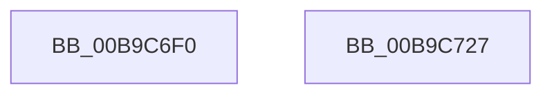

# ViPtCaptureTraceInformationCallBack

- RVA: `0x00B9C6F0`–`0x00B9C728` (길이 `56` bytes)
- VA: `0x0000000140B9C6F0`
- 실행 섹션: `PAGEVRFY`
- PDB 이름 있음: `예`; PDB Function 태그: `아니요`
- unwind 정보 RVA: `0x0006E5F8`
- 디코드: `16`개 명령, `56/56` bytes 표시
- 미해석 바이트: `0` (있으면 어셈블리에 `.byte`로 보존)

> 이 문서는 커널 이미지의 기계어와 PDB 기호를 분석해 생성했습니다. 4번과 5번은 함수 원형과 자료형을 바이너리 사용 방식에서 추정한 C 해석이며 원본 소스 복구 결과는 아닙니다.

## 1. Dependencies

- 직접 호출 지점: **1**; 고유 호출 대상: **1**
- 직접 호출자로 확인된 함수: **0**
- RIP 상대 이미지 참조: **1**

### Outgoing calls
- `0x00B9C713` → [guard_dispatch_icall](../../text/6B/guard_dispatch_icall_function_006BAAD0.md) (function, `0x006BAAD0`)

### Direct callers
- 이 함수 시작 RVA로 연결되는 직접 call은 확인되지 않았습니다. 간접 호출은 완전히 역산할 수 없습니다.

### Static image references
- `0x00B9C702` → RVA `0x00B8C0D8` (`GUID_VERIFIER_LIVEDUMP_INTERFACE`; read)

## 2. Other-region calls and transfers

- 다른 실행 섹션으로 향하는 call: **1**
  - `0x00B9C713` → [guard_dispatch_icall](../../text/6B/guard_dispatch_icall_function_006BAAD0.md) (`PAGEVRFY` → `.text`)
- 별도 외부 분기/꼬리 이동을 확인하지 못했습니다.

## 3. Assembly (complete function range)

```asm
00B9C6F0  48 89 5C 24 08                  mov qword ptr [rsp + 8], rbx
00B9C6F5  57                              push rdi
00B9C6F6  48 83 EC 30                     sub rsp, 0x30
00B9C6FA  48 8B 5C 24 78                  mov rbx, qword ptr [rsp + 0x78]
00B9C6FF  48 8B C2                        mov rax, rdx
00B9C702  48 8D 15 CF F9 FE FF            lea rdx, [rip - 0x10631]
00B9C709  48 8B F9                        mov rdi, rcx
00B9C70C  44 8B 4B 08                     mov r9d, dword ptr [rbx + 8]
00B9C710  4C 8B 03                        mov r8, qword ptr [rbx]
00B9C713  E8 B8 E3 B1 FF                  call 0x1406baad0
00B9C718  48 89 7B 18                     mov qword ptr [rbx + 0x18], rdi
00B9C71C  48 8B 5C 24 40                  mov rbx, qword ptr [rsp + 0x40]
00B9C721  48 83 C4 30                     add rsp, 0x30
00B9C725  5F                              pop rdi
00B9C726  C3                              ret
00B9C727  CC                              int3
```

## 4. C-style interpretation (structured pseudocode)

```c
__int64 __fastcall ViPtCaptureTraceInformationCallBack(__int64 a1, __int64 a2, __int64 a3, __int64 a4, __int64 a5, __int64 a6, __int64 a7, __int64 a8)
{
    __int64 result;
    __int64 v_rsp;
    unsigned __int64 v_stack_p8;

    v_stack_p8 = v_rbx;
    v_rsp = (v_rsp) - (48);
    result = guard_dispatch_icall(a1, v_rip - 67121, *(unsigned __int64 *)(a8), (unsigned int)(*(unsigned int *)(a8 + 8)));
    *(unsigned __int64 *)(a8 + 24) = a1;
    v_rsp = (v_rsp) + (48);
    return result;
}
```

## 5. (Beta) C Style

```c
int64_t ViPtCaptureTraceInformationCallBack(int64_t Arg1, int64_t Arg2, int64_t Arg3, int64_t Arg4, uint64_t Arg5, uint64_t Arg6, uint64_t Arg7, void *Arg8)
{
    uint8_t *arg8 = (uint8_t *)Arg8;

    int64_t result;
    int64_t local_rsp;
    uint64_t v_stack_p8;

    v_stack_p8 = local_rbx;
    local_rsp = (local_rsp) - (48);
    result = guard_dispatch_icall(Arg1, v_rip - 67121, *(uint64_t *)(arg8), (uint32_t)(*(uint32_t *)(arg8 + 0x8)));
    *(uint64_t *)(arg8 + 0x18) = Arg1;
    local_rsp = (local_rsp) + (48);
    return result;
}
```

### 관측된 메모리 오프셋

구조체 형식이 확인되지 않은 접근은 인자 기준의 오프셋으로만 기록했습니다.

| 기준 인자 | 오프셋 표현 | 폭 (bit) | 접근 |
|---|---:|---:|---|
| `Arg8` | `+ 0x0` | `64` | `R` |
| `Arg8` | `+ 0x8` | `32` | `R` |
| `Arg8` | `+ 0x18` | `64` | `W` |

## 6. Execution-region graph

[열기: 2D/3D 그래프와 함수 탐색 컨트롤 패널](../../../control-panel.html?section=pagevrfy&rva=0x00B9C6F0&view=graph)

- 2D 그래프는 위에서 아래로 흐르고, 3D 그래프는 빈 공간을 드래그해 회전합니다. Shift+드래그는 이동, 휠은 확대·축소, 함수 노드 선택은 대상 보고서 이동입니다.

### Static fallback


