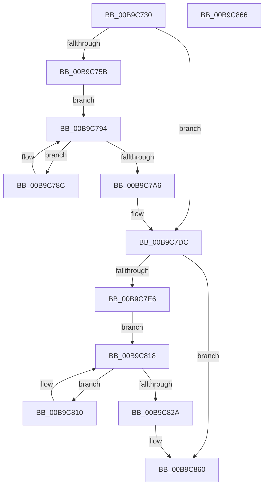

# ViPtDeleteAvlTrees

- RVA: `0x00B9C730`–`0x00B9C867` (길이 `311` bytes)
- VA: `0x0000000140B9C730`
- 실행 섹션: `PAGEVRFY`
- PDB 이름 있음: `예`; PDB Function 태그: `아니요`
- unwind 정보 RVA: `0x000BD408`
- 디코드: `73`개 명령, `311/311` bytes 표시
- 미해석 바이트: `0` (있으면 어셈블리에 `.byte`로 보존)

> 이 문서는 커널 이미지의 기계어와 PDB 기호를 분석해 생성했습니다. 4번과 5번은 함수 원형과 자료형을 바이너리 사용 방식에서 추정한 C 해석이며 원본 소스 복구 결과는 아닙니다.

## 1. Dependencies

- 직접 호출 지점: **16**; 고유 호출 대상: **8**
- 직접 호출자로 확인된 함수: **1**
- RIP 상대 이미지 참조: **13**

### Outgoing calls
- `0x00B9C767` → [ViPtInitializeLockContext](../../text/61/ViPtInitializeLockContext_function_00613958.md) (function, `0x00613958`)
- `0x00B9C771` → [CarDbRaiseIrqlSafe](../../text/61/CarDbRaiseIrqlSafe_function_0061396C.md) (function, `0x0061396C`)
- `0x00B9C785` → [ViPtAcquireTreeLockAtDpcLevelSafe](../../text/61/ViPtAcquireTreeLockAtDpcLevelSafe_function_0061388C.md) (function, `0x0061388C`)
- `0x00B9C78F` → [RtlDeleteElementGenericTableAvl](../../text/3E/RtlDeleteElementGenericTableAvl_function_003EE750.md) (function, `0x003EE750`)
- `0x00B9C799` → [RtlEnumerateGenericTableAvl](../../text/3E/RtlEnumerateGenericTableAvl_function_003E5AB0.md) (function, `0x003E5AB0`)
- `0x00B9C7BD` → [ViPtReleaseTreeLockFromDpcLevel](../../text/61/ViPtReleaseTreeLockFromDpcLevel_function_006139C0.md) (function, `0x006139C0`)
- `0x00B9C7C7` → [ViPtCleanupLockContext](../../text/61/ViPtCleanupLockContext_function_006138FC.md) (function, `0x006138FC`)
- `0x00B9C7D7` → [memset](../../text/6C/memset_function_006C6C40.md) (function, `0x006C6C40`)
- `0x00B9C7EB` → [ViPtInitializeLockContext](../../text/61/ViPtInitializeLockContext_function_00613958.md) (function, `0x00613958`)
- `0x00B9C7F5` → [CarDbRaiseIrqlSafe](../../text/61/CarDbRaiseIrqlSafe_function_0061396C.md) (function, `0x0061396C`)
- `0x00B9C809` → [ViPtAcquireTreeLockAtDpcLevelSafe](../../text/61/ViPtAcquireTreeLockAtDpcLevelSafe_function_0061388C.md) (function, `0x0061388C`)
- `0x00B9C813` → [RtlDeleteElementGenericTableAvl](../../text/3E/RtlDeleteElementGenericTableAvl_function_003EE750.md) (function, `0x003EE750`)
- `0x00B9C81D` → [RtlEnumerateGenericTableAvl](../../text/3E/RtlEnumerateGenericTableAvl_function_003E5AB0.md) (function, `0x003E5AB0`)
- `0x00B9C841` → [ViPtReleaseTreeLockFromDpcLevel](../../text/61/ViPtReleaseTreeLockFromDpcLevel_function_006139C0.md) (function, `0x006139C0`)
- `0x00B9C84B` → [ViPtCleanupLockContext](../../text/61/ViPtCleanupLockContext_function_006138FC.md) (function, `0x006138FC`)
- `0x00B9C85B` → [memset](../../text/6C/memset_function_006C6C40.md) (function, `0x006C6C40`)

### Direct callers
- [ViPtPluginUnload](ViPtPluginUnload_function_00B9CA40.md) at `0x00B9CA5A`

### Static image references
- `0x00B9C736` → RVA `0x00F04980` (`.data`; read/write)
- `0x00B9C741` → RVA `0x00FFDAA0` (`PAGEVRFD`; read)
- `0x00B9C747` → RVA `0x00F04240` (`.data`; write)
- `0x00B9C760` → RVA `0x00F04241` (`.data`; write)
- `0x00B9C776` → RVA `0x00FFF140` (`PAGEVRFD`; read)
- `0x00B9C7A6` → RVA `0x00FFDAA0` (`PAGEVRFD`; write)
- `0x00B9C7B1` → RVA `0x00FFDB98` (`PAGEVRFD`; write)
- `0x00B9C7B7` → RVA `0x00FFDB9C` (`PAGEVRFD`; write)
- `0x00B9C7DC` → RVA `0x00FFDA98` (`PAGEVRFD`; read)
- `0x00B9C7FA` → RVA `0x00FFF080` (`PAGEVRFD`; read)
- `0x00B9C82A` → RVA `0x00F04214` (`.data`; read/write)
- `0x00B9C835` → RVA `0x00FFDA98` (`PAGEVRFD`; write)
- `0x00B9C83B` → RVA `0x00FFDB88` (`PAGEVRFD`; write)

## 2. Other-region calls and transfers

- 다른 실행 섹션으로 향하는 call: **16**
  - `0x00B9C767` → [ViPtInitializeLockContext](../../text/61/ViPtInitializeLockContext_function_00613958.md) (`PAGEVRFY` → `.text`)
  - `0x00B9C771` → [CarDbRaiseIrqlSafe](../../text/61/CarDbRaiseIrqlSafe_function_0061396C.md) (`PAGEVRFY` → `.text`)
  - `0x00B9C785` → [ViPtAcquireTreeLockAtDpcLevelSafe](../../text/61/ViPtAcquireTreeLockAtDpcLevelSafe_function_0061388C.md) (`PAGEVRFY` → `.text`)
  - `0x00B9C78F` → [RtlDeleteElementGenericTableAvl](../../text/3E/RtlDeleteElementGenericTableAvl_function_003EE750.md) (`PAGEVRFY` → `.text`)
  - `0x00B9C799` → [RtlEnumerateGenericTableAvl](../../text/3E/RtlEnumerateGenericTableAvl_function_003E5AB0.md) (`PAGEVRFY` → `.text`)
  - `0x00B9C7BD` → [ViPtReleaseTreeLockFromDpcLevel](../../text/61/ViPtReleaseTreeLockFromDpcLevel_function_006139C0.md) (`PAGEVRFY` → `.text`)
  - `0x00B9C7C7` → [ViPtCleanupLockContext](../../text/61/ViPtCleanupLockContext_function_006138FC.md) (`PAGEVRFY` → `.text`)
  - `0x00B9C7D7` → [memset](../../text/6C/memset_function_006C6C40.md) (`PAGEVRFY` → `.text`)
  - `0x00B9C7EB` → [ViPtInitializeLockContext](../../text/61/ViPtInitializeLockContext_function_00613958.md) (`PAGEVRFY` → `.text`)
  - `0x00B9C7F5` → [CarDbRaiseIrqlSafe](../../text/61/CarDbRaiseIrqlSafe_function_0061396C.md) (`PAGEVRFY` → `.text`)
  - `0x00B9C809` → [ViPtAcquireTreeLockAtDpcLevelSafe](../../text/61/ViPtAcquireTreeLockAtDpcLevelSafe_function_0061388C.md) (`PAGEVRFY` → `.text`)
  - `0x00B9C813` → [RtlDeleteElementGenericTableAvl](../../text/3E/RtlDeleteElementGenericTableAvl_function_003EE750.md) (`PAGEVRFY` → `.text`)
  - `0x00B9C81D` → [RtlEnumerateGenericTableAvl](../../text/3E/RtlEnumerateGenericTableAvl_function_003E5AB0.md) (`PAGEVRFY` → `.text`)
  - `0x00B9C841` → [ViPtReleaseTreeLockFromDpcLevel](../../text/61/ViPtReleaseTreeLockFromDpcLevel_function_006139C0.md) (`PAGEVRFY` → `.text`)
  - `0x00B9C84B` → [ViPtCleanupLockContext](../../text/61/ViPtCleanupLockContext_function_006138FC.md) (`PAGEVRFY` → `.text`)
  - `0x00B9C85B` → [memset](../../text/6C/memset_function_006C6C40.md) (`PAGEVRFY` → `.text`)
- 별도 외부 분기/꼬리 이동을 확인하지 못했습니다.

## 3. Assembly (complete function range)

```asm
00B9C730  40 57                           push rdi
00B9C732  48 83 EC 30                     sub rsp, 0x30
00B9C736  0F BA 35 42 82 36 00 0C         btr dword ptr [rip + 0x368242], 0xc
00B9C73E  0F 57 C0                        xorps xmm0, xmm0
00B9C741  8B 05 59 13 46 00               mov eax, dword ptr [rip + 0x461359]
00B9C747  C6 05 F2 7A 36 00 00            mov byte ptr [rip + 0x367af2], 0
00B9C74E  0F 11 44 24 20                  movups xmmword ptr [rsp + 0x20], xmm0
00B9C753  85 C0                           test eax, eax
00B9C755  0F 84 81 00 00 00               je 0x140b9c7dc
00B9C75B  48 8D 4C 24 20                  lea rcx, [rsp + 0x20]
00B9C760  C6 05 DA 7A 36 00 00            mov byte ptr [rip + 0x367ada], 0
00B9C767  E8 EC 71 A7 FF                  call 0x140613958
00B9C76C  48 8D 4C 24 20                  lea rcx, [rsp + 0x20]
00B9C771  E8 F6 71 A7 FF                  call 0x14061396c
00B9C776  48 8D 3D C3 29 46 00            lea rdi, [rip + 0x4629c3]
00B9C77D  48 8B CF                        mov rcx, rdi
00B9C780  48 8D 54 24 20                  lea rdx, [rsp + 0x20]
00B9C785  E8 02 71 A7 FF                  call 0x14061388c
00B9C78A  EB 08                           jmp 0x140b9c794
00B9C78C  48 8B D0                        mov rdx, rax
00B9C78F  E8 BC 1F 85 FF                  call 0x1403ee750
00B9C794  B2 01                           mov dl, 1
00B9C796  48 8B CF                        mov rcx, rdi
00B9C799  E8 12 93 84 FF                  call 0x1403e5ab0
00B9C79E  48 8B CF                        mov rcx, rdi
00B9C7A1  48 85 C0                        test rax, rax
00B9C7A4  75 E6                           jne 0x140b9c78c
00B9C7A6  89 05 F4 12 46 00               mov dword ptr [rip + 0x4612f4], eax
00B9C7AC  48 8D 54 24 20                  lea rdx, [rsp + 0x20]
00B9C7B1  89 05 E1 13 46 00               mov dword ptr [rip + 0x4613e1], eax
00B9C7B7  89 05 DF 13 46 00               mov dword ptr [rip + 0x4613df], eax
00B9C7BD  E8 FE 71 A7 FF                  call 0x1406139c0
00B9C7C2  48 8D 4C 24 20                  lea rcx, [rsp + 0x20]
00B9C7C7  E8 30 71 A7 FF                  call 0x1406138fc
00B9C7CC  33 D2                           xor edx, edx
00B9C7CE  41 B8 C0 00 00 00               mov r8d, 0xc0
00B9C7D4  48 8B CF                        mov rcx, rdi
00B9C7D7  E8 64 A4 B2 FF                  call 0x1406c6c40
00B9C7DC  8B 05 B6 12 46 00               mov eax, dword ptr [rip + 0x4612b6]
00B9C7E2  85 C0                           test eax, eax
00B9C7E4  74 7A                           je 0x140b9c860
00B9C7E6  48 8D 4C 24 20                  lea rcx, [rsp + 0x20]
00B9C7EB  E8 68 71 A7 FF                  call 0x140613958
00B9C7F0  48 8D 4C 24 20                  lea rcx, [rsp + 0x20]
00B9C7F5  E8 72 71 A7 FF                  call 0x14061396c
00B9C7FA  48 8D 3D 7F 28 46 00            lea rdi, [rip + 0x46287f]
00B9C801  48 8B CF                        mov rcx, rdi
00B9C804  48 8D 54 24 20                  lea rdx, [rsp + 0x20]
00B9C809  E8 7E 70 A7 FF                  call 0x14061388c
00B9C80E  EB 08                           jmp 0x140b9c818
00B9C810  48 8B D0                        mov rdx, rax
00B9C813  E8 38 1F 85 FF                  call 0x1403ee750
00B9C818  B2 01                           mov dl, 1
00B9C81A  48 8B CF                        mov rcx, rdi
00B9C81D  E8 8E 92 84 FF                  call 0x1403e5ab0
00B9C822  48 8B CF                        mov rcx, rdi
00B9C825  48 85 C0                        test rax, rax
00B9C828  75 E6                           jne 0x140b9c810
00B9C82A  21 05 E4 79 36 00               and dword ptr [rip + 0x3679e4], eax
00B9C830  48 8D 54 24 20                  lea rdx, [rsp + 0x20]
00B9C835  89 05 5D 12 46 00               mov dword ptr [rip + 0x46125d], eax
00B9C83B  89 05 47 13 46 00               mov dword ptr [rip + 0x461347], eax
00B9C841  E8 7A 71 A7 FF                  call 0x1406139c0
00B9C846  48 8D 4C 24 20                  lea rcx, [rsp + 0x20]
00B9C84B  E8 AC 70 A7 FF                  call 0x1406138fc
00B9C850  33 D2                           xor edx, edx
00B9C852  41 B8 C0 00 00 00               mov r8d, 0xc0
00B9C858  48 8B CF                        mov rcx, rdi
00B9C85B  E8 E0 A3 B2 FF                  call 0x1406c6c40
00B9C860  48 83 C4 30                     add rsp, 0x30
00B9C864  5F                              pop rdi
00B9C865  C3                              ret
00B9C866  CC                              int3
```

## 4. C-style interpretation (structured pseudocode)

```c
__int64 __fastcall ViPtDeleteAvlTrees(void)
{
    __int64 result;
    __int64 v_rsp;
    unsigned __int64 v_stack_m18;

    v_rsp = (v_rsp) - (48);
    *(unsigned __int8 *)(v_rip + 3570418) = 0;
    v_stack_m18 = v_xmm0;
    if ((unsigned int)((unsigned int)(*(unsigned int *)(v_rip + 4592473))) == 0) goto loc_00B9C7DC;
    *(unsigned __int8 *)(v_rip + 3570394) = 0;
    result = ViPtInitializeLockContext(v_stack_m18, a2, a3, a4);
    result = CarDbRaiseIrqlSafe(v_stack_m18, a2, a3, a4);
    result = ViPtAcquireTreeLockAtDpcLevelSafe(v_rip + 4598211, v_stack_m18, a3, a4);
    goto loc_00B9C794;
loc_00B9C78C:
    result = RtlDeleteElementGenericTableAvl(v_rip + 4598211, result, a3, a4);
loc_00B9C794:
    result = RtlEnumerateGenericTableAvl(v_rip + 4598211, 1, a3, a4);
    if (result != 0) goto loc_00B9C78C;
    *(unsigned int *)(v_rip + 4592372) = (unsigned int)(result);
    *(unsigned int *)(v_rip + 4592609) = (unsigned int)(result);
    *(unsigned int *)(v_rip + 4592607) = (unsigned int)(result);
    result = ViPtReleaseTreeLockFromDpcLevel(v_rip + 4598211, v_stack_m18, a3, a4);
    result = ViPtCleanupLockContext(v_stack_m18, v_stack_m18, a3, a4);
    a2 = 0;
    result = memset(v_rip + 4598211, a2, 192, a4);
loc_00B9C7DC:
    if ((unsigned int)((unsigned int)(*(unsigned int *)(v_rip + 4592310))) == 0) goto loc_00B9C860;
    result = ViPtInitializeLockContext(v_stack_m18, a2, 192, a4);
    result = CarDbRaiseIrqlSafe(v_stack_m18, a2, 192, a4);
    result = ViPtAcquireTreeLockAtDpcLevelSafe(v_rip + 4597887, v_stack_m18, 192, a4);
    goto loc_00B9C818;
loc_00B9C810:
    result = RtlDeleteElementGenericTableAvl(v_rip + 4597887, result, 192, a4);
loc_00B9C818:
    result = RtlEnumerateGenericTableAvl(v_rip + 4597887, 1, 192, a4);
    if (result != 0) goto loc_00B9C810;
    *(unsigned int *)(v_rip + 4592221) = (unsigned int)(result);
    *(unsigned int *)(v_rip + 4592455) = (unsigned int)(result);
    result = ViPtReleaseTreeLockFromDpcLevel(v_rip + 4597887, v_stack_m18, 192, a4);
    result = ViPtCleanupLockContext(v_stack_m18, v_stack_m18, 192, a4);
    a2 = 0;
    result = memset(v_rip + 4597887, a2, 192, a4);
loc_00B9C860:
    v_rsp = (v_rsp) + (48);
    return result;
}
```

## 5. (Beta) C Style

```c
void ViPtDeleteAvlTrees(void)
{
    int64_t result;
    int64_t local_rsp;
    uint64_t v_stack_m18;

    local_rsp = (local_rsp) - (48);
    *(uint8_t *)(v_rip + 0x367AF2) = 0;
    v_stack_m18 = v_xmm0;
    if ((uint32_t)((uint32_t)(*(uint32_t *)(v_rip + 0x461359))) == 0) goto loc_00B9C7DC;
    *(uint8_t *)(v_rip + 0x367ADA) = 0;
    result = ViPtInitializeLockContext(v_stack_m18, a2, a3, a4);
    result = CarDbRaiseIrqlSafe(v_stack_m18, a2, a3, a4);
    result = ViPtAcquireTreeLockAtDpcLevelSafe(v_rip + 4598211, v_stack_m18, a3, a4);
    goto loc_00B9C794;
loc_00B9C78C:
    result = RtlDeleteElementGenericTableAvl(v_rip + 4598211, result, a3, a4);
loc_00B9C794:
    result = RtlEnumerateGenericTableAvl(v_rip + 4598211, 1, a3, a4);
    if (result != 0) goto loc_00B9C78C;
    *(uint32_t *)(v_rip + 0x4612F4) = (uint32_t)(result);
    *(uint32_t *)(v_rip + 0x4613E1) = (uint32_t)(result);
    *(uint32_t *)(v_rip + 0x4613DF) = (uint32_t)(result);
    result = ViPtReleaseTreeLockFromDpcLevel(v_rip + 4598211, v_stack_m18, a3, a4);
    result = ViPtCleanupLockContext(v_stack_m18, v_stack_m18, a3, a4);
    a2 = 0;
    result = memset(v_rip + 4598211, a2, 192, a4);
loc_00B9C7DC:
    if ((uint32_t)((uint32_t)(*(uint32_t *)(v_rip + 0x4612B6))) == 0) goto loc_00B9C860;
    result = ViPtInitializeLockContext(v_stack_m18, a2, 192, a4);
    result = CarDbRaiseIrqlSafe(v_stack_m18, a2, 192, a4);
    result = ViPtAcquireTreeLockAtDpcLevelSafe(v_rip + 4597887, v_stack_m18, 192, a4);
    goto loc_00B9C818;
loc_00B9C810:
    result = RtlDeleteElementGenericTableAvl(v_rip + 4597887, result, 192, a4);
loc_00B9C818:
    result = RtlEnumerateGenericTableAvl(v_rip + 4597887, 1, 192, a4);
    if (result != 0) goto loc_00B9C810;
    *(uint32_t *)(v_rip + 0x46125D) = (uint32_t)(result);
    *(uint32_t *)(v_rip + 0x461347) = (uint32_t)(result);
    result = ViPtReleaseTreeLockFromDpcLevel(v_rip + 4597887, v_stack_m18, 192, a4);
    result = ViPtCleanupLockContext(v_stack_m18, v_stack_m18, 192, a4);
    a2 = 0;
    result = memset(v_rip + 4597887, a2, 192, a4);
loc_00B9C860:
    local_rsp = (local_rsp) + (48);
    return result;
}
```

## 6. Execution-region graph

[열기: 2D/3D 그래프와 함수 탐색 컨트롤 패널](../../../control-panel.html?section=pagevrfy&rva=0x00B9C730&view=graph)

- 2D 그래프는 위에서 아래로 흐르고, 3D 그래프는 빈 공간을 드래그해 회전합니다. Shift+드래그는 이동, 휠은 확대·축소, 함수 노드 선택은 대상 보고서 이동입니다.

### Static fallback


