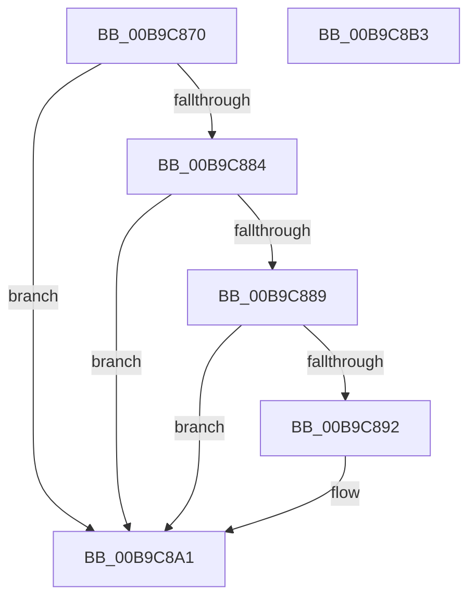

# ViPtFreePoolInfoEntryCallback

- RVA: `0x00B9C870`–`0x00B9C8B4` (길이 `68` bytes)
- VA: `0x0000000140B9C870`
- 실행 섹션: `PAGEVRFY`
- PDB 이름 있음: `예`; PDB Function 태그: `아니요`
- unwind 정보 RVA: `0x0005C788`
- 디코드: `20`개 명령, `68/68` bytes 표시
- 미해석 바이트: `0` (있으면 어셈블리에 `.byte`로 보존)

> 이 문서는 커널 이미지의 기계어와 PDB 기호를 분석해 생성했습니다. 4번과 5번은 함수 원형과 자료형을 바이너리 사용 방식에서 추정한 C 해석이며 원본 소스 복구 결과는 아닙니다.

## 1. Dependencies

- 직접 호출 지점: **1**; 고유 호출 대상: **1**
- 직접 호출자로 확인된 함수: **0**
- RIP 상대 이미지 참조: **1**

### Outgoing calls
- `0x00B9C8A9` → [ExFreePoolWithTag](../../poolcode/B8/ExFreePoolWithTag_function_00B82870.md) (function, `0x00B82870`)

### Direct callers
- 이 함수 시작 RVA로 연결되는 직접 call은 확인되지 않았습니다. 간접 호출은 완전히 역산할 수 없습니다.

### Static image references
- `0x00B9C874` → RVA `0x00F04241` (`.data`; read)

## 2. Other-region calls and transfers

- 다른 실행 섹션으로 향하는 call: **1**
  - `0x00B9C8A9` → [ExFreePoolWithTag](../../poolcode/B8/ExFreePoolWithTag_function_00B82870.md) (`PAGEVRFY` → `POOLCODE`)
- 별도 외부 분기/꼬리 이동을 확인하지 못했습니다.

## 3. Assembly (complete function range)

```asm
00B9C870  48 83 EC 28                     sub rsp, 0x28
00B9C874  80 3D C6 79 36 00 00            cmp byte ptr [rip + 0x3679c6], 0
00B9C87B  48 8D 42 20                     lea rax, [rdx + 0x20]
00B9C87F  4C 8B C2                        mov r8, rdx
00B9C882  74 1D                           je 0x140b9c8a1
00B9C884  48 85 C0                        test rax, rax
00B9C887  74 18                           je 0x140b9c8a1
00B9C889  48 8B 48 10                     mov rcx, qword ptr [rax + 0x10]
00B9C88D  48 85 C9                        test rcx, rcx
00B9C890  74 0F                           je 0x140b9c8a1
00B9C892  FF 41 10                        inc dword ptr [rcx + 0x10]
00B9C895  48 8B 48 10                     mov rcx, qword ptr [rax + 0x10]
00B9C899  48 8B 40 08                     mov rax, qword ptr [rax + 8]
00B9C89D  48 01 41 20                     add qword ptr [rcx + 0x20], rax
00B9C8A1  BA 56 69 49 6E                  mov edx, 0x6e496956
00B9C8A6  49 8B C8                        mov rcx, r8
00B9C8A9  E8 C2 5F FE FF                  call 0x140b82870
00B9C8AE  48 83 C4 28                     add rsp, 0x28
00B9C8B2  C3                              ret
00B9C8B3  CC                              int3
```

## 4. C-style interpretation (structured pseudocode)

```c
__int64 __fastcall ViPtFreePoolInfoEntryCallback(__int64 a1, __int64 a2)
{
    __int64 result;
    __int64 v_rsp;

    v_rsp = (v_rsp) - (40);
    if ((*(unsigned __int8 *)(v_rip + 3570118)) == 0) goto loc_00B9C8A1;
    if (a2 + 32 == 0) goto loc_00B9C8A1;
    result = a2 + 32;
    if (*(unsigned __int64 *)(a2 + 32 + 16) != 0) {
        a1 = *(unsigned __int64 *)(a2 + 32 + 16);
        result = *(unsigned __int64 *)(a2 + 32 + 8);
    }
    result = ExFreePoolWithTag(a2, (unsigned int)(0x6E496956ULL), a2, a4);
    v_rsp = (v_rsp) + (40);
    return result;
}
```

## 5. (Beta) C Style

```c
int64_t ViPtFreePoolInfoEntryCallback(int64_t Arg1, void *Arg2)
{
    uint8_t *arg2 = (uint8_t *)Arg2;

    int64_t result;
    int64_t local_rsp;

    local_rsp = (local_rsp) - (40);
    if ((*(uint8_t *)(v_rip + 0x3679C6)) == 0) goto loc_00B9C8A1;
    if (Arg2 + 32 == 0) goto loc_00B9C8A1;
    result = Arg2 + 32;
    if (*(uint64_t *)(arg2 + 0x20 + 0x10) != 0) {
        Arg1 = *(uint64_t *)(arg2 + 0x20 + 0x10);
        result = *(uint64_t *)(arg2 + 0x20 + 0x8);
    }
    result = ExFreePoolWithTag(Arg2, (uint32_t)(0x6E496956ULL), Arg2, a4);
    local_rsp = (local_rsp) + (40);
    return result;
}
```

### 관측된 메모리 오프셋

구조체 형식이 확인되지 않은 접근은 인자 기준의 오프셋으로만 기록했습니다.

| 기준 인자 | 오프셋 표현 | 폭 (bit) | 접근 |
|---|---:|---:|---|
| `Arg2` | `+ 0x20` | `64` | `R` |

## 6. Execution-region graph

[열기: 2D/3D 그래프와 함수 탐색 컨트롤 패널](../../../control-panel.html?section=pagevrfy&rva=0x00B9C870&view=graph)

- 2D 그래프는 위에서 아래로 흐르고, 3D 그래프는 빈 공간을 드래그해 회전합니다. Shift+드래그는 이동, 휠은 확대·축소, 함수 노드 선택은 대상 보고서 이동입니다.

### Static fallback


