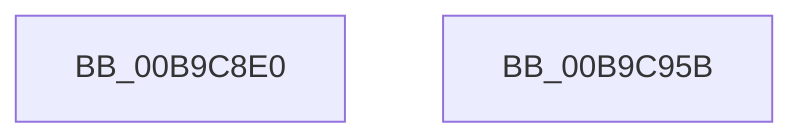

# ViPtInitAvlTrees

- RVA: `0x00B9C8E0`–`0x00B9C95C` (길이 `124` bytes)
- VA: `0x0000000140B9C8E0`
- 실행 섹션: `PAGEVRFY`
- PDB 이름 있음: `예`; PDB Function 태그: `아니요`
- unwind 정보 RVA: `0x0005D2F4`
- 디코드: `22`개 명령, `124/124` bytes 표시
- 미해석 바이트: `0` (있으면 어셈블리에 `.byte`로 보존)

> 이 문서는 커널 이미지의 기계어와 PDB 기호를 분석해 생성했습니다. 4번과 5번은 함수 원형과 자료형을 바이너리 사용 방식에서 추정한 C 해석이며 원본 소스 복구 결과는 아닙니다.

## 1. Dependencies

- 직접 호출 지점: **2**; 고유 호출 대상: **1**
- 직접 호출자로 확인된 함수: **1**
- RIP 상대 이미지 참조: **11**

### Outgoing calls
- `0x00B9C90D` → [RtlInitializeGenericTableAvl](../../text/46/RtlInitializeGenericTableAvl_function_00466100.md) (function, `0x00466100`)
- `0x00B9C93F` → [RtlInitializeGenericTableAvl](../../text/46/RtlInitializeGenericTableAvl_function_00466100.md) (function, `0x00466100`)

### Direct callers
- [VfPoolTrackingEntry](../../text/61/VfPoolTrackingEntry_function_00613380.md) at `0x006133CF`

### Static image references
- `0x00B9C8EA` → RVA `0x00B9C870` (`ViPtFreePoolInfoEntryCallback`; read)
- `0x00B9C8F1` → RVA `0x00B9C6C0` (`ViPtAllocPoolInfoCallback`; read)
- `0x00B9C8F8` → RVA `0x00F04241` (`.data`; write)
- `0x00B9C8FF` → RVA `0x00B9BF10` (`VfPtComparePoolInfoCallback`; read)
- `0x00B9C906` → RVA `0x00FFF140` (`PAGEVRFD`; read)
- `0x00B9C918` → RVA `0x00B9C8C0` (`ViPtFreeStackInfoEntryCallback`; read)
- `0x00B9C92B` → RVA `0x00FFDAA0` (`PAGEVRFD`; read/write)
- `0x00B9C931` → RVA `0x00B9BF30` (`VfPtComparePoolStackInfoCallback`; read)
- `0x00B9C938` → RVA `0x00FFF080` (`PAGEVRFD`; read)
- `0x00B9C949` → RVA `0x00FFDA98` (`PAGEVRFD`; read/write)
- `0x00B9C94F` → RVA `0x00F04240` (`.data`; write)

## 2. Other-region calls and transfers

- 다른 실행 섹션으로 향하는 call: **2**
  - `0x00B9C90D` → [RtlInitializeGenericTableAvl](../../text/46/RtlInitializeGenericTableAvl_function_00466100.md) (`PAGEVRFY` → `.text`)
  - `0x00B9C93F` → [RtlInitializeGenericTableAvl](../../text/46/RtlInitializeGenericTableAvl_function_00466100.md) (`PAGEVRFY` → `.text`)
- 별도 외부 분기/꼬리 이동을 확인하지 못했습니다.

## 3. Assembly (complete function range)

```asm
00B9C8E0  48 83 EC 38                     sub rsp, 0x38
00B9C8E4  48 83 64 24 20 00               and qword ptr [rsp + 0x20], 0
00B9C8EA  4C 8D 0D 7F FF FF FF            lea r9, [rip - 0x81]
00B9C8F1  4C 8D 05 C8 FD FF FF            lea r8, [rip - 0x238]
00B9C8F8  C6 05 42 79 36 00 01            mov byte ptr [rip + 0x367942], 1
00B9C8FF  48 8D 15 0A F6 FF FF            lea rdx, [rip - 0x9f6]
00B9C906  48 8D 0D 33 28 46 00            lea rcx, [rip + 0x462833]
00B9C90D  E8 EE 97 8C FF                  call 0x140466100
00B9C912  48 83 64 24 20 00               and qword ptr [rsp + 0x20], 0
00B9C918  4C 8D 0D A1 FF FF FF            lea r9, [rip - 0x5f]
00B9C91F  B8 01 00 00 00                  mov eax, 1
00B9C924  4C 8D 05 95 FD FF FF            lea r8, [rip - 0x26b]
00B9C92B  87 05 6F 11 46 00               xchg dword ptr [rip + 0x46116f], eax
00B9C931  48 8D 15 F8 F5 FF FF            lea rdx, [rip - 0xa08]
00B9C938  48 8D 0D 41 27 46 00            lea rcx, [rip + 0x462741]
00B9C93F  E8 BC 97 8C FF                  call 0x140466100
00B9C944  B8 01 00 00 00                  mov eax, 1
00B9C949  87 05 49 11 46 00               xchg dword ptr [rip + 0x461149], eax
00B9C94F  C6 05 EA 78 36 00 01            mov byte ptr [rip + 0x3678ea], 1
00B9C956  48 83 C4 38                     add rsp, 0x38
00B9C95A  C3                              ret
00B9C95B  CC                              int3
```

## 4. C-style interpretation (structured pseudocode)

```c
__int64 __fastcall ViPtInitAvlTrees(void)
{
    __int64 result;
    __int64 v_rsp;
    unsigned __int64 v_stack_m18;

    v_rsp = (v_rsp) - (56);
    *(unsigned __int8 *)(v_rip + 3569986) = 1;
    result = RtlInitializeGenericTableAvl(v_rip + 4597811, v_rip - 2550, v_rip - 568, v_rip - 129);
    result = RtlInitializeGenericTableAvl(v_rip + 4597569, v_rip - 2568, v_rip - 619, v_rip - 95);
    *(unsigned __int8 *)(v_rip + 3569898) = 1;
    v_rsp = (v_rsp) + (56);
    return 1;
}
```

## 5. (Beta) C Style

```c
void ViPtInitAvlTrees(void)
{
    int64_t result;
    int64_t local_rsp;
    uint64_t v_stack_m18;

    local_rsp = (local_rsp) - (56);
    *(uint8_t *)(v_rip + 0x367942) = 1;
    result = RtlInitializeGenericTableAvl(v_rip + 4597811, v_rip - 2550, v_rip - 568, v_rip - 129);
    result = RtlInitializeGenericTableAvl(v_rip + 4597569, v_rip - 2568, v_rip - 619, v_rip - 95);
    *(uint8_t *)(v_rip + 0x3678EA) = 1;
    local_rsp = (local_rsp) + (56);
    return 1;
}
```

## 6. Execution-region graph

[열기: 2D/3D 그래프와 함수 탐색 컨트롤 패널](../../../control-panel.html?section=pagevrfy&rva=0x00B9C8E0&view=graph)

- 2D 그래프는 위에서 아래로 흐르고, 3D 그래프는 빈 공간을 드래그해 회전합니다. Shift+드래그는 이동, 휠은 확대·축소, 함수 노드 선택은 대상 보고서 이동입니다.

### Static fallback


