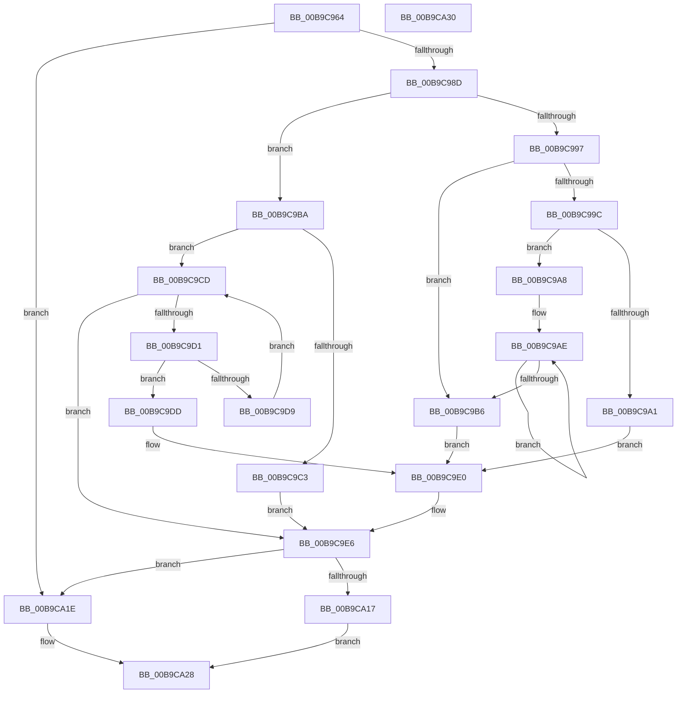

# ViPtInitCircularPoolTrace

- RVA: `0x00B9C964`–`0x00B9CA31` (길이 `205` bytes)
- VA: `0x0000000140B9C964`
- 실행 섹션: `PAGEVRFY`
- PDB 이름 있음: `예`; PDB Function 태그: `아니요`
- unwind 정보 RVA: `0x00064C80`
- 디코드: `60`개 명령, `205/205` bytes 표시
- 미해석 바이트: `0` (있으면 어셈블리에 `.byte`로 보존)

> 이 문서는 커널 이미지의 기계어와 PDB 기호를 분석해 생성했습니다. 4번과 5번은 함수 원형과 자료형을 바이너리 사용 방식에서 추정한 C 해석이며 원본 소스 복구 결과는 아닙니다.

## 1. Dependencies

- 직접 호출 지점: **3**; 고유 호출 대상: **3**
- 직접 호출자로 확인된 함수: **1**
- RIP 상대 이미지 참조: **5**

### Outgoing calls
- `0x00B9C96E` → [MmGetNumberOfPhysicalPages](../../text/46/MmGetNumberOfPhysicalPages_function_00467F80.md) (function, `0x00467F80`)
- `0x00B9CA06` → [ExAllocatePool3](../../poolcode/B8/ExAllocatePool3_function_00B84270.md) (function, `0x00B84270`)
- `0x00B9CA23` → [ExSetPoolFlags](../../text/65/ExSetPoolFlags_function_006567C4.md) (function, `0x006567C4`)

### Direct callers
- [VfPoolTrackingEntry](../../text/61/VfPoolTrackingEntry_function_00613380.md) at `0x006133B4`

### Static image references
- `0x00B9C97B` → RVA `0x00F04980` (`.data`; read)
- `0x00B9C98D` → RVA `0x00FFDA0C` (`PAGEVRFD`; read)
- `0x00B9C9C5` → RVA `0x00FFDA0C` (`PAGEVRFD`; write)
- `0x00B9C9EC` → RVA `0x00E681B0` (`.data`; read)
- `0x00B9CA0B` → RVA `0x00FFDAC8` (`PAGEVRFD`; write)

## 2. Other-region calls and transfers

- 다른 실행 섹션으로 향하는 call: **3**
  - `0x00B9C96E` → [MmGetNumberOfPhysicalPages](../../text/46/MmGetNumberOfPhysicalPages_function_00467F80.md) (`PAGEVRFY` → `.text`)
  - `0x00B9CA06` → [ExAllocatePool3](../../poolcode/B8/ExAllocatePool3_function_00B84270.md) (`PAGEVRFY` → `POOLCODE`)
  - `0x00B9CA23` → [ExSetPoolFlags](../../text/65/ExSetPoolFlags_function_006567C4.md) (`PAGEVRFY` → `.text`)
- 별도 외부 분기/꼬리 이동을 확인하지 못했습니다.

## 3. Assembly (complete function range)

```asm
00B9C964  40 53                           push rbx
00B9C966  48 83 EC 30                     sub rsp, 0x30
00B9C96A  33 C9                           xor ecx, ecx
00B9C96C  33 DB                           xor ebx, ebx
00B9C96E  E8 0D B6 8C FF                  call 0x140467f80
00B9C973  48 8B C8                        mov rcx, rax
00B9C976  BA 00 00 01 00                  mov edx, 0x10000
00B9C97B  8B 05 FF 7F 36 00               mov eax, dword ptr [rip + 0x367fff]
00B9C981  48 C1 E9 12                     shr rcx, 0x12
00B9C985  A8 02                           test al, 2
00B9C987  0F 85 91 00 00 00               jne 0x140b9ca1e
00B9C98D  8B 05 79 10 46 00               mov eax, dword ptr [rip + 0x461079]
00B9C993  3B C2                           cmp eax, edx
00B9C995  77 23                           ja 0x140b9c9ba
00B9C997  83 F9 04                        cmp ecx, 4
00B9C99A  76 1A                           jbe 0x140b9c9b6
00B9C99C  83 F9 10                        cmp ecx, 0x10
00B9C99F  76 07                           jbe 0x140b9c9a8
00B9C9A1  B8 00 00 08 00                  mov eax, 0x80000
00B9C9A6  EB 38                           jmp 0x140b9c9e0
00B9C9A8  8B C1                           mov eax, ecx
00B9C9AA  48 C1 E8 02                     shr rax, 2
00B9C9AE  03 D2                           add edx, edx
00B9C9B0  48 83 E8 01                     sub rax, 1
00B9C9B4  75 F8                           jne 0x140b9c9ae
00B9C9B6  8B C2                           mov eax, edx
00B9C9B8  EB 26                           jmp 0x140b9c9e0
00B9C9BA  B9 00 00 80 00                  mov ecx, 0x800000
00B9C9BF  3B C1                           cmp eax, ecx
00B9C9C1  76 0A                           jbe 0x140b9c9cd
00B9C9C3  8B C1                           mov eax, ecx
00B9C9C5  89 0D 41 10 46 00               mov dword ptr [rip + 0x461041], ecx
00B9C9CB  EB 19                           jmp 0x140b9c9e6
00B9C9CD  3B CA                           cmp ecx, edx
00B9C9CF  72 15                           jb 0x140b9c9e6
00B9C9D1  44 8B C1                        mov r8d, ecx
00B9C9D4  44 23 C0                        and r8d, eax
00B9C9D7  75 04                           jne 0x140b9c9dd
00B9C9D9  D1 E9                           shr ecx, 1
00B9C9DB  EB F0                           jmp 0x140b9c9cd
00B9C9DD  41 8B C0                        mov eax, r8d
00B9C9E0  89 05 26 10 46 00               mov dword ptr [rip + 0x461026], eax
00B9C9E6  69 D0 A8 01 00 00               imul edx, eax, 0x1a8
00B9C9EC  4C 8D 0D BD B7 2C 00            lea r9, [rip + 0x2cb7bd]
00B9C9F3  B9 40 00 00 00                  mov ecx, 0x40
00B9C9F8  C7 44 24 20 01 00 00 00         mov dword ptr [rsp + 0x20], 1
00B9CA00  41 B8 56 69 49 6E               mov r8d, 0x6e496956
00B9CA06  E8 65 78 FE FF                  call 0x140b84270
00B9CA0B  48 89 05 B6 10 46 00            mov qword ptr [rip + 0x4610b6], rax
00B9CA12  48 85 C0                        test rax, rax
00B9CA15  75 07                           jne 0x140b9ca1e
00B9CA17  BB 17 00 00 C0                  mov ebx, 0xc0000017
00B9CA1C  EB 0A                           jmp 0x140b9ca28
00B9CA1E  B9 10 00 00 00                  mov ecx, 0x10
00B9CA23  E8 9C 9D AB FF                  call 0x1406567c4
00B9CA28  8B C3                           mov eax, ebx
00B9CA2A  48 83 C4 30                     add rsp, 0x30
00B9CA2E  5B                              pop rbx
00B9CA2F  C3                              ret
00B9CA30  CC                              int3
```

## 4. C-style interpretation (structured pseudocode)

```c
__int64 __fastcall ViPtInitCircularPoolTrace(int a1)
{
    __int64 result;
    __int64 v_rbx;
    __int64 v_rsp;
    unsigned int v_stack_m18;

    v_rsp = (v_rsp) - (48);
    a1 = 0;
    v_rbx = 0;
    result = MmGetNumberOfPhysicalPages(a1, a2, a3, a4);
    a1 = (result) >> (18);
    if ((((unsigned __int8)((unsigned int)(*(unsigned int *)(v_rip + 3571711)))) & (2)) != 0) goto loc_00B9CA1E;
    if (((unsigned int)((unsigned int)(*(unsigned int *)(v_rip + 4591737)))) > ((unsigned int)((unsigned int)(0x10000ULL)))) goto loc_00B9C9BA;
    if (a1 <= 4) goto loc_00B9C9B6;
    if (a1 <= 16) goto loc_00B9C9A8;
    goto loc_00B9C9E0;
loc_00B9C9A8:
    result = ((unsigned int)(a1)) >> (2);
loc_00B9C9AE:
    a2 = (unsigned int)(((unsigned int)(0x10000ULL)) + ((unsigned int)((unsigned int)(0x10000ULL))));
    result = (result) - (1);
    if (condition_is_not_equal) goto loc_00B9C9AE;
loc_00B9C9B6:
    goto loc_00B9C9E0;
loc_00B9C9BA:
    if (((unsigned int)((unsigned int)((unsigned int)(a2)))) <= ((unsigned int)((unsigned int)(0x800000ULL)))) goto loc_00B9C9CD;
    *(unsigned int *)(v_rip + 4591681) = (unsigned int)((unsigned int)(0x800000ULL));
    goto loc_00B9C9E6;
loc_00B9C9CD:
    if (((unsigned int)((unsigned int)(0x800000ULL))) < ((unsigned int)(a2))) goto loc_00B9C9E6;
    a3 = (unsigned int)(((unsigned int)((unsigned int)((unsigned int)(0x800000ULL)))) & ((unsigned int)((unsigned int)((unsigned int)((unsigned int)(0x800000ULL))))));
    if (condition_is_not_equal) goto loc_00B9C9DD;
    a1 = (unsigned int)(((unsigned int)(0x800000ULL)) >> (1));
    goto loc_00B9C9CD;
loc_00B9C9DD:
loc_00B9C9E0:
    *(unsigned int *)(v_rip + 4591654) = (unsigned int)((unsigned int)((unsigned int)(a3)));
loc_00B9C9E6:
    a2 = (unsigned int)((a2) * ((unsigned int)((unsigned int)((unsigned int)(a3)))));
    v_stack_m18 = 1;
    result = ExAllocatePool3(64, a2, (unsigned int)(0x6E496956ULL), v_rip + 2930621);
    *(unsigned __int64 *)(v_rip + 4591798) = result;
    if (result != 0) goto loc_00B9CA1E;
    goto loc_00B9CA28;
loc_00B9CA1E:
    result = ExSetPoolFlags(16, a2, (unsigned int)(0x6E496956ULL), v_rip + 2930621);
loc_00B9CA28:
    v_rsp = (v_rsp) + (48);
    return (unsigned int)((unsigned int)((unsigned int)(0xC0000017ULL)));
}
```

## 5. (Beta) C Style

```c
int64_t ViPtInitCircularPoolTrace(int32_t Arg1)
{
    int64_t result;
    int64_t local_rbx;
    int64_t local_rsp;
    uint32_t v_stack_m18;

    local_rsp = (local_rsp) - (48);
    Arg1 = 0;
    local_rbx = 0;
    result = MmGetNumberOfPhysicalPages(Arg1, a2, a3, a4);
    Arg1 = (result) >> (18);
    if ((((uint8_t)((uint32_t)(*(uint32_t *)(v_rip + 0x367FFF)))) & (2)) != 0) goto loc_00B9CA1E;
    if (((uint32_t)((uint32_t)(*(uint32_t *)(v_rip + 0x461079)))) > ((uint32_t)((uint32_t)(0x10000ULL)))) goto loc_00B9C9BA;
    if (Arg1 <= 4) goto loc_00B9C9B6;
    if (Arg1 <= 16) goto loc_00B9C9A8;
    goto loc_00B9C9E0;
loc_00B9C9A8:
    result = ((uint32_t)(Arg1)) >> (2);
loc_00B9C9AE:
    a2 = (uint32_t)(((uint32_t)(0x10000ULL)) + ((uint32_t)((uint32_t)(0x10000ULL))));
    result = (result) - (1);
    if (condition_is_not_equal) goto loc_00B9C9AE;
loc_00B9C9B6:
    goto loc_00B9C9E0;
loc_00B9C9BA:
    if (((uint32_t)((uint32_t)((uint32_t)(a2)))) <= ((uint32_t)((uint32_t)(0x800000ULL)))) goto loc_00B9C9CD;
    *(uint32_t *)(v_rip + 0x461041) = (uint32_t)((uint32_t)(0x800000ULL));
    goto loc_00B9C9E6;
loc_00B9C9CD:
    if (((uint32_t)((uint32_t)(0x800000ULL))) < ((uint32_t)(a2))) goto loc_00B9C9E6;
    a3 = (uint32_t)(((uint32_t)((uint32_t)((uint32_t)(0x800000ULL)))) & ((uint32_t)((uint32_t)((uint32_t)((uint32_t)(0x800000ULL))))));
    if (condition_is_not_equal) goto loc_00B9C9DD;
    Arg1 = (uint32_t)(((uint32_t)(0x800000ULL)) >> (1));
    goto loc_00B9C9CD;
loc_00B9C9DD:
loc_00B9C9E0:
    *(uint32_t *)(v_rip + 0x461026) = (uint32_t)((uint32_t)((uint32_t)(a3)));
loc_00B9C9E6:
    a2 = (uint32_t)((a2) * ((uint32_t)((uint32_t)((uint32_t)(a3)))));
    v_stack_m18 = 1;
    result = ExAllocatePool3(64, a2, (uint32_t)(0x6E496956ULL), v_rip + 2930621);
    *(uint64_t *)(v_rip + 0x4610B6) = result;
    if (result != 0) goto loc_00B9CA1E;
    goto loc_00B9CA28;
loc_00B9CA1E:
    result = ExSetPoolFlags(16, a2, (uint32_t)(0x6E496956ULL), v_rip + 2930621);
loc_00B9CA28:
    local_rsp = (local_rsp) + (48);
    return (uint32_t)((uint32_t)((uint32_t)(0xC0000017ULL)));
}
```

## 6. Execution-region graph

[열기: 2D/3D 그래프와 함수 탐색 컨트롤 패널](../../../control-panel.html?section=pagevrfy&rva=0x00B9C964&view=graph)

- 2D 그래프는 위에서 아래로 흐르고, 3D 그래프는 빈 공간을 드래그해 회전합니다. Shift+드래그는 이동, 휠은 확대·축소, 함수 노드 선택은 대상 보고서 이동입니다.

### Static fallback


