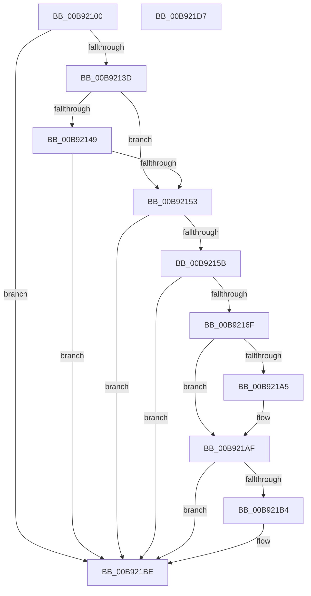

# ViPtLogPoolTraceWrapper

- RVA: `0x00B92100`–`0x00B921D8` (길이 `216` bytes)
- VA: `0x0000000140B92100`
- 실행 섹션: `PAGEVRFY`
- PDB 이름 있음: `예`; PDB Function 태그: `아니요`
- unwind 정보 RVA: `0x000BF9B4`
- 디코드: `49`개 명령, `216/216` bytes 표시
- 미해석 바이트: `0` (있으면 어셈블리에 `.byte`로 보존)

> 이 문서는 커널 이미지의 기계어와 PDB 기호를 분석해 생성했습니다. 4번과 5번은 함수 원형과 자료형을 바이너리 사용 방식에서 추정한 C 해석이며 원본 소스 복구 결과는 아닙니다.

## 1. Dependencies

- 직접 호출 지점: **4**; 고유 호출 대상: **4**
- 직접 호출자로 확인된 함수: **7**
- RIP 상대 이미지 참조: **2**

### Outgoing calls
- `0x00B9212F` → [memset](../../text/6C/memset_function_006C6C40.md) (function, `0x006C6C40`)
- `0x00B92160` → [ViPtCaptureStackTrace](../BB/ViPtCaptureStackTrace_function_00BB7314.md) (function, `0x00BB7314`)
- `0x00B921AA` → [ViPtProcessApt](ViPtProcessApt_function_00B9CAB8.md) (function, `0x00B9CAB8`)
- `0x00B921B9` → [ViPtLogPoolTrace](../BB/ViPtLogPoolTrace_function_00BB7464.md) (function, `0x00BB7464`)

### Direct callers
- [VfPtMiscPoolNotification](../../text/3F/VfPtMiscPoolNotification_function_003FF310.md) at `0x003FF356`
- [VerifierExAllocatePool](../BA/VerifierExAllocatePool_function_00BA1060.md) at `0x00BA10C6`
- [VerifierExAllocatePool2](../BA/VerifierExAllocatePool2_function_00BA1180.md) at `0x00BA1215`
- [VerifierExAllocatePoolWithTag](../BA/VerifierExAllocatePoolWithTag_function_00BA15B0.md) at `0x00BA161C`
- [VerifierExAllocatePoolWithTagPriority](../BA/VerifierExAllocatePoolWithTagPriority_function_00BA16D0.md) at `0x00BA1744`
- [VfHandlePoolAlloc](../BB/VfHandlePoolAlloc_function_00BB8A90.md) at `0x00BB8EB3`
- [VfPtFreePoolNotification](../BB/VfPtFreePoolNotification_function_00BB96DC.md) at `0x00BB9772`

### Static image references
- `0x00B9213D` → RVA `0x00F04980` (`.data`; read)
- `0x00B92149` → RVA `0x00FFDAC8` (`PAGEVRFD`; read)

## 2. Other-region calls and transfers

- 다른 실행 섹션으로 향하는 call: **1**
  - `0x00B9212F` → [memset](../../text/6C/memset_function_006C6C40.md) (`PAGEVRFY` → `.text`)
- 별도 외부 분기/꼬리 이동을 확인하지 못했습니다.

## 3. Assembly (complete function range)

```asm
00B92100  48 89 5C 24 08                  mov qword ptr [rsp + 8], rbx
00B92105  48 89 6C 24 10                  mov qword ptr [rsp + 0x10], rbp
00B9210A  48 89 74 24 18                  mov qword ptr [rsp + 0x18], rsi
00B9210F  57                              push rdi
00B92110  48 81 EC E0 01 00 00            sub rsp, 0x1e0
00B92117  49 8B E8                        mov rbp, r8
00B9211A  8B FA                           mov edi, edx
00B9211C  48 8B F1                        mov rsi, rcx
00B9211F  33 D2                           xor edx, edx
00B92121  41 B8 B8 01 00 00               mov r8d, 0x1b8
00B92127  48 8D 4C 24 20                  lea rcx, [rsp + 0x20]
00B9212C  41 8B D9                        mov ebx, r9d
00B9212F  E8 0C 4B B3 FF                  call 0x1406c6c40
00B92134  48 85 F6                        test rsi, rsi
00B92137  0F 84 81 00 00 00               je 0x140b921be
00B9213D  F7 05 39 28 37 00 00 10 00 00   test dword ptr [rip + 0x372839], 0x1000
00B92147  75 0A                           jne 0x140b92153
00B92149  48 83 3D 77 B9 46 00 00         cmp qword ptr [rip + 0x46b977], 0
00B92151  74 6B                           je 0x140b921be
00B92153  81 FF 56 69 49 6E               cmp edi, 0x6e496956
00B92159  74 63                           je 0x140b921be
00B9215B  48 8D 4C 24 20                  lea rcx, [rsp + 0x20]
00B92160  E8 AF 51 02 00                  call 0x140bb7314
00B92165  83 BC 24 CC 01 00 00 00         cmp dword ptr [rsp + 0x1cc], 0
00B9216D  74 4F                           je 0x140b921be
00B9216F  8A C3                           mov al, bl
00B92171  89 BC 24 D0 01 00 00            mov dword ptr [rsp + 0x1d0], edi
00B92178  24 01                           and al, 1
00B9217A  48 89 74 24 20                  mov qword ptr [rsp + 0x20], rsi
00B9217F  88 84 24 D4 01 00 00            mov byte ptr [rsp + 0x1d4], al
00B92186  48 89 6C 24 28                  mov qword ptr [rsp + 0x28], rbp
00B9218B  65 48 8B 04 25 88 01 00 00      mov rax, qword ptr gs:[0x188]
00B92194  F7 05 E2 27 37 00 00 10 00 00   test dword ptr [rip + 0x3727e2], 0x1000
00B9219E  48 89 44 24 30                  mov qword ptr [rsp + 0x30], rax
00B921A3  74 0A                           je 0x140b921af
00B921A5  48 8D 4C 24 20                  lea rcx, [rsp + 0x20]
00B921AA  E8 09 A9 00 00                  call 0x140b9cab8
00B921AF  F6 C3 02                        test bl, 2
00B921B2  75 0A                           jne 0x140b921be
00B921B4  48 8D 4C 24 20                  lea rcx, [rsp + 0x20]
00B921B9  E8 A6 52 02 00                  call 0x140bb7464
00B921BE  4C 8D 9C 24 E0 01 00 00         lea r11, [rsp + 0x1e0]
00B921C6  49 8B 5B 10                     mov rbx, qword ptr [r11 + 0x10]
00B921CA  49 8B 6B 18                     mov rbp, qword ptr [r11 + 0x18]
00B921CE  49 8B 73 20                     mov rsi, qword ptr [r11 + 0x20]
00B921D2  49 8B E3                        mov rsp, r11
00B921D5  5F                              pop rdi
00B921D6  C3                              ret
00B921D7  CC                              int3
```

## 4. C-style interpretation (structured pseudocode)

```c
__int64 __fastcall ViPtLogPoolTraceWrapper(__int64 a1, int a2, __int64 a3, int a4)
{
    __int64 result;
    __int64 v_rsp;
    unsigned __int8 v_stack_m14;
    unsigned int v_stack_m18;
    unsigned __int64 v_stack_m1B8;
    unsigned int v_stack_m1C;
    unsigned __int64 v_stack_m1C0;
    unsigned __int64 v_stack_m1C8;
    unsigned __int64 v_stack_m8;
    unsigned __int64 v_stack_p10;
    unsigned __int64 v_stack_p18;
    unsigned __int64 v_stack_p8;

    v_stack_p8 = v_rbx;
    v_stack_p10 = v_rbp;
    v_stack_p18 = v_rsi;
    v_rsp = (v_rsp) - (480);
    a2 = 0;
    result = memset(v_stack_m1C8, a2, 440, a4);
    if (a1 == 0) goto loc_00B921BE;
    if (((*(unsigned int *)(v_rip + 3614777)) & (0x1000ULL)) != 0) goto loc_00B92153;
    if ((*(unsigned __int64 *)(v_rip + 4634999)) == 0) goto loc_00B921BE;
loc_00B92153:
    if (((unsigned int)((unsigned int)(a2))) == 0x6E496956ULL) goto loc_00B921BE;
    result = ViPtCaptureStackTrace(v_stack_m1C8, a2, 440, a4);
    if (v_stack_m1C == 0) goto loc_00B921BE;
    v_stack_m18 = (unsigned int)((unsigned int)(a2));
    result = (unsigned __int8)(((unsigned __int8)((unsigned int)(a4))) & (1));
    v_stack_m1C8 = a1;
    v_stack_m14 = (unsigned __int8)(result);
    v_stack_m1C0 = a3;
    v_stack_m1B8 = *(unsigned __int64 *)(gs_base + (0 + 392));
    result = *(unsigned __int64 *)(gs_base + (0 + 392));
    if (((*(unsigned int *)(v_rip + 3614690)) & (0x1000ULL)) != 0) {
        a1 = v_stack_m1C8;
        result = ViPtProcessApt(a1, a2, 440, a4);
    }
    if ((((unsigned __int8)((unsigned int)(a4))) & (2)) == 0) {
        a1 = v_stack_m1C8;
        result = ViPtLogPoolTrace(a1, a2, 440, a4);
    }
    return result;
}
```

## 5. (Beta) C Style

```c
int64_t ViPtLogPoolTraceWrapper(int64_t Arg1, int32_t Arg2, int64_t Arg3, int32_t Arg4)
{
    int64_t result;
    int64_t local_rsp;
    uint8_t v_stack_m14;
    uint32_t v_stack_m18;
    uint64_t v_stack_m1B8;
    uint32_t v_stack_m1C;
    uint64_t v_stack_m1C0;
    uint64_t v_stack_m1C8;
    uint64_t v_stack_m8;
    uint64_t v_stack_p10;
    uint64_t v_stack_p18;
    uint64_t v_stack_p8;

    v_stack_p8 = local_rbx;
    v_stack_p10 = local_rbp;
    v_stack_p18 = local_rsi;
    local_rsp = (local_rsp) - (480);
    Arg2 = 0;
    result = memset(v_stack_m1C8, Arg2, 440, Arg4);
    if (Arg1 == 0) goto loc_00B921BE;
    if (((*(uint32_t *)(v_rip + 0x372839)) & (0x1000ULL)) != 0) goto loc_00B92153;
    if ((*(uint64_t *)(v_rip + 0x46B977)) == 0) goto loc_00B921BE;
loc_00B92153:
    if (((uint32_t)((uint32_t)(Arg2))) == 0x6E496956ULL) goto loc_00B921BE;
    result = ViPtCaptureStackTrace(v_stack_m1C8, Arg2, 440, Arg4);
    if (v_stack_m1C == 0) goto loc_00B921BE;
    v_stack_m18 = (uint32_t)((uint32_t)(Arg2));
    result = (uint8_t)(((uint8_t)((uint32_t)(Arg4))) & (1));
    v_stack_m1C8 = Arg1;
    v_stack_m14 = (uint8_t)(result);
    v_stack_m1C0 = Arg3;
    v_stack_m1B8 = *(uint64_t *)(gs_base + (0 + 0x188));
    result = *(uint64_t *)(gs_base + (0 + 0x188));
    if (((*(uint32_t *)(v_rip + 0x3727E2)) & (0x1000ULL)) != 0) {
        Arg1 = v_stack_m1C8;
        result = ViPtProcessApt(Arg1, Arg2, 440, Arg4);
    }
    if ((((uint8_t)((uint32_t)(Arg4))) & (2)) == 0) {
        Arg1 = v_stack_m1C8;
        result = ViPtLogPoolTrace(Arg1, Arg2, 440, Arg4);
    }
    return result;
}
```

## 6. Execution-region graph

[열기: 2D/3D 그래프와 함수 탐색 컨트롤 패널](../../../control-panel.html?section=pagevrfy&rva=0x00B92100&view=graph)

- 2D 그래프는 위에서 아래로 흐르고, 3D 그래프는 빈 공간을 드래그해 회전합니다. Shift+드래그는 이동, 휠은 확대·축소, 함수 노드 선택은 대상 보고서 이동입니다.

### Static fallback


