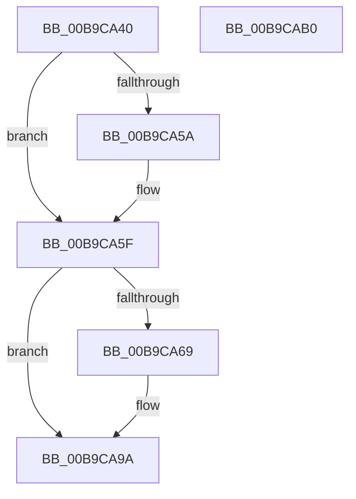

# ViPtPluginUnload

- RVA: `0x00B9CA40`–`0x00B9CAB1` (길이 `113` bytes)
- VA: `0x0000000140B9CA40`
- 실행 섹션: `PAGEVRFY`
- PDB 이름 있음: `예`; PDB Function 태그: `아니요`
- unwind 정보 RVA: `0x0005C788`
- 디코드: `21`개 명령, `113/113` bytes 표시
- 미해석 바이트: `0` (있으면 어셈블리에 `.byte`로 보존)

> 이 문서는 커널 이미지의 기계어와 PDB 기호를 분석해 생성했습니다. 4번과 5번은 함수 원형과 자료형을 바이너리 사용 방식에서 추정한 C 해석이며 원본 소스 복구 결과는 아닙니다.

## 1. Dependencies

- 직접 호출 지점: **4**; 고유 호출 대상: **4**
- 직접 호출자로 확인된 함수: **1**
- RIP 상대 이미지 참조: **7**

### Outgoing calls
- `0x00B9CA49` → [ExClearPoolFlags](../../text/65/ExClearPoolFlags_function_00655E60.md) (function, `0x00655E60`)
- `0x00B9CA5A` → [ViPtDeleteAvlTrees](ViPtDeleteAvlTrees_function_00B9C730.md) (function, `0x00B9C730`)
- `0x00B9CA70` → [ExWaitForRundownProtectionRelease](../../text/2A/ExWaitForRundownProtectionRelease_function_002A4CB0.md) (function, `0x002A4CB0`)
- `0x00B9CA81` → [ExFreePoolWithTag](../../poolcode/B8/ExFreePoolWithTag_function_00B82870.md) (function, `0x00B82870`)

### Direct callers
- [VfPoolTrackingEntry](../../text/61/VfPoolTrackingEntry_function_00613380.md) at `0x0061385A`

### Static image references
- `0x00B9CA4E` → RVA `0x00F04980` (`.data`; read)
- `0x00B9CA5F` → RVA `0x00FFDAC8` (`PAGEVRFD`; read)
- `0x00B9CA69` → RVA `0x00F04218` (`.data`; read)
- `0x00B9CA86` → RVA `0x00FFDAC8` (`PAGEVRFD`; read/write)
- `0x00B9CA93` → RVA `0x00F04218` (`.data`; read/write)
- `0x00B9CA9A` → RVA `0x00FFDA0C` (`PAGEVRFD`; read/write)
- `0x00B9CAA1` → RVA `0x00FFDBA0` (`PAGEVRFD`; write)

## 2. Other-region calls and transfers

- 다른 실행 섹션으로 향하는 call: **3**
  - `0x00B9CA49` → [ExClearPoolFlags](../../text/65/ExClearPoolFlags_function_00655E60.md) (`PAGEVRFY` → `.text`)
  - `0x00B9CA70` → [ExWaitForRundownProtectionRelease](../../text/2A/ExWaitForRundownProtectionRelease_function_002A4CB0.md) (`PAGEVRFY` → `.text`)
  - `0x00B9CA81` → [ExFreePoolWithTag](../../poolcode/B8/ExFreePoolWithTag_function_00B82870.md) (`PAGEVRFY` → `POOLCODE`)
- 별도 외부 분기/꼬리 이동을 확인하지 못했습니다.

## 3. Assembly (complete function range)

```asm
00B9CA40  48 83 EC 28                     sub rsp, 0x28
00B9CA44  B9 10 00 00 00                  mov ecx, 0x10
00B9CA49  E8 12 94 AB FF                  call 0x140655e60
00B9CA4E  F7 05 28 7F 36 00 00 10 00 00   test dword ptr [rip + 0x367f28], 0x1000
00B9CA58  74 05                           je 0x140b9ca5f
00B9CA5A  E8 D1 FC FF FF                  call 0x140b9c730
00B9CA5F  48 83 3D 61 10 46 00 00         cmp qword ptr [rip + 0x461061], 0
00B9CA67  74 31                           je 0x140b9ca9a
00B9CA69  48 8D 0D A8 77 36 00            lea rcx, [rip + 0x3677a8]
00B9CA70  E8 3B 82 70 FF                  call 0x1402a4cb0
00B9CA75  48 8B 0D 4C 10 46 00            mov rcx, qword ptr [rip + 0x46104c]
00B9CA7C  BA 56 69 49 6E                  mov edx, 0x6e496956
00B9CA81  E8 EA 5D FE FF                  call 0x140b82870
00B9CA86  48 83 25 3A 10 46 00 00         and qword ptr [rip + 0x46103a], 0
00B9CA8E  B8 01 00 00 00                  mov eax, 1
00B9CA93  48 87 05 7E 77 36 00            xchg qword ptr [rip + 0x36777e], rax
00B9CA9A  83 25 6B 0F 46 00 00            and dword ptr [rip + 0x460f6b], 0
00B9CAA1  C7 05 F5 10 46 00 00 00 00 00   mov dword ptr [rip + 0x4610f5], 0
00B9CAAB  48 83 C4 28                     add rsp, 0x28
00B9CAAF  C3                              ret
00B9CAB0  CC                              int3
```

## 4. C-style interpretation (structured pseudocode)

```c
__int64 __fastcall ViPtPluginUnload(void)
{
    __int64 result;
    __int64 v_rsp;

    v_rsp = (v_rsp) - (40);
    result = ExClearPoolFlags(16, a2, a3, a4);
    if (((*(unsigned int *)(v_rip + 3571496)) & (0x1000ULL)) != 0) {
        result = ViPtDeleteAvlTrees(16, a2, a3, a4);
    }
    if ((*(unsigned __int64 *)(v_rip + 4591713)) != 0) {
        a1 = v_rip + 3569576;
        result = ExWaitForRundownProtectionRelease(a1, a2, a3, a4);
        a1 = *(unsigned __int64 *)(v_rip + 4591692);
        a2 = 0x6E496956ULL;
        result = ExFreePoolWithTag(a1, a2, a3, a4);
        result = 1;
    }
    *(unsigned int *)(v_rip + 4591861) = 0;
    v_rsp = (v_rsp) + (40);
    return result;
}
```

## 5. (Beta) C Style

```c
void ViPtPluginUnload(void)
{
    int64_t result;
    int64_t local_rsp;

    local_rsp = (local_rsp) - (40);
    result = ExClearPoolFlags(16, a2, a3, a4);
    if (((*(uint32_t *)(v_rip + 0x367F28)) & (0x1000ULL)) != 0) {
        result = ViPtDeleteAvlTrees(16, a2, a3, a4);
    }
    if ((*(uint64_t *)(v_rip + 0x461061)) != 0) {
        a1 = v_rip + 3569576;
        result = ExWaitForRundownProtectionRelease(a1, a2, a3, a4);
        a1 = *(uint64_t *)(v_rip + 0x46104C);
        a2 = 0x6E496956ULL;
        result = ExFreePoolWithTag(a1, a2, a3, a4);
        result = 1;
    }
    *(uint32_t *)(v_rip + 0x4610F5) = 0;
    local_rsp = (local_rsp) + (40);
    return result;
}
```

## 6. Execution-region graph

[열기: 2D/3D 그래프와 함수 탐색 컨트롤 패널](../../../control-panel.html?section=pagevrfy&rva=0x00B9CA40&view=graph)

- 2D 그래프는 위에서 아래로 흐르고, 3D 그래프는 빈 공간을 드래그해 회전합니다. Shift+드래그는 이동, 휠은 확대·축소, 함수 노드 선택은 대상 보고서 이동입니다.

### Static fallback


