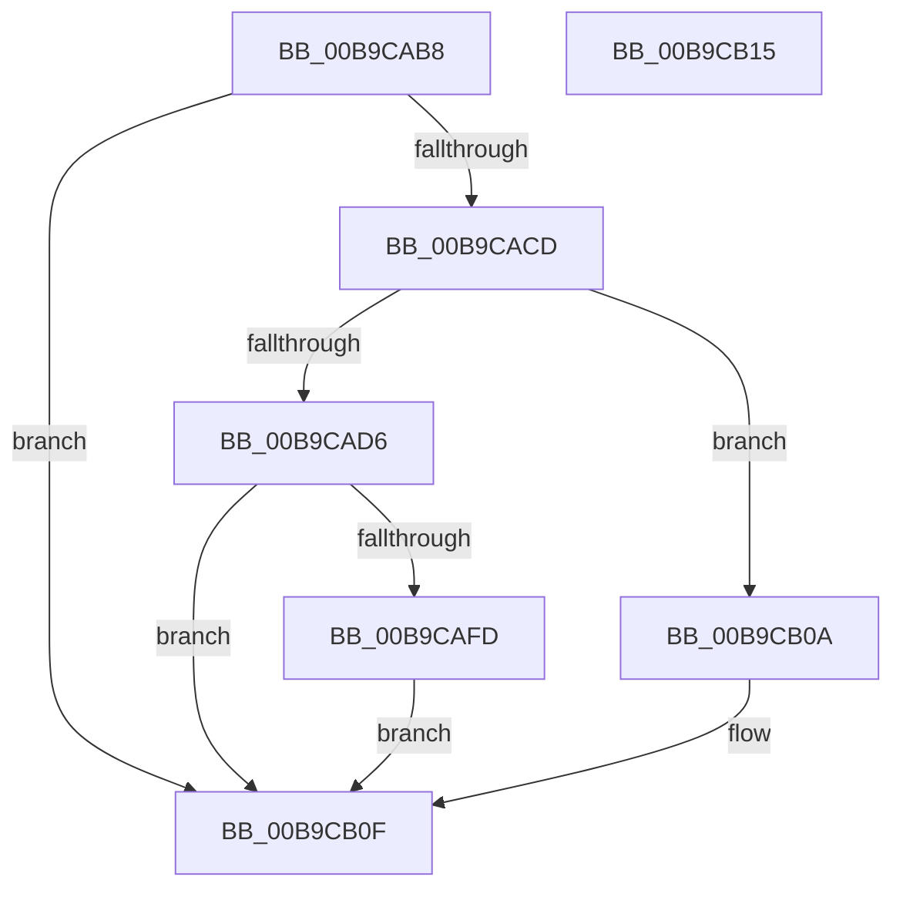

# ViPtProcessApt

- RVA: `0x00B9CAB8`–`0x00B9CB16` (길이 `94` bytes)
- VA: `0x0000000140B9CAB8`
- 실행 섹션: `PAGEVRFY`
- PDB 이름 있음: `예`; PDB Function 태그: `아니요`
- unwind 정보 RVA: `0x00064C80`
- 디코드: `25`개 명령, `94/94` bytes 표시
- 미해석 바이트: `0` (있으면 어셈블리에 `.byte`로 보존)

> 이 문서는 커널 이미지의 기계어와 PDB 기호를 분석해 생성했습니다. 4번과 5번은 함수 원형과 자료형을 바이너리 사용 방식에서 추정한 C 해석이며 원본 소스 복구 결과는 아닙니다.

## 1. Dependencies

- 직접 호출 지점: **3**; 고유 호출 대상: **3**
- 직접 호출자로 확인된 함수: **1**
- RIP 상대 이미지 참조: **1**

### Outgoing calls
- `0x00B9CAF3` → [VfPtAddStackInfoIfNotExist](VfPtAddStackInfoIfNotExist_function_00B9BD74.md) (function, `0x00B9BD74`)
- `0x00B9CB03` → [VfPtProcessAllocPoolInfo](VfPtProcessAllocPoolInfo_function_00B9C54C.md) (function, `0x00B9C54C`)
- `0x00B9CB0A` → [VfPtProcessFreePoolInfo](VfPtProcessFreePoolInfo_function_00B9C604.md) (function, `0x00B9C604`)

### Direct callers
- [ViPtLogPoolTraceWrapper](ViPtLogPoolTraceWrapper_function_00B92100.md) at `0x00B921AA`

### Static image references
- `0x00B9CABE` → RVA `0x00F04980` (`.data`; read)

## 2. Other-region calls and transfers

- 다른 실행 섹션으로 향하는 call: **0**
- 별도 외부 분기/꼬리 이동을 확인하지 못했습니다.

## 3. Assembly (complete function range)

```asm
00B9CAB8  40 53                           push rbx
00B9CABA  48 83 EC 30                     sub rsp, 0x30
00B9CABE  F7 05 B8 7E 36 00 00 10 00 00   test dword ptr [rip + 0x367eb8], 0x1000
00B9CAC8  48 8B D9                        mov rbx, rcx
00B9CACB  74 42                           je 0x140b9cb0f
00B9CACD  80 B9 B4 01 00 00 00            cmp byte ptr [rcx + 0x1b4], 0
00B9CAD4  75 34                           jne 0x140b9cb0a
00B9CAD6  48 8B 43 08                     mov rax, qword ptr [rbx + 8]
00B9CADA  48 83 C1 18                     add rcx, 0x18
00B9CADE  44 8B 8B B0 01 00 00            mov r9d, dword ptr [rbx + 0x1b0]
00B9CAE5  4C 8B 03                        mov r8, qword ptr [rbx]
00B9CAE8  8B 93 A8 01 00 00               mov edx, dword ptr [rbx + 0x1a8]
00B9CAEE  48 89 44 24 20                  mov qword ptr [rsp + 0x20], rax
00B9CAF3  E8 7C F2 FF FF                  call 0x140b9bd74
00B9CAF8  48 85 C0                        test rax, rax
00B9CAFB  74 12                           je 0x140b9cb0f
00B9CAFD  48 8B D0                        mov rdx, rax
00B9CB00  48 8B CB                        mov rcx, rbx
00B9CB03  E8 44 FA FF FF                  call 0x140b9c54c
00B9CB08  EB 05                           jmp 0x140b9cb0f
00B9CB0A  E8 F5 FA FF FF                  call 0x140b9c604
00B9CB0F  48 83 C4 30                     add rsp, 0x30
00B9CB13  5B                              pop rbx
00B9CB14  C3                              ret
00B9CB15  CC                              int3
```

## 4. C-style interpretation (structured pseudocode)

```c
__int64 __fastcall ViPtProcessApt(__int64 a1)
{
    __int64 result;
    __int64 v_rsp;
    unsigned __int64 v_stack_m18;

    v_rsp = (v_rsp) - (48);
    if (((*(unsigned int *)(v_rip + 3571384)) & (0x1000ULL)) == 0) goto loc_00B9CB0F;
    if ((*(unsigned __int8 *)(a1 + 436)) != 0) goto loc_00B9CB0A;
    a1 = (a1) + (24);
    v_stack_m18 = *(unsigned __int64 *)(a1 + 8);
    result = VfPtAddStackInfoIfNotExist(a1, (unsigned int)(*(unsigned int *)(a1 + 424)), *(unsigned __int64 *)(a1), (unsigned int)(*(unsigned int *)(a1 + 432)));
    if (result == 0) goto loc_00B9CB0F;
    result = VfPtProcessAllocPoolInfo(a1, result, *(unsigned __int64 *)(a1), (unsigned int)(*(unsigned int *)(a1 + 432)));
    goto loc_00B9CB0F;
loc_00B9CB0A:
    result = VfPtProcessFreePoolInfo(a1, result, *(unsigned __int64 *)(a1), (unsigned int)(*(unsigned int *)(a1 + 432)));
loc_00B9CB0F:
    v_rsp = (v_rsp) + (48);
    return result;
}
```

## 5. (Beta) C Style

```c
int64_t ViPtProcessApt(void *Arg1)
{
    uint8_t *arg1 = (uint8_t *)Arg1;

    int64_t result;
    int64_t local_rsp;
    uint64_t v_stack_m18;

    local_rsp = (local_rsp) - (48);
    if (((*(uint32_t *)(v_rip + 0x367EB8)) & (0x1000ULL)) == 0) goto loc_00B9CB0F;
    if ((*(uint8_t *)(arg1 + 0x1B4)) != 0) goto loc_00B9CB0A;
    Arg1 = (Arg1) + (24);
    v_stack_m18 = *(uint64_t *)(arg1 + 0x8);
    result = VfPtAddStackInfoIfNotExist(Arg1, (uint32_t)(*(uint32_t *)(arg1 + 0x1A8)), *(uint64_t *)(arg1), (uint32_t)(*(uint32_t *)(arg1 + 0x1B0)));
    if (result == 0) goto loc_00B9CB0F;
    result = VfPtProcessAllocPoolInfo(Arg1, result, *(uint64_t *)(arg1), (uint32_t)(*(uint32_t *)(arg1 + 0x1B0)));
    goto loc_00B9CB0F;
loc_00B9CB0A:
    result = VfPtProcessFreePoolInfo(Arg1, result, *(uint64_t *)(arg1), (uint32_t)(*(uint32_t *)(arg1 + 0x1B0)));
loc_00B9CB0F:
    local_rsp = (local_rsp) + (48);
    return result;
}
```

### 관측된 메모리 오프셋

구조체 형식이 확인되지 않은 접근은 인자 기준의 오프셋으로만 기록했습니다.

| 기준 인자 | 오프셋 표현 | 폭 (bit) | 접근 |
|---|---:|---:|---|
| `Arg1` | `+ 0x0` | `64` | `R` |
| `Arg1` | `+ 0x8` | `64` | `R` |
| `Arg1` | `+ 0x1A8` | `32` | `R` |
| `Arg1` | `+ 0x1B0` | `32` | `R` |
| `Arg1` | `+ 0x1B4` | `8` | `R` |

## 6. Execution-region graph

[열기: 2D/3D 그래프와 함수 탐색 컨트롤 패널](../../../control-panel.html?section=pagevrfy&rva=0x00B9CAB8&view=graph)

- 2D 그래프는 위에서 아래로 흐르고, 3D 그래프는 빈 공간을 드래그해 회전합니다. Shift+드래그는 이동, 휠은 확대·축소, 함수 노드 선택은 대상 보고서 이동입니다.

### Static fallback


