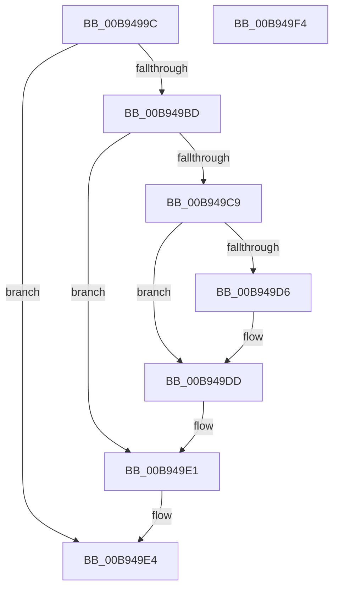

# ViQueryObjectContext

- RVA: `0x00B9499C`–`0x00B949F5` (길이 `89` bytes)
- VA: `0x0000000140B9499C`
- 실행 섹션: `PAGEVRFY`
- PDB 이름 있음: `예`; PDB Function 태그: `아니요`
- unwind 정보 RVA: `0x00060BC4`
- 디코드: `28`개 명령, `89/89` bytes 표시
- 미해석 바이트: `0` (있으면 어셈블리에 `.byte`로 보존)

> 이 문서는 커널 이미지의 기계어와 PDB 기호를 분석해 생성했습니다. 4번과 5번은 함수 원형과 자료형을 바이너리 사용 방식에서 추정한 C 해석이며 원본 소스 복구 결과는 아닙니다.

## 1. Dependencies

- 직접 호출 지점: **2**; 고유 호출 대상: **2**
- 직접 호출자로 확인된 함수: **3**
- RIP 상대 이미지 참조: **0**

### Outgoing calls
- `0x00B949B0` → [ViGetContextPointer](ViGetContextPointer_function_00B948E8.md) (function, `0x00B948E8`)
- `0x00B949C0` → [ViLockContextPointer](ViLockContextPointer_function_00B94954.md) (function, `0x00B94954`)

### Direct callers
- [VfQueryDeviceContext](../../text/61/VfQueryDeviceContext_function_006128D0.md) at `0x006128F3`
- [VfQueryDriverContext](../../text/61/VfQueryDriverContext_function_00612910.md) at `0x0061293B`
- [VfQueryIrpContext](../../text/61/VfQueryIrpContext_function_00612950.md) at `0x0061297B`

### Static image references
- 디코드된 RIP-relative 메모리 참조가 없습니다.

## 2. Other-region calls and transfers

- 다른 실행 섹션으로 향하는 call: **0**
- 별도 외부 분기/꼬리 이동을 확인하지 못했습니다.

## 3. Assembly (complete function range)

```asm
00B9499C  48 89 5C 24 08                  mov qword ptr [rsp + 8], rbx
00B949A1  48 89 74 24 10                  mov qword ptr [rsp + 0x10], rsi
00B949A6  57                              push rdi
00B949A7  48 83 EC 20                     sub rsp, 0x20
00B949AB  41 8B F0                        mov esi, r8d
00B949AE  33 DB                           xor ebx, ebx
00B949B0  E8 33 FF FF FF                  call 0x140b948e8
00B949B5  48 8B F8                        mov rdi, rax
00B949B8  48 85 C0                        test rax, rax
00B949BB  74 27                           je 0x140b949e4
00B949BD  48 8B CF                        mov rcx, rdi
00B949C0  E8 8F FF FF FF                  call 0x140b94954
00B949C5  84 C0                           test al, al
00B949C7  74 18                           je 0x140b949e1
00B949C9  48 8B 07                        mov rax, qword ptr [rdi]
00B949CC  48 8B 54 F0 08                  mov rdx, qword ptr [rax + rsi*8 + 8]
00B949D1  48 85 D2                        test rdx, rdx
00B949D4  74 07                           je 0x140b949dd
00B949D6  48 8B DA                        mov rbx, rdx
00B949D9  F0 FF 42 04                     lock inc dword ptr [rdx + 4]
00B949DD  F0 48 FF 07                     lock inc qword ptr [rdi]
00B949E1  48 8B C3                        mov rax, rbx
00B949E4  48 8B 5C 24 30                  mov rbx, qword ptr [rsp + 0x30]
00B949E9  48 8B 74 24 38                  mov rsi, qword ptr [rsp + 0x38]
00B949EE  48 83 C4 20                     add rsp, 0x20
00B949F2  5F                              pop rdi
00B949F3  C3                              ret
00B949F4  CC                              int3
```

## 4. C-style interpretation (structured pseudocode)

```c
__int64 __fastcall ViQueryObjectContext(__int64 a1, __int64 a2, int a3)
{
    __int64 result;
    __int64 v_rbx;
    __int64 v_rsp;
    unsigned __int64 v_stack_p10;
    unsigned __int64 v_stack_p8;

    v_stack_p8 = v_rbx;
    v_stack_p10 = v_rsi;
    v_rsp = (v_rsp) - (32);
    v_rbx = 0;
    result = ViGetContextPointer(a1, a2, a3, a4);
    if (result == 0) goto loc_00B949E4;
    result = ViLockContextPointer(result, a2, a3, a4);
    if ((unsigned __int8)(result) == 0) goto loc_00B949E1;
    if (*(unsigned __int64 *)(*(unsigned __int64 *)(result) + (unsigned int)(a3) * 8 + 8) != 0) {
        v_rbx = *(unsigned __int64 *)(*(unsigned __int64 *)(result) + (unsigned int)(a3) * 8 + 8);
    }
loc_00B949E1:
loc_00B949E4:
    v_rsp = (v_rsp) + (32);
    return v_rbx;
}
```

## 5. (Beta) C Style

```c
int64_t ViQueryObjectContext(int64_t Arg1, int64_t Arg2, int32_t Arg3)
{
    int64_t result;
    int64_t local_rbx;
    int64_t local_rsp;
    uint64_t v_stack_p10;
    uint64_t v_stack_p8;

    v_stack_p8 = local_rbx;
    v_stack_p10 = local_rsi;
    local_rsp = (local_rsp) - (32);
    local_rbx = 0;
    result = ViGetContextPointer(Arg1, Arg2, Arg3, a4);
    if (result == 0) goto loc_00B949E4;
    result = ViLockContextPointer(result, Arg2, Arg3, a4);
    if ((uint8_t)(result) == 0) goto loc_00B949E1;
    if (*(uint64_t *)(*(uint64_t *)(result) + (uint32_t)(Arg3) * 8 + 0x8) != 0) {
        local_rbx = *(uint64_t *)(*(uint64_t *)(result) + (uint32_t)(Arg3) * 8 + 0x8);
    }
loc_00B949E1:
loc_00B949E4:
    local_rsp = (local_rsp) + (32);
    return local_rbx;
}
```

## 6. Execution-region graph

[열기: 2D/3D 그래프와 함수 탐색 컨트롤 패널](../../../control-panel.html?section=pagevrfy&rva=0x00B9499C&view=graph)

- 2D 그래프는 위에서 아래로 흐르고, 3D 그래프는 빈 공간을 드래그해 회전합니다. Shift+드래그는 이동, 휠은 확대·축소, 함수 노드 선택은 대상 보고서 이동입니다.

### Static fallback


