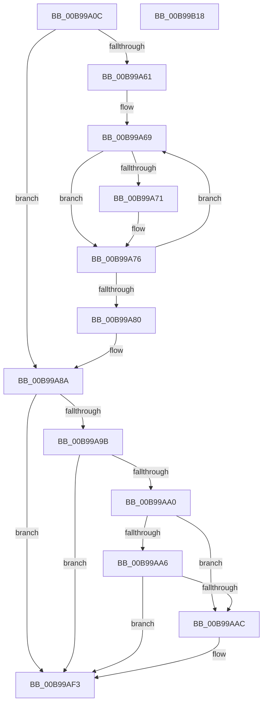

# ViReleaseDmaAdapter

- RVA: `0x00B99A0C`–`0x00B99B19` (길이 `269` bytes)
- VA: `0x0000000140B99A0C`
- 실행 섹션: `PAGEVRFY`
- PDB 이름 있음: `예`; PDB Function 태그: `아니요`
- unwind 정보 RVA: `0x0005D7BC`
- 디코드: `71`개 명령, `269/269` bytes 표시
- 미해석 바이트: `0` (있으면 어셈블리에 `.byte`로 보존)

> 이 문서는 커널 이미지의 기계어와 PDB 기호를 분석해 생성했습니다. 4번과 5번은 함수 원형과 자료형을 바이너리 사용 방식에서 추정한 C 해석이며 원본 소스 복구 결과는 아닙니다.

## 1. Dependencies

- 직접 호출 지점: **9**; 고유 호출 대상: **8**
- 직접 호출자로 확인된 함수: **3**
- RIP 상대 이미지 참조: **2**

### Outgoing calls
- `0x00B99A2C` → [ViGetRealDmaAdapter](ViGetRealDmaAdapter_function_00B990DC.md) (function, `0x00B990DC`)
- `0x00B99A3E` → [KeAcquireSpinLockRaiseToDpc](../../text/20/KeAcquireSpinLockRaiseToDpc_function_00208470.md) (function, `0x00208470`)
- `0x00B99A57` → [KeReleaseSpinLock](../../text/39/KeReleaseSpinLock_function_00392BA0.md) (function, `0x00392BA0`)
- `0x00B99A71` → [MmFreeContiguousMemory](../../text/3F/MmFreeContiguousMemory_function_003F6F60.md) (function, `0x003F6F60`)
- `0x00B99A85` → [ExFreePoolWithTag](../../poolcode/B8/ExFreePoolWithTag_function_00B82870.md) (function, `0x00B82870`)
- `0x00B99A8D` → [ObfDereferenceObject](../../text/2F/ObfDereferenceObject_function_002F9350.md) (function, `0x002F9350`)
- `0x00B99AD2` → [ViHalPreprocessOptions](ViHalPreprocessOptions_function_00B9920C.md) (function, `0x00B9920C`)
- `0x00B99AEE` → [VfReportIssueWithOptions](../../text/61/VfReportIssueWithOptions_function_00614444.md) (function, `0x00614444`)
- `0x00B99AF8` → [ExFreePoolWithTag](../../poolcode/B8/ExFreePoolWithTag_function_00B82870.md) (function, `0x00B82870`)

### Direct callers
- [VfGetDmaAdapter](VfGetDmaAdapter_function_00B96930.md) at `0x00B96999`
- [VfHalDeleteDevice](VfHalDeleteDevice_function_00B97190.md) at `0x00B97213`
- [VfPutDmaAdapter](VfPutDmaAdapter_function_00B97680.md) at `0x00B97914`
- [VfPutDmaAdapter](VfPutDmaAdapter_function_00B97680.md) at `0x00B97945`

### Static image references
- `0x00B99AB6` → RVA `0x00E0E9C4` (`.data`; read)
- `0x00B99AC5` → RVA `0x00BB9AD0` (` ?? ::JKADOLAD::`string'`; read)

## 2. Other-region calls and transfers

- 다른 실행 섹션으로 향하는 call: **7**
  - `0x00B99A3E` → [KeAcquireSpinLockRaiseToDpc](../../text/20/KeAcquireSpinLockRaiseToDpc_function_00208470.md) (`PAGEVRFY` → `.text`)
  - `0x00B99A57` → [KeReleaseSpinLock](../../text/39/KeReleaseSpinLock_function_00392BA0.md) (`PAGEVRFY` → `.text`)
  - `0x00B99A71` → [MmFreeContiguousMemory](../../text/3F/MmFreeContiguousMemory_function_003F6F60.md) (`PAGEVRFY` → `.text`)
  - `0x00B99A85` → [ExFreePoolWithTag](../../poolcode/B8/ExFreePoolWithTag_function_00B82870.md) (`PAGEVRFY` → `POOLCODE`)
  - `0x00B99A8D` → [ObfDereferenceObject](../../text/2F/ObfDereferenceObject_function_002F9350.md) (`PAGEVRFY` → `.text`)
  - `0x00B99AEE` → [VfReportIssueWithOptions](../../text/61/VfReportIssueWithOptions_function_00614444.md) (`PAGEVRFY` → `.text`)
  - `0x00B99AF8` → [ExFreePoolWithTag](../../poolcode/B8/ExFreePoolWithTag_function_00B82870.md) (`PAGEVRFY` → `POOLCODE`)
- 별도 외부 분기/꼬리 이동을 확인하지 못했습니다.

## 3. Assembly (complete function range)

```asm
00B99A0C  48 8B C4                        mov rax, rsp
00B99A0F  48 89 58 08                     mov qword ptr [rax + 8], rbx
00B99A13  48 89 68 10                     mov qword ptr [rax + 0x10], rbp
00B99A17  48 89 70 18                     mov qword ptr [rax + 0x18], rsi
00B99A1B  48 89 78 20                     mov qword ptr [rax + 0x20], rdi
00B99A1F  41 56                           push r14
00B99A21  48 83 EC 30                     sub rsp, 0x30
00B99A25  48 8B F9                        mov rdi, rcx
00B99A28  48 83 C1 10                     add rcx, 0x10
00B99A2C  E8 AB F6 FF FF                  call 0x140b990dc
00B99A31  48 8D 9F 38 01 00 00            lea rbx, [rdi + 0x138]
00B99A38  4C 8B F0                        mov r14, rax
00B99A3B  48 8B CB                        mov rcx, rbx
00B99A3E  E8 2D EA 66 FF                  call 0x140208470
00B99A43  48 8B AF 28 01 00 00            mov rbp, qword ptr [rdi + 0x128]
00B99A4A  8A D0                           mov dl, al
00B99A4C  48 83 A7 28 01 00 00 00         and qword ptr [rdi + 0x128], 0
00B99A54  48 8B CB                        mov rcx, rbx
00B99A57  E8 44 91 7F FF                  call 0x140392ba0
00B99A5C  48 85 ED                        test rbp, rbp
00B99A5F  74 29                           je 0x140b99a8a
00B99A61  48 8B DD                        mov rbx, rbp
00B99A64  BE 20 00 00 00                  mov esi, 0x20
00B99A69  48 8B 0B                        mov rcx, qword ptr [rbx]
00B99A6C  48 85 C9                        test rcx, rcx
00B99A6F  74 05                           je 0x140b99a76
00B99A71  E8 EA D4 85 FF                  call 0x1403f6f60
00B99A76  48 83 C3 08                     add rbx, 8
00B99A7A  48 83 EE 01                     sub rsi, 1
00B99A7E  75 E9                           jne 0x140b99a69
00B99A80  33 D2                           xor edx, edx
00B99A82  48 8B CD                        mov rcx, rbp
00B99A85  E8 E6 8D FE FF                  call 0x140b82870
00B99A8A  49 8B CE                        mov rcx, r14
00B99A8D  E8 BE F8 75 FF                  call 0x1402f9350
00B99A92  83 7F 4C 00                     cmp dword ptr [rdi + 0x4c], 0
00B99A96  48 8B D8                        mov rbx, rax
00B99A99  7E 58                           jle 0x140b99af3
00B99A9B  48 85 C0                        test rax, rax
00B99A9E  74 53                           je 0x140b99af3
00B99AA0  48 83 F8 01                     cmp rax, 1
00B99AA4  75 06                           jne 0x140b99aac
00B99AA6  80 7F 4A 00                     cmp byte ptr [rdi + 0x4a], 0
00B99AAA  75 47                           jne 0x140b99af3
00B99AAC  BD 11 00 00 00                  mov ebp, 0x11
00B99AB1  48 89 7C 24 28                  mov qword ptr [rsp + 0x28], rdi
00B99AB6  48 8D 35 07 4F 27 00            lea rsi, [rip + 0x274f07]
00B99ABD  4C 89 74 24 20                  mov qword ptr [rsp + 0x20], r14
00B99AC2  44 8B C5                        mov r8d, ebp
00B99AC5  48 8D 15 04 00 02 00            lea rdx, [rip + 0x20004]
00B99ACC  48 8B CE                        mov rcx, rsi
00B99ACF  4C 8B CB                        mov r9, rbx
00B99AD2  E8 35 F7 FF FF                  call 0x140b9920c
00B99AD7  4D 8B CE                        mov r9, r14
00B99ADA  48 89 74 24 28                  mov qword ptr [rsp + 0x28], rsi
00B99ADF  4C 8B C3                        mov r8, rbx
00B99AE2  48 89 7C 24 20                  mov qword ptr [rsp + 0x20], rdi
00B99AE7  8B D5                           mov edx, ebp
00B99AE9  B9 E6 00 00 00                  mov ecx, 0xe6
00B99AEE  E8 51 A9 A7 FF                  call 0x140614444
00B99AF3  33 D2                           xor edx, edx
00B99AF5  48 8B CF                        mov rcx, rdi
00B99AF8  E8 73 8D FE FF                  call 0x140b82870
00B99AFD  48 8B 5C 24 40                  mov rbx, qword ptr [rsp + 0x40]
00B99B02  48 8B 6C 24 48                  mov rbp, qword ptr [rsp + 0x48]
00B99B07  48 8B 74 24 50                  mov rsi, qword ptr [rsp + 0x50]
00B99B0C  48 8B 7C 24 58                  mov rdi, qword ptr [rsp + 0x58]
00B99B11  48 83 C4 30                     add rsp, 0x30
00B99B15  41 5E                           pop r14
00B99B17  C3                              ret
00B99B18  CC                              int3
```

## 4. C-style interpretation (structured pseudocode)

```c
__int64 __fastcall ViReleaseDmaAdapter(__int64 a1)
{
    __int64 result;
    __int64 v_rbp;
    __int64 v_rbx;
    __int64 v_rsi;
    __int64 v_rsp;
    unsigned __int64 v_stack_m10;
    unsigned __int64 v_stack_m18;
    unsigned __int64 v_stack_p10;
    unsigned __int64 v_stack_p18;
    unsigned __int64 v_stack_p20;
    unsigned __int64 v_stack_p8;

    *(unsigned __int64 *)(v_rsp + 8) = v_rbx;
    *(unsigned __int64 *)(v_rsp + 16) = v_rbp;
    *(unsigned __int64 *)(v_rsp + 24) = v_rsi;
    *(unsigned __int64 *)(v_rsp + 32) = v_rdi;
    v_rsp = (v_rsp) - (48);
    a1 = (a1) + (16);
    result = ViGetRealDmaAdapter(a1, a2, a3, a4);
    result = KeAcquireSpinLockRaiseToDpc(a1 + 312, a2, a3, a4);
    result = KeReleaseSpinLock(a1 + 312, (unsigned __int8)(result), a3, a4);
    if (*(unsigned __int64 *)(a1 + 296) == 0) goto loc_00B99A8A;
loc_00B99A69:
    if (*(unsigned __int64 *)(*(unsigned __int64 *)(a1 + 296)) != 0) {
        result = MmFreeContiguousMemory(*(unsigned __int64 *)(*(unsigned __int64 *)(a1 + 296)), (unsigned __int8)(result), a3, a4);
    }
    v_rbx = (*(unsigned __int64 *)(a1 + 296)) + (8);
    v_rsi = (32) - (1);
    if (condition_is_not_equal) goto loc_00B99A69;
    a2 = 0;
    result = ExFreePoolWithTag(*(unsigned __int64 *)(a1 + 296), a2, a3, a4);
loc_00B99A8A:
    result = ObfDereferenceObject(result, a2, a3, a4);
    if ((*(unsigned int *)(a1 + 76)) <= 0) goto loc_00B99AF3;
    if (result == 0) goto loc_00B99AF3;
    if (result != 1) goto loc_00B99AAC;
    v_rbp = *(unsigned __int64 *)(a1 + 296);
    if ((*(unsigned __int8 *)(a1 + 74)) == 0) {
        v_rbp = 17;
        v_stack_m10 = a1;
        v_rsi = v_rip + 2576135;
        v_stack_m18 = result;
        a3 = (unsigned int)(v_rbp);
        a2 = v_rip + 131076;
        a1 = v_rsi;
        a4 = result;
        result = ViHalPreprocessOptions(a1, a2, a3, a4);
        a4 = result;
        v_stack_m10 = v_rsi;
        a3 = result;
        v_stack_m18 = a1;
        a2 = (unsigned int)(v_rbp);
        a1 = 230;
        result = VfReportIssueWithOptions(a1, a2, a3, a4);
    }
    a2 = 0;
    result = ExFreePoolWithTag(a1, a2, a3, a4);
    v_rsp = (v_rsp) + (48);
    return result;
}
```

## 5. (Beta) C Style

```c
int64_t ViReleaseDmaAdapter(void *Arg1)
{
    uint8_t *arg1 = (uint8_t *)Arg1;

    int64_t result;
    int64_t local_rbp;
    int64_t local_rbx;
    int64_t local_rsi;
    int64_t local_rsp;
    uint64_t v_stack_m10;
    uint64_t v_stack_m18;
    uint64_t v_stack_p10;
    uint64_t v_stack_p18;
    uint64_t v_stack_p20;
    uint64_t v_stack_p8;

    *(uint64_t *)(local_rsp + 0x8) = local_rbx;
    *(uint64_t *)(local_rsp + 0x10) = local_rbp;
    *(uint64_t *)(local_rsp + 0x18) = local_rsi;
    *(uint64_t *)(local_rsp + 0x20) = local_rdi;
    local_rsp = (local_rsp) - (48);
    Arg1 = (Arg1) + (16);
    result = ViGetRealDmaAdapter(Arg1, a2, a3, a4);
    result = KeAcquireSpinLockRaiseToDpc(Arg1 + 312, a2, a3, a4);
    result = KeReleaseSpinLock(Arg1 + 312, (uint8_t)(result), a3, a4);
    if (*(uint64_t *)(arg1 + 0x128) == 0) goto loc_00B99A8A;
loc_00B99A69:
    if (*(uint64_t *)(*(uint64_t *)(arg1 + 0x128)) != 0) {
        result = MmFreeContiguousMemory(*(uint64_t *)(*(uint64_t *)(arg1 + 0x128)), (uint8_t)(result), a3, a4);
    }
    local_rbx = (*(uint64_t *)(arg1 + 0x128)) + (8);
    local_rsi = (32) - (1);
    if (condition_is_not_equal) goto loc_00B99A69;
    a2 = 0;
    result = ExFreePoolWithTag(*(uint64_t *)(arg1 + 0x128), a2, a3, a4);
loc_00B99A8A:
    result = ObfDereferenceObject(result, a2, a3, a4);
    if ((*(uint32_t *)(arg1 + 0x4C)) <= 0) goto loc_00B99AF3;
    if (result == 0) goto loc_00B99AF3;
    if (result != 1) goto loc_00B99AAC;
    local_rbp = *(uint64_t *)(arg1 + 0x128);
    if ((*(uint8_t *)(arg1 + 0x4A)) == 0) {
        local_rbp = 17;
        v_stack_m10 = Arg1;
        local_rsi = v_rip + 2576135;
        v_stack_m18 = result;
        a3 = (uint32_t)(local_rbp);
        a2 = v_rip + 131076;
        Arg1 = local_rsi;
        a4 = result;
        result = ViHalPreprocessOptions(Arg1, a2, a3, a4);
        a4 = result;
        v_stack_m10 = local_rsi;
        a3 = result;
        v_stack_m18 = Arg1;
        a2 = (uint32_t)(local_rbp);
        Arg1 = 230;
        result = VfReportIssueWithOptions(Arg1, a2, a3, a4);
    }
    a2 = 0;
    result = ExFreePoolWithTag(Arg1, a2, a3, a4);
    local_rsp = (local_rsp) + (48);
    return result;
}
```

### 관측된 메모리 오프셋

구조체 형식이 확인되지 않은 접근은 인자 기준의 오프셋으로만 기록했습니다.

| 기준 인자 | 오프셋 표현 | 폭 (bit) | 접근 |
|---|---:|---:|---|
| `Arg1` | `+ 0x4A` | `8` | `R` |
| `Arg1` | `+ 0x4C` | `32` | `R` |
| `Arg1` | `+ 0x128` | `64` | `R` |
| `Arg1` | `+ 0x128` | `64` | `R/W` |
| `Arg1` | `+ 0x138` | `64` | `R` |

## 6. Execution-region graph

[열기: 2D/3D 그래프와 함수 탐색 컨트롤 패널](../../../control-panel.html?section=pagevrfy&rva=0x00B99A0C&view=graph)

- 2D 그래프는 위에서 아래로 흐르고, 3D 그래프는 빈 공간을 드래그해 회전합니다. Shift+드래그는 이동, 휠은 확대·축소, 함수 노드 선택은 대상 보고서 이동입니다.

### Static fallback


