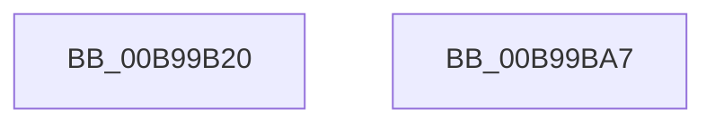

# ViScatterGatherCallback

- RVA: `0x00B99B20`–`0x00B99BA8` (길이 `136` bytes)
- VA: `0x0000000140B99B20`
- 실행 섹션: `PAGEVRFY`
- PDB 이름 있음: `예`; PDB Function 태그: `아니요`
- unwind 정보 RVA: `0x0005D7BC`
- 디코드: `38`개 명령, `136/136` bytes 표시
- 미해석 바이트: `0` (있으면 어셈블리에 `.byte`로 보존)

> 이 문서는 커널 이미지의 기계어와 PDB 기호를 분석해 생성했습니다. 4번과 5번은 함수 원형과 자료형을 바이너리 사용 방식에서 추정한 C 해석이며 원본 소스 복구 결과는 아닙니다.

## 1. Dependencies

- 직접 호출 지점: **4**; 고유 호출 대상: **4**
- 직접 호출자로 확인된 함수: **0**
- RIP 상대 이미지 참조: **0**

### Outgoing calls
- `0x00B99B51` → [ADD_MAP_REGISTERS](ADD_MAP_REGISTERS_function_00B94A08.md) (function, `0x00B94A08`)
- `0x00B99B66` → [ExInterlockedInsertHeadList](../../text/38/ExInterlockedInsertHeadList_function_00386680.md) (function, `0x00386680`)
- `0x00B99B72` → [VF_MARK_SCATTER_GATHER_LIST](VF_MARK_SCATTER_GATHER_LIST_function_00B95140.md) (function, `0x00B95140`)
- `0x00B99B87` → [guard_dispatch_icall](../../text/6B/guard_dispatch_icall_function_006BAAD0.md) (function, `0x006BAAD0`)

### Direct callers
- 이 함수 시작 RVA로 연결되는 직접 call은 확인되지 않았습니다. 간접 호출은 완전히 역산할 수 없습니다.

### Static image references
- 디코드된 RIP-relative 메모리 참조가 없습니다.

## 2. Other-region calls and transfers

- 다른 실행 섹션으로 향하는 call: **2**
  - `0x00B99B66` → [ExInterlockedInsertHeadList](../../text/38/ExInterlockedInsertHeadList_function_00386680.md) (`PAGEVRFY` → `.text`)
  - `0x00B99B87` → [guard_dispatch_icall](../../text/6B/guard_dispatch_icall_function_006BAAD0.md) (`PAGEVRFY` → `.text`)
- 별도 외부 분기/꼬리 이동을 확인하지 못했습니다.

## 3. Assembly (complete function range)

```asm
00B99B20  48 8B C4                        mov rax, rsp
00B99B23  48 89 58 08                     mov qword ptr [rax + 8], rbx
00B99B27  48 89 68 10                     mov qword ptr [rax + 0x10], rbp
00B99B2B  48 89 70 18                     mov qword ptr [rax + 0x18], rsi
00B99B2F  48 89 78 20                     mov qword ptr [rax + 0x20], rdi
00B99B33  41 56                           push r14
00B99B35  48 83 EC 30                     sub rsp, 0x30
00B99B39  49 8B 59 38                     mov rbx, qword ptr [r9 + 0x38]
00B99B3D  49 8B F0                        mov rsi, r8
00B99B40  48 8B EA                        mov rbp, rdx
00B99B43  4C 8B F1                        mov r14, rcx
00B99B46  41 B0 01                        mov r8b, 1
00B99B49  48 8B CB                        mov rcx, rbx
00B99B4C  49 8B F9                        mov rdi, r9
00B99B4F  8B 16                           mov edx, dword ptr [rsi]
00B99B51  E8 B2 AE FF FF                  call 0x140b94a08
00B99B56  4C 8D 43 68                     lea r8, [rbx + 0x68]
00B99B5A  48 89 77 40                     mov qword ptr [rdi + 0x40], rsi
00B99B5E  48 8D 57 48                     lea rdx, [rdi + 0x48]
00B99B62  48 8D 4B 58                     lea rcx, [rbx + 0x58]
00B99B66  E8 15 CB 7E FF                  call 0x140386680
00B99B6B  48 8B 57 60                     mov rdx, qword ptr [rdi + 0x60]
00B99B6F  48 8B CE                        mov rcx, rsi
00B99B72  E8 C9 B5 FF FF                  call 0x140b95140
00B99B77  48 8B 47 08                     mov rax, qword ptr [rdi + 8]
00B99B7B  4C 8B C6                        mov r8, rsi
00B99B7E  4C 8B 0F                        mov r9, qword ptr [rdi]
00B99B81  48 8B D5                        mov rdx, rbp
00B99B84  49 8B CE                        mov rcx, r14
00B99B87  E8 44 0F B2 FF                  call 0x1406baad0
00B99B8C  48 8B 5C 24 40                  mov rbx, qword ptr [rsp + 0x40]
00B99B91  48 8B 6C 24 48                  mov rbp, qword ptr [rsp + 0x48]
00B99B96  48 8B 74 24 50                  mov rsi, qword ptr [rsp + 0x50]
00B99B9B  48 8B 7C 24 58                  mov rdi, qword ptr [rsp + 0x58]
00B99BA0  48 83 C4 30                     add rsp, 0x30
00B99BA4  41 5E                           pop r14
00B99BA6  C3                              ret
00B99BA7  CC                              int3
```

## 4. C-style interpretation (structured pseudocode)

```c
__int64 __fastcall ViScatterGatherCallback(__int64 a1, __int64 a2, __int64 a3, __int64 a4)
{
    __int64 result;
    __int64 v_rsp;
    unsigned __int64 v_stack_p10;
    unsigned __int64 v_stack_p18;
    unsigned __int64 v_stack_p20;
    unsigned __int64 v_stack_p8;

    *(unsigned __int64 *)(v_rsp + 8) = v_rbx;
    *(unsigned __int64 *)(v_rsp + 16) = v_rbp;
    *(unsigned __int64 *)(v_rsp + 24) = v_rsi;
    *(unsigned __int64 *)(v_rsp + 32) = v_rdi;
    v_rsp = (v_rsp) - (48);
    result = ADD_MAP_REGISTERS(*(unsigned __int64 *)(a4 + 56), (unsigned int)(*(unsigned int *)(a3)), 1, a4);
    *(unsigned __int64 *)(a4 + 64) = a3;
    result = ExInterlockedInsertHeadList(*(unsigned __int64 *)(a4 + 56) + 88, a4 + 72, *(unsigned __int64 *)(a4 + 56) + 104, a4);
    result = VF_MARK_SCATTER_GATHER_LIST(a3, *(unsigned __int64 *)(a4 + 96), *(unsigned __int64 *)(a4 + 56) + 104, a4);
    result = guard_dispatch_icall(a1, a2, a3, *(unsigned __int64 *)(a4));
    v_rsp = (v_rsp) + (48);
    return result;
}
```

## 5. (Beta) C Style

```c
int64_t ViScatterGatherCallback(int64_t Arg1, int64_t Arg2, void *Arg3, void *Arg4)
{
    uint8_t *arg3 = (uint8_t *)Arg3;
    uint8_t *arg4 = (uint8_t *)Arg4;

    int64_t result;
    int64_t local_rsp;
    uint64_t v_stack_p10;
    uint64_t v_stack_p18;
    uint64_t v_stack_p20;
    uint64_t v_stack_p8;

    *(uint64_t *)(local_rsp + 0x8) = local_rbx;
    *(uint64_t *)(local_rsp + 0x10) = local_rbp;
    *(uint64_t *)(local_rsp + 0x18) = local_rsi;
    *(uint64_t *)(local_rsp + 0x20) = local_rdi;
    local_rsp = (local_rsp) - (48);
    result = ADD_MAP_REGISTERS(*(uint64_t *)(arg4 + 0x38), (uint32_t)(*(uint32_t *)(arg3)), 1, Arg4);
    *(void **)(arg4 + 0x40) = Arg3;
    result = ExInterlockedInsertHeadList(*(uint64_t *)(arg4 + 0x38) + 88, Arg4 + 72, *(uint64_t *)(arg4 + 0x38) + 104, Arg4);
    result = VF_MARK_SCATTER_GATHER_LIST(Arg3, *(uint64_t *)(arg4 + 0x60), *(uint64_t *)(arg4 + 0x38) + 104, Arg4);
    result = guard_dispatch_icall(Arg1, Arg2, Arg3, *(uint64_t *)(arg4));
    local_rsp = (local_rsp) + (48);
    return result;
}
```

### 관측된 메모리 오프셋

구조체 형식이 확인되지 않은 접근은 인자 기준의 오프셋으로만 기록했습니다.

| 기준 인자 | 오프셋 표현 | 폭 (bit) | 접근 |
|---|---:|---:|---|
| `Arg3` | `+ 0x0` | `32` | `R` |
| `Arg4` | `+ 0x0` | `64` | `R` |
| `Arg4` | `+ 0x8` | `64` | `R` |
| `Arg4` | `+ 0x38` | `64` | `R` |
| `Arg4` | `+ 0x40` | `64` | `W` |
| `Arg4` | `+ 0x48` | `64` | `R` |
| `Arg4` | `+ 0x60` | `64` | `R` |

## 6. Execution-region graph

[열기: 2D/3D 그래프와 함수 탐색 컨트롤 패널](../../../control-panel.html?section=pagevrfy&rva=0x00B99B20&view=graph)

- 2D 그래프는 위에서 아래로 흐르고, 3D 그래프는 빈 공간을 드래그해 회전합니다. Shift+드래그는 이동, 휠은 확대·축소, 함수 노드 선택은 대상 보고서 이동입니다.

### Static fallback


