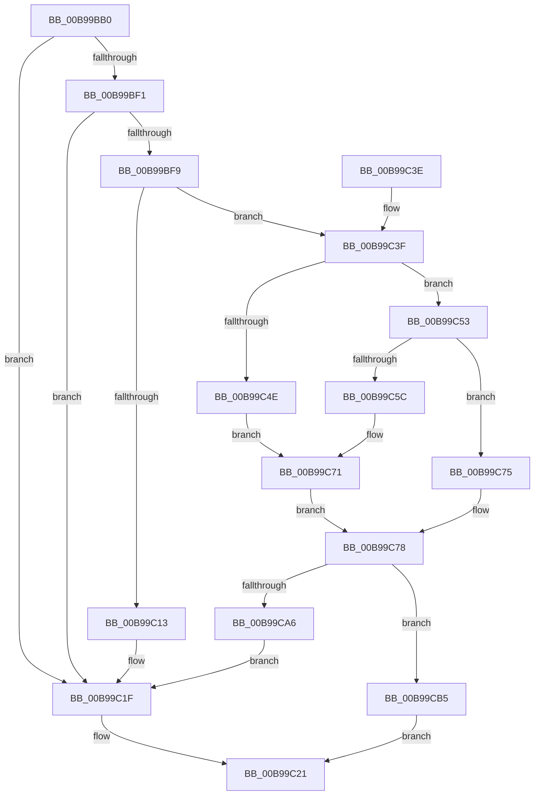

# ViSpecialAllocateCommonBuffer

- RVA: `0x00B99BB0`–`0x00B99D24` (길이 `372` bytes)
- VA: `0x0000000140B99BB0`
- 실행 섹션: `PAGEVRFY`
- PDB 이름 있음: `예`; PDB Function 태그: `아니요`
- unwind 정보 RVA: `0x000D22D4`
- 디코드: `101`개 명령, `372/372` bytes 표시
- 미해석 바이트: `0` (있으면 어셈블리에 `.byte`로 보존)

> 이 문서는 커널 이미지의 기계어와 PDB 기호를 분석해 생성했습니다. 4번과 5번은 함수 원형과 자료형을 바이너리 사용 방식에서 추정한 C 해석이며 원본 소스 복구 결과는 아닙니다.

## 1. Dependencies

- 직접 호출 지점: **6**; 고유 호출 대상: **6**
- 직접 호출자로 확인된 함수: **1**
- RIP 상대 이미지 참조: **1**

### Outgoing calls
- `0x00B99C06` → [ExAllocatePool2](../../poolcode/B8/ExAllocatePool2_function_00B820F0.md) (function, `0x00B820F0`)
- `0x00B99C1A` → [VfUtilDbgPrint](../../text/61/VfUtilDbgPrint_function_006122AC.md) (function, `0x006122AC`)
- `0x00B99C99` → [guard_dispatch_icall](../../text/6B/guard_dispatch_icall_function_006BAAD0.md) (function, `0x006BAAD0`)
- `0x00B99CAB` → [ExFreePoolWithTag](../../poolcode/B8/ExFreePoolWithTag_function_00B82870.md) (function, `0x00B82870`)
- `0x00B99CE9` → [ViInitializePadding](ViInitializePadding_function_00B99598.md) (function, `0x00B99598`)
- `0x00B99D10` → [ExInterlockedInsertHeadList](../../text/38/ExInterlockedInsertHeadList_function_00386680.md) (function, `0x00386680`)

### Direct callers
- [VfAllocateCommonBuffer](VfAllocateCommonBuffer_function_00B95570.md) at `0x00B955D2`

### Static image references
- `0x00B99C13` → RVA `0x00BB9BB0` (` ?? ::JKADOLAD::`string'`; read)

## 2. Other-region calls and transfers

- 다른 실행 섹션으로 향하는 call: **5**
  - `0x00B99C06` → [ExAllocatePool2](../../poolcode/B8/ExAllocatePool2_function_00B820F0.md) (`PAGEVRFY` → `POOLCODE`)
  - `0x00B99C1A` → [VfUtilDbgPrint](../../text/61/VfUtilDbgPrint_function_006122AC.md) (`PAGEVRFY` → `.text`)
  - `0x00B99C99` → [guard_dispatch_icall](../../text/6B/guard_dispatch_icall_function_006BAAD0.md) (`PAGEVRFY` → `.text`)
  - `0x00B99CAB` → [ExFreePoolWithTag](../../poolcode/B8/ExFreePoolWithTag_function_00B82870.md) (`PAGEVRFY` → `POOLCODE`)
  - `0x00B99D10` → [ExInterlockedInsertHeadList](../../text/38/ExInterlockedInsertHeadList_function_00386680.md) (`PAGEVRFY` → `.text`)
- 별도 외부 분기/꼬리 이동을 확인하지 못했습니다.

## 3. Assembly (complete function range)

```asm
00B99BB0  48 8B C4                        mov rax, rsp
00B99BB3  48 89 58 08                     mov qword ptr [rax + 8], rbx
00B99BB7  48 89 68 18                     mov qword ptr [rax + 0x18], rbp
00B99BBB  48 89 70 20                     mov qword ptr [rax + 0x20], rsi
00B99BBF  57                              push rdi
00B99BC0  41 54                           push r12
00B99BC2  41 55                           push r13
00B99BC4  41 56                           push r14
00B99BC6  41 57                           push r15
00B99BC8  48 83 EC 30                     sub rsp, 0x30
00B99BCC  44 8B 92 CC 00 00 00            mov r10d, dword ptr [rdx + 0xcc]
00B99BD3  4D 8B E0                        mov r12, r8
00B99BD6  44 2B 92 D0 00 00 00            sub r10d, dword ptr [rdx + 0xd0]
00B99BDD  48 8B EA                        mov rbp, rdx
00B99BE0  48 83 60 10 00                  and qword ptr [rax + 0x10], 0
00B99BE5  4C 8B F9                        mov r15, rcx
00B99BE8  41 8B F9                        mov edi, r9d
00B99BEB  41 83 FA 20                     cmp r10d, 0x20
00B99BEF  73 2E                           jae 0x140b99c1f
00B99BF1  81 FF FF DF FF FF               cmp edi, 0xffffdfff
00B99BF7  77 26                           ja 0x140b99c1f
00B99BF9  B9 40 00 00 00                  mov ecx, 0x40
00B99BFE  41 B8 48 61 6C 56               mov r8d, 0x566c6148
00B99C04  8B D1                           mov edx, ecx
00B99C06  E8 E5 84 FE FF                  call 0x140b820f0
00B99C0B  48 8B F0                        mov rsi, rax
00B99C0E  48 85 C0                        test rax, rax
00B99C11  75 2C                           jne 0x140b99c3f
00B99C13  48 8D 0D 96 FF 01 00            lea rcx, [rip + 0x1ff96]
00B99C1A  E8 8D 86 A7 FF                  call 0x1406122ac
00B99C1F  33 C0                           xor eax, eax
00B99C21  48 8B 5C 24 60                  mov rbx, qword ptr [rsp + 0x60]
00B99C26  48 8B 6C 24 70                  mov rbp, qword ptr [rsp + 0x70]
00B99C2B  48 8B 74 24 78                  mov rsi, qword ptr [rsp + 0x78]
00B99C30  48 83 C4 30                     add rsp, 0x30
00B99C34  41 5F                           pop r15
00B99C36  41 5E                           pop r14
00B99C38  41 5D                           pop r13
00B99C3A  41 5C                           pop r12
00B99C3C  5F                              pop rdi
00B99C3D  C3                              ret
00B99C3E  CC                              int3
00B99C3F  48 8D 47 08                     lea rax, [rdi + 8]
00B99C43  41 BD 00 10 00 00               mov r13d, 0x1000
00B99C49  49 3B C5                        cmp rax, r13
00B99C4C  77 05                           ja 0x140b99c53
00B99C4E  41 8B DD                        mov ebx, r13d
00B99C51  EB 1E                           jmp 0x140b99c71
00B99C53  B9 FF 0F 00 00                  mov ecx, 0xfff
00B99C58  85 F9                           test ecx, edi
00B99C5A  74 19                           je 0x140b99c75
00B99C5C  48 23 C1                        and rax, rcx
00B99C5F  48 F7 D8                        neg rax
00B99C62  8D 47 08                        lea eax, [rdi + 8]
00B99C65  1B DB                           sbb ebx, ebx
00B99C67  25 00 F0 FF FF                  and eax, 0xfffff000
00B99C6C  41 23 DD                        and ebx, r13d
00B99C6F  03 D8                           add ebx, eax
00B99C71  2B DF                           sub ebx, edi
00B99C73  EB 03                           jmp 0x140b99c78
00B99C75  41 8B DD                        mov ebx, r13d
00B99C78  44 8A 8C 24 88 00 00 00         mov r9b, byte ptr [rsp + 0x88]
00B99C80  44 8D B7 00 10 00 00            lea r14d, [rdi + 0x1000]
00B99C87  48 8B 4D 28                     mov rcx, qword ptr [rbp + 0x28]
00B99C8B  4C 8D 44 24 68                  lea r8, [rsp + 0x68]
00B99C90  44 03 F3                        add r14d, ebx
00B99C93  49 8B C7                        mov rax, r15
00B99C96  41 8B D6                        mov edx, r14d
00B99C99  E8 32 0E B2 FF                  call 0x1406baad0
00B99C9E  48 8B C8                        mov rcx, rax
00B99CA1  48 85 C0                        test rax, rax
00B99CA4  75 0F                           jne 0x140b99cb5
00B99CA6  33 D2                           xor edx, edx
00B99CA8  48 8B CE                        mov rcx, rsi
00B99CAB  E8 C0 8B FE FF                  call 0x140b82870
00B99CB0  E9 6A FF FF FF                  jmp 0x140b99c1f
00B99CB5  66 89 5E 02                     mov word ptr [rsi + 2], bx
00B99CB9  44 8B CF                        mov r9d, edi
00B99CBC  48 8D 98 00 10 00 00            lea rbx, [rax + 0x1000]
00B99CC3  66 44 89 2E                     mov word ptr [rsi], r13w
00B99CC7  48 89 5E 18                     mov qword ptr [rsi + 0x18], rbx
00B99CCB  4C 8B C3                        mov r8, rbx
00B99CCE  89 7E 08                        mov dword ptr [rsi + 8], edi
00B99CD1  41 8B D6                        mov edx, r14d
00B99CD4  44 89 76 04                     mov dword ptr [rsi + 4], r14d
00B99CD8  48 89 4E 10                     mov qword ptr [rsi + 0x10], rcx
00B99CDC  48 8B 44 24 68                  mov rax, qword ptr [rsp + 0x68]
00B99CE1  48 89 46 20                     mov qword ptr [rsi + 0x20], rax
00B99CE5  4C 89 66 28                     mov qword ptr [rsi + 0x28], r12
00B99CE9  E8 AA F8 FF FF                  call 0x140b99598
00B99CEE  48 8B 8C 24 80 00 00 00         mov rcx, qword ptr [rsp + 0x80]
00B99CF6  4C 8D 85 80 00 00 00            lea r8, [rbp + 0x80]
00B99CFD  48 8B 54 24 68                  mov rdx, qword ptr [rsp + 0x68]
00B99D02  49 03 D5                        add rdx, r13
00B99D05  48 89 11                        mov qword ptr [rcx], rdx
00B99D08  48 8D 56 30                     lea rdx, [rsi + 0x30]
00B99D0C  48 8D 4D 70                     lea rcx, [rbp + 0x70]
00B99D10  E8 6B C9 7E FF                  call 0x140386680
00B99D15  F0 FF 85 CC 00 00 00            lock inc dword ptr [rbp + 0xcc]
00B99D1C  48 8B C3                        mov rax, rbx
00B99D1F  E9 FD FE FF FF                  jmp 0x140b99c21
```

## 4. C-style interpretation (structured pseudocode)

```c
__int64 __fastcall ViSpecialAllocateCommonBuffer(__int64 a1, __int64 a2, __int64 a3, int a4, __int64 a5, unsigned __int8 a6)
{
    __int64 result;
    __int64 v_r10;
    __int64 v_r14;
    __int64 v_rbx;
    __int64 v_rsp;
    unsigned __int64 v_stack_p18;
    unsigned __int64 v_stack_p20;
    unsigned __int64 v_stack_p68;
    unsigned __int64 v_stack_p8;

    *(unsigned __int64 *)(v_rsp + 8) = v_rbx;
    *(unsigned __int64 *)(v_rsp + 24) = v_rbp;
    *(unsigned __int64 *)(v_rsp + 32) = v_rsi;
    v_rsp = (v_rsp) - (48);
    v_r10 = (unsigned int)(((unsigned int)(*(unsigned int *)(a2 + 204))) - (*(unsigned int *)(a2 + 208)));
    if (((unsigned int)(v_r10)) >= 32) goto loc_00B99C1F;
    if (((unsigned int)((unsigned int)(a4))) > 0xFFFFDFFFULL) goto loc_00B99C1F;
    result = ExAllocatePool2(64, 64, (unsigned int)(0x566C6148ULL), a4);
    if (result != 0) goto loc_00B99C3F;
    result = VfUtilDbgPrint(v_rip + 130966, 64, (unsigned int)(0x566C6148ULL), a4);
loc_00B99C1F:
    result = 0;
loc_00B99C21:
    v_rsp = (v_rsp) + (48);
    return result;
loc_00B99C3F:
    if (((unsigned int)(a4) + 8) > ((unsigned int)(0x1000ULL))) goto loc_00B99C53;
    goto loc_00B99C71;
loc_00B99C53:
    if ((((unsigned int)((unsigned int)(0xFFFULL))) & ((unsigned int)((unsigned int)(a4)))) == 0) goto loc_00B99C75;
    result = ((unsigned int)(a4) + 8) & ((unsigned int)(0xFFFULL));
    result = -(result);
    result = (unsigned int)(((unsigned int)(a4) + 8) & (0xFFFFF000ULL));
    v_rbx = (unsigned int)(((unsigned int)((unsigned int)((unsigned int)(0x1000ULL)))) & ((unsigned int)((unsigned int)(0x1000ULL))));
    v_rbx = (unsigned int)((v_rbx) + ((unsigned int)(result)));
loc_00B99C71:
    v_rbx = (unsigned int)((v_rbx) - ((unsigned int)((unsigned int)(a4))));
    goto loc_00B99C78;
loc_00B99C75:
loc_00B99C78:
    v_r14 = (unsigned int)(((unsigned int)(a4) + 4096) + ((unsigned int)((unsigned int)((unsigned int)((unsigned int)(0x1000ULL))))));
    result = guard_dispatch_icall(*(unsigned __int64 *)(v_stack_p18 + 40), (unsigned int)((unsigned int)(v_r14)), v_stack_p68, a6);
    if (result != 0) goto loc_00B99CB5;
    a2 = 0;
    result = ExFreePoolWithTag(v_stack_p20, a2, v_stack_p68, a6);
    goto loc_00B99C1F;
loc_00B99CB5:
    *(unsigned __int16 *)(v_stack_p20 + 2) = (unsigned __int16)((unsigned int)((unsigned int)((unsigned int)(0x1000ULL))));
    *(unsigned __int16 *)(v_stack_p20) = (unsigned __int16)((unsigned int)(0x1000ULL));
    *(unsigned __int64 *)(v_stack_p20 + 24) = result + 4096;
    *(unsigned int *)(v_stack_p20 + 8) = (unsigned int)((unsigned int)(a4));
    *(unsigned int *)(v_stack_p20 + 4) = (unsigned int)(v_r14);
    *(unsigned __int64 *)(v_stack_p20 + 16) = v_stack_p20;
    *(unsigned __int64 *)(v_stack_p20 + 32) = v_stack_p68;
    *(unsigned __int64 *)(v_stack_p20 + 40) = a3;
    result = ViInitializePadding(v_stack_p20, (unsigned int)((unsigned int)(v_r14)), result + 4096, (unsigned int)((unsigned int)((unsigned int)(a4))));
    a2 = (v_stack_p68) + ((unsigned int)(0x1000ULL));
    *(unsigned __int64 *)(a5) = a2;
    result = ExInterlockedInsertHeadList(v_stack_p18 + 112, v_stack_p20 + 48, v_stack_p18 + 128, (unsigned int)((unsigned int)((unsigned int)(a4))));
    goto loc_00B99C21;
}
```

## 5. (Beta) C Style

```c
int64_t ViSpecialAllocateCommonBuffer(int64_t Arg1, void *Arg2, int64_t Arg3, int32_t Arg4, void *Arg5, uint8_t Arg6)
{
    uint8_t *arg2 = (uint8_t *)Arg2;
    uint8_t *arg5 = (uint8_t *)Arg5;

    int64_t result;
    int64_t local_r10;
    int64_t local_r14;
    int64_t local_rbx;
    int64_t local_rsp;
    uint64_t v_stack_p18;
    uint64_t v_stack_p20;
    uint64_t v_stack_p68;
    uint64_t v_stack_p8;

    *(uint64_t *)(local_rsp + 0x8) = local_rbx;
    *(uint64_t *)(local_rsp + 0x18) = local_rbp;
    *(uint64_t *)(local_rsp + 0x20) = local_rsi;
    local_rsp = (local_rsp) - (48);
    local_r10 = (uint32_t)(((uint32_t)(*(uint32_t *)(arg2 + 0xCC))) - (*(uint32_t *)(arg2 + 0xD0)));
    if (((uint32_t)(local_r10)) >= 32) goto loc_00B99C1F;
    if (((uint32_t)((uint32_t)(Arg4))) > 0xFFFFDFFFULL) goto loc_00B99C1F;
    result = ExAllocatePool2(64, 64, (uint32_t)(0x566C6148ULL), Arg4);
    if (result != 0) goto loc_00B99C3F;
    result = VfUtilDbgPrint(v_rip + 130966, 64, (uint32_t)(0x566C6148ULL), Arg4);
loc_00B99C1F:
    result = 0;
loc_00B99C21:
    local_rsp = (local_rsp) + (48);
    return result;
loc_00B99C3F:
    if (((uint32_t)(Arg4) + 8) > ((uint32_t)(0x1000ULL))) goto loc_00B99C53;
    goto loc_00B99C71;
loc_00B99C53:
    if ((((uint32_t)((uint32_t)(0xFFFULL))) & ((uint32_t)((uint32_t)(Arg4)))) == 0) goto loc_00B99C75;
    result = ((uint32_t)(Arg4) + 8) & ((uint32_t)(0xFFFULL));
    result = -(result);
    result = (uint32_t)(((uint32_t)(Arg4) + 8) & (0xFFFFF000ULL));
    local_rbx = (uint32_t)(((uint32_t)((uint32_t)((uint32_t)(0x1000ULL)))) & ((uint32_t)((uint32_t)(0x1000ULL))));
    local_rbx = (uint32_t)((local_rbx) + ((uint32_t)(result)));
loc_00B99C71:
    local_rbx = (uint32_t)((local_rbx) - ((uint32_t)((uint32_t)(Arg4))));
    goto loc_00B99C78;
loc_00B99C75:
loc_00B99C78:
    local_r14 = (uint32_t)(((uint32_t)(Arg4) + 4096) + ((uint32_t)((uint32_t)((uint32_t)((uint32_t)(0x1000ULL))))));
    result = guard_dispatch_icall(*(uint64_t *)(v_stack_p18 + 0x28), (uint32_t)((uint32_t)(local_r14)), v_stack_p68, Arg6);
    if (result != 0) goto loc_00B99CB5;
    Arg2 = 0;
    result = ExFreePoolWithTag(v_stack_p20, Arg2, v_stack_p68, Arg6);
    goto loc_00B99C1F;
loc_00B99CB5:
    *(uint16_t *)(v_stack_p20 + 0x2) = (uint16_t)((uint32_t)((uint32_t)((uint32_t)(0x1000ULL))));
    *(uint16_t *)(v_stack_p20) = (uint16_t)((uint32_t)(0x1000ULL));
    *(uint64_t *)(v_stack_p20 + 0x18) = result + 4096;
    *(uint32_t *)(v_stack_p20 + 0x8) = (uint32_t)((uint32_t)(Arg4));
    *(uint32_t *)(v_stack_p20 + 0x4) = (uint32_t)(local_r14);
    *(uint64_t *)(v_stack_p20 + 0x10) = v_stack_p20;
    *(uint64_t *)(v_stack_p20 + 0x20) = v_stack_p68;
    *(uint64_t *)(v_stack_p20 + 0x28) = Arg3;
    result = ViInitializePadding(v_stack_p20, (uint32_t)((uint32_t)(local_r14)), result + 4096, (uint32_t)((uint32_t)((uint32_t)(Arg4))));
    Arg2 = (v_stack_p68) + ((uint32_t)(0x1000ULL));
    *(void **)(arg5) = Arg2;
    result = ExInterlockedInsertHeadList(v_stack_p18 + 112, v_stack_p20 + 48, v_stack_p18 + 128, (uint32_t)((uint32_t)((uint32_t)(Arg4))));
    goto loc_00B99C21;
}
```

### 관측된 메모리 오프셋

구조체 형식이 확인되지 않은 접근은 인자 기준의 오프셋으로만 기록했습니다.

| 기준 인자 | 오프셋 표현 | 폭 (bit) | 접근 |
|---|---:|---:|---|
| `Arg2` | `+ 0x28` | `64` | `R` |
| `Arg2` | `+ 0x70` | `64` | `R` |
| `Arg2` | `+ 0x80` | `64` | `R` |
| `Arg2` | `+ 0xCC` | `32` | `R` |
| `Arg2` | `+ 0xCC` | `32` | `R/W` |
| `Arg2` | `+ 0xD0` | `32` | `R` |
| `Arg5` | `+ 0x0` | `64` | `W` |

## 6. Execution-region graph

[열기: 2D/3D 그래프와 함수 탐색 컨트롤 패널](../../../control-panel.html?section=pagevrfy&rva=0x00B99BB0&view=graph)

- 2D 그래프는 위에서 아래로 흐르고, 3D 그래프는 빈 공간을 드래그해 회전합니다. Shift+드래그는 이동, 휠은 확대·축소, 함수 노드 선택은 대상 보고서 이동입니다.

### Static fallback


