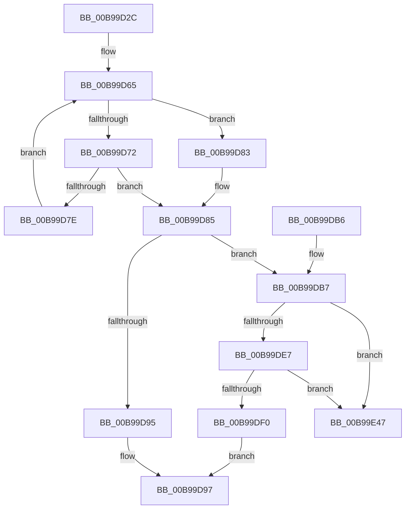

# ViSpecialFreeCommonBuffer

- RVA: `0x00B99D2C`–`0x00B99E4E` (길이 `290` bytes)
- VA: `0x0000000140B99D2C`
- 실행 섹션: `PAGEVRFY`
- PDB 이름 있음: `예`; PDB Function 태그: `아니요`
- unwind 정보 RVA: `0x000D22B4`
- 디코드: `84`개 명령, `290/290` bytes 표시
- 미해석 바이트: `0` (있으면 어셈블리에 `.byte`로 보존)

> 이 문서는 커널 이미지의 기계어와 PDB 기호를 분석해 생성했습니다. 4번과 5번은 함수 원형과 자료형을 바이너리 사용 방식에서 추정한 C 해석이며 원본 소스 복구 결과는 아닙니다.

## 1. Dependencies

- 직접 호출 지점: **9**; 고유 호출 대상: **7**
- 직접 호출자로 확인된 함수: **1**
- RIP 상대 이미지 참조: **0**

### Outgoing calls
- `0x00B99D5D` → [KeAcquireSpinLockRaiseToDpc](../../text/20/KeAcquireSpinLockRaiseToDpc_function_00208470.md) (function, `0x00208470`)
- `0x00B99D8B` → [KeReleaseSpinLock](../../text/39/KeReleaseSpinLock_function_00392BA0.md) (function, `0x00392BA0`)
- `0x00B99DC6` → [ViCheckPadding](ViCheckPadding_function_00B98464.md) (function, `0x00B98464`)
- `0x00B99DD5` → [KeAcquireSpinLockRaiseToDpc](../../text/20/KeAcquireSpinLockRaiseToDpc_function_00208470.md) (function, `0x00208470`)
- `0x00B99DFC` → [KeReleaseSpinLock](../../text/39/KeReleaseSpinLock_function_00392BA0.md) (function, `0x00392BA0`)
- `0x00B99E0A` → [memset](../../text/6C/memset_function_006C6C40.md) (function, `0x006C6C40`)
- `0x00B99E26` → [guard_dispatch_icall](../../text/6B/guard_dispatch_icall_function_006BAAD0.md) (function, `0x006BAAD0`)
- `0x00B99E2E` → [DECREMENT_COMMON_BUFFERS](DECREMENT_COMMON_BUFFERS_function_00B94BB0.md) (function, `0x00B94BB0`)
- `0x00B99E38` → [ExFreePoolWithTag](../../poolcode/B8/ExFreePoolWithTag_function_00B82870.md) (function, `0x00B82870`)

### Direct callers
- [VfFreeCommonBuffer](VfFreeCommonBuffer_function_00B96650.md) at `0x00B966C3`

### Static image references
- 디코드된 RIP-relative 메모리 참조가 없습니다.

## 2. Other-region calls and transfers

- 다른 실행 섹션으로 향하는 call: **7**
  - `0x00B99D5D` → [KeAcquireSpinLockRaiseToDpc](../../text/20/KeAcquireSpinLockRaiseToDpc_function_00208470.md) (`PAGEVRFY` → `.text`)
  - `0x00B99D8B` → [KeReleaseSpinLock](../../text/39/KeReleaseSpinLock_function_00392BA0.md) (`PAGEVRFY` → `.text`)
  - `0x00B99DD5` → [KeAcquireSpinLockRaiseToDpc](../../text/20/KeAcquireSpinLockRaiseToDpc_function_00208470.md) (`PAGEVRFY` → `.text`)
  - `0x00B99DFC` → [KeReleaseSpinLock](../../text/39/KeReleaseSpinLock_function_00392BA0.md) (`PAGEVRFY` → `.text`)
  - `0x00B99E0A` → [memset](../../text/6C/memset_function_006C6C40.md) (`PAGEVRFY` → `.text`)
  - `0x00B99E26` → [guard_dispatch_icall](../../text/6B/guard_dispatch_icall_function_006BAAD0.md) (`PAGEVRFY` → `.text`)
  - `0x00B99E38` → [ExFreePoolWithTag](../../poolcode/B8/ExFreePoolWithTag_function_00B82870.md) (`PAGEVRFY` → `POOLCODE`)
- 별도 외부 분기/꼬리 이동을 확인하지 못했습니다.

## 3. Assembly (complete function range)

```asm
00B99D2C  48 8B C4                        mov rax, rsp
00B99D2F  48 89 58 08                     mov qword ptr [rax + 8], rbx
00B99D33  48 89 68 10                     mov qword ptr [rax + 0x10], rbp
00B99D37  48 89 70 18                     mov qword ptr [rax + 0x18], rsi
00B99D3B  48 89 78 20                     mov qword ptr [rax + 0x20], rdi
00B99D3F  41 54                           push r12
00B99D41  41 56                           push r14
00B99D43  41 57                           push r15
00B99D45  48 83 EC 30                     sub rsp, 0x30
00B99D49  48 8D 7A 70                     lea rdi, [rdx + 0x70]
00B99D4D  4C 8B E1                        mov r12, rcx
00B99D50  48 8D 4F 10                     lea rcx, [rdi + 0x10]
00B99D54  45 8A F9                        mov r15b, r9b
00B99D57  4D 8B F0                        mov r14, r8
00B99D5A  48 8B EA                        mov rbp, rdx
00B99D5D  E8 0E E7 66 FF                  call 0x140208470
00B99D62  48 8B 1F                        mov rbx, qword ptr [rdi]
00B99D65  48 83 EB 30                     sub rbx, 0x30
00B99D69  48 8D 53 30                     lea rdx, [rbx + 0x30]
00B99D6D  48 3B FA                        cmp rdi, rdx
00B99D70  74 11                           je 0x140b99d83
00B99D72  0F B7 0B                        movzx ecx, word ptr [rbx]
00B99D75  48 03 4B 10                     add rcx, qword ptr [rbx + 0x10]
00B99D79  49 3B CE                        cmp rcx, r14
00B99D7C  74 07                           je 0x140b99d85
00B99D7E  48 8B 1A                        mov rbx, qword ptr [rdx]
00B99D81  EB E2                           jmp 0x140b99d65
00B99D83  33 DB                           xor ebx, ebx
00B99D85  8A D0                           mov dl, al
00B99D87  48 8D 4F 10                     lea rcx, [rdi + 0x10]
00B99D8B  E8 10 8E 7F FF                  call 0x140392ba0
00B99D90  48 85 DB                        test rbx, rbx
00B99D93  75 22                           jne 0x140b99db7
00B99D95  33 C0                           xor eax, eax
00B99D97  48 8B 5C 24 50                  mov rbx, qword ptr [rsp + 0x50]
00B99D9C  48 8B 6C 24 58                  mov rbp, qword ptr [rsp + 0x58]
00B99DA1  48 8B 74 24 60                  mov rsi, qword ptr [rsp + 0x60]
00B99DA6  48 8B 7C 24 68                  mov rdi, qword ptr [rsp + 0x68]
00B99DAB  48 83 C4 30                     add rsp, 0x30
00B99DAF  41 5F                           pop r15
00B99DB1  41 5E                           pop r14
00B99DB3  41 5C                           pop r12
00B99DB5  C3                              ret
00B99DB6  CC                              int3
00B99DB7  44 8B 4B 08                     mov r9d, dword ptr [rbx + 8]
00B99DBB  4C 8B 43 18                     mov r8, qword ptr [rbx + 0x18]
00B99DBF  8B 53 04                        mov edx, dword ptr [rbx + 4]
00B99DC2  48 8B 4B 10                     mov rcx, qword ptr [rbx + 0x10]
00B99DC6  E8 99 E6 FF FF                  call 0x140b98464
00B99DCB  48 8D BD 80 00 00 00            lea rdi, [rbp + 0x80]
00B99DD2  48 8B CF                        mov rcx, rdi
00B99DD5  E8 96 E6 66 FF                  call 0x140208470
00B99DDA  48 8D 53 30                     lea rdx, [rbx + 0x30]
00B99DDE  4C 8B 0A                        mov r9, qword ptr [rdx]
00B99DE1  49 39 51 08                     cmp qword ptr [r9 + 8], rdx
00B99DE5  75 60                           jne 0x140b99e47
00B99DE7  4C 8B 42 08                     mov r8, qword ptr [rdx + 8]
00B99DEB  49 39 10                        cmp qword ptr [r8], rdx
00B99DEE  75 57                           jne 0x140b99e47
00B99DF0  4D 89 08                        mov qword ptr [r8], r9
00B99DF3  8A D0                           mov dl, al
00B99DF5  48 8B CF                        mov rcx, rdi
00B99DF8  4D 89 41 08                     mov qword ptr [r9 + 8], r8
00B99DFC  E8 9F 8D 7F FF                  call 0x140392ba0
00B99E01  44 8B 43 08                     mov r8d, dword ptr [rbx + 8]
00B99E05  33 D2                           xor edx, edx
00B99E07  49 8B CE                        mov rcx, r14
00B99E0A  E8 31 CE B2 FF                  call 0x1406c6c40
00B99E0F  4C 8B 4B 10                     mov r9, qword ptr [rbx + 0x10]
00B99E13  49 8B C4                        mov rax, r12
00B99E16  4C 8B 43 20                     mov r8, qword ptr [rbx + 0x20]
00B99E1A  8B 53 04                        mov edx, dword ptr [rbx + 4]
00B99E1D  48 8B 4D 28                     mov rcx, qword ptr [rbp + 0x28]
00B99E21  44 88 7C 24 20                  mov byte ptr [rsp + 0x20], r15b
00B99E26  E8 A5 0C B2 FF                  call 0x1406baad0
00B99E2B  48 8B CD                        mov rcx, rbp
00B99E2E  E8 7D AD FF FF                  call 0x140b94bb0
00B99E33  33 D2                           xor edx, edx
00B99E35  48 8B CB                        mov rcx, rbx
00B99E38  E8 33 8A FE FF                  call 0x140b82870
00B99E3D  B8 01 00 00 00                  mov eax, 1
00B99E42  E9 50 FF FF FF                  jmp 0x140b99d97
00B99E47  B9 03 00 00 00                  mov ecx, 3
00B99E4C  CD 29                           int 0x29
```

## 4. C-style interpretation (structured pseudocode)

```c
__int64 __fastcall ViSpecialFreeCommonBuffer(__int64 a1, __int64 a2, __int64 a3, unsigned __int8 a4)
{
    __int64 result;
    __int64 v_rbx;
    __int64 v_rsp;
    unsigned __int64 v_stack_p10;
    unsigned __int64 v_stack_p18;
    unsigned __int64 v_stack_p20;
    unsigned __int64 v_stack_p8;

    *(unsigned __int64 *)(v_rsp + 8) = v_rbx;
    *(unsigned __int64 *)(v_rsp + 16) = v_rbp;
    *(unsigned __int64 *)(v_rsp + 24) = v_rsi;
    *(unsigned __int64 *)(v_rsp + 32) = v_rdi;
    v_rsp = (v_rsp) - (48);
    result = KeAcquireSpinLockRaiseToDpc(a2 + 112 + 16, a2, a3, a4);
loc_00B99D65:
    v_rbx = (*(unsigned __int64 *)(a2 + 112)) - (48);
    if ((a2 + 112) == (v_rbx + 48)) goto loc_00B99D83;
    a1 = (*(unsigned __int16 *)(v_rbx)) + (*(unsigned __int64 *)(v_rbx + 16));
    if (a1 == a3) goto loc_00B99D85;
    goto loc_00B99D65;
loc_00B99D83:
    v_rbx = 0;
loc_00B99D85:
    result = KeReleaseSpinLock(a2 + 112 + 16, (unsigned __int8)(result), a3, a4);
    if (0 != 0) goto loc_00B99DB7;
    result = 0;
loc_00B99D97:
    v_rsp = (v_rsp) + (48);
    return result;
loc_00B99DB7:
    result = ViCheckPadding(*(unsigned __int64 *)(v_stack_p8 + 16), (unsigned int)(*(unsigned int *)(v_stack_p8 + 4)), *(unsigned __int64 *)(v_stack_p8 + 24), (unsigned int)(*(unsigned int *)(v_stack_p8 + 8)));
    result = KeAcquireSpinLockRaiseToDpc(v_stack_p10 + 128, (unsigned int)(*(unsigned int *)(v_stack_p8 + 4)), *(unsigned __int64 *)(v_stack_p8 + 24), (unsigned int)(*(unsigned int *)(v_stack_p8 + 8)));
    if ((*(unsigned __int64 *)(*(unsigned __int64 *)(v_stack_p8 + 48) + 8)) != (v_stack_p8 + 48)) goto loc_00B99E47;
    if ((*(unsigned __int64 *)(*(unsigned __int64 *)(v_stack_p8 + 48 + 8))) != (v_stack_p8 + 48)) goto loc_00B99E47;
    *(unsigned __int64 *)(*(unsigned __int64 *)(v_stack_p8 + 48 + 8)) = *(unsigned __int64 *)(v_stack_p8 + 48);
    *(unsigned __int64 *)(*(unsigned __int64 *)(v_stack_p8 + 48) + 8) = *(unsigned __int64 *)(v_stack_p8 + 48 + 8);
    result = KeReleaseSpinLock(v_stack_p10 + 128, (unsigned __int8)(result), *(unsigned __int64 *)(v_stack_p8 + 48 + 8), *(unsigned __int64 *)(v_stack_p8 + 48));
    a2 = 0;
    result = memset(a3, a2, (unsigned int)(*(unsigned int *)(v_stack_p8 + 8)), *(unsigned __int64 *)(v_stack_p8 + 48));
    v_stack_p20 = a4;
    result = guard_dispatch_icall(*(unsigned __int64 *)(v_stack_p10 + 40), (unsigned int)(*(unsigned int *)(v_stack_p8 + 4)), *(unsigned __int64 *)(v_stack_p8 + 32), *(unsigned __int64 *)(v_stack_p8 + 16));
    result = DECREMENT_COMMON_BUFFERS(v_stack_p10, (unsigned int)(*(unsigned int *)(v_stack_p8 + 4)), *(unsigned __int64 *)(v_stack_p8 + 32), *(unsigned __int64 *)(v_stack_p8 + 16));
    a2 = 0;
    result = ExFreePoolWithTag(v_stack_p8, a2, *(unsigned __int64 *)(v_stack_p8 + 32), *(unsigned __int64 *)(v_stack_p8 + 16));
    goto loc_00B99D97;
loc_00B99E47:
    return 1;
}
```

## 5. (Beta) C Style

```c
int64_t ViSpecialFreeCommonBuffer(int64_t Arg1, void *Arg2, int64_t Arg3, uint8_t Arg4)
{
    uint8_t *arg2 = (uint8_t *)Arg2;

    int64_t result;
    int64_t local_rbx;
    int64_t local_rsp;
    uint64_t v_stack_p10;
    uint64_t v_stack_p18;
    uint64_t v_stack_p20;
    uint64_t v_stack_p8;

    *(uint64_t *)(local_rsp + 0x8) = local_rbx;
    *(uint64_t *)(local_rsp + 0x10) = local_rbp;
    *(uint64_t *)(local_rsp + 0x18) = local_rsi;
    *(uint64_t *)(local_rsp + 0x20) = local_rdi;
    local_rsp = (local_rsp) - (48);
    result = KeAcquireSpinLockRaiseToDpc(Arg2 + 112 + 16, Arg2, Arg3, Arg4);
loc_00B99D65:
    local_rbx = (*(uint64_t *)(arg2 + 0x70)) - (48);
    if ((Arg2 + 112) == (local_rbx + 48)) goto loc_00B99D83;
    Arg1 = (*(uint16_t *)(local_rbx)) + (*(uint64_t *)(local_rbx + 0x10));
    if (Arg1 == Arg3) goto loc_00B99D85;
    goto loc_00B99D65;
loc_00B99D83:
    local_rbx = 0;
loc_00B99D85:
    result = KeReleaseSpinLock(Arg2 + 112 + 16, (uint8_t)(result), Arg3, Arg4);
    if (0 != 0) goto loc_00B99DB7;
    result = 0;
loc_00B99D97:
    local_rsp = (local_rsp) + (48);
    return result;
loc_00B99DB7:
    result = ViCheckPadding(*(uint64_t *)(v_stack_p8 + 0x10), (uint32_t)(*(uint32_t *)(v_stack_p8 + 0x4)), *(uint64_t *)(v_stack_p8 + 0x18), (uint32_t)(*(uint32_t *)(v_stack_p8 + 0x8)));
    result = KeAcquireSpinLockRaiseToDpc(v_stack_p10 + 128, (uint32_t)(*(uint32_t *)(v_stack_p8 + 0x4)), *(uint64_t *)(v_stack_p8 + 0x18), (uint32_t)(*(uint32_t *)(v_stack_p8 + 0x8)));
    if ((*(uint64_t *)(*(uint64_t *)(v_stack_p8 + 0x30) + 0x8)) != (v_stack_p8 + 48)) goto loc_00B99E47;
    if ((*(uint64_t *)(*(uint64_t *)(v_stack_p8 + 0x30 + 0x8))) != (v_stack_p8 + 48)) goto loc_00B99E47;
    *(uint64_t *)(*(uint64_t *)(v_stack_p8 + 0x30 + 0x8)) = *(uint64_t *)(v_stack_p8 + 0x30);
    *(uint64_t *)(*(uint64_t *)(v_stack_p8 + 0x30) + 0x8) = *(uint64_t *)(v_stack_p8 + 0x30 + 0x8);
    result = KeReleaseSpinLock(v_stack_p10 + 128, (uint8_t)(result), *(uint64_t *)(v_stack_p8 + 0x30 + 0x8), *(uint64_t *)(v_stack_p8 + 0x30));
    Arg2 = 0;
    result = memset(Arg3, Arg2, (uint32_t)(*(uint32_t *)(v_stack_p8 + 0x8)), *(uint64_t *)(v_stack_p8 + 0x30));
    v_stack_p20 = Arg4;
    result = guard_dispatch_icall(*(uint64_t *)(v_stack_p10 + 0x28), (uint32_t)(*(uint32_t *)(v_stack_p8 + 0x4)), *(uint64_t *)(v_stack_p8 + 0x20), *(uint64_t *)(v_stack_p8 + 0x10));
    result = DECREMENT_COMMON_BUFFERS(v_stack_p10, (uint32_t)(*(uint32_t *)(v_stack_p8 + 0x4)), *(uint64_t *)(v_stack_p8 + 0x20), *(uint64_t *)(v_stack_p8 + 0x10));
    Arg2 = 0;
    result = ExFreePoolWithTag(v_stack_p8, Arg2, *(uint64_t *)(v_stack_p8 + 0x20), *(uint64_t *)(v_stack_p8 + 0x10));
    goto loc_00B99D97;
loc_00B99E47:
    return 1;
}
```

### 관측된 메모리 오프셋

구조체 형식이 확인되지 않은 접근은 인자 기준의 오프셋으로만 기록했습니다.

| 기준 인자 | 오프셋 표현 | 폭 (bit) | 접근 |
|---|---:|---:|---|
| `Arg2` | `+ 0x0` | `64` | `R` |
| `Arg2` | `+ 0x10` | `64` | `R` |
| `Arg2` | `+ 0x28` | `64` | `R` |
| `Arg2` | `+ 0x70` | `64` | `R` |
| `Arg2` | `+ 0x80` | `64` | `R` |

## 6. Execution-region graph

[열기: 2D/3D 그래프와 함수 탐색 컨트롤 패널](../../../control-panel.html?section=pagevrfy&rva=0x00B99D2C&view=graph)

- 2D 그래프는 위에서 아래로 흐르고, 3D 그래프는 빈 공간을 드래그해 회전합니다. Shift+드래그는 이동, 휠은 확대·축소, 함수 노드 선택은 대상 보고서 이동입니다.

### Static fallback


