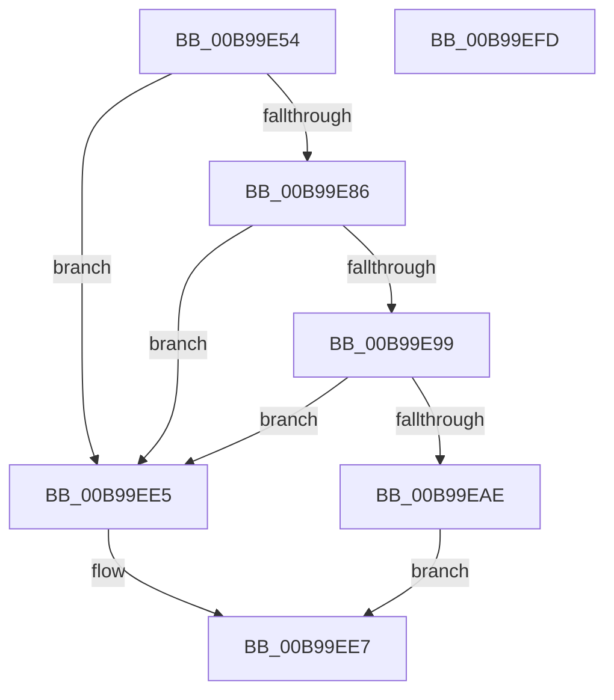

# ViSwap

- RVA: `0x00B99E54`–`0x00B99EFE` (길이 `170` bytes)
- VA: `0x0000000140B99E54`
- 실행 섹션: `PAGEVRFY`
- PDB 이름 있음: `예`; PDB Function 태그: `아니요`
- unwind 정보 RVA: `0x0006F978`
- 디코드: `50`개 명령, `170/170` bytes 표시
- 미해석 바이트: `0` (있으면 어셈블리에 `.byte`로 보존)

> 이 문서는 커널 이미지의 기계어와 PDB 기호를 분석해 생성했습니다. 4번과 5번은 함수 원형과 자료형을 바이너리 사용 방식에서 추정한 C 해석이며 원본 소스 복구 결과는 아닙니다.

## 1. Dependencies

- 직접 호출 지점: **3**; 고유 호출 대상: **3**
- 직접 호출자로 확인된 함수: **4**
- RIP 상대 이미지 참조: **0**

### Outgoing calls
- `0x00B99E79` → [ViGetMapRegisterFile](ViGetMapRegisterFile_function_00B98FA0.md) (function, `0x00B98FA0`)
- `0x00B99E8C` → [ViGetMdlBufferSa](ViGetMdlBufferSa_function_00B98FC8.md) (function, `0x00B98FC8`)
- `0x00B99EA4` → [ViFindMappedRegisterInFile](ViFindMappedRegisterInFile_function_00B9899C.md) (function, `0x00B9899C`)

### Direct callers
- [VfBuildScatterGatherList](VfBuildScatterGatherList_function_00B95AA0.md) at `0x00B95C91`
- [VfFlushAdapterBuffers](VfFlushAdapterBuffers_function_00B96220.md) at `0x00B962FF`
- [VfGetScatterGatherList](VfGetScatterGatherList_function_00B96BD0.md) at `0x00B96E30`
- [VfMapTransfer](VfMapTransfer_function_00B97300.md) at `0x00B97433`

### Static image references
- 디코드된 RIP-relative 메모리 참조가 없습니다.

## 2. Other-region calls and transfers

- 다른 실행 섹션으로 향하는 call: **0**
- 별도 외부 분기/꼬리 이동을 확인하지 못했습니다.

## 3. Assembly (complete function range)

```asm
00B99E54  48 8B C4                        mov rax, rsp
00B99E57  48 89 58 08                     mov qword ptr [rax + 8], rbx
00B99E5B  48 89 70 10                     mov qword ptr [rax + 0x10], rsi
00B99E5F  48 89 78 18                     mov qword ptr [rax + 0x18], rdi
00B99E63  41 56                           push r14
00B99E65  48 83 EC 20                     sub rsp, 0x20
00B99E69  83 60 20 00                     and dword ptr [rax + 0x20], 0
00B99E6D  4C 8B F1                        mov r14, rcx
00B99E70  48 8B 09                        mov rcx, qword ptr [rcx]
00B99E73  49 8B F8                        mov rdi, r8
00B99E76  48 8B F2                        mov rsi, rdx
00B99E79  E8 22 F1 FF FF                  call 0x140b98fa0
00B99E7E  48 8B D8                        mov rbx, rax
00B99E81  48 85 C0                        test rax, rax
00B99E84  74 5F                           je 0x140b99ee5
00B99E86  49 8B 10                        mov rdx, qword ptr [r8]
00B99E89  48 8B 0E                        mov rcx, qword ptr [rsi]
00B99E8C  E8 37 F1 FF FF                  call 0x140b98fc8
00B99E91  4C 8B D8                        mov r11, rax
00B99E94  48 85 C0                        test rax, rax
00B99E97  74 4C                           je 0x140b99ee5
00B99E99  4C 8D 44 24 48                  lea r8, [rsp + 0x48]
00B99E9E  48 8B D0                        mov rdx, rax
00B99EA1  48 8B CB                        mov rcx, rbx
00B99EA4  E8 F3 EA FF FF                  call 0x140b9899c
00B99EA9  48 85 C0                        test rax, rax
00B99EAC  74 37                           je 0x140b99ee5
00B99EAE  48 8B 4B 38                     mov rcx, qword ptr [rbx + 0x38]
00B99EB2  41 81 E3 FF 0F 00 00            and r11d, 0xfff
00B99EB9  48 89 0E                        mov qword ptr [rsi], rcx
00B99EBC  48 8B 53 38                     mov rdx, qword ptr [rbx + 0x38]
00B99EC0  8B 4C 24 48                     mov ecx, dword ptr [rsp + 0x48]
00B99EC4  C1 E1 0C                        shl ecx, 0xc
00B99EC7  8B 42 2C                        mov eax, dword ptr [rdx + 0x2c]
00B99ECA  4C 03 D8                        add r11, rax
00B99ECD  4C 03 D9                        add r11, rcx
00B99ED0  4C 03 5A 20                     add r11, qword ptr [rdx + 0x20]
00B99ED4  4C 89 1F                        mov qword ptr [rdi], r11
00B99ED7  48 8B 43 30                     mov rax, qword ptr [rbx + 0x30]
00B99EDB  49 89 06                        mov qword ptr [r14], rax
00B99EDE  B8 01 00 00 00                  mov eax, 1
00B99EE3  EB 02                           jmp 0x140b99ee7
00B99EE5  33 C0                           xor eax, eax
00B99EE7  48 8B 5C 24 30                  mov rbx, qword ptr [rsp + 0x30]
00B99EEC  48 8B 74 24 38                  mov rsi, qword ptr [rsp + 0x38]
00B99EF1  48 8B 7C 24 40                  mov rdi, qword ptr [rsp + 0x40]
00B99EF6  48 83 C4 20                     add rsp, 0x20
00B99EFA  41 5E                           pop r14
00B99EFC  C3                              ret
00B99EFD  CC                              int3
```

## 4. C-style interpretation (structured pseudocode)

```c
__int64 __fastcall ViSwap(__int64 a1, __int64 a2, __int64 a3)
{
    __int64 result;
    __int64 v_r11;
    __int64 v_rsp;
    unsigned __int64 v_stack_p10;
    unsigned __int64 v_stack_p18;
    unsigned __int64 v_stack_p20;
    unsigned __int64 v_stack_p8;

    *(unsigned __int64 *)(v_rsp + 8) = v_rbx;
    *(unsigned __int64 *)(v_rsp + 16) = v_rsi;
    *(unsigned __int64 *)(v_rsp + 24) = v_rdi;
    v_rsp = (v_rsp) - (32);
    result = ViGetMapRegisterFile(*(unsigned __int64 *)(a1), a2, a3, a4);
    if (result == 0) goto loc_00B99EE5;
    result = ViGetMdlBufferSa(*(unsigned __int64 *)(a2), *(unsigned __int64 *)(a3), a3, a4);
    if (result == 0) goto loc_00B99EE5;
    result = ViFindMappedRegisterInFile(result, result, v_stack_p20, a4);
    if (result == 0) goto loc_00B99EE5;
    v_r11 = (unsigned int)((result) & (0xFFFULL));
    *(unsigned __int64 *)(a2) = *(unsigned __int64 *)(result + 56);
    a1 = (unsigned int)(((unsigned int)(v_stack_p20)) << (12));
    v_r11 = (v_r11) + ((unsigned int)(*(unsigned int *)(*(unsigned __int64 *)(result + 56) + 44)));
    v_r11 = (v_r11) + (a1);
    v_r11 = (v_r11) + (*(unsigned __int64 *)(*(unsigned __int64 *)(result + 56) + 32));
    *(unsigned __int64 *)(a3) = v_r11;
    *(unsigned __int64 *)(a1) = *(unsigned __int64 *)(result + 48);
    goto loc_00B99EE7;
loc_00B99EE5:
    result = 0;
loc_00B99EE7:
    v_rsp = (v_rsp) + (32);
    return result;
}
```

## 5. (Beta) C Style

```c
int64_t ViSwap(void *Arg1, void *Arg2, void *Arg3)
{
    uint8_t *arg1 = (uint8_t *)Arg1;
    uint8_t *arg2 = (uint8_t *)Arg2;
    uint8_t *arg3 = (uint8_t *)Arg3;

    int64_t result;
    int64_t local_r11;
    int64_t local_rsp;
    uint64_t v_stack_p10;
    uint64_t v_stack_p18;
    uint64_t v_stack_p20;
    uint64_t v_stack_p8;

    *(uint64_t *)(local_rsp + 0x8) = local_rbx;
    *(uint64_t *)(local_rsp + 0x10) = local_rsi;
    *(uint64_t *)(local_rsp + 0x18) = local_rdi;
    local_rsp = (local_rsp) - (32);
    result = ViGetMapRegisterFile(*(uint64_t *)(arg1), Arg2, Arg3, a4);
    if (result == 0) goto loc_00B99EE5;
    result = ViGetMdlBufferSa(*(uint64_t *)(arg2), *(uint64_t *)(arg3), Arg3, a4);
    if (result == 0) goto loc_00B99EE5;
    result = ViFindMappedRegisterInFile(result, result, v_stack_p20, a4);
    if (result == 0) goto loc_00B99EE5;
    local_r11 = (uint32_t)((result) & (0xFFFULL));
    *(uint64_t *)(arg2) = *(uint64_t *)(result + 0x38);
    Arg1 = (uint32_t)(((uint32_t)(v_stack_p20)) << (12));
    local_r11 = (local_r11) + ((uint32_t)(*(uint32_t *)(*(uint64_t *)(result + 0x38) + 0x2C)));
    local_r11 = (local_r11) + (Arg1);
    local_r11 = (local_r11) + (*(uint64_t *)(*(uint64_t *)(result + 0x38) + 0x20));
    *(uint64_t *)(arg3) = local_r11;
    *(uint64_t *)(arg1) = *(uint64_t *)(result + 0x30);
    goto loc_00B99EE7;
loc_00B99EE5:
    result = 0;
loc_00B99EE7:
    local_rsp = (local_rsp) + (32);
    return result;
}
```

### 관측된 메모리 오프셋

구조체 형식이 확인되지 않은 접근은 인자 기준의 오프셋으로만 기록했습니다.

| 기준 인자 | 오프셋 표현 | 폭 (bit) | 접근 |
|---|---:|---:|---|
| `Arg1` | `+ 0x0` | `64` | `R` |
| `Arg1` | `+ 0x0` | `64` | `W` |
| `Arg2` | `+ 0x0` | `64` | `R` |
| `Arg2` | `+ 0x0` | `64` | `W` |
| `Arg3` | `+ 0x0` | `64` | `W` |

## 6. Execution-region graph

[열기: 2D/3D 그래프와 함수 탐색 컨트롤 패널](../../../control-panel.html?section=pagevrfy&rva=0x00B99E54&view=graph)

- 2D 그래프는 위에서 아래로 흐르고, 3D 그래프는 빈 공간을 드래그해 회전합니다. Shift+드래그는 이동, 휠은 확대·축소, 함수 노드 선택은 대상 보고서 이동입니다.

### Static fallback


