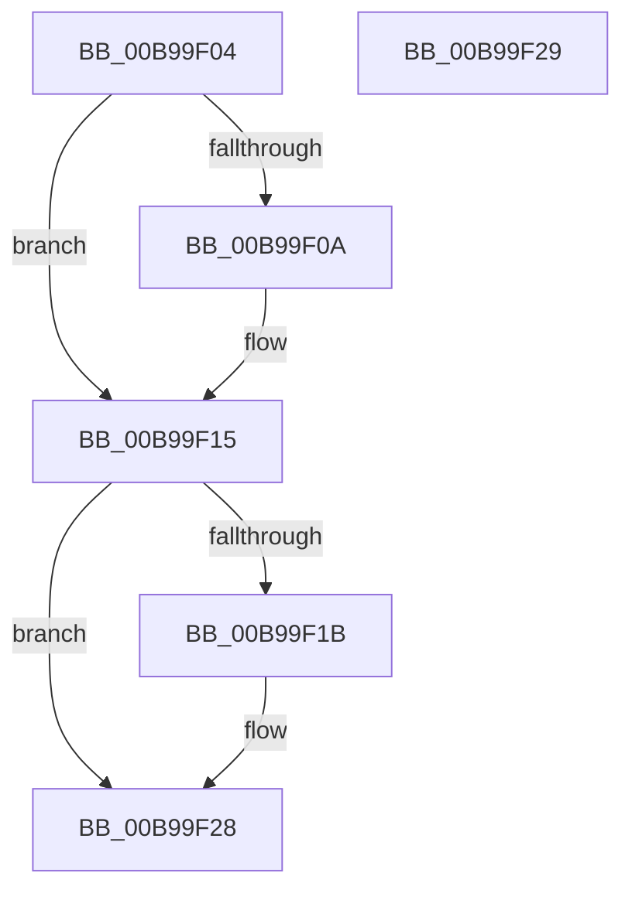

# ViTagBuffer

- RVA: `0x00B99F04`–`0x00B99F2A` (길이 `38` bytes)
- VA: `0x0000000140B99F04`
- 실행 섹션: `PAGEVRFY`
- PDB 이름 있음: `예`; PDB Function 태그: `아니요`
- unwind 정보 RVA: `0x000DB714`
- 디코드: `11`개 명령, `38/38` bytes 표시
- 미해석 바이트: `0` (있으면 어셈블리에 `.byte`로 보존)

> 이 문서는 커널 이미지의 기계어와 PDB 기호를 분석해 생성했습니다. 4번과 5번은 함수 원형과 자료형을 바이너리 사용 방식에서 추정한 C 해석이며 원본 소스 복구 결과는 아닙니다.

## 1. Dependencies

- 직접 호출 지점: **0**; 고유 호출 대상: **0**
- 직접 호출자로 확인된 함수: **2**
- RIP 상대 이미지 참조: **1**

### Outgoing calls
- 직접 디코드된 call 명령이 없습니다.

### Direct callers
- [ViAllocateMapRegistersFromFile](ViAllocateMapRegistersFromFile_function_00B980A8.md) at `0x00B982A4`
- [ViAllocateMapRegistersFromFile](ViAllocateMapRegistersFromFile_function_00B980A8.md) at `0x00B9830B`
- [ViInitializePadding](ViInitializePadding_function_00B99598.md) at `0x00B9960E`

### Static image references
- `0x00B99F0A` → RVA `0x00B8B020` (`ViDmaVerifierTag`; read)

## 2. Other-region calls and transfers

- 다른 실행 섹션으로 향하는 call: **0**
- 별도 외부 분기/꼬리 이동을 확인하지 못했습니다.

## 3. Assembly (complete function range)

```asm
00B99F04  41 F6 C0 01                     test r8b, 1
00B99F08  74 0B                           je 0x140b99f15
00B99F0A  48 8B 05 0F 11 FF FF            mov rax, qword ptr [rip - 0xeef1]
00B99F11  48 89 41 F8                     mov qword ptr [rcx - 8], rax
00B99F15  41 F6 C0 02                     test r8b, 2
00B99F19  74 0D                           je 0x140b99f28
00B99F1B  48 8B 05 FE 10 FF FF            mov rax, qword ptr [rip - 0xef02]
00B99F22  8B D2                           mov edx, edx
00B99F24  48 89 04 0A                     mov qword ptr [rdx + rcx], rax
00B99F28  C3                              ret
00B99F29  CC                              int3
```

## 4. C-style interpretation (structured pseudocode)

```c
__int64 __fastcall ViTagBuffer(__int64 a1, int a2, unsigned __int8 a3)
{
    __int64 result;

    if (((a3) & (1)) != 0) {
        result = *(unsigned __int64 *)(v_rip - 61169);
        *(unsigned __int64 *)(a1 - 8) = result;
    }
    if (((a3) & (2)) != 0) {
        result = *(unsigned __int64 *)(v_rip - 61186);
        a2 = a2;
        *(unsigned __int64 *)(a2 + a1 * 1) = result;
    }
    return result;
}
```

## 5. (Beta) C Style

```c
int64_t ViTagBuffer(void *Arg1, void *Arg2, uint8_t Arg3)
{
    uint8_t *arg1 = (uint8_t *)Arg1;
    uint8_t *arg2 = (uint8_t *)Arg2;

    int64_t result;

    if (((Arg3) & (1)) != 0) {
        result = *(uint64_t *)(v_rip - 0xEEF1);
        *(uint64_t *)(arg1 - 0x8) = result;
    }
    if (((Arg3) & (2)) != 0) {
        result = *(uint64_t *)(v_rip - 0xEF02);
        Arg2 = Arg2;
        *(uint64_t *)(arg2 + arg1 * 1) = result;
    }
    return result;
}
```

### 관측된 메모리 오프셋

구조체 형식이 확인되지 않은 접근은 인자 기준의 오프셋으로만 기록했습니다.

| 기준 인자 | 오프셋 표현 | 폭 (bit) | 접근 |
|---|---:|---:|---|
| `Arg1` | `- 0x8` | `64` | `W` |
| `Arg2` | `+ 0x0 + rcx*1` | `64` | `W` |

## 6. Execution-region graph

[열기: 2D/3D 그래프와 함수 탐색 컨트롤 패널](../../../control-panel.html?section=pagevrfy&rva=0x00B99F04&view=graph)

- 2D 그래프는 위에서 아래로 흐르고, 3D 그래프는 빈 공간을 드래그해 회전합니다. Shift+드래그는 이동, 휠은 확대·축소, 함수 노드 선택은 대상 보고서 이동입니다.

### Static fallback


