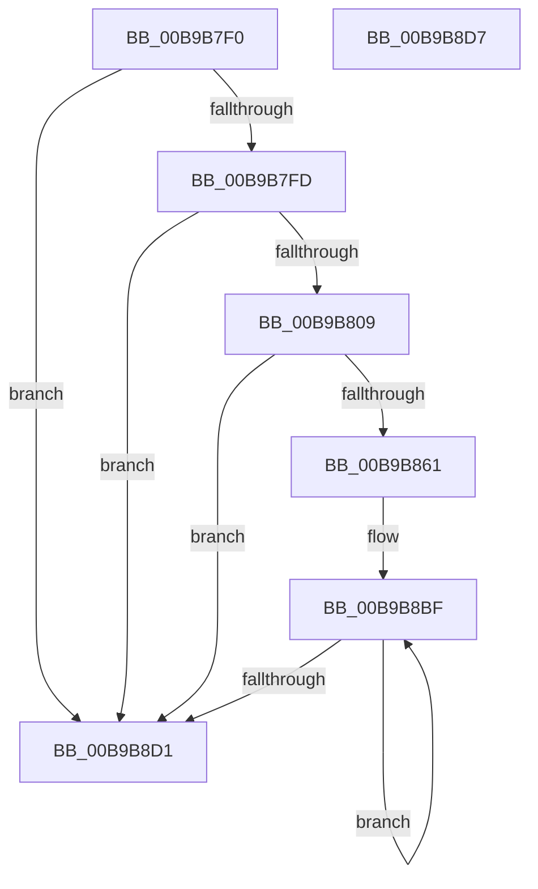

# ViTargetAddCountersCallback

- RVA: `0x00B9B7F0`–`0x00B9B8D8` (길이 `232` bytes)
- VA: `0x0000000140B9B7F0`
- 실행 섹션: `PAGEVRFY`
- PDB 이름 있음: `예`; PDB Function 태그: `아니요`
- unwind 정보 RVA: `0x000DB714`
- 디코드: `48`개 명령, `232/232` bytes 표시
- 미해석 바이트: `0` (있으면 어셈블리에 `.byte`로 보존)

> 이 문서는 커널 이미지의 기계어와 PDB 기호를 분석해 생성했습니다. 4번과 5번은 함수 원형과 자료형을 바이너리 사용 방식에서 추정한 C 해석이며 원본 소스 복구 결과는 아닙니다.

## 1. Dependencies

- 직접 호출 지점: **0**; 고유 호출 대상: **0**
- 직접 호출자로 확인된 함수: **0**
- RIP 상대 이미지 참조: **0**

### Outgoing calls
- 직접 디코드된 call 명령이 없습니다.

### Direct callers
- 이 함수 시작 RVA로 연결되는 직접 call은 확인되지 않았습니다. 간접 호출은 완전히 역산할 수 없습니다.

### Static image references
- 디코드된 RIP-relative 메모리 참조가 없습니다.

## 2. Other-region calls and transfers

- 다른 실행 섹션으로 향하는 call: **0**
- 별도 외부 분기/꼬리 이동을 확인하지 못했습니다.

## 3. Assembly (complete function range)

```asm
00B9B7F0  4C 8B 41 40                     mov r8, qword ptr [rcx + 0x40]
00B9B7F4  4D 85 C0                        test r8, r8
00B9B7F7  0F 84 D4 00 00 00               je 0x140b9b8d1
00B9B7FD  48 8B 02                        mov rax, qword ptr [rdx]
00B9B800  49 39 00                        cmp qword ptr [r8], rax
00B9B803  0F 85 C8 00 00 00               jne 0x140b9b8d1
00B9B809  41 8B 40 70                     mov eax, dword ptr [r8 + 0x70]
00B9B80D  48 8B 4A 08                     mov rcx, qword ptr [rdx + 8]
00B9B811  01 41 60                        add dword ptr [rcx + 0x60], eax
00B9B814  41 8B 40 74                     mov eax, dword ptr [r8 + 0x74]
00B9B818  01 41 64                        add dword ptr [rcx + 0x64], eax
00B9B81B  41 8B 40 78                     mov eax, dword ptr [r8 + 0x78]
00B9B81F  01 41 68                        add dword ptr [rcx + 0x68], eax
00B9B822  41 8B 40 7C                     mov eax, dword ptr [r8 + 0x7c]
00B9B826  01 41 6C                        add dword ptr [rcx + 0x6c], eax
00B9B829  49 8B 80 80 00 00 00            mov rax, qword ptr [r8 + 0x80]
00B9B830  48 01 41 70                     add qword ptr [rcx + 0x70], rax
00B9B834  49 8B 80 88 00 00 00            mov rax, qword ptr [r8 + 0x88]
00B9B83B  48 01 41 78                     add qword ptr [rcx + 0x78], rax
00B9B83F  49 8B 80 90 00 00 00            mov rax, qword ptr [r8 + 0x90]
00B9B846  48 01 81 80 00 00 00            add qword ptr [rcx + 0x80], rax
00B9B84D  49 8B 80 98 00 00 00            mov rax, qword ptr [r8 + 0x98]
00B9B854  48 01 81 88 00 00 00            add qword ptr [rcx + 0x88], rax
00B9B85B  83 7A 10 00                     cmp dword ptr [rdx + 0x10], 0
00B9B85F  74 70                           je 0x140b9b8d1
00B9B861  41 8B 80 A0 00 00 00            mov eax, dword ptr [r8 + 0xa0]
00B9B868  48 8D 91 A8 00 00 00            lea rdx, [rcx + 0xa8]
00B9B86F  01 81 90 00 00 00               add dword ptr [rcx + 0x90], eax
00B9B875  41 B9 0A 00 00 00               mov r9d, 0xa
00B9B87B  41 8B 80 A4 00 00 00            mov eax, dword ptr [r8 + 0xa4]
00B9B882  01 81 94 00 00 00               add dword ptr [rcx + 0x94], eax
00B9B888  41 8B 80 A8 00 00 00            mov eax, dword ptr [r8 + 0xa8]
00B9B88F  01 81 98 00 00 00               add dword ptr [rcx + 0x98], eax
00B9B895  41 8B 80 AC 00 00 00            mov eax, dword ptr [r8 + 0xac]
00B9B89C  01 81 9C 00 00 00               add dword ptr [rcx + 0x9c], eax
00B9B8A2  41 8B 80 B0 00 00 00            mov eax, dword ptr [r8 + 0xb0]
00B9B8A9  01 81 A0 00 00 00               add dword ptr [rcx + 0xa0], eax
00B9B8AF  41 8B 80 B4 00 00 00            mov eax, dword ptr [r8 + 0xb4]
00B9B8B6  01 81 A4 00 00 00               add dword ptr [rcx + 0xa4], eax
00B9B8BC  4C 2B C1                        sub r8, rcx
00B9B8BF  49 8B 4C 10 10                  mov rcx, qword ptr [r8 + rdx + 0x10]
00B9B8C4  48 01 0A                        add qword ptr [rdx], rcx
00B9B8C7  48 8D 52 08                     lea rdx, [rdx + 8]
00B9B8CB  49 83 E9 01                     sub r9, 1
00B9B8CF  75 EE                           jne 0x140b9b8bf
00B9B8D1  B8 01 00 00 00                  mov eax, 1
00B9B8D6  C3                              ret
00B9B8D7  CC                              int3
```

## 4. C-style interpretation (structured pseudocode)

```c
__int64 __fastcall ViTargetAddCountersCallback(__int64 a1, __int64 a2)
{
    if (*(unsigned __int64 *)(a1 + 64) == 0) goto loc_00B9B8D1;
    if ((*(unsigned __int64 *)(*(unsigned __int64 *)(a1 + 64))) != (*(unsigned __int64 *)(a2))) goto loc_00B9B8D1;
    if ((*(unsigned int *)(a2 + 16)) == 0) goto loc_00B9B8D1;
    a3 = (*(unsigned __int64 *)(a1 + 64)) - (*(unsigned __int64 *)(a2 + 8));
loc_00B9B8BF:
    a4 = (10) - (1);
    if (condition_is_not_equal) goto loc_00B9B8BF;
loc_00B9B8D1:
    return 1;
}
```

## 5. (Beta) C Style

```c
int64_t ViTargetAddCountersCallback(void *Arg1, void *Arg2)
{
    uint8_t *arg1 = (uint8_t *)Arg1;
    uint8_t *arg2 = (uint8_t *)Arg2;

    if (*(uint64_t *)(arg1 + 0x40) == 0) goto loc_00B9B8D1;
    if ((*(uint64_t *)(*(uint64_t *)(arg1 + 0x40))) != (*(uint64_t *)(arg2))) goto loc_00B9B8D1;
    if ((*(uint32_t *)(arg2 + 0x10)) == 0) goto loc_00B9B8D1;
    a3 = (*(uint64_t *)(arg1 + 0x40)) - (*(uint64_t *)(arg2 + 0x8));
loc_00B9B8BF:
    a4 = (10) - (1);
    if (condition_is_not_equal) goto loc_00B9B8BF;
loc_00B9B8D1:
    return 1;
}
```

### 관측된 메모리 오프셋

구조체 형식이 확인되지 않은 접근은 인자 기준의 오프셋으로만 기록했습니다.

| 기준 인자 | 오프셋 표현 | 폭 (bit) | 접근 |
|---|---:|---:|---|
| `Arg1` | `+ 0x40` | `64` | `R` |
| `Arg2` | `+ 0x0` | `64` | `R` |
| `Arg2` | `+ 0x8` | `64` | `R` |
| `Arg2` | `+ 0x10` | `32` | `R` |

## 6. Execution-region graph

[열기: 2D/3D 그래프와 함수 탐색 컨트롤 패널](../../../control-panel.html?section=pagevrfy&rva=0x00B9B7F0&view=graph)

- 2D 그래프는 위에서 아래로 흐르고, 3D 그래프는 빈 공간을 드래그해 회전합니다. Shift+드래그는 이동, 휠은 확대·축소, 함수 노드 선택은 대상 보고서 이동입니다.

### Static fallback


