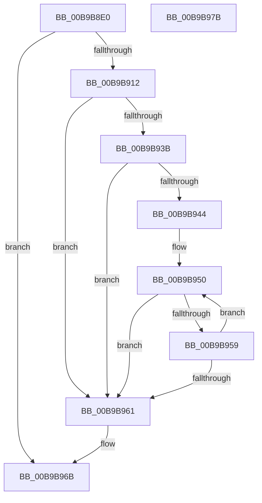

# ViTargetAddToCounter

- RVA: `0x00B9B8E0`–`0x00B9B97C` (길이 `156` bytes)
- VA: `0x0000000140B9B8E0`
- 실행 섹션: `PAGEVRFY`
- PDB 이름 있음: `예`; PDB Function 태그: `아니요`
- unwind 정보 RVA: `0x00086C28`
- 디코드: `43`개 명령, `156/156` bytes 표시
- 미해석 바이트: `0` (있으면 어셈블리에 `.byte`로 보존)

> 이 문서는 커널 이미지의 기계어와 PDB 기호를 분석해 생성했습니다. 4번과 5번은 함수 원형과 자료형을 바이너리 사용 방식에서 추정한 C 해석이며 원본 소스 복구 결과는 아닙니다.

## 1. Dependencies

- 직접 호출 지점: **4**; 고유 호출 대상: **4**
- 직접 호출자로 확인된 함수: **9**
- RIP 상대 이미지 참조: **1**

### Outgoing calls
- `0x00B9B909` → [ViTargetUpdateTreeAllowed](ViTargetUpdateTreeAllowed_function_00B9BC04.md) (function, `0x00B9BC04`)
- `0x00B9B920` → [VfAvlInitializeLockContext](../../text/4A/VfAvlInitializeLockContext_function_004A686C.md) (function, `0x004A686C`)
- `0x00B9B931` → [VfAvlLookupTreeNode](../../text/3E/VfAvlLookupTreeNode_function_003EF1B4.md) (function, `0x003EF1B4`)
- `0x00B9B966` → [VfAvlCleanupLockContext](../../text/3E/VfAvlCleanupLockContext_function_003EF56C.md) (function, `0x003EF56C`)

### Direct callers
- [VfMiscMmUnmapLockedPages_Entry](../BA/VfMiscMmUnmapLockedPages_Entry_function_00BAE1D0.md) at `0x00BAE43E`
- [VerifierMmAllocateNodePagesForMdlEx](../BB/VerifierMmAllocateNodePagesForMdlEx_function_00BB03E0.md) at `0x00BB0496`
- [VerifierMmAllocatePagesForMdl](../BB/VerifierMmAllocatePagesForMdl_function_00BB0510.md) at `0x00BB05B7`
- [VerifierMmAllocatePagesForMdlEx](../BB/VerifierMmAllocatePagesForMdlEx_function_00BB05F0.md) at `0x00BB0699`
- [VerifierMmFreePagesFromMdl](../BB/VerifierMmFreePagesFromMdl_function_00BB08B0.md) at `0x00BB08DA`
- [VerifierMmMapIoSpace](../BB/VerifierMmMapIoSpace_function_00BB0980.md) at `0x00BB0A4F`
- [VerifierMmMapLockedPages](../BB/VerifierMmMapLockedPages_function_00BB0AA0.md) at `0x00BB0B07`
- [VerifierMmUnlockPages](../BB/VerifierMmUnlockPages_function_00BB0D20.md) at `0x00BB0E4B`
- [VerifierMmUnlockPages](../BB/VerifierMmUnlockPages_function_00BB0D20.md) at `0x00BB0E6F`
- [VerifierMmUnmapIoSpace](../BB/VerifierMmUnmapIoSpace_function_00BB0EA0.md) at `0x00BB0F10`

### Static image references
- `0x00B9B92A` → RVA `0x00F049A0` (`.data`; read)

## 2. Other-region calls and transfers

- 다른 실행 섹션으로 향하는 call: **3**
  - `0x00B9B920` → [VfAvlInitializeLockContext](../../text/4A/VfAvlInitializeLockContext_function_004A686C.md) (`PAGEVRFY` → `.text`)
  - `0x00B9B931` → [VfAvlLookupTreeNode](../../text/3E/VfAvlLookupTreeNode_function_003EF1B4.md) (`PAGEVRFY` → `.text`)
  - `0x00B9B966` → [VfAvlCleanupLockContext](../../text/3E/VfAvlCleanupLockContext_function_003EF56C.md) (`PAGEVRFY` → `.text`)
- 별도 외부 분기/꼬리 이동을 확인하지 못했습니다.

## 3. Assembly (complete function range)

```asm
00B9B8E0  48 89 5C 24 08                  mov qword ptr [rsp + 8], rbx
00B9B8E5  48 89 74 24 10                  mov qword ptr [rsp + 0x10], rsi
00B9B8EA  57                              push rdi
00B9B8EB  48 83 EC 40                     sub rsp, 0x40
00B9B8EF  33 C0                           xor eax, eax
00B9B8F1  41 8B F8                        mov edi, r8d
00B9B8F4  0F 57 C0                        xorps xmm0, xmm0
00B9B8F7  48 89 44 24 38                  mov qword ptr [rsp + 0x38], rax
00B9B8FC  0F 11 44 24 28                  movups xmmword ptr [rsp + 0x28], xmm0
00B9B901  49 8B D9                        mov rbx, r9
00B9B904  8B F2                           mov esi, edx
00B9B906  4C 8B C1                        mov r8, rcx
00B9B909  E8 F6 02 00 00                  call 0x140b9bc04
00B9B90E  85 C0                           test eax, eax
00B9B910  74 59                           je 0x140b9b96b
00B9B912  41 B9 01 00 00 00               mov r9d, 1
00B9B918  48 8D 4C 24 28                  lea rcx, [rsp + 0x28]
00B9B91D  41 8B D1                        mov edx, r9d
00B9B920  E8 47 AF 90 FF                  call 0x1404a686c
00B9B925  48 8D 54 24 28                  lea rdx, [rsp + 0x28]
00B9B92A  48 8D 0D 6F 90 36 00            lea rcx, [rip + 0x36906f]
00B9B931  E8 7E 38 85 FF                  call 0x1403ef1b4
00B9B936  48 85 C0                        test rax, rax
00B9B939  74 26                           je 0x140b9b961
00B9B93B  4C 8B 40 40                     mov r8, qword ptr [rax + 0x40]
00B9B93F  4D 85 C0                        test r8, r8
00B9B942  74 1D                           je 0x140b9b961
00B9B944  48 8B CB                        mov rcx, rbx
00B9B947  F0 4A 0F C1 0C 06               lock xadd qword ptr [rsi + r8], rcx
00B9B94D  48 03 CB                        add rcx, rbx
00B9B950  4A 8B 04 07                     mov rax, qword ptr [rdi + r8]
00B9B954  48 3B C1                        cmp rax, rcx
00B9B957  77 08                           ja 0x140b9b961
00B9B959  F0 4A 0F B1 0C 07               lock cmpxchg qword ptr [rdi + r8], rcx
00B9B95F  75 EF                           jne 0x140b9b950
00B9B961  48 8D 4C 24 28                  lea rcx, [rsp + 0x28]
00B9B966  E8 01 3C 85 FF                  call 0x1403ef56c
00B9B96B  48 8B 5C 24 50                  mov rbx, qword ptr [rsp + 0x50]
00B9B970  48 8B 74 24 58                  mov rsi, qword ptr [rsp + 0x58]
00B9B975  48 83 C4 40                     add rsp, 0x40
00B9B979  5F                              pop rdi
00B9B97A  C3                              ret
00B9B97B  CC                              int3
```

## 4. C-style interpretation (structured pseudocode)

```c
__int64 __fastcall ViTargetAddToCounter(__int64 a1, int a2, int a3, __int64 a4)
{
    __int64 result;
    __int64 v_rsp;
    unsigned __int64 v_stack_m10;
    unsigned __int64 v_stack_m20;
    unsigned __int64 v_stack_p10;
    unsigned __int64 v_stack_p8;

    v_stack_p8 = v_rbx;
    v_stack_p10 = v_rsi;
    v_rsp = (v_rsp) - (64);
    result = 0;
    v_stack_m10 = 0;
    v_stack_m20 = v_xmm0;
    result = ViTargetUpdateTreeAllowed(a1, a2, a1, a4);
    if ((unsigned int)(result) == 0) goto loc_00B9B96B;
    result = VfAvlInitializeLockContext(v_stack_m20, 1, a1, 1);
    result = VfAvlLookupTreeNode(v_rip + 3575919, v_stack_m20, a1, 1);
    if (result == 0) goto loc_00B9B961;
    if (*(unsigned __int64 *)(result + 64) == 0) goto loc_00B9B961;
    a1 = (a4) + (a4);
loc_00B9B950:
    if ((*(unsigned __int64 *)((unsigned int)(a3) + *(unsigned __int64 *)(result + 64) * 1)) > a1) goto loc_00B9B961;
    if ((*(unsigned __int64 *)((unsigned int)(a3) + *(unsigned __int64 *)(result + 64) * 1)) != a1) goto loc_00B9B950;
loc_00B9B961:
    result = VfAvlCleanupLockContext(v_stack_m20, v_stack_m20, *(unsigned __int64 *)(result + 64), 1);
loc_00B9B96B:
    v_rsp = (v_rsp) + (64);
    return result;
}
```

## 5. (Beta) C Style

```c
int64_t ViTargetAddToCounter(int64_t Arg1, void *Arg2, void *Arg3, int64_t Arg4)
{
    uint8_t *arg2 = (uint8_t *)Arg2;
    uint8_t *arg3 = (uint8_t *)Arg3;

    int64_t result;
    int64_t local_rsp;
    uint64_t v_stack_m10;
    uint64_t v_stack_m20;
    uint64_t v_stack_p10;
    uint64_t v_stack_p8;

    v_stack_p8 = local_rbx;
    v_stack_p10 = local_rsi;
    local_rsp = (local_rsp) - (64);
    result = 0;
    v_stack_m10 = 0;
    v_stack_m20 = v_xmm0;
    result = ViTargetUpdateTreeAllowed(Arg1, Arg2, Arg1, Arg4);
    if ((uint32_t)(result) == 0) goto loc_00B9B96B;
    result = VfAvlInitializeLockContext(v_stack_m20, 1, Arg1, 1);
    result = VfAvlLookupTreeNode(v_rip + 3575919, v_stack_m20, Arg1, 1);
    if (result == 0) goto loc_00B9B961;
    if (*(uint64_t *)(result + 0x40) == 0) goto loc_00B9B961;
    Arg1 = (Arg4) + (Arg4);
loc_00B9B950:
    if ((*(uint64_t *)((uint32_t)(arg3) + *(uint64_t *)(result + 0x40) * 1)) > Arg1) goto loc_00B9B961;
    if ((*(uint64_t *)((uint32_t)(arg3) + *(uint64_t *)(result + 0x40) * 1)) != Arg1) goto loc_00B9B950;
loc_00B9B961:
    result = VfAvlCleanupLockContext(v_stack_m20, v_stack_m20, *(uint64_t *)(result + 0x40), 1);
loc_00B9B96B:
    local_rsp = (local_rsp) + (64);
    return result;
}
```

### 관측된 메모리 오프셋

구조체 형식이 확인되지 않은 접근은 인자 기준의 오프셋으로만 기록했습니다.

| 기준 인자 | 오프셋 표현 | 폭 (bit) | 접근 |
|---|---:|---:|---|
| `Arg2` | `+ 0x0 + r8*1` | `64` | `R/W` |
| `Arg3` | `+ 0x0 + r8*1` | `64` | `R` |

## 6. Execution-region graph

[열기: 2D/3D 그래프와 함수 탐색 컨트롤 패널](../../../control-panel.html?section=pagevrfy&rva=0x00B9B8E0&view=graph)

- 2D 그래프는 위에서 아래로 흐르고, 3D 그래프는 빈 공간을 드래그해 회전합니다. Shift+드래그는 이동, 휠은 확대·축소, 함수 노드 선택은 대상 보고서 이동입니다.

### Static fallback


