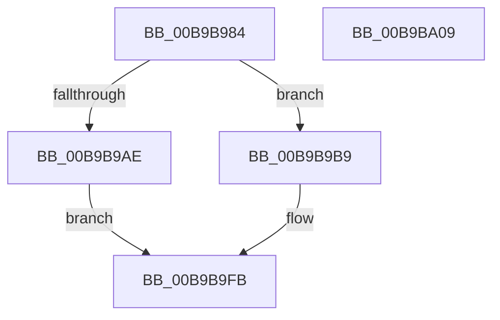

# ViTargetDriversAllocateVerifiedData

- RVA: `0x00B9B984`–`0x00B9BA0A` (길이 `134` bytes)
- VA: `0x0000000140B9B984`
- 실행 섹션: `PAGEVRFY`
- PDB 이름 있음: `예`; PDB Function 태그: `아니요`
- unwind 정보 RVA: `0x0005CAAC`
- 디코드: `36`개 명령, `134/134` bytes 표시
- 미해석 바이트: `0` (있으면 어셈블리에 `.byte`로 보존)

> 이 문서는 커널 이미지의 기계어와 PDB 기호를 분석해 생성했습니다. 4번과 5번은 함수 원형과 자료형을 바이너리 사용 방식에서 추정한 C 해석이며 원본 소스 복구 결과는 아닙니다.

## 1. Dependencies

- 직접 호출 지점: **3**; 고유 호출 대상: **2**
- 직접 호출자로 확인된 함수: **2**
- RIP 상대 이미지 참조: **1**

### Outgoing calls
- `0x00B9B9A1` → [ExAllocatePool2](../../poolcode/B8/ExAllocatePool2_function_00B820F0.md) (function, `0x00B820F0`)
- `0x00B9B9DF` → [InitializeSListHead](../../text/46/InitializeSListHead_function_00468A90.md) (function, `0x00468A90`)
- `0x00B9B9E8` → [InitializeSListHead](../../text/46/InitializeSListHead_function_00468A90.md) (function, `0x00468A90`)

### Direct callers
- [VfTargetDriversAdd](../../text/3E/VfTargetDriversAdd_function_003EE2F4.md) at `0x003EE3DA`
- [VfTargetDriversEnableVerifier](VfTargetDriversEnableVerifier_function_00B9B354.md) at `0x00B9B38C`

### Static image references
- `0x00B9B9B1` → RVA `0x00F04958` (`.data`; read/write)

## 2. Other-region calls and transfers

- 다른 실행 섹션으로 향하는 call: **3**
  - `0x00B9B9A1` → [ExAllocatePool2](../../poolcode/B8/ExAllocatePool2_function_00B820F0.md) (`PAGEVRFY` → `POOLCODE`)
  - `0x00B9B9DF` → [InitializeSListHead](../../text/46/InitializeSListHead_function_00468A90.md) (`PAGEVRFY` → `.text`)
  - `0x00B9B9E8` → [InitializeSListHead](../../text/46/InitializeSListHead_function_00468A90.md) (`PAGEVRFY` → `.text`)
- 별도 외부 분기/꼬리 이동을 확인하지 못했습니다.

## 3. Assembly (complete function range)

```asm
00B9B984  48 89 5C 24 08                  mov qword ptr [rsp + 8], rbx
00B9B989  57                              push rdi
00B9B98A  48 83 EC 20                     sub rsp, 0x20
00B9B98E  48 8B F9                        mov rdi, rcx
00B9B991  BA 20 01 00 00                  mov edx, 0x120
00B9B996  B9 40 00 00 00                  mov ecx, 0x40
00B9B99B  41 B8 56 66 56 44               mov r8d, 0x44566656
00B9B9A1  E8 4A 67 FE FF                  call 0x140b820f0
00B9B9A6  48 8B D8                        mov rbx, rax
00B9B9A9  48 85 C0                        test rax, rax
00B9B9AC  75 0B                           jne 0x140b9b9b9
00B9B9AE  8D 48 01                        lea ecx, [rax + 1]
00B9B9B1  87 0D A1 8F 36 00               xchg dword ptr [rip + 0x368fa1], ecx
00B9B9B7  EB 42                           jmp 0x140b9b9fb
00B9B9B9  48 89 3B                        mov qword ptr [rbx], rdi
00B9B9BC  48 8D 4B 40                     lea rcx, [rbx + 0x40]
00B9B9C0  B8 40 19 76 98                  mov eax, 0x98761940
00B9B9C5  48 89 43 28                     mov qword ptr [rbx + 0x28], rax
00B9B9C9  48 8D 43 10                     lea rax, [rbx + 0x10]
00B9B9CD  48 89 40 08                     mov qword ptr [rax + 8], rax
00B9B9D1  48 89 00                        mov qword ptr [rax], rax
00B9B9D4  48 8D 43 60                     lea rax, [rbx + 0x60]
00B9B9D8  48 89 40 08                     mov qword ptr [rax + 8], rax
00B9B9DC  48 89 00                        mov qword ptr [rax], rax
00B9B9DF  E8 AC D0 8C FF                  call 0x140468a90
00B9B9E4  48 8D 4B 50                     lea rcx, [rbx + 0x50]
00B9B9E8  E8 A3 D0 8C FF                  call 0x140468a90
00B9B9ED  48 8D 83 08 01 00 00            lea rax, [rbx + 0x108]
00B9B9F4  48 89 40 08                     mov qword ptr [rax + 8], rax
00B9B9F8  48 89 00                        mov qword ptr [rax], rax
00B9B9FB  48 8B C3                        mov rax, rbx
00B9B9FE  48 8B 5C 24 30                  mov rbx, qword ptr [rsp + 0x30]
00B9BA03  48 83 C4 20                     add rsp, 0x20
00B9BA07  5F                              pop rdi
00B9BA08  C3                              ret
00B9BA09  CC                              int3
```

## 4. C-style interpretation (structured pseudocode)

```c
__int64 __fastcall ViTargetDriversAllocateVerifiedData(__int64 a1)
{
    __int64 result;
    __int64 v_rsp;
    unsigned __int64 v_stack_p8;

    v_stack_p8 = v_rbx;
    v_rsp = (v_rsp) - (32);
    result = ExAllocatePool2(64, 288, (unsigned int)(0x44566656ULL), a4);
    if (result != 0) goto loc_00B9B9B9;
    goto loc_00B9B9FB;
loc_00B9B9B9:
    *(unsigned __int64 *)(result) = a1;
    *(unsigned __int64 *)(result + 40) = (unsigned int)(0x98761940ULL);
    *(unsigned __int64 *)(result + 16 + 8) = result + 16;
    *(unsigned __int64 *)(result + 16) = result + 16;
    *(unsigned __int64 *)(result + 96 + 8) = result + 96;
    *(unsigned __int64 *)(result + 96) = result + 96;
    result = InitializeSListHead(result + 64, 288, (unsigned int)(0x44566656ULL), a4);
    result = InitializeSListHead(result + 80, 288, (unsigned int)(0x44566656ULL), a4);
    *(unsigned __int64 *)(result + 264 + 8) = result + 264;
    *(unsigned __int64 *)(result + 264) = result + 264;
loc_00B9B9FB:
    v_rsp = (v_rsp) + (32);
    return result;
}
```

## 5. (Beta) C Style

```c
int64_t ViTargetDriversAllocateVerifiedData(int64_t Arg1)
{
    int64_t result;
    int64_t local_rsp;
    uint64_t v_stack_p8;

    v_stack_p8 = local_rbx;
    local_rsp = (local_rsp) - (32);
    result = ExAllocatePool2(64, 288, (uint32_t)(0x44566656ULL), a4);
    if (result != 0) goto loc_00B9B9B9;
    goto loc_00B9B9FB;
loc_00B9B9B9:
    *(uint64_t *)(result) = Arg1;
    *(uint64_t *)(result + 0x28) = (uint32_t)(0x98761940ULL);
    *(uint64_t *)(result + 0x10 + 0x8) = result + 16;
    *(uint64_t *)(result + 0x10) = result + 16;
    *(uint64_t *)(result + 0x60 + 0x8) = result + 96;
    *(uint64_t *)(result + 0x60) = result + 96;
    result = InitializeSListHead(result + 64, 288, (uint32_t)(0x44566656ULL), a4);
    result = InitializeSListHead(result + 80, 288, (uint32_t)(0x44566656ULL), a4);
    *(uint64_t *)(result + 0x108 + 0x8) = result + 264;
    *(uint64_t *)(result + 0x108) = result + 264;
loc_00B9B9FB:
    local_rsp = (local_rsp) + (32);
    return result;
}
```

## 6. Execution-region graph

[열기: 2D/3D 그래프와 함수 탐색 컨트롤 패널](../../../control-panel.html?section=pagevrfy&rva=0x00B9B984&view=graph)

- 2D 그래프는 위에서 아래로 흐르고, 3D 그래프는 빈 공간을 드래그해 회전합니다. Shift+드래그는 이동, 휠은 확대·축소, 함수 노드 선택은 대상 보고서 이동입니다.

### Static fallback


