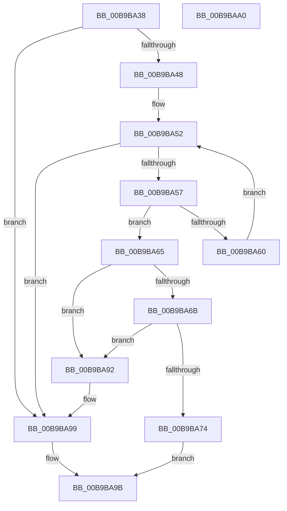

# ViTargetFreeContiguousMemoryFromNode

- RVA: `0x00B9BA38`–`0x00B9BAA1` (길이 `105` bytes)
- VA: `0x0000000140B9BA38`
- 실행 섹션: `PAGEVRFY`
- PDB 이름 있음: `예`; PDB Function 태그: `아니요`
- unwind 정보 RVA: `0x0005C788`
- 디코드: `32`개 명령, `105/105` bytes 표시
- 미해석 바이트: `0` (있으면 어셈블리에 `.byte`로 보존)

> 이 문서는 커널 이미지의 기계어와 PDB 기호를 분석해 생성했습니다. 4번과 5번은 함수 원형과 자료형을 바이너리 사용 방식에서 추정한 C 해석이며 원본 소스 복구 결과는 아닙니다.

## 1. Dependencies

- 직접 호출 지점: **1**; 고유 호출 대상: **1**
- 직접 호출자로 확인된 함수: **2**
- RIP 상대 이미지 참조: **0**

### Outgoing calls
- `0x00B9BA86` → [VfUtilFreePoolDispatchLevel](../../text/61/VfUtilFreePoolDispatchLevel_function_00612300.md) (function, `0x00612300`)

### Direct callers
- [VfTargetFreeContiguousMemory](VfTargetFreeContiguousMemory_function_00B9B6BC.md) at `0x00B9B716`
- [ViTargetFreeContiguousMemoryCallback](ViTargetFreeContiguousMemoryCallback_function_00B9BA10.md) at `0x00B9BA1D`

### Static image references
- 디코드된 RIP-relative 메모리 참조가 없습니다.

## 2. Other-region calls and transfers

- 다른 실행 섹션으로 향하는 call: **1**
  - `0x00B9BA86` → [VfUtilFreePoolDispatchLevel](../../text/61/VfUtilFreePoolDispatchLevel_function_00612300.md) (`PAGEVRFY` → `.text`)
- 별도 외부 분기/꼬리 이동을 확인하지 못했습니다.

## 3. Assembly (complete function range)

```asm
00B9BA38  48 83 EC 28                     sub rsp, 0x28
00B9BA3C  4C 8B 42 40                     mov r8, qword ptr [rdx + 0x40]
00B9BA40  4C 8B C9                        mov r9, rcx
00B9BA43  4D 85 C0                        test r8, r8
00B9BA46  74 51                           je 0x140b9ba99
00B9BA48  49 8D 90 08 01 00 00            lea rdx, [r8 + 0x108]
00B9BA4F  48 8B 0A                        mov rcx, qword ptr [rdx]
00B9BA52  48 3B CA                        cmp rcx, rdx
00B9BA55  74 42                           je 0x140b9ba99
00B9BA57  48 8B 01                        mov rax, qword ptr [rcx]
00B9BA5A  4C 39 49 10                     cmp qword ptr [rcx + 0x10], r9
00B9BA5E  74 05                           je 0x140b9ba65
00B9BA60  48 8B C8                        mov rcx, rax
00B9BA63  EB ED                           jmp 0x140b9ba52
00B9BA65  48 39 48 08                     cmp qword ptr [rax + 8], rcx
00B9BA69  75 27                           jne 0x140b9ba92
00B9BA6B  48 8B 51 08                     mov rdx, qword ptr [rcx + 8]
00B9BA6F  48 39 0A                        cmp qword ptr [rdx], rcx
00B9BA72  75 1E                           jne 0x140b9ba92
00B9BA74  48 89 02                        mov qword ptr [rdx], rax
00B9BA77  48 89 50 08                     mov qword ptr [rax + 8], rdx
00B9BA7B  48 8B 41 18                     mov rax, qword ptr [rcx + 0x18]
00B9BA7F  49 29 80 F8 00 00 00            sub qword ptr [r8 + 0xf8], rax
00B9BA86  E8 75 68 A7 FF                  call 0x140612300
00B9BA8B  B8 01 00 00 00                  mov eax, 1
00B9BA90  EB 09                           jmp 0x140b9ba9b
00B9BA92  B9 03 00 00 00                  mov ecx, 3
00B9BA97  CD 29                           int 0x29
00B9BA99  33 C0                           xor eax, eax
00B9BA9B  48 83 C4 28                     add rsp, 0x28
00B9BA9F  C3                              ret
00B9BAA0  CC                              int3
```

## 4. C-style interpretation (structured pseudocode)

```c
__int64 __fastcall ViTargetFreeContiguousMemoryFromNode(__int64 a1, __int64 a2)
{
    __int64 result;
    __int64 v_rsp;

    v_rsp = (v_rsp) - (40);
    if (*(unsigned __int64 *)(a2 + 64) == 0) goto loc_00B9BA99;
loc_00B9BA52:
    if ((*(unsigned __int64 *)(*(unsigned __int64 *)(a2 + 64) + 264)) == (*(unsigned __int64 *)(a2 + 64) + 264)) goto loc_00B9BA99;
    if ((*(unsigned __int64 *)(*(unsigned __int64 *)(*(unsigned __int64 *)(a2 + 64) + 264) + 16)) == a1) goto loc_00B9BA65;
    goto loc_00B9BA52;
loc_00B9BA65:
    if ((*(unsigned __int64 *)(*(unsigned __int64 *)(*(unsigned __int64 *)(*(unsigned __int64 *)(a2 + 64) + 264)) + 8)) != (*(unsigned __int64 *)(*(unsigned __int64 *)(*(unsigned __int64 *)(a2 + 64) + 264)))) goto loc_00B9BA92;
    if ((*(unsigned __int64 *)(*(unsigned __int64 *)(*(unsigned __int64 *)(*(unsigned __int64 *)(*(unsigned __int64 *)(a2 + 64) + 264)) + 8))) != (*(unsigned __int64 *)(*(unsigned __int64 *)(*(unsigned __int64 *)(a2 + 64) + 264)))) goto loc_00B9BA92;
    *(unsigned __int64 *)(*(unsigned __int64 *)(*(unsigned __int64 *)(*(unsigned __int64 *)(*(unsigned __int64 *)(a2 + 64) + 264)) + 8)) = *(unsigned __int64 *)(*(unsigned __int64 *)(*(unsigned __int64 *)(a2 + 64) + 264));
    *(unsigned __int64 *)(*(unsigned __int64 *)(*(unsigned __int64 *)(*(unsigned __int64 *)(a2 + 64) + 264)) + 8) = *(unsigned __int64 *)(*(unsigned __int64 *)(*(unsigned __int64 *)(*(unsigned __int64 *)(a2 + 64) + 264)) + 8);
    result = VfUtilFreePoolDispatchLevel(*(unsigned __int64 *)(*(unsigned __int64 *)(*(unsigned __int64 *)(a2 + 64) + 264)), *(unsigned __int64 *)(*(unsigned __int64 *)(*(unsigned __int64 *)(*(unsigned __int64 *)(a2 + 64) + 264)) + 8), *(unsigned __int64 *)(a2 + 64), a1);
    goto loc_00B9BA9B;
loc_00B9BA92:
loc_00B9BA99:
    result = 0;
loc_00B9BA9B:
    v_rsp = (v_rsp) + (40);
    return result;
}
```

## 5. (Beta) C Style

```c
int64_t ViTargetFreeContiguousMemoryFromNode(int64_t Arg1, void *Arg2)
{
    uint8_t *arg2 = (uint8_t *)Arg2;

    int64_t result;
    int64_t local_rsp;

    local_rsp = (local_rsp) - (40);
    if (*(uint64_t *)(arg2 + 0x40) == 0) goto loc_00B9BA99;
loc_00B9BA52:
    if ((*(uint64_t *)(*(uint64_t *)(arg2 + 0x40) + 0x108)) == (*(uint64_t *)(arg2 + 0x40) + 264)) goto loc_00B9BA99;
    if ((*(uint64_t *)(*(uint64_t *)(*(uint64_t *)(arg2 + 0x40) + 0x108) + 0x10)) == Arg1) goto loc_00B9BA65;
    goto loc_00B9BA52;
loc_00B9BA65:
    if ((*(uint64_t *)(*(uint64_t *)(*(uint64_t *)(*(uint64_t *)(arg2 + 0x40) + 0x108)) + 0x8)) != (*(uint64_t *)(*(uint64_t *)(*(uint64_t *)(arg2 + 0x40) + 0x108)))) goto loc_00B9BA92;
    if ((*(uint64_t *)(*(uint64_t *)(*(uint64_t *)(*(uint64_t *)(*(uint64_t *)(arg2 + 0x40) + 0x108)) + 0x8))) != (*(uint64_t *)(*(uint64_t *)(*(uint64_t *)(arg2 + 0x40) + 0x108)))) goto loc_00B9BA92;
    *(uint64_t *)(*(uint64_t *)(*(uint64_t *)(*(uint64_t *)(*(uint64_t *)(arg2 + 0x40) + 0x108)) + 0x8)) = *(uint64_t *)(*(uint64_t *)(*(uint64_t *)(arg2 + 0x40) + 0x108));
    *(uint64_t *)(*(uint64_t *)(*(uint64_t *)(*(uint64_t *)(arg2 + 0x40) + 0x108)) + 0x8) = *(uint64_t *)(*(uint64_t *)(*(uint64_t *)(*(uint64_t *)(arg2 + 0x40) + 0x108)) + 0x8);
    result = VfUtilFreePoolDispatchLevel(*(uint64_t *)(*(uint64_t *)(*(uint64_t *)(arg2 + 0x40) + 0x108)), *(uint64_t *)(*(uint64_t *)(*(uint64_t *)(*(uint64_t *)(arg2 + 0x40) + 0x108)) + 0x8), *(uint64_t *)(arg2 + 0x40), Arg1);
    goto loc_00B9BA9B;
loc_00B9BA92:
loc_00B9BA99:
    result = 0;
loc_00B9BA9B:
    local_rsp = (local_rsp) + (40);
    return result;
}
```

### 관측된 메모리 오프셋

구조체 형식이 확인되지 않은 접근은 인자 기준의 오프셋으로만 기록했습니다.

| 기준 인자 | 오프셋 표현 | 폭 (bit) | 접근 |
|---|---:|---:|---|
| `Arg2` | `+ 0x40` | `64` | `R` |

## 6. Execution-region graph

[열기: 2D/3D 그래프와 함수 탐색 컨트롤 패널](../../../control-panel.html?section=pagevrfy&rva=0x00B9BA38&view=graph)

- 2D 그래프는 위에서 아래로 흐르고, 3D 그래프는 빈 공간을 드래그해 회전합니다. Shift+드래그는 이동, 휠은 확대·축소, 함수 노드 선택은 대상 보고서 이동입니다.

### Static fallback


