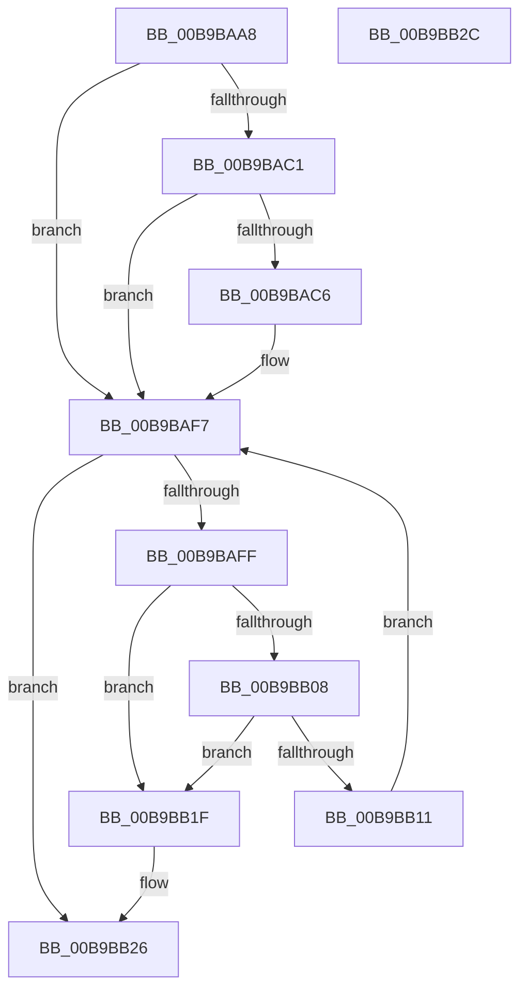

# ViTargetRemovingCheckContiguousMemory

- RVA: `0x00B9BAA8`–`0x00B9BB2D` (길이 `133` bytes)
- VA: `0x0000000140B9BAA8`
- 실행 섹션: `PAGEVRFY`
- PDB 이름 있음: `예`; PDB Function 태그: `아니요`
- unwind 정보 RVA: `0x000697A4`
- 디코드: `36`개 명령, `133/133` bytes 표시
- 미해석 바이트: `0` (있으면 어셈블리에 `.byte`로 보존)

> 이 문서는 커널 이미지의 기계어와 PDB 기호를 분석해 생성했습니다. 4번과 5번은 함수 원형과 자료형을 바이너리 사용 방식에서 추정한 C 해석이며 원본 소스 복구 결과는 아닙니다.

## 1. Dependencies

- 직접 호출 지점: **2**; 고유 호출 대상: **2**
- 직접 호출자로 확인된 함수: **1**
- RIP 상대 이미지 참조: **1**

### Outgoing calls
- `0x00B9BAF2` → [CarReportRuleViolationFromNt](CarReportRuleViolationFromNt_function_00B9D904.md) (function, `0x00B9D904`)
- `0x00B9BB18` → [VfUtilFreePoolDispatchLevel](../../text/61/VfUtilFreePoolDispatchLevel_function_00612300.md) (function, `0x00612300`)

### Direct callers
- [VfTargetDriversRemove](../../text/3E/VfTargetDriversRemove_function_003EEF9C.md) at `0x003EF14F`

### Static image references
- `0x00B9BAAE` → RVA `0x00F04A20` (`.data`; read)

## 2. Other-region calls and transfers

- 다른 실행 섹션으로 향하는 call: **1**
  - `0x00B9BB18` → [VfUtilFreePoolDispatchLevel](../../text/61/VfUtilFreePoolDispatchLevel_function_00612300.md) (`PAGEVRFY` → `.text`)
- 별도 외부 분기/꼬리 이동을 확인하지 못했습니다.

## 3. Assembly (complete function range)

```asm
00B9BAA8  40 53                           push rbx
00B9BAAA  48 83 EC 40                     sub rsp, 0x40
00B9BAAE  F7 05 68 8F 36 00 00 08 00 00   test dword ptr [rip + 0x368f68], 0x800
00B9BAB8  48 8D 99 08 01 00 00            lea rbx, [rcx + 0x108]
00B9BABF  74 36                           je 0x140b9baf7
00B9BAC1  48 39 1B                        cmp qword ptr [rbx], rbx
00B9BAC4  74 31                           je 0x140b9baf7
00B9BAC6  48 8B 42 30                     mov rax, qword ptr [rdx + 0x30]
00B9BACA  4C 8B C9                        mov r9, rcx
00B9BACD  4C 8B 42 60                     mov r8, qword ptr [rdx + 0x60]
00B9BAD1  BA 62 00 00 00                  mov edx, 0x62
00B9BAD6  48 89 44 24 30                  mov qword ptr [rsp + 0x30], rax
00B9BADB  48 8B 81 F8 00 00 00            mov rax, qword ptr [rcx + 0xf8]
00B9BAE2  C7 44 24 28 0B 00 00 00         mov dword ptr [rsp + 0x28], 0xb
00B9BAEA  8D 4A 62                        lea ecx, [rdx + 0x62]
00B9BAED  48 89 44 24 20                  mov qword ptr [rsp + 0x20], rax
00B9BAF2  E8 0D 1E 00 00                  call 0x140b9d904
00B9BAF7  48 8B 0B                        mov rcx, qword ptr [rbx]
00B9BAFA  48 3B CB                        cmp rcx, rbx
00B9BAFD  74 27                           je 0x140b9bb26
00B9BAFF  48 8B 11                        mov rdx, qword ptr [rcx]
00B9BB02  48 39 4A 08                     cmp qword ptr [rdx + 8], rcx
00B9BB06  75 17                           jne 0x140b9bb1f
00B9BB08  48 8B 41 08                     mov rax, qword ptr [rcx + 8]
00B9BB0C  48 39 08                        cmp qword ptr [rax], rcx
00B9BB0F  75 0E                           jne 0x140b9bb1f
00B9BB11  48 89 10                        mov qword ptr [rax], rdx
00B9BB14  48 89 42 08                     mov qword ptr [rdx + 8], rax
00B9BB18  E8 E3 67 A7 FF                  call 0x140612300
00B9BB1D  EB D8                           jmp 0x140b9baf7
00B9BB1F  B9 03 00 00 00                  mov ecx, 3
00B9BB24  CD 29                           int 0x29
00B9BB26  48 83 C4 40                     add rsp, 0x40
00B9BB2A  5B                              pop rbx
00B9BB2B  C3                              ret
00B9BB2C  CC                              int3
```

## 4. C-style interpretation (structured pseudocode)

```c
__int64 __fastcall ViTargetRemovingCheckContiguousMemory(__int64 a1, __int64 a2)
{
    __int64 result;
    __int64 v_rsp;
    unsigned __int64 v_stack_m18;
    unsigned int v_stack_m20;
    unsigned __int64 v_stack_m28;

    v_rsp = (v_rsp) - (64);
    if (((*(unsigned int *)(v_rip + 3575656)) & (0x800ULL)) == 0) goto loc_00B9BAF7;
    if ((*(unsigned __int64 *)(a1 + 264)) != (a1 + 264)) {
        result = *(unsigned __int64 *)(a2 + 48);
        a4 = a1;
        a3 = *(unsigned __int64 *)(a2 + 96);
        a2 = 98;
        v_stack_m18 = result;
        result = *(unsigned __int64 *)(a1 + 248);
        v_stack_m20 = 11;
        a1 = a2 + 98;
        v_stack_m28 = result;
        result = CarReportRuleViolationFromNt(a1, a2, a3, a4);
    }
    if ((*(unsigned __int64 *)(a1 + 264)) == (a1 + 264)) goto loc_00B9BB26;
    if ((*(unsigned __int64 *)(*(unsigned __int64 *)(*(unsigned __int64 *)(a1 + 264)) + 8)) != (*(unsigned __int64 *)(a1 + 264))) goto loc_00B9BB1F;
    if ((*(unsigned __int64 *)(*(unsigned __int64 *)(*(unsigned __int64 *)(a1 + 264) + 8))) != (*(unsigned __int64 *)(a1 + 264))) goto loc_00B9BB1F;
    *(unsigned __int64 *)(*(unsigned __int64 *)(*(unsigned __int64 *)(a1 + 264) + 8)) = *(unsigned __int64 *)(*(unsigned __int64 *)(a1 + 264));
    *(unsigned __int64 *)(*(unsigned __int64 *)(*(unsigned __int64 *)(a1 + 264)) + 8) = *(unsigned __int64 *)(*(unsigned __int64 *)(a1 + 264) + 8);
    result = VfUtilFreePoolDispatchLevel(*(unsigned __int64 *)(a1 + 264), *(unsigned __int64 *)(*(unsigned __int64 *)(a1 + 264)), a3, a4);
    goto loc_00B9BAF7;
loc_00B9BB1F:
loc_00B9BB26:
    v_rsp = (v_rsp) + (64);
    return result;
}
```

## 5. (Beta) C Style

```c
int64_t ViTargetRemovingCheckContiguousMemory(void *Arg1, void *Arg2)
{
    uint8_t *arg1 = (uint8_t *)Arg1;
    uint8_t *arg2 = (uint8_t *)Arg2;

    int64_t result;
    int64_t local_rsp;
    uint64_t v_stack_m18;
    uint32_t v_stack_m20;
    uint64_t v_stack_m28;

    local_rsp = (local_rsp) - (64);
    if (((*(uint32_t *)(v_rip + 0x368F68)) & (0x800ULL)) == 0) goto loc_00B9BAF7;
    if ((*(uint64_t *)(arg1 + 0x108)) != (Arg1 + 264)) {
        result = *(uint64_t *)(arg2 + 0x30);
        a4 = Arg1;
        a3 = *(uint64_t *)(arg2 + 0x60);
        Arg2 = 98;
        v_stack_m18 = result;
        result = *(uint64_t *)(arg1 + 0xF8);
        v_stack_m20 = 11;
        Arg1 = Arg2 + 98;
        v_stack_m28 = result;
        result = CarReportRuleViolationFromNt(Arg1, Arg2, a3, a4);
    }
    if ((*(uint64_t *)(arg1 + 0x108)) == (Arg1 + 264)) goto loc_00B9BB26;
    if ((*(uint64_t *)(*(uint64_t *)(*(uint64_t *)(arg1 + 0x108)) + 0x8)) != (*(uint64_t *)(arg1 + 0x108))) goto loc_00B9BB1F;
    if ((*(uint64_t *)(*(uint64_t *)(*(uint64_t *)(arg1 + 0x108) + 0x8))) != (*(uint64_t *)(arg1 + 0x108))) goto loc_00B9BB1F;
    *(uint64_t *)(*(uint64_t *)(*(uint64_t *)(arg1 + 0x108) + 0x8)) = *(uint64_t *)(*(uint64_t *)(arg1 + 0x108));
    *(uint64_t *)(*(uint64_t *)(*(uint64_t *)(arg1 + 0x108)) + 0x8) = *(uint64_t *)(*(uint64_t *)(arg1 + 0x108) + 0x8);
    result = VfUtilFreePoolDispatchLevel(*(uint64_t *)(arg1 + 0x108), *(uint64_t *)(*(uint64_t *)(arg1 + 0x108)), a3, a4);
    goto loc_00B9BAF7;
loc_00B9BB1F:
loc_00B9BB26:
    local_rsp = (local_rsp) + (64);
    return result;
}
```

### 관측된 메모리 오프셋

구조체 형식이 확인되지 않은 접근은 인자 기준의 오프셋으로만 기록했습니다.

| 기준 인자 | 오프셋 표현 | 폭 (bit) | 접근 |
|---|---:|---:|---|
| `Arg1` | `+ 0x0` | `64` | `R` |
| `Arg1` | `+ 0xF8` | `64` | `R` |
| `Arg1` | `+ 0x108` | `64` | `R` |
| `Arg2` | `+ 0x30` | `64` | `R` |
| `Arg2` | `+ 0x60` | `64` | `R` |

## 6. Execution-region graph

[열기: 2D/3D 그래프와 함수 탐색 컨트롤 패널](../../../control-panel.html?section=pagevrfy&rva=0x00B9BAA8&view=graph)

- 2D 그래프는 위에서 아래로 흐르고, 3D 그래프는 빈 공간을 드래그해 회전합니다. Shift+드래그는 이동, 휠은 확대·축소, 함수 노드 선택은 대상 보고서 이동입니다.

### Static fallback


