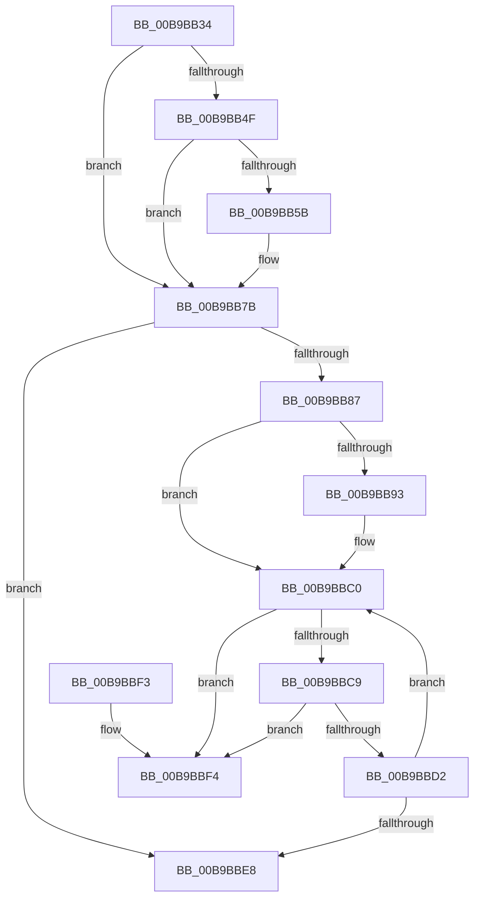

# ViTargetRemovingCheckEtwWmi

- RVA: `0x00B9BB34`–`0x00B9BBFB` (길이 `199` bytes)
- VA: `0x0000000140B9BB34`
- 실행 섹션: `PAGEVRFY`
- PDB 이름 있음: `예`; PDB Function 태그: `아니요`
- unwind 정보 RVA: `0x000B2A54`
- 디코드: `54`개 명령, `199/199` bytes 표시
- 미해석 바이트: `0` (있으면 어셈블리에 `.byte`로 보존)

> 이 문서는 커널 이미지의 기계어와 PDB 기호를 분석해 생성했습니다. 4번과 5번은 함수 원형과 자료형을 바이너리 사용 방식에서 추정한 C 해석이며 원본 소스 복구 결과는 아닙니다.

## 1. Dependencies

- 직접 호출 지점: **3**; 고유 호출 대상: **2**
- 직접 호출자로 확인된 함수: **1**
- RIP 상대 이미지 참조: **1**

### Outgoing calls
- `0x00B9BB76` → [CarReportRuleViolationFromNt](CarReportRuleViolationFromNt_function_00B9D904.md) (function, `0x00B9D904`)
- `0x00B9BBB8` → [CarReportRuleViolationFromNt](CarReportRuleViolationFromNt_function_00B9D904.md) (function, `0x00B9D904`)
- `0x00B9BBDB` → [ExFreePoolWithTag](../../poolcode/B8/ExFreePoolWithTag_function_00B82870.md) (function, `0x00B82870`)

### Direct callers
- [VfTargetDriversRemove](../../text/3E/VfTargetDriversRemove_function_003EEF9C.md) at `0x003EF139`

### Static image references
- `0x00B9BB4F` → RVA `0x00F04A20` (`.data`; read)

## 2. Other-region calls and transfers

- 다른 실행 섹션으로 향하는 call: **1**
  - `0x00B9BBDB` → [ExFreePoolWithTag](../../poolcode/B8/ExFreePoolWithTag_function_00B82870.md) (`PAGEVRFY` → `POOLCODE`)
- 별도 외부 분기/꼬리 이동을 확인하지 못했습니다.

## 3. Assembly (complete function range)

```asm
00B9BB34  48 8B C4                        mov rax, rsp
00B9BB37  48 89 58 08                     mov qword ptr [rax + 8], rbx
00B9BB3B  57                              push rdi
00B9BB3C  48 83 EC 40                     sub rsp, 0x40
00B9BB40  4C 8B 49 08                     mov r9, qword ptr [rcx + 8]
00B9BB44  48 8B FA                        mov rdi, rdx
00B9BB47  48 8B D9                        mov rbx, rcx
00B9BB4A  4D 85 C9                        test r9, r9
00B9BB4D  74 2C                           je 0x140b9bb7b
00B9BB4F  F7 05 C7 8E 36 00 00 08 00 00   test dword ptr [rip + 0x368ec7], 0x800
00B9BB59  74 20                           je 0x140b9bb7b
00B9BB5B  48 89 50 E8                     mov qword ptr [rax - 0x18], rdx
00B9BB5F  4C 8B C2                        mov r8, rdx
00B9BB62  BA DA 00 00 00                  mov edx, 0xda
00B9BB67  C7 40 E0 0B 00 00 00            mov dword ptr [rax - 0x20], 0xb
00B9BB6E  48 83 60 D8 00                  and qword ptr [rax - 0x28], 0
00B9BB73  8D 4A EA                        lea ecx, [rdx - 0x16]
00B9BB76  E8 89 1D 00 00                  call 0x140b9d904
00B9BB7B  48 83 C3 10                     add rbx, 0x10
00B9BB7F  48 8B 0B                        mov rcx, qword ptr [rbx]
00B9BB82  48 3B CB                        cmp rcx, rbx
00B9BB85  74 61                           je 0x140b9bbe8
00B9BB87  F7 05 8F 8E 36 00 00 08 00 00   test dword ptr [rip + 0x368e8f], 0x800
00B9BB91  74 2D                           je 0x140b9bbc0
00B9BB93  48 8B 41 10                     mov rax, qword ptr [rcx + 0x10]
00B9BB97  BA DD 00 00 00                  mov edx, 0xdd
00B9BB9C  4C 8B 41 18                     mov r8, qword ptr [rcx + 0x18]
00B9BBA0  4C 8B CF                        mov r9, rdi
00B9BBA3  48 89 7C 24 30                  mov qword ptr [rsp + 0x30], rdi
00B9BBA8  C7 44 24 28 0B 00 00 00         mov dword ptr [rsp + 0x28], 0xb
00B9BBB0  8D 4A E7                        lea ecx, [rdx - 0x19]
00B9BBB3  48 89 44 24 20                  mov qword ptr [rsp + 0x20], rax
00B9BBB8  E8 47 1D 00 00                  call 0x140b9d904
00B9BBBD  48 8B 0B                        mov rcx, qword ptr [rbx]
00B9BBC0  48 8B 11                        mov rdx, qword ptr [rcx]
00B9BBC3  48 39 4A 08                     cmp qword ptr [rdx + 8], rcx
00B9BBC7  75 2B                           jne 0x140b9bbf4
00B9BBC9  48 8B 41 08                     mov rax, qword ptr [rcx + 8]
00B9BBCD  48 39 08                        cmp qword ptr [rax], rcx
00B9BBD0  75 22                           jne 0x140b9bbf4
00B9BBD2  48 89 10                        mov qword ptr [rax], rdx
00B9BBD5  48 89 42 08                     mov qword ptr [rdx + 8], rax
00B9BBD9  33 D2                           xor edx, edx
00B9BBDB  E8 90 6C FE FF                  call 0x140b82870
00B9BBE0  48 8B 0B                        mov rcx, qword ptr [rbx]
00B9BBE3  48 3B CB                        cmp rcx, rbx
00B9BBE6  75 D8                           jne 0x140b9bbc0
00B9BBE8  48 8B 5C 24 50                  mov rbx, qword ptr [rsp + 0x50]
00B9BBED  48 83 C4 40                     add rsp, 0x40
00B9BBF1  5F                              pop rdi
00B9BBF2  C3                              ret
00B9BBF3  CC                              int3
00B9BBF4  B9 03 00 00 00                  mov ecx, 3
00B9BBF9  CD 29                           int 0x29
```

## 4. C-style interpretation (structured pseudocode)

```c
__int64 __fastcall ViTargetRemovingCheckEtwWmi(__int64 a1, __int64 a2)
{
    __int64 result;
    __int64 v_rbx;
    __int64 v_rsp;
    unsigned __int64 v_stack_m18;
    unsigned int v_stack_m20;
    unsigned __int64 v_stack_m28;
    unsigned __int64 v_stack_p8;

    *(unsigned __int64 *)(v_rsp + 8) = v_rbx;
    v_rsp = (v_rsp) - (64);
    if (*(unsigned __int64 *)(a1 + 8) == 0) goto loc_00B9BB7B;
    result = v_rsp;
    if (((*(unsigned int *)(v_rip + 3575495)) & (0x800ULL)) != 0) {
        *(unsigned __int64 *)(v_rsp - 24) = a2;
        a3 = a2;
        a2 = 218;
        *(unsigned int *)(v_rsp - 32) = 11;
        a1 = a2 - 22;
        result = CarReportRuleViolationFromNt(a1, a2, a3, *(unsigned __int64 *)(a1 + 8));
    }
    v_rbx = (a1) + (16);
    if ((*(unsigned __int64 *)(v_rbx)) == v_rbx) goto loc_00B9BBE8;
    if (((*(unsigned int *)(v_rip + 3575439)) & (0x800ULL)) != 0) {
        result = *(unsigned __int64 *)(*(unsigned __int64 *)(v_rbx) + 16);
        a2 = 221;
        a3 = *(unsigned __int64 *)(*(unsigned __int64 *)(v_rbx) + 24);
        a4 = a2;
        v_stack_m18 = a2;
        v_stack_m20 = 11;
        a1 = a2 - 25;
        v_stack_m28 = result;
        result = CarReportRuleViolationFromNt(a1, a2, a3, a4);
        a1 = *(unsigned __int64 *)(v_rbx);
    }
    if ((*(unsigned __int64 *)(*(unsigned __int64 *)(a1) + 8)) != a1) goto loc_00B9BBF4;
    if ((*(unsigned __int64 *)(*(unsigned __int64 *)(a1 + 8))) != a1) goto loc_00B9BBF4;
    *(unsigned __int64 *)(*(unsigned __int64 *)(a1 + 8)) = *(unsigned __int64 *)(a1);
    *(unsigned __int64 *)(*(unsigned __int64 *)(a1) + 8) = *(unsigned __int64 *)(a1 + 8);
    a2 = 0;
    result = ExFreePoolWithTag(a1, a2, a3, a4);
    if ((*(unsigned __int64 *)(v_rbx)) != v_rbx) goto loc_00B9BBC0;
loc_00B9BBE8:
    v_rsp = (v_rsp) + (64);
    return result;
loc_00B9BBF4:
    return result;
}
```

## 5. (Beta) C Style

```c
int64_t ViTargetRemovingCheckEtwWmi(void *Arg1, int64_t Arg2)
{
    uint8_t *arg1 = (uint8_t *)Arg1;

    int64_t result;
    int64_t local_rbx;
    int64_t local_rsp;
    uint64_t v_stack_m18;
    uint32_t v_stack_m20;
    uint64_t v_stack_m28;
    uint64_t v_stack_p8;

    *(uint64_t *)(local_rsp + 0x8) = local_rbx;
    local_rsp = (local_rsp) - (64);
    if (*(uint64_t *)(arg1 + 0x8) == 0) goto loc_00B9BB7B;
    result = local_rsp;
    if (((*(uint32_t *)(v_rip + 0x368EC7)) & (0x800ULL)) != 0) {
        *(uint64_t *)(local_rsp - 0x18) = Arg2;
        a3 = Arg2;
        Arg2 = 218;
        *(uint32_t *)(local_rsp - 0x20) = 11;
        Arg1 = Arg2 - 22;
        result = CarReportRuleViolationFromNt(Arg1, Arg2, a3, *(uint64_t *)(arg1 + 0x8));
    }
    local_rbx = (Arg1) + (16);
    if ((*(uint64_t *)(local_rbx)) == local_rbx) goto loc_00B9BBE8;
    if (((*(uint32_t *)(v_rip + 0x368E8F)) & (0x800ULL)) != 0) {
        result = *(uint64_t *)(*(uint64_t *)(local_rbx) + 0x10);
        Arg2 = 221;
        a3 = *(uint64_t *)(*(uint64_t *)(local_rbx) + 0x18);
        a4 = Arg2;
        v_stack_m18 = Arg2;
        v_stack_m20 = 11;
        Arg1 = Arg2 - 25;
        v_stack_m28 = result;
        result = CarReportRuleViolationFromNt(Arg1, Arg2, a3, a4);
        Arg1 = *(uint64_t *)(local_rbx);
    }
    if ((*(uint64_t *)(*(uint64_t *)(arg1) + 0x8)) != Arg1) goto loc_00B9BBF4;
    if ((*(uint64_t *)(*(uint64_t *)(arg1 + 0x8))) != Arg1) goto loc_00B9BBF4;
    *(uint64_t *)(*(uint64_t *)(arg1 + 0x8)) = *(uint64_t *)(arg1);
    *(uint64_t *)(*(uint64_t *)(arg1) + 0x8) = *(uint64_t *)(arg1 + 0x8);
    Arg2 = 0;
    result = ExFreePoolWithTag(Arg1, Arg2, a3, a4);
    if ((*(uint64_t *)(local_rbx)) != local_rbx) goto loc_00B9BBC0;
loc_00B9BBE8:
    local_rsp = (local_rsp) + (64);
    return result;
loc_00B9BBF4:
    return result;
}
```

### 관측된 메모리 오프셋

구조체 형식이 확인되지 않은 접근은 인자 기준의 오프셋으로만 기록했습니다.

| 기준 인자 | 오프셋 표현 | 폭 (bit) | 접근 |
|---|---:|---:|---|
| `Arg1` | `+ 0x0` | `64` | `R` |
| `Arg1` | `+ 0x8` | `64` | `R` |

## 6. Execution-region graph

[열기: 2D/3D 그래프와 함수 탐색 컨트롤 패널](../../../control-panel.html?section=pagevrfy&rva=0x00B9BB34&view=graph)

- 2D 그래프는 위에서 아래로 흐르고, 3D 그래프는 빈 공간을 드래그해 회전합니다. Shift+드래그는 이동, 휠은 확대·축소, 함수 노드 선택은 대상 보고서 이동입니다.

### Static fallback


