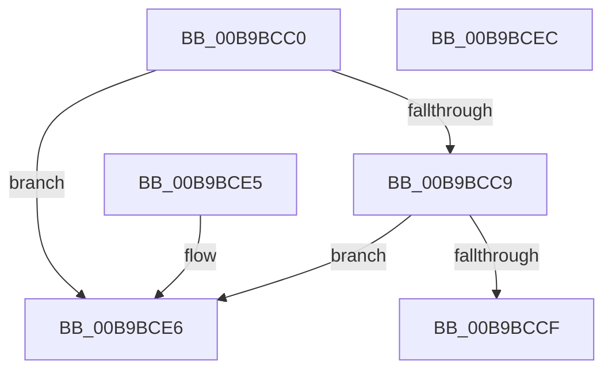

# ViTargetWMIDeregisterCallback

- RVA: `0x00B9BCC0`–`0x00B9BCED` (길이 `45` bytes)
- VA: `0x0000000140B9BCC0`
- 실행 섹션: `PAGEVRFY`
- PDB 이름 있음: `예`; PDB Function 태그: `아니요`
- unwind 정보 RVA: `0x000DB714`
- 디코드: `15`개 명령, `45/45` bytes 표시
- 미해석 바이트: `0` (있으면 어셈블리에 `.byte`로 보존)

> 이 문서는 커널 이미지의 기계어와 PDB 기호를 분석해 생성했습니다. 4번과 5번은 함수 원형과 자료형을 바이너리 사용 방식에서 추정한 C 해석이며 원본 소스 복구 결과는 아닙니다.

## 1. Dependencies

- 직접 호출 지점: **0**; 고유 호출 대상: **0**
- 직접 호출자로 확인된 함수: **0**
- RIP 상대 이미지 참조: **2**

### Outgoing calls
- 직접 디코드된 call 명령이 없습니다.

### Direct callers
- 이 함수 시작 RVA로 연결되는 직접 call은 확인되지 않았습니다. 간접 호출은 완전히 역산할 수 없습니다.

### Static image references
- `0x00B9BCD4` → RVA `0x00FFEF7C` (`PAGEVRFD`; read)
- `0x00B9BCDC` → RVA `0x00FFEF7C` (`PAGEVRFD`; write)

## 2. Other-region calls and transfers

- 다른 실행 섹션으로 향하는 call: **0**
- 별도 외부 분기/꼬리 이동을 확인하지 못했습니다.

## 3. Assembly (complete function range)

```asm
00B9BCC0  48 8B 41 40                     mov rax, qword ptr [rcx + 0x40]
00B9BCC4  48 85 C0                        test rax, rax
00B9BCC7  74 1D                           je 0x140b9bce6
00B9BCC9  48 39 50 08                     cmp qword ptr [rax + 8], rdx
00B9BCCD  75 17                           jne 0x140b9bce6
00B9BCCF  48 83 60 08 00                  and qword ptr [rax + 8], 0
00B9BCD4  8B 05 A2 32 46 00               mov eax, dword ptr [rip + 0x4632a2]
00B9BCDA  FF C0                           inc eax
00B9BCDC  89 05 9A 32 46 00               mov dword ptr [rip + 0x46329a], eax
00B9BCE2  33 C0                           xor eax, eax
00B9BCE4  C3                              ret
00B9BCE5  CC                              int3
00B9BCE6  B8 01 00 00 00                  mov eax, 1
00B9BCEB  C3                              ret
00B9BCEC  CC                              int3
```

## 4. C-style interpretation (structured pseudocode)

```c
__int64 __fastcall ViTargetWMIDeregisterCallback(__int64 a1, __int64 a2)
{
    __int64 result;

    if (*(unsigned __int64 *)(a1 + 64) == 0) goto loc_00B9BCE6;
    if ((*(unsigned __int64 *)(*(unsigned __int64 *)(a1 + 64) + 8)) != a2) goto loc_00B9BCE6;
    result = (unsigned int)(((unsigned int)(*(unsigned int *)(v_rip + 4600482))) + 1);
    *(unsigned int *)(v_rip + 4600474) = (unsigned int)(result);
    result = 0;
    return result;
loc_00B9BCE6:
    return 1;
}
```

## 5. (Beta) C Style

```c
int64_t ViTargetWMIDeregisterCallback(void *Arg1, int64_t Arg2)
{
    uint8_t *arg1 = (uint8_t *)Arg1;

    int64_t result;

    if (*(uint64_t *)(arg1 + 0x40) == 0) goto loc_00B9BCE6;
    if ((*(uint64_t *)(*(uint64_t *)(arg1 + 0x40) + 0x8)) != Arg2) goto loc_00B9BCE6;
    result = (uint32_t)(((uint32_t)(*(uint32_t *)(v_rip + 0x4632A2))) + 1);
    *(uint32_t *)(v_rip + 0x46329A) = (uint32_t)(result);
    result = 0;
    return result;
loc_00B9BCE6:
    return 1;
}
```

### 관측된 메모리 오프셋

구조체 형식이 확인되지 않은 접근은 인자 기준의 오프셋으로만 기록했습니다.

| 기준 인자 | 오프셋 표현 | 폭 (bit) | 접근 |
|---|---:|---:|---|
| `Arg1` | `+ 0x40` | `64` | `R` |

## 6. Execution-region graph

[열기: 2D/3D 그래프와 함수 탐색 컨트롤 패널](../../../control-panel.html?section=pagevrfy&rva=0x00B9BCC0&view=graph)

- 2D 그래프는 위에서 아래로 흐르고, 3D 그래프는 빈 공간을 드래그해 회전합니다. Shift+드래그는 이동, 휠은 확대·축소, 함수 노드 선택은 대상 보고서 이동입니다.

### Static fallback


