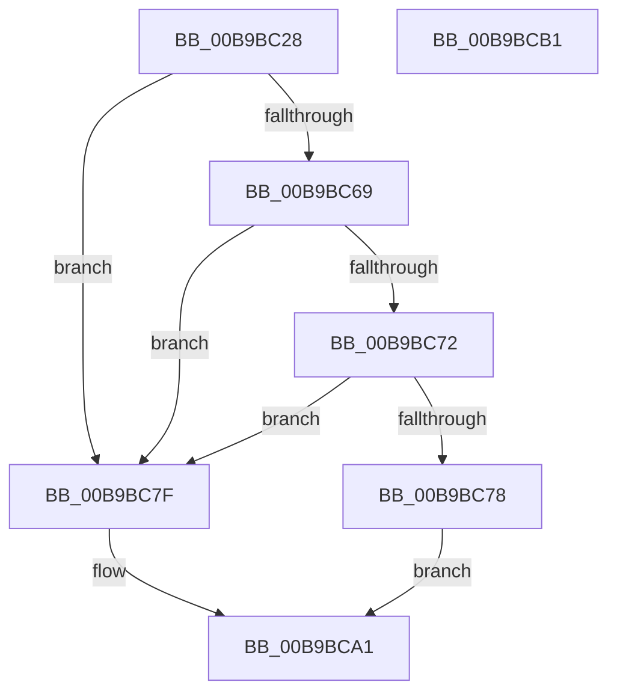

# ViTargetWMIDeregister

- RVA: `0x00B9BC28`–`0x00B9BCB2` (길이 `138` bytes)
- VA: `0x0000000140B9BC28`
- 실행 섹션: `PAGEVRFY`
- PDB 이름 있음: `예`; PDB Function 태그: `아니요`
- unwind 정보 RVA: `0x000697A4`
- 디코드: `37`개 명령, `138/138` bytes 표시
- 미해석 바이트: `0` (있으면 어셈블리에 `.byte`로 보존)

> 이 문서는 커널 이미지의 기계어와 PDB 기호를 분석해 생성했습니다. 4번과 5번은 함수 원형과 자료형을 바이너리 사용 방식에서 추정한 C 해석이며 원본 소스 복구 결과는 아닙니다.

## 1. Dependencies

- 직접 호출 지점: **4**; 고유 호출 대상: **4**
- 직접 호출자로 확인된 함수: **1**
- RIP 상대 이미지 참조: **4**

### Outgoing calls
- `0x00B9BC4A` → [VfAvlInitializeLockContext](../../text/4A/VfAvlInitializeLockContext_function_004A686C.md) (function, `0x004A686C`)
- `0x00B9BC5F` → [VfAvlLookupTreeNode](../../text/3E/VfAvlLookupTreeNode_function_003EF1B4.md) (function, `0x003EF1B4`)
- `0x00B9BC9C` → [VfAvlEnumerateNodes](VfAvlEnumerateNodes_function_00B93C14.md) (function, `0x00B93C14`)
- `0x00B9BCA6` → [VfAvlCleanupLockContext](../../text/3E/VfAvlCleanupLockContext_function_003EF56C.md) (function, `0x003EF56C`)

### Direct callers
- [VfTargetWMIRegistrationControl](VfTargetWMIRegistrationControl_function_00B9B74C.md) at `0x00B9B77F`
- [VfTargetWMIRegistrationControl](VfTargetWMIRegistrationControl_function_00B9B74C.md) at `0x00B9B7E3`

### Static image references
- `0x00B9BC58` → RVA `0x00F049A0` (`.data`; read)
- `0x00B9BC7F` → RVA `0x00FFEF78` (`PAGEVRFD`; read)
- `0x00B9BC85` → RVA `0x00B9BCC0` (`ViTargetWMIDeregisterCallback`; read)
- `0x00B9BC96` → RVA `0x00FFEF78` (`PAGEVRFD`; write)

## 2. Other-region calls and transfers

- 다른 실행 섹션으로 향하는 call: **3**
  - `0x00B9BC4A` → [VfAvlInitializeLockContext](../../text/4A/VfAvlInitializeLockContext_function_004A686C.md) (`PAGEVRFY` → `.text`)
  - `0x00B9BC5F` → [VfAvlLookupTreeNode](../../text/3E/VfAvlLookupTreeNode_function_003EF1B4.md) (`PAGEVRFY` → `.text`)
  - `0x00B9BCA6` → [VfAvlCleanupLockContext](../../text/3E/VfAvlCleanupLockContext_function_003EF56C.md) (`PAGEVRFY` → `.text`)
- 별도 외부 분기/꼬리 이동을 확인하지 못했습니다.

## 3. Assembly (complete function range)

```asm
00B9BC28  40 53                           push rbx
00B9BC2A  48 83 EC 40                     sub rsp, 0x40
00B9BC2E  0F 57 C0                        xorps xmm0, xmm0
00B9BC31  33 C0                           xor eax, eax
00B9BC33  4C 8B C2                        mov r8, rdx
00B9BC36  48 89 44 24 30                  mov qword ptr [rsp + 0x30], rax
00B9BC3B  48 8B D9                        mov rbx, rcx
00B9BC3E  33 D2                           xor edx, edx
00B9BC40  48 8D 4C 24 20                  lea rcx, [rsp + 0x20]
00B9BC45  0F 11 44 24 20                  movups xmmword ptr [rsp + 0x20], xmm0
00B9BC4A  E8 1D AC 90 FF                  call 0x1404a686c
00B9BC4F  44 8D 4A 01                     lea r9d, [rdx + 1]
00B9BC53  48 8D 54 24 20                  lea rdx, [rsp + 0x20]
00B9BC58  48 8D 0D 41 8D 36 00            lea rcx, [rip + 0x368d41]
00B9BC5F  E8 50 35 85 FF                  call 0x1403ef1b4
00B9BC64  48 85 C0                        test rax, rax
00B9BC67  74 16                           je 0x140b9bc7f
00B9BC69  48 8B 40 40                     mov rax, qword ptr [rax + 0x40]
00B9BC6D  48 85 C0                        test rax, rax
00B9BC70  74 0D                           je 0x140b9bc7f
00B9BC72  48 39 58 08                     cmp qword ptr [rax + 8], rbx
00B9BC76  75 07                           jne 0x140b9bc7f
00B9BC78  48 83 60 08 00                  and qword ptr [rax + 8], 0
00B9BC7D  EB 22                           jmp 0x140b9bca1
00B9BC7F  8B 05 F3 32 46 00               mov eax, dword ptr [rip + 0x4632f3]
00B9BC85  4C 8D 05 34 00 00 00            lea r8, [rip + 0x34]
00B9BC8C  FF C0                           inc eax
00B9BC8E  48 8D 54 24 20                  lea rdx, [rsp + 0x20]
00B9BC93  4C 8B CB                        mov r9, rbx
00B9BC96  89 05 DC 32 46 00               mov dword ptr [rip + 0x4632dc], eax
00B9BC9C  E8 73 7F FF FF                  call 0x140b93c14
00B9BCA1  48 8D 4C 24 20                  lea rcx, [rsp + 0x20]
00B9BCA6  E8 C1 38 85 FF                  call 0x1403ef56c
00B9BCAB  48 83 C4 40                     add rsp, 0x40
00B9BCAF  5B                              pop rbx
00B9BCB0  C3                              ret
00B9BCB1  CC                              int3
```

## 4. C-style interpretation (structured pseudocode)

```c
__int64 __fastcall ViTargetWMIDeregister(__int64 a1, __int64 a2)
{
    __int64 result;
    __int64 v_rsp;
    unsigned __int64 v_stack_m18;
    unsigned __int64 v_stack_m28;

    v_rsp = (v_rsp) - (64);
    result = 0;
    v_stack_m18 = 0;
    a2 = 0;
    v_stack_m28 = v_xmm0;
    result = VfAvlInitializeLockContext(v_stack_m28, a2, a2, a4);
    result = VfAvlLookupTreeNode(v_rip + 3575105, v_stack_m28, a2, a2 + 1);
    if (result == 0) goto loc_00B9BC7F;
    if (*(unsigned __int64 *)(result + 64) == 0) goto loc_00B9BC7F;
    if ((*(unsigned __int64 *)(*(unsigned __int64 *)(result + 64) + 8)) != a1) goto loc_00B9BC7F;
    goto loc_00B9BCA1;
loc_00B9BC7F:
    result = (unsigned int)(((unsigned int)(*(unsigned int *)(v_rip + 4600563))) + 1);
    *(unsigned int *)(v_rip + 4600540) = (unsigned int)(result);
    result = VfAvlEnumerateNodes(v_rip + 3575105, v_stack_m28, v_rip + 52, a1);
loc_00B9BCA1:
    result = VfAvlCleanupLockContext(v_stack_m28, v_stack_m28, v_rip + 52, a1);
    v_rsp = (v_rsp) + (64);
    return result;
}
```

## 5. (Beta) C Style

```c
int64_t ViTargetWMIDeregister(int64_t Arg1, int64_t Arg2)
{
    int64_t result;
    int64_t local_rsp;
    uint64_t v_stack_m18;
    uint64_t v_stack_m28;

    local_rsp = (local_rsp) - (64);
    result = 0;
    v_stack_m18 = 0;
    Arg2 = 0;
    v_stack_m28 = v_xmm0;
    result = VfAvlInitializeLockContext(v_stack_m28, Arg2, Arg2, a4);
    result = VfAvlLookupTreeNode(v_rip + 3575105, v_stack_m28, Arg2, Arg2 + 1);
    if (result == 0) goto loc_00B9BC7F;
    if (*(uint64_t *)(result + 0x40) == 0) goto loc_00B9BC7F;
    if ((*(uint64_t *)(*(uint64_t *)(result + 0x40) + 0x8)) != Arg1) goto loc_00B9BC7F;
    goto loc_00B9BCA1;
loc_00B9BC7F:
    result = (uint32_t)(((uint32_t)(*(uint32_t *)(v_rip + 0x4632F3))) + 1);
    *(uint32_t *)(v_rip + 0x4632DC) = (uint32_t)(result);
    result = VfAvlEnumerateNodes(v_rip + 3575105, v_stack_m28, v_rip + 52, Arg1);
loc_00B9BCA1:
    result = VfAvlCleanupLockContext(v_stack_m28, v_stack_m28, v_rip + 52, Arg1);
    local_rsp = (local_rsp) + (64);
    return result;
}
```

## 6. Execution-region graph

[열기: 2D/3D 그래프와 함수 탐색 컨트롤 패널](../../../control-panel.html?section=pagevrfy&rva=0x00B9BC28&view=graph)

- 2D 그래프는 위에서 아래로 흐르고, 3D 그래프는 빈 공간을 드래그해 회전합니다. Shift+드래그는 이동, 휠은 확대·축소, 함수 노드 선택은 대상 보고서 이동입니다.

### Static fallback


