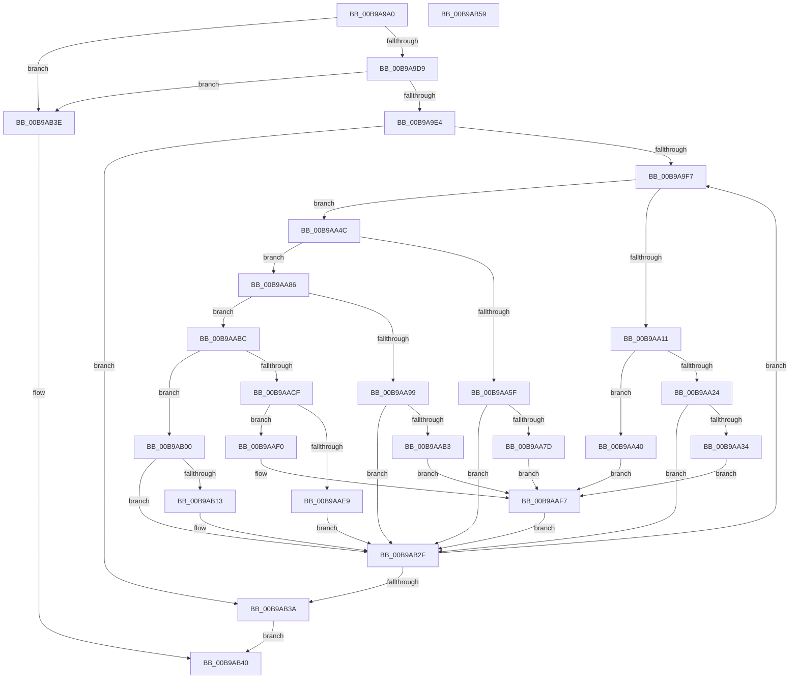

# ViXdvDriverLoadImage

- RVA: `0x00B9A9A0`–`0x00B9AB5A` (길이 `442` bytes)
- VA: `0x0000000140B9A9A0`
- 실행 섹션: `PAGEVRFY`
- PDB 이름 있음: `예`; PDB Function 태그: `아니요`
- unwind 정보 RVA: `0x0006B074`
- 디코드: `121`개 명령, `442/442` bytes 표시
- 미해석 바이트: `0` (있으면 어셈블리에 `.byte`로 보존)

> 이 문서는 커널 이미지의 기계어와 PDB 기호를 분석해 생성했습니다. 4번과 5번은 함수 원형과 자료형을 바이너리 사용 방식에서 추정한 C 해석이며 원본 소스 복구 결과는 아닙니다.

## 1. Dependencies

- 직접 호출 지점: **14**; 고유 호출 대상: **6**
- 직접 호출자로 확인된 함수: **2**
- RIP 상대 이미지 참조: **14**

### Outgoing calls
- `0x00B9A9C8` → [RtlImageDirectoryEntryToData](../../text/43/RtlImageDirectoryEntryToData_function_004328D0.md) (function, `0x004328D0`)
- `0x00B9AA08` → [strcmp](../../text/6C/strcmp_function_006C7000.md) (function, `0x006C7000`)
- `0x00B9AA1A` → [ViXdvGetFuncAddress](ViXdvGetFuncAddress_function_00B9AB60.md) (function, `0x00B9AB60`)
- `0x00B9AA27` → [ViXdvSetXdvKernelUtilities](../../text/61/ViXdvSetXdvKernelUtilities_function_006131B4.md) (function, `0x006131B4`)
- `0x00B9AA56` → [strcmp](../../text/6C/strcmp_function_006C7000.md) (function, `0x006C7000`)
- `0x00B9AA68` → [ViXdvGetFuncAddress](ViXdvGetFuncAddress_function_00B9AB60.md) (function, `0x00B9AB60`)
- `0x00B9AA90` → [strcmp](../../text/6C/strcmp_function_006C7000.md) (function, `0x006C7000`)
- `0x00B9AAA2` → [ViXdvGetFuncAddress](ViXdvGetFuncAddress_function_00B9AB60.md) (function, `0x00B9AB60`)
- `0x00B9AAC6` → [strcmp](../../text/6C/strcmp_function_006C7000.md) (function, `0x006C7000`)
- `0x00B9AAD8` → [ViXdvGetFuncAddress](ViXdvGetFuncAddress_function_00B9AB60.md) (function, `0x00B9AB60`)
- `0x00B9AAE9` → [guard_dispatch_icall](../../text/6B/guard_dispatch_icall_function_006BAAD0.md) (function, `0x006BAAD0`)
- `0x00B9AAF7` → [VfUtilDbgPrint](../../text/61/VfUtilDbgPrint_function_006122AC.md) (function, `0x006122AC`)
- `0x00B9AB0A` → [strcmp](../../text/6C/strcmp_function_006C7000.md) (function, `0x006C7000`)
- `0x00B9AB1C` → [ViXdvGetFuncAddress](ViXdvGetFuncAddress_function_00B9AB60.md) (function, `0x00B9AB60`)

### Direct callers
- [VfDriverLoadSucceeded](../../text/4B/VfDriverLoadSucceeded_function_004BD418.md) at `0x004BD459`
- [ViLogAndLoadXdv](ViLogAndLoadXdv_function_00B93B30.md) at `0x00B93B81`

### Static image references
- `0x00B9A9FB` → RVA `0x00BBA7E0` (` ?? ::JKADOLAD::`string'`; read)
- `0x00B9AA34` → RVA `0x00BBA760` (` ?? ::JKADOLAD::`string'`; read)
- `0x00B9AA40` → RVA `0x00BBA730` (` ?? ::JKADOLAD::`string'`; read)
- `0x00B9AA4F` → RVA `0x00BBA7C0` (` ?? ::JKADOLAD::`string'`; read)
- `0x00B9AA6D` → RVA `0x00FFDAD0` (`PAGEVRFD`; write)
- `0x00B9AA7D` → RVA `0x00BBA790` (` ?? ::JKADOLAD::`string'`; read)
- `0x00B9AA89` → RVA `0x00BBA6C0` (` ?? ::JKADOLAD::`string'`; read)
- `0x00B9AAA7` → RVA `0x00FFDAD8` (`PAGEVRFD`; write)
- `0x00B9AAB3` → RVA `0x00BBA690` (` ?? ::JKADOLAD::`string'`; read)
- `0x00B9AABF` → RVA `0x00BBA710` (` ?? ::JKADOLAD::`string'`; read)
- `0x00B9AADD` → RVA `0x00FFDBB0` (`PAGEVRFD`; write)
- `0x00B9AAF0` → RVA `0x00BBA6E0` (` ?? ::JKADOLAD::`string'`; read)
- `0x00B9AB03` → RVA `0x00BBA680` (` ?? ::JKADOLAD::`string'`; read)
- `0x00B9AB21` → RVA `0x00FFDA10` (`PAGEVRFD`; write)

## 2. Other-region calls and transfers

- 다른 실행 섹션으로 향하는 call: **9**
  - `0x00B9A9C8` → [RtlImageDirectoryEntryToData](../../text/43/RtlImageDirectoryEntryToData_function_004328D0.md) (`PAGEVRFY` → `.text`)
  - `0x00B9AA08` → [strcmp](../../text/6C/strcmp_function_006C7000.md) (`PAGEVRFY` → `.text`)
  - `0x00B9AA27` → [ViXdvSetXdvKernelUtilities](../../text/61/ViXdvSetXdvKernelUtilities_function_006131B4.md) (`PAGEVRFY` → `.text`)
  - `0x00B9AA56` → [strcmp](../../text/6C/strcmp_function_006C7000.md) (`PAGEVRFY` → `.text`)
  - `0x00B9AA90` → [strcmp](../../text/6C/strcmp_function_006C7000.md) (`PAGEVRFY` → `.text`)
  - `0x00B9AAC6` → [strcmp](../../text/6C/strcmp_function_006C7000.md) (`PAGEVRFY` → `.text`)
  - `0x00B9AAE9` → [guard_dispatch_icall](../../text/6B/guard_dispatch_icall_function_006BAAD0.md) (`PAGEVRFY` → `.text`)
  - `0x00B9AAF7` → [VfUtilDbgPrint](../../text/61/VfUtilDbgPrint_function_006122AC.md) (`PAGEVRFY` → `.text`)
  - `0x00B9AB0A` → [strcmp](../../text/6C/strcmp_function_006C7000.md) (`PAGEVRFY` → `.text`)
- 별도 외부 분기/꼬리 이동을 확인하지 못했습니다.

## 3. Assembly (complete function range)

```asm
00B9A9A0  48 8B C4                        mov rax, rsp
00B9A9A3  48 89 58 10                     mov qword ptr [rax + 0x10], rbx
00B9A9A7  48 89 68 18                     mov qword ptr [rax + 0x18], rbp
00B9A9AB  48 89 70 20                     mov qword ptr [rax + 0x20], rsi
00B9A9AF  57                              push rdi
00B9A9B0  41 56                           push r14
00B9A9B2  41 57                           push r15
00B9A9B4  48 83 EC 20                     sub rsp, 0x20
00B9A9B8  4C 8B 71 30                     mov r14, qword ptr [rcx + 0x30]
00B9A9BC  4C 8D 48 08                     lea r9, [rax + 8]
00B9A9C0  49 8B CE                        mov rcx, r14
00B9A9C3  45 33 C0                        xor r8d, r8d
00B9A9C6  B2 01                           mov dl, 1
00B9A9C8  E8 03 7F 89 FF                  call 0x1404328d0
00B9A9CD  48 8B F8                        mov rdi, rax
00B9A9D0  48 85 C0                        test rax, rax
00B9A9D3  0F 84 65 01 00 00               je 0x140b9ab3e
00B9A9D9  8B 40 18                        mov eax, dword ptr [rax + 0x18]
00B9A9DC  85 C0                           test eax, eax
00B9A9DE  0F 84 5A 01 00 00               je 0x140b9ab3e
00B9A9E4  44 8B 7F 20                     mov r15d, dword ptr [rdi + 0x20]
00B9A9E8  33 F6                           xor esi, esi
00B9A9EA  4D 03 FE                        add r15, r14
00B9A9ED  B3 01                           mov bl, 1
00B9A9EF  85 C0                           test eax, eax
00B9A9F1  0F 84 43 01 00 00               je 0x140b9ab3a
00B9A9F7  41 8B 2C B7                     mov ebp, dword ptr [r15 + rsi*4]
00B9A9FB  48 8D 0D DE FD 01 00            lea rcx, [rip + 0x1fdde]
00B9AA02  49 03 EE                        add rbp, r14
00B9AA05  48 8B D5                        mov rdx, rbp
00B9AA08  E8 F3 C5 B2 FF                  call 0x1406c7000
00B9AA0D  85 C0                           test eax, eax
00B9AA0F  75 3B                           jne 0x140b9aa4c
00B9AA11  44 8B C6                        mov r8d, esi
00B9AA14  48 8B D7                        mov rdx, rdi
00B9AA17  49 8B CE                        mov rcx, r14
00B9AA1A  E8 41 01 00 00                  call 0x140b9ab60
00B9AA1F  48 85 C0                        test rax, rax
00B9AA22  74 1C                           je 0x140b9aa40
00B9AA24  48 8B C8                        mov rcx, rax
00B9AA27  E8 88 87 A7 FF                  call 0x1406131b4
00B9AA2C  84 C0                           test al, al
00B9AA2E  0F 85 FB 00 00 00               jne 0x140b9ab2f
00B9AA34  48 8D 0D 25 FD 01 00            lea rcx, [rip + 0x1fd25]
00B9AA3B  E9 B7 00 00 00                  jmp 0x140b9aaf7
00B9AA40  48 8D 0D E9 FC 01 00            lea rcx, [rip + 0x1fce9]
00B9AA47  E9 AB 00 00 00                  jmp 0x140b9aaf7
00B9AA4C  48 8B D5                        mov rdx, rbp
00B9AA4F  48 8D 0D 6A FD 01 00            lea rcx, [rip + 0x1fd6a]
00B9AA56  E8 A5 C5 B2 FF                  call 0x1406c7000
00B9AA5B  85 C0                           test eax, eax
00B9AA5D  75 27                           jne 0x140b9aa86
00B9AA5F  44 8B C6                        mov r8d, esi
00B9AA62  48 8B D7                        mov rdx, rdi
00B9AA65  49 8B CE                        mov rcx, r14
00B9AA68  E8 F3 00 00 00                  call 0x140b9ab60
00B9AA6D  48 89 05 5C 30 46 00            mov qword ptr [rip + 0x46305c], rax
00B9AA74  48 85 C0                        test rax, rax
00B9AA77  0F 85 B2 00 00 00               jne 0x140b9ab2f
00B9AA7D  48 8D 0D 0C FD 01 00            lea rcx, [rip + 0x1fd0c]
00B9AA84  EB 71                           jmp 0x140b9aaf7
00B9AA86  48 8B D5                        mov rdx, rbp
00B9AA89  48 8D 0D 30 FC 01 00            lea rcx, [rip + 0x1fc30]
00B9AA90  E8 6B C5 B2 FF                  call 0x1406c7000
00B9AA95  85 C0                           test eax, eax
00B9AA97  75 23                           jne 0x140b9aabc
00B9AA99  44 8B C6                        mov r8d, esi
00B9AA9C  48 8B D7                        mov rdx, rdi
00B9AA9F  49 8B CE                        mov rcx, r14
00B9AAA2  E8 B9 00 00 00                  call 0x140b9ab60
00B9AAA7  48 89 05 2A 30 46 00            mov qword ptr [rip + 0x46302a], rax
00B9AAAE  48 85 C0                        test rax, rax
00B9AAB1  75 7C                           jne 0x140b9ab2f
00B9AAB3  48 8D 0D D6 FB 01 00            lea rcx, [rip + 0x1fbd6]
00B9AABA  EB 3B                           jmp 0x140b9aaf7
00B9AABC  48 8B D5                        mov rdx, rbp
00B9AABF  48 8D 0D 4A FC 01 00            lea rcx, [rip + 0x1fc4a]
00B9AAC6  E8 35 C5 B2 FF                  call 0x1406c7000
00B9AACB  85 C0                           test eax, eax
00B9AACD  75 31                           jne 0x140b9ab00
00B9AACF  44 8B C6                        mov r8d, esi
00B9AAD2  48 8B D7                        mov rdx, rdi
00B9AAD5  49 8B CE                        mov rcx, r14
00B9AAD8  E8 83 00 00 00                  call 0x140b9ab60
00B9AADD  48 89 05 CC 30 46 00            mov qword ptr [rip + 0x4630cc], rax
00B9AAE4  48 85 C0                        test rax, rax
00B9AAE7  74 07                           je 0x140b9aaf0
00B9AAE9  E8 E2 FF B1 FF                  call 0x1406baad0
00B9AAEE  EB 3F                           jmp 0x140b9ab2f
00B9AAF0  48 8D 0D E9 FB 01 00            lea rcx, [rip + 0x1fbe9]
00B9AAF7  E8 B0 77 A7 FF                  call 0x1406122ac
00B9AAFC  32 DB                           xor bl, bl
00B9AAFE  EB 2F                           jmp 0x140b9ab2f
00B9AB00  48 8B D5                        mov rdx, rbp
00B9AB03  48 8D 0D 76 FB 01 00            lea rcx, [rip + 0x1fb76]
00B9AB0A  E8 F1 C4 B2 FF                  call 0x1406c7000
00B9AB0F  85 C0                           test eax, eax
00B9AB11  75 1C                           jne 0x140b9ab2f
00B9AB13  44 8B C6                        mov r8d, esi
00B9AB16  48 8B D7                        mov rdx, rdi
00B9AB19  49 8B CE                        mov rcx, r14
00B9AB1C  E8 3F 00 00 00                  call 0x140b9ab60
00B9AB21  48 89 05 E8 2E 46 00            mov qword ptr [rip + 0x462ee8], rax
00B9AB28  48 F7 D8                        neg rax
00B9AB2B  1A C0                           sbb al, al
00B9AB2D  22 D8                           and bl, al
00B9AB2F  FF C6                           inc esi
00B9AB31  3B 77 18                        cmp esi, dword ptr [rdi + 0x18]
00B9AB34  0F 82 BD FE FF FF               jb 0x140b9a9f7
00B9AB3A  8A C3                           mov al, bl
00B9AB3C  EB 02                           jmp 0x140b9ab40
00B9AB3E  32 C0                           xor al, al
00B9AB40  48 8B 5C 24 48                  mov rbx, qword ptr [rsp + 0x48]
00B9AB45  48 8B 6C 24 50                  mov rbp, qword ptr [rsp + 0x50]
00B9AB4A  48 8B 74 24 58                  mov rsi, qword ptr [rsp + 0x58]
00B9AB4F  48 83 C4 20                     add rsp, 0x20
00B9AB53  41 5F                           pop r15
00B9AB55  41 5E                           pop r14
00B9AB57  5F                              pop rdi
00B9AB58  C3                              ret
00B9AB59  CC                              int3
```

## 4. C-style interpretation (structured pseudocode)

```c
__int64 __fastcall ViXdvDriverLoadImage(__int64 a1, __int64 a2, int a3)
{
    __int64 result;
    __int64 v_r15;
    __int64 v_rbp;
    __int64 v_rbx;
    __int64 v_rsi;
    __int64 v_rsp;
    unsigned __int64 v_stack_p10;
    unsigned __int64 v_stack_p18;
    unsigned __int64 v_stack_p20;

    *(unsigned __int64 *)(v_rsp + 16) = v_rbx;
    *(unsigned __int64 *)(v_rsp + 24) = v_rbp;
    *(unsigned __int64 *)(v_rsp + 32) = v_rsi;
    v_rsp = (v_rsp) - (32);
    a3 = 0;
    result = RtlImageDirectoryEntryToData(*(unsigned __int64 *)(a1 + 48), 1, a3, v_rsp + 8);
    if (result == 0) goto loc_00B9AB3E;
    if ((unsigned int)((unsigned int)(*(unsigned int *)(result + 24))) == 0) goto loc_00B9AB3E;
    v_rsi = 0;
    v_r15 = ((unsigned int)(*(unsigned int *)(result + 32))) + (*(unsigned __int64 *)(a1 + 48));
    if ((unsigned int)((unsigned int)(*(unsigned int *)(result + 24))) == 0) goto loc_00B9AB3A;
loc_00B9A9F7:
    v_rbp = ((unsigned int)(*(unsigned int *)(v_r15 + v_rsi * 4))) + (*(unsigned __int64 *)(a1 + 48));
    result = strcmp(v_rip + 130526, v_rbp, a3, v_rsp + 8);
    if ((unsigned int)(result) != 0) goto loc_00B9AA4C;
    result = ViXdvGetFuncAddress(*(unsigned __int64 *)(a1 + 48), result, 0, v_rsp + 8);
    if (result == 0) goto loc_00B9AA40;
    result = ViXdvSetXdvKernelUtilities(result, result, 0, v_rsp + 8);
    if ((unsigned __int8)(result) != 0) goto loc_00B9AB2F;
    goto loc_00B9AAF7;
loc_00B9AA40:
    goto loc_00B9AAF7;
loc_00B9AA4C:
    result = strcmp(v_rip + 130410, v_rbp, 0, v_rsp + 8);
    if ((unsigned int)(result) != 0) goto loc_00B9AA86;
    result = ViXdvGetFuncAddress(*(unsigned __int64 *)(a1 + 48), result, 0, v_rsp + 8);
    *(unsigned __int64 *)(v_rip + 4599900) = result;
    if (result != 0) goto loc_00B9AB2F;
    goto loc_00B9AAF7;
loc_00B9AA86:
    result = strcmp(v_rip + 130096, v_rbp, 0, v_rsp + 8);
    if ((unsigned int)(result) != 0) goto loc_00B9AABC;
    result = ViXdvGetFuncAddress(*(unsigned __int64 *)(a1 + 48), result, 0, v_rsp + 8);
    *(unsigned __int64 *)(v_rip + 4599850) = result;
    if (result != 0) goto loc_00B9AB2F;
    goto loc_00B9AAF7;
loc_00B9AABC:
    result = strcmp(v_rip + 130122, v_rbp, 0, v_rsp + 8);
    if ((unsigned int)(result) != 0) goto loc_00B9AB00;
    result = ViXdvGetFuncAddress(*(unsigned __int64 *)(a1 + 48), result, 0, v_rsp + 8);
    *(unsigned __int64 *)(v_rip + 4600012) = result;
    if (result == 0) goto loc_00B9AAF0;
    result = guard_dispatch_icall(*(unsigned __int64 *)(a1 + 48), result, 0, v_rsp + 8);
    goto loc_00B9AB2F;
loc_00B9AAF0:
loc_00B9AAF7:
    result = VfUtilDbgPrint(v_rip + 130025, result, 0, v_rsp + 8);
    v_rbx = 0;
    goto loc_00B9AB2F;
loc_00B9AB00:
    result = strcmp(v_rip + 129910, v_rbp, 0, v_rsp + 8);
    if ((unsigned int)(result) == 0) {
        a3 = 0;
        a2 = result;
        a1 = *(unsigned __int64 *)(a1 + 48);
        result = ViXdvGetFuncAddress(a1, a2, a3, v_rsp + 8);
        *(unsigned __int64 *)(v_rip + 4599528) = result;
        result = -(result);
        v_rbx = (unsigned __int8)((v_rbx) & ((unsigned __int8)(result)));
    }
    v_rsi = (unsigned int)((v_rsi) + 1);
    if (((unsigned int)(v_rsi)) < (*(unsigned int *)(result + 24))) goto loc_00B9A9F7;
loc_00B9AB3A:
    goto loc_00B9AB40;
loc_00B9AB3E:
    result = 0;
loc_00B9AB40:
    v_rsp = (v_rsp) + (32);
    return result;
}
```

## 5. (Beta) C Style

```c
int64_t ViXdvDriverLoadImage(void *Arg1, int64_t Arg2, int32_t Arg3)
{
    uint8_t *arg1 = (uint8_t *)Arg1;

    int64_t result;
    int64_t local_r15;
    int64_t local_rbp;
    int64_t local_rbx;
    int64_t local_rsi;
    int64_t local_rsp;
    uint64_t v_stack_p10;
    uint64_t v_stack_p18;
    uint64_t v_stack_p20;

    *(uint64_t *)(local_rsp + 0x10) = local_rbx;
    *(uint64_t *)(local_rsp + 0x18) = local_rbp;
    *(uint64_t *)(local_rsp + 0x20) = local_rsi;
    local_rsp = (local_rsp) - (32);
    Arg3 = 0;
    result = RtlImageDirectoryEntryToData(*(uint64_t *)(arg1 + 0x30), 1, Arg3, local_rsp + 8);
    if (result == 0) goto loc_00B9AB3E;
    if ((uint32_t)((uint32_t)(*(uint32_t *)(result + 0x18))) == 0) goto loc_00B9AB3E;
    local_rsi = 0;
    local_r15 = ((uint32_t)(*(uint32_t *)(result + 0x20))) + (*(uint64_t *)(arg1 + 0x30));
    if ((uint32_t)((uint32_t)(*(uint32_t *)(result + 0x18))) == 0) goto loc_00B9AB3A;
loc_00B9A9F7:
    local_rbp = ((uint32_t)(*(uint32_t *)(local_r15 + local_rsi * 4))) + (*(uint64_t *)(arg1 + 0x30));
    result = strcmp(v_rip + 130526, local_rbp, Arg3, local_rsp + 8);
    if ((uint32_t)(result) != 0) goto loc_00B9AA4C;
    result = ViXdvGetFuncAddress(*(uint64_t *)(arg1 + 0x30), result, 0, local_rsp + 8);
    if (result == 0) goto loc_00B9AA40;
    result = ViXdvSetXdvKernelUtilities(result, result, 0, local_rsp + 8);
    if ((uint8_t)(result) != 0) goto loc_00B9AB2F;
    goto loc_00B9AAF7;
loc_00B9AA40:
    goto loc_00B9AAF7;
loc_00B9AA4C:
    result = strcmp(v_rip + 130410, local_rbp, 0, local_rsp + 8);
    if ((uint32_t)(result) != 0) goto loc_00B9AA86;
    result = ViXdvGetFuncAddress(*(uint64_t *)(arg1 + 0x30), result, 0, local_rsp + 8);
    *(uint64_t *)(v_rip + 0x46305C) = result;
    if (result != 0) goto loc_00B9AB2F;
    goto loc_00B9AAF7;
loc_00B9AA86:
    result = strcmp(v_rip + 130096, local_rbp, 0, local_rsp + 8);
    if ((uint32_t)(result) != 0) goto loc_00B9AABC;
    result = ViXdvGetFuncAddress(*(uint64_t *)(arg1 + 0x30), result, 0, local_rsp + 8);
    *(uint64_t *)(v_rip + 0x46302A) = result;
    if (result != 0) goto loc_00B9AB2F;
    goto loc_00B9AAF7;
loc_00B9AABC:
    result = strcmp(v_rip + 130122, local_rbp, 0, local_rsp + 8);
    if ((uint32_t)(result) != 0) goto loc_00B9AB00;
    result = ViXdvGetFuncAddress(*(uint64_t *)(arg1 + 0x30), result, 0, local_rsp + 8);
    *(uint64_t *)(v_rip + 0x4630CC) = result;
    if (result == 0) goto loc_00B9AAF0;
    result = guard_dispatch_icall(*(uint64_t *)(arg1 + 0x30), result, 0, local_rsp + 8);
    goto loc_00B9AB2F;
loc_00B9AAF0:
loc_00B9AAF7:
    result = VfUtilDbgPrint(v_rip + 130025, result, 0, local_rsp + 8);
    local_rbx = 0;
    goto loc_00B9AB2F;
loc_00B9AB00:
    result = strcmp(v_rip + 129910, local_rbp, 0, local_rsp + 8);
    if ((uint32_t)(result) == 0) {
        Arg3 = 0;
        Arg2 = result;
        Arg1 = *(uint64_t *)(arg1 + 0x30);
        result = ViXdvGetFuncAddress(Arg1, Arg2, Arg3, local_rsp + 8);
        *(uint64_t *)(v_rip + 0x462EE8) = result;
        result = -(result);
        local_rbx = (uint8_t)((local_rbx) & ((uint8_t)(result)));
    }
    local_rsi = (uint32_t)((local_rsi) + 1);
    if (((uint32_t)(local_rsi)) < (*(uint32_t *)(result + 0x18))) goto loc_00B9A9F7;
loc_00B9AB3A:
    goto loc_00B9AB40;
loc_00B9AB3E:
    result = 0;
loc_00B9AB40:
    local_rsp = (local_rsp) + (32);
    return result;
}
```

### 관측된 메모리 오프셋

구조체 형식이 확인되지 않은 접근은 인자 기준의 오프셋으로만 기록했습니다.

| 기준 인자 | 오프셋 표현 | 폭 (bit) | 접근 |
|---|---:|---:|---|
| `Arg1` | `+ 0x30` | `64` | `R` |

## 6. Execution-region graph

[열기: 2D/3D 그래프와 함수 탐색 컨트롤 패널](../../../control-panel.html?section=pagevrfy&rva=0x00B9A9A0&view=graph)

- 2D 그래프는 위에서 아래로 흐르고, 3D 그래프는 빈 공간을 드래그해 회전합니다. Shift+드래그는 이동, 휠은 확대·축소, 함수 노드 선택은 대상 보고서 이동입니다.

### Static fallback


