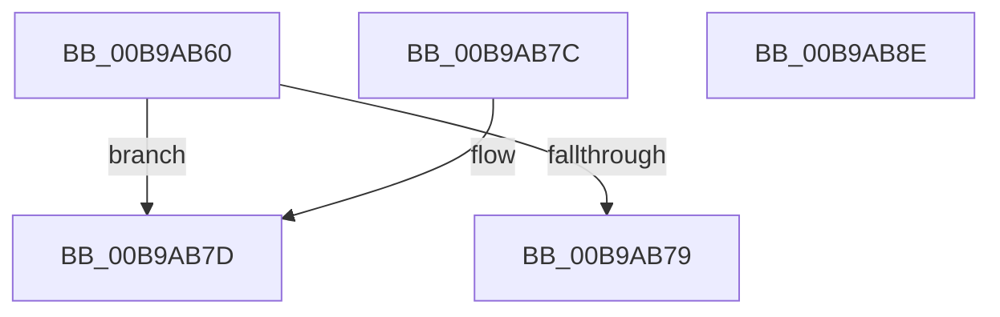

# ViXdvGetFuncAddress

- RVA: `0x00B9AB60`–`0x00B9AB8F` (길이 `47` bytes)
- VA: `0x0000000140B9AB60`
- 실행 섹션: `PAGEVRFY`
- PDB 이름 있음: `예`; PDB Function 태그: `아니요`
- unwind 정보 RVA: `0x000DB714`
- 디코드: `18`개 명령, `47/47` bytes 표시
- 미해석 바이트: `0` (있으면 어셈블리에 `.byte`로 보존)

> 이 문서는 커널 이미지의 기계어와 PDB 기호를 분석해 생성했습니다. 4번과 5번은 함수 원형과 자료형을 바이너리 사용 방식에서 추정한 C 해석이며 원본 소스 복구 결과는 아닙니다.

## 1. Dependencies

- 직접 호출 지점: **0**; 고유 호출 대상: **0**
- 직접 호출자로 확인된 함수: **1**
- RIP 상대 이미지 참조: **0**

### Outgoing calls
- 직접 디코드된 call 명령이 없습니다.

### Direct callers
- [ViXdvDriverLoadImage](ViXdvDriverLoadImage_function_00B9A9A0.md) at `0x00B9AA1A`
- [ViXdvDriverLoadImage](ViXdvDriverLoadImage_function_00B9A9A0.md) at `0x00B9AA68`
- [ViXdvDriverLoadImage](ViXdvDriverLoadImage_function_00B9A9A0.md) at `0x00B9AAA2`
- [ViXdvDriverLoadImage](ViXdvDriverLoadImage_function_00B9A9A0.md) at `0x00B9AAD8`
- [ViXdvDriverLoadImage](ViXdvDriverLoadImage_function_00B9A9A0.md) at `0x00B9AB1C`

### Static image references
- 디코드된 RIP-relative 메모리 참조가 없습니다.

## 2. Other-region calls and transfers

- 다른 실행 섹션으로 향하는 call: **0**
- 별도 외부 분기/꼬리 이동을 확인하지 못했습니다.

## 3. Assembly (complete function range)

```asm
00B9AB60  8B 42 24                        mov eax, dword ptr [rdx + 0x24]
00B9AB63  4C 8B C9                        mov r9, rcx
00B9AB66  48 03 C1                        add rax, rcx
00B9AB69  45 8B C0                        mov r8d, r8d
00B9AB6C  4C 8B D2                        mov r10, rdx
00B9AB6F  42 0F B7 0C 40                  movzx ecx, word ptr [rax + r8*2]
00B9AB74  3B 4A 14                        cmp ecx, dword ptr [rdx + 0x14]
00B9AB77  72 04                           jb 0x140b9ab7d
00B9AB79  33 C0                           xor eax, eax
00B9AB7B  C3                              ret
00B9AB7C  CC                              int3
00B9AB7D  48 8B D1                        mov rdx, rcx
00B9AB80  41 8B 4A 1C                     mov ecx, dword ptr [r10 + 0x1c]
00B9AB84  49 03 C9                        add rcx, r9
00B9AB87  8B 04 91                        mov eax, dword ptr [rcx + rdx*4]
00B9AB8A  49 03 C1                        add rax, r9
00B9AB8D  C3                              ret
00B9AB8E  CC                              int3
```

## 4. C-style interpretation (structured pseudocode)

```c
__int64 __fastcall ViXdvGetFuncAddress(__int64 a1, __int64 a2, int a3)
{
    __int64 result;

    result = ((unsigned int)(*(unsigned int *)(a2 + 36))) + (a1);
    if (((unsigned int)(*(unsigned __int16 *)(result + (unsigned int)(a3) * 2))) < (*(unsigned int *)(a2 + 20))) goto loc_00B9AB7D;
    result = 0;
    return result;
loc_00B9AB7D:
    a1 = ((unsigned int)(*(unsigned int *)(a2 + 28))) + (a1);
    result = ((unsigned int)(*(unsigned int *)(a1 + *(unsigned __int16 *)(result + (unsigned int)(a3) * 2) * 4))) + (a1);
    return result;
}
```

## 5. (Beta) C Style

```c
int64_t ViXdvGetFuncAddress(int64_t Arg1, void *Arg2, int32_t Arg3)
{
    uint8_t *arg2 = (uint8_t *)Arg2;

    int64_t result;

    result = ((uint32_t)(*(uint32_t *)(arg2 + 0x24))) + (Arg1);
    if (((uint32_t)(*(uint16_t *)(result + (uint32_t)(Arg3) * 2))) < (*(uint32_t *)(arg2 + 0x14))) goto loc_00B9AB7D;
    result = 0;
    return result;
loc_00B9AB7D:
    Arg1 = ((uint32_t)(*(uint32_t *)(arg2 + 0x1C))) + (Arg1);
    result = ((uint32_t)(*(uint32_t *)(Arg1 + *(uint16_t *)(result + (uint32_t)(Arg3) * 2) * 4))) + (Arg1);
    return result;
}
```

### 관측된 메모리 오프셋

구조체 형식이 확인되지 않은 접근은 인자 기준의 오프셋으로만 기록했습니다.

| 기준 인자 | 오프셋 표현 | 폭 (bit) | 접근 |
|---|---:|---:|---|
| `Arg2` | `+ 0x14` | `32` | `R` |
| `Arg2` | `+ 0x1C` | `32` | `R` |
| `Arg2` | `+ 0x24` | `32` | `R` |

## 6. Execution-region graph

[열기: 2D/3D 그래프와 함수 탐색 컨트롤 패널](../../../control-panel.html?section=pagevrfy&rva=0x00B9AB60&view=graph)

- 2D 그래프는 위에서 아래로 흐르고, 3D 그래프는 빈 공간을 드래그해 회전합니다. Shift+드래그는 이동, 휠은 확대·축소, 함수 노드 선택은 대상 보고서 이동입니다.

### Static fallback


