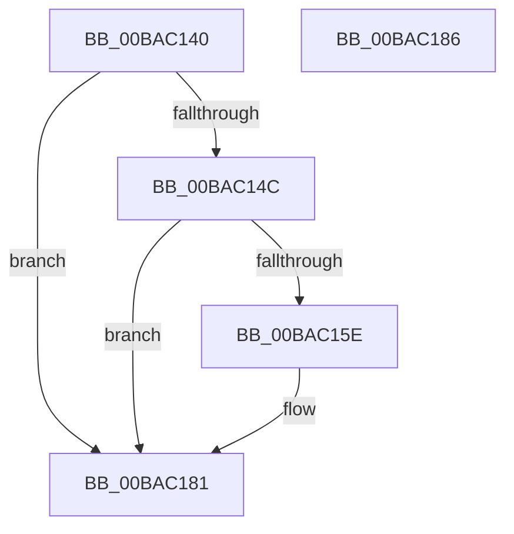

# Below4gb_AllocateCommonBuffer_Entry

- RVA: `0x00BAC140`–`0x00BAC187` (길이 `71` bytes)
- VA: `0x0000000140BAC140`
- 실행 섹션: `PAGEVRFY`
- PDB 이름 있음: `예`; PDB Function 태그: `아니요`
- unwind 정보 RVA: `0x00063458`
- 디코드: `18`개 명령, `71/71` bytes 표시
- 미해석 바이트: `0` (있으면 어셈블리에 `.byte`로 보존)

> 이 문서는 커널 이미지의 기계어와 PDB 기호를 분석해 생성했습니다. 4번과 5번은 함수 원형과 자료형을 바이너리 사용 방식에서 추정한 C 해석이며 원본 소스 복구 결과는 아닙니다.

## 1. Dependencies

- 직접 호출 지점: **1**; 고유 호출 대상: **1**
- 직접 호출자로 확인된 함수: **2**
- RIP 상대 이미지 참조: **0**

### Outgoing calls
- `0x00BAC17C` → [CarReportRuleViolationFromNt](../B9/CarReportRuleViolationFromNt_function_00B9D904.md) (function, `0x00B9D904`)

### Direct callers
- [VfAllocateCommonBufferEx](../B9/VfAllocateCommonBufferEx_function_00B95630.md) at `0x00B95685`
- [VfAllocateCommonBufferWithBounds](../B9/VfAllocateCommonBufferWithBounds_function_00B95780.md) at `0x00B957D5`

### Static image references
- 디코드된 RIP-relative 메모리 참조가 없습니다.

## 2. Other-region calls and transfers

- 다른 실행 섹션으로 향하는 call: **0**
- 별도 외부 분기/꼬리 이동을 확인하지 못했습니다.

## 3. Assembly (complete function range)

```asm
00BAC140  48 83 EC 48                     sub rsp, 0x48
00BAC144  41 8B C0                        mov eax, r8d
00BAC147  48 85 D2                        test rdx, rdx
00BAC14A  74 35                           je 0x140bac181
00BAC14C  4C 8B 02                        mov r8, qword ptr [rdx]
00BAC14F  48 BA 00 00 00 00 01 00 00 00   movabs rdx, 0x100000000
00BAC159  4C 3B C2                        cmp r8, rdx
00BAC15C  73 23                           jae 0x140bac181
00BAC15E  48 89 4C 24 30                  mov qword ptr [rsp + 0x30], rcx
00BAC163  BA 41 01 00 00                  mov edx, 0x141
00BAC168  C7 44 24 28 1A 00 00 00         mov dword ptr [rsp + 0x28], 0x1a
00BAC170  44 8B C8                        mov r9d, eax
00BAC173  48 83 64 24 20 00               and qword ptr [rsp + 0x20], 0
00BAC179  8D 4A 83                        lea ecx, [rdx - 0x7d]
00BAC17C  E8 83 17 FF FF                  call 0x140b9d904
00BAC181  48 83 C4 48                     add rsp, 0x48
00BAC185  C3                              ret
00BAC186  CC                              int3
```

## 4. C-style interpretation (structured pseudocode)

```c
__int64 __fastcall Below4gb_AllocateCommonBuffer_Entry(__int64 a1, __int64 a2, int a3)
{
    __int64 result;
    __int64 v_rsp;
    unsigned __int64 v_stack_m18;
    unsigned int v_stack_m20;
    unsigned __int64 v_stack_m28;

    v_rsp = (v_rsp) - (72);
    if (a2 == 0) goto loc_00BAC181;
    result = (unsigned int)(a3);
    if ((*(unsigned __int64 *)(a2)) < a2) {
        v_stack_m18 = a1;
        a2 = 321;
        v_stack_m20 = 26;
        a4 = (unsigned int)((unsigned int)(a3));
        a1 = a2 - 125;
        result = CarReportRuleViolationFromNt(a1, a2, *(unsigned __int64 *)(a2), a4);
    }
    v_rsp = (v_rsp) + (72);
    return result;
}
```

## 5. (Beta) C Style

```c
int64_t Below4gb_AllocateCommonBuffer_Entry(int64_t Arg1, int64_t Arg2, int32_t Arg3)
{
    int64_t result;
    int64_t local_rsp;
    uint64_t v_stack_m18;
    uint32_t v_stack_m20;
    uint64_t v_stack_m28;

    local_rsp = (local_rsp) - (72);
    if (Arg2 == 0) goto loc_00BAC181;
    result = (uint32_t)(Arg3);
    if ((*(uint64_t *)(Arg2)) < Arg2) {
        v_stack_m18 = Arg1;
        Arg2 = 321;
        v_stack_m20 = 26;
        a4 = (uint32_t)((uint32_t)(Arg3));
        Arg1 = Arg2 - 125;
        result = CarReportRuleViolationFromNt(Arg1, Arg2, *(uint64_t *)(Arg2), a4);
    }
    local_rsp = (local_rsp) + (72);
    return result;
}
```

## 6. Execution-region graph

[열기: 2D/3D 그래프와 함수 탐색 컨트롤 패널](../../../control-panel.html?section=pagevrfy&rva=0x00BAC140&view=graph)

- 2D 그래프는 위에서 아래로 흐르고, 3D 그래프는 빈 공간을 드래그해 회전합니다. Shift+드래그는 이동, 휠은 확대·축소, 함수 노드 선택은 대상 보고서 이동입니다.

### Static fallback


