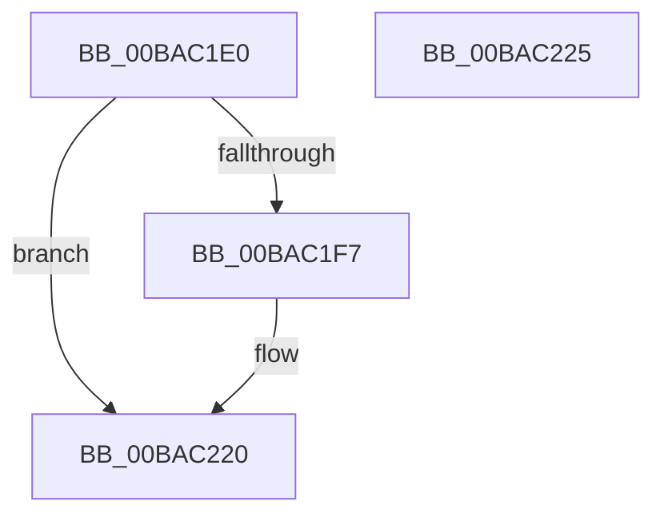

# Below4gb_MmAllocateContiguousMemory_Entry

- RVA: `0x00BAC1E0`–`0x00BAC226` (길이 `70` bytes)
- VA: `0x0000000140BAC1E0`
- 실행 섹션: `PAGEVRFY`
- PDB 이름 있음: `예`; PDB Function 태그: `아니요`
- unwind 정보 RVA: `0x00063458`
- 디코드: `16`개 명령, `70/70` bytes 표시
- 미해석 바이트: `0` (있으면 어셈블리에 `.byte`로 보존)

> 이 문서는 커널 이미지의 기계어와 PDB 기호를 분석해 생성했습니다. 4번과 5번은 함수 원형과 자료형을 바이너리 사용 방식에서 추정한 C 해석이며 원본 소스 복구 결과는 아닙니다.

## 1. Dependencies

- 직접 호출 지점: **1**; 고유 호출 대상: **1**
- 직접 호출자로 확인된 함수: **0**
- RIP 상대 이미지 참조: **0**

### Outgoing calls
- `0x00BAC21B` → [CarReportRuleViolationFromNt](../B9/CarReportRuleViolationFromNt_function_00B9D904.md) (function, `0x00B9D904`)

### Direct callers
- 이 함수 시작 RVA로 연결되는 직접 call은 확인되지 않았습니다. 간접 호출은 완전히 역산할 수 없습니다.

### Static image references
- 디코드된 RIP-relative 메모리 참조가 없습니다.

## 2. Other-region calls and transfers

- 다른 실행 섹션으로 향하는 call: **0**
- 별도 외부 분기/꼬리 이동을 확인하지 못했습니다.

## 3. Assembly (complete function range)

```asm
00BAC1E0  48 83 EC 48                     sub rsp, 0x48
00BAC1E4  4C 8B 41 08                     mov r8, qword ptr [rcx + 8]
00BAC1E8  48 B8 00 00 00 00 01 00 00 00   movabs rax, 0x100000000
00BAC1F2  4C 3B C0                        cmp r8, rax
00BAC1F5  73 29                           jae 0x140bac220
00BAC1F7  48 8B 44 24 48                  mov rax, qword ptr [rsp + 0x48]
00BAC1FC  BA 41 01 00 00                  mov edx, 0x141
00BAC201  4C 8B 49 10                     mov r9, qword ptr [rcx + 0x10]
00BAC205  48 89 44 24 30                  mov qword ptr [rsp + 0x30], rax
00BAC20A  C7 44 24 28 1A 00 00 00         mov dword ptr [rsp + 0x28], 0x1a
00BAC212  48 83 64 24 20 00               and qword ptr [rsp + 0x20], 0
00BAC218  8D 4A 83                        lea ecx, [rdx - 0x7d]
00BAC21B  E8 E4 16 FF FF                  call 0x140b9d904
00BAC220  48 83 C4 48                     add rsp, 0x48
00BAC224  C3                              ret
00BAC225  CC                              int3
```

## 4. C-style interpretation (structured pseudocode)

```c
__int64 __fastcall Below4gb_MmAllocateContiguousMemory_Entry(__int64 a1)
{
    __int64 result;
    __int64 v_rsp;
    unsigned __int64 v_stack_m18;
    unsigned int v_stack_m20;
    unsigned __int64 v_stack_m28;
    unsigned __int64 v_stack_p0;

    v_rsp = (v_rsp) - (72);
    if ((*(unsigned __int64 *)(a1 + 8)) < result) {
        result = v_stack_p0;
        a2 = 321;
        a4 = *(unsigned __int64 *)(a1 + 16);
        v_stack_m18 = result;
        v_stack_m20 = 26;
        a1 = a2 - 125;
        result = CarReportRuleViolationFromNt(a1, a2, *(unsigned __int64 *)(a1 + 8), a4);
    }
    v_rsp = (v_rsp) + (72);
    return result;
}
```

## 5. (Beta) C Style

```c
int64_t Below4gb_MmAllocateContiguousMemory_Entry(void *Arg1)
{
    uint8_t *arg1 = (uint8_t *)Arg1;

    int64_t result;
    int64_t local_rsp;
    uint64_t v_stack_m18;
    uint32_t v_stack_m20;
    uint64_t v_stack_m28;
    uint64_t v_stack_p0;

    local_rsp = (local_rsp) - (72);
    if ((*(uint64_t *)(arg1 + 0x8)) < result) {
        result = v_stack_p0;
        a2 = 321;
        a4 = *(uint64_t *)(arg1 + 0x10);
        v_stack_m18 = result;
        v_stack_m20 = 26;
        Arg1 = a2 - 125;
        result = CarReportRuleViolationFromNt(Arg1, a2, *(uint64_t *)(arg1 + 0x8), a4);
    }
    local_rsp = (local_rsp) + (72);
    return result;
}
```

### 관측된 메모리 오프셋

구조체 형식이 확인되지 않은 접근은 인자 기준의 오프셋으로만 기록했습니다.

| 기준 인자 | 오프셋 표현 | 폭 (bit) | 접근 |
|---|---:|---:|---|
| `Arg1` | `+ 0x8` | `64` | `R` |
| `Arg1` | `+ 0x10` | `64` | `R` |

## 6. Execution-region graph

[열기: 2D/3D 그래프와 함수 탐색 컨트롤 패널](../../../control-panel.html?section=pagevrfy&rva=0x00BAC1E0&view=graph)

- 2D 그래프는 위에서 아래로 흐르고, 3D 그래프는 빈 공간을 드래그해 회전합니다. Shift+드래그는 이동, 휠은 확대·축소, 함수 노드 선택은 대상 보고서 이동입니다.

### Static fallback


