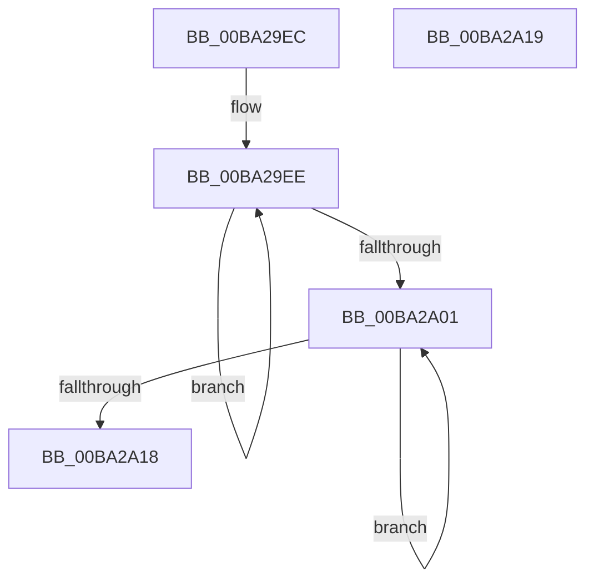

# IovUtilFlushStackCache

- RVA: `0x00BA29EC`–`0x00BA2A1A` (길이 `46` bytes)
- VA: `0x0000000140BA29EC`
- 실행 섹션: `PAGEVRFY`
- PDB 이름 있음: `예`; PDB Function 태그: `아니요`
- unwind 정보 RVA: `0x000DB714`
- 디코드: `13`개 명령, `46/46` bytes 표시
- 미해석 바이트: `0` (있으면 어셈블리에 `.byte`로 보존)

> 이 문서는 커널 이미지의 기계어와 PDB 기호를 분석해 생성했습니다. 4번과 5번은 함수 원형과 자료형을 바이너리 사용 방식에서 추정한 C 해석이며 원본 소스 복구 결과는 아닙니다.

## 1. Dependencies

- 직접 호출 지점: **0**; 고유 호출 대상: **0**
- 직접 호출자로 확인된 함수: **2**
- RIP 상대 이미지 참조: **0**

### Outgoing calls
- 직접 디코드된 call 명령이 없습니다.

### Direct callers
- [IovAttachDeviceToDeviceStack](../B9/IovAttachDeviceToDeviceStack_function_00B92508.md) at `0x00B92519`
- [VfIoDetachDevice](VfIoDetachDevice_function_00BA234C.md) at `0x00BA23C4`

### Static image references
- 디코드된 RIP-relative 메모리 참조가 없습니다.

## 2. Other-region calls and transfers

- 다른 실행 섹션으로 향하는 call: **0**
- 별도 외부 분기/꼬리 이동을 확인하지 못했습니다.

## 3. Assembly (complete function range)

```asm
00BA29EC  66 90                           nop
00BA29EE  48 8B 81 38 01 00 00            mov rax, qword ptr [rcx + 0x138]
00BA29F5  48 8B D1                        mov rdx, rcx
00BA29F8  48 8B 48 30                     mov rcx, qword ptr [rax + 0x30]
00BA29FC  48 85 C9                        test rcx, rcx
00BA29FF  75 ED                           jne 0x140ba29ee
00BA2A01  48 8B 82 38 01 00 00            mov rax, qword ptr [rdx + 0x138]
00BA2A08  81 60 20 FF FF FF 3F            and dword ptr [rax + 0x20], 0x3fffffff
00BA2A0F  48 8B 52 18                     mov rdx, qword ptr [rdx + 0x18]
00BA2A13  48 85 D2                        test rdx, rdx
00BA2A16  75 E9                           jne 0x140ba2a01
00BA2A18  C3                              ret
00BA2A19  CC                              int3
```

## 4. C-style interpretation (structured pseudocode)

```c
__int64 __fastcall IovUtilFlushStackCache(__int64 a1)
{
loc_00BA29EE:
    if (*(unsigned __int64 *)(*(unsigned __int64 *)(a1 + 312) + 48) != 0) goto loc_00BA29EE;
loc_00BA2A01:
    if (*(unsigned __int64 *)(a1 + 24) != 0) goto loc_00BA2A01;
    return *(unsigned __int64 *)(a1 + 312);
}
```

## 5. (Beta) C Style

```c
int64_t IovUtilFlushStackCache(int64_t Arg1)
{
loc_00BA29EE:
    if (*(uint64_t *)(*(uint64_t *)(Arg1 + 0x138) + 0x30) != 0) goto loc_00BA29EE;
loc_00BA2A01:
    if (*(uint64_t *)(Arg1 + 0x18) != 0) goto loc_00BA2A01;
    return *(uint64_t *)(Arg1 + 0x138);
}
```

## 6. Execution-region graph

[열기: 2D/3D 그래프와 함수 탐색 컨트롤 패널](../../../control-panel.html?section=pagevrfy&rva=0x00BA29EC&view=graph)

- 2D 그래프는 위에서 아래로 흐르고, 3D 그래프는 빈 공간을 드래그해 회전합니다. Shift+드래그는 이동, 휠은 확대·축소, 함수 노드 선택은 대상 보고서 이동입니다.

### Static fallback


