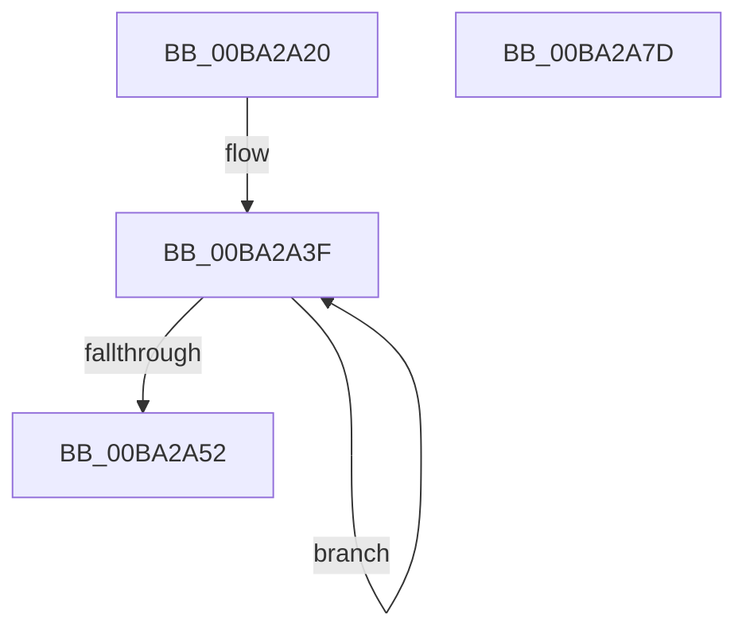

# IovUtilGetBottomDeviceObjectWithTag

- RVA: `0x00BA2A20`–`0x00BA2A7E` (길이 `94` bytes)
- VA: `0x0000000140BA2A20`
- 실행 섹션: `PAGEVRFY`
- PDB 이름 있음: `예`; PDB Function 태그: `아니요`
- unwind 정보 RVA: `0x00060BC4`
- 디코드: `26`개 명령, `94/94` bytes 표시
- 미해석 바이트: `0` (있으면 어셈블리에 `.byte`로 보존)

> 이 문서는 커널 이미지의 기계어와 PDB 기호를 분석해 생성했습니다. 4번과 5번은 함수 원형과 자료형을 바이너리 사용 방식에서 추정한 C 해석이며 원본 소스 복구 결과는 아닙니다.

## 1. Dependencies

- 직접 호출 지점: **3**; 고유 호출 대상: **3**
- 직접 호출자로 확인된 함수: **4**
- RIP 상대 이미지 참조: **0**

### Outgoing calls
- `0x00BA2A37` → [KeAcquireQueuedSpinLock](../../text/27/KeAcquireQueuedSpinLock_function_00273D80.md) (function, `0x00273D80`)
- `0x00BA2A5A` → [ObfReferenceObjectWithTag](../../text/21/ObfReferenceObjectWithTag_function_00210710.md) (function, `0x00210710`)
- `0x00BA2A65` → [KeReleaseQueuedSpinLock](../../text/27/KeReleaseQueuedSpinLock_function_00272540.md) (function, `0x00272540`)

### Direct callers
- [IovpCallDriver1](../B9/IovpCallDriver1_function_00B9CCA4.md) at `0x00B9CE05`
- [IovpCallDriver1](../B9/IovpCallDriver1_function_00B9CCA4.md) at `0x00B9D081`
- [IovUtilIsWdmStack](IovUtilIsWdmStack_function_00BA2C68.md) at `0x00BA2C6E`
- [VfPnpVerifyIrpStackUpward](../BB/VfPnpVerifyIrpStackUpward_function_00BB58E0.md) at `0x00BB5A57`
- [ViPnpVerifyMinorWasProcessedProperly](../BB/ViPnpVerifyMinorWasProcessedProperly_function_00BB5BC0.md) at `0x00BB5CFC`

### Static image references
- 디코드된 RIP-relative 메모리 참조가 없습니다.

## 2. Other-region calls and transfers

- 다른 실행 섹션으로 향하는 call: **3**
  - `0x00BA2A37` → [KeAcquireQueuedSpinLock](../../text/27/KeAcquireQueuedSpinLock_function_00273D80.md) (`PAGEVRFY` → `.text`)
  - `0x00BA2A5A` → [ObfReferenceObjectWithTag](../../text/21/ObfReferenceObjectWithTag_function_00210710.md) (`PAGEVRFY` → `.text`)
  - `0x00BA2A65` → [KeReleaseQueuedSpinLock](../../text/27/KeReleaseQueuedSpinLock_function_00272540.md) (`PAGEVRFY` → `.text`)
- 별도 외부 분기/꼬리 이동을 확인하지 못했습니다.

## 3. Assembly (complete function range)

```asm
00BA2A20  48 89 5C 24 08                  mov qword ptr [rsp + 8], rbx
00BA2A25  48 89 74 24 10                  mov qword ptr [rsp + 0x10], rsi
00BA2A2A  57                              push rdi
00BA2A2B  48 83 EC 20                     sub rsp, 0x20
00BA2A2F  48 8B D9                        mov rbx, rcx
00BA2A32  B9 0A 00 00 00                  mov ecx, 0xa
00BA2A37  E8 44 13 6D FF                  call 0x140273d80
00BA2A3C  40 8A F0                        mov sil, al
00BA2A3F  48 8B 93 38 01 00 00            mov rdx, qword ptr [rbx + 0x138]
00BA2A46  48 8B FB                        mov rdi, rbx
00BA2A49  48 8B 5A 30                     mov rbx, qword ptr [rdx + 0x30]
00BA2A4D  48 85 DB                        test rbx, rbx
00BA2A50  75 ED                           jne 0x140ba2a3f
00BA2A52  BA 56 72 66 49                  mov edx, 0x49667256
00BA2A57  48 8B CF                        mov rcx, rdi
00BA2A5A  E8 B1 DC 66 FF                  call 0x140210710
00BA2A5F  40 8A D6                        mov dl, sil
00BA2A62  8D 4B 0A                        lea ecx, [rbx + 0xa]
00BA2A65  E8 D6 FA 6C FF                  call 0x140272540
00BA2A6A  48 8B 5C 24 30                  mov rbx, qword ptr [rsp + 0x30]
00BA2A6F  48 8B C7                        mov rax, rdi
00BA2A72  48 8B 74 24 38                  mov rsi, qword ptr [rsp + 0x38]
00BA2A77  48 83 C4 20                     add rsp, 0x20
00BA2A7B  5F                              pop rdi
00BA2A7C  C3                              ret
00BA2A7D  CC                              int3
```

## 4. C-style interpretation (structured pseudocode)

```c
__int64 __fastcall IovUtilGetBottomDeviceObjectWithTag(__int64 a1)
{
    __int64 result;
    __int64 v_rsp;
    unsigned __int64 v_stack_p10;
    unsigned __int64 v_stack_p8;

    v_stack_p8 = v_rbx;
    v_stack_p10 = v_rsi;
    v_rsp = (v_rsp) - (32);
    result = KeAcquireQueuedSpinLock(10, a2, a3, a4);
loc_00BA2A3F:
    if (*(unsigned __int64 *)(*(unsigned __int64 *)(a1 + 312) + 48) != 0) goto loc_00BA2A3F;
    result = ObfReferenceObjectWithTag(a1, (unsigned int)(0x49667256ULL), a3, a4);
    result = KeReleaseQueuedSpinLock(*(unsigned __int64 *)(*(unsigned __int64 *)(a1 + 312) + 48) + 10, (unsigned __int8)((unsigned __int8)(result)), a3, a4);
    v_rsp = (v_rsp) + (32);
    return a1;
}
```

## 5. (Beta) C Style

```c
int64_t IovUtilGetBottomDeviceObjectWithTag(int64_t Arg1)
{
    int64_t result;
    int64_t local_rsp;
    uint64_t v_stack_p10;
    uint64_t v_stack_p8;

    v_stack_p8 = local_rbx;
    v_stack_p10 = local_rsi;
    local_rsp = (local_rsp) - (32);
    result = KeAcquireQueuedSpinLock(10, a2, a3, a4);
loc_00BA2A3F:
    if (*(uint64_t *)(*(uint64_t *)(Arg1 + 0x138) + 0x30) != 0) goto loc_00BA2A3F;
    result = ObfReferenceObjectWithTag(Arg1, (uint32_t)(0x49667256ULL), a3, a4);
    result = KeReleaseQueuedSpinLock(*(uint64_t *)(*(uint64_t *)(Arg1 + 0x138) + 0x30) + 10, (uint8_t)((uint8_t)(result)), a3, a4);
    local_rsp = (local_rsp) + (32);
    return Arg1;
}
```

## 6. Execution-region graph

[열기: 2D/3D 그래프와 함수 탐색 컨트롤 패널](../../../control-panel.html?section=pagevrfy&rva=0x00BA2A20&view=graph)

- 2D 그래프는 위에서 아래로 흐르고, 3D 그래프는 빈 공간을 드래그해 회전합니다. Shift+드래그는 이동, 휠은 확대·축소, 함수 노드 선택은 대상 보고서 이동입니다.

### Static fallback


