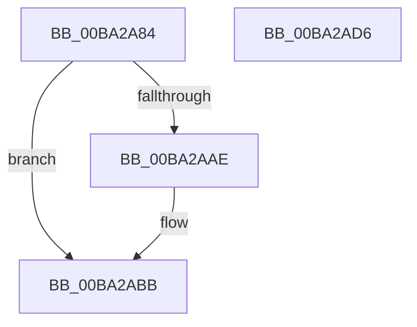

# IovUtilGetLowerDeviceObjectWithTag

- RVA: `0x00BA2A84`–`0x00BA2AD7` (길이 `83` bytes)
- VA: `0x0000000140BA2A84`
- 실행 섹션: `PAGEVRFY`
- PDB 이름 있음: `예`; PDB Function 태그: `아니요`
- unwind 정보 RVA: `0x0005CAAC`
- 디코드: `23`개 명령, `83/83` bytes 표시
- 미해석 바이트: `0` (있으면 어셈블리에 `.byte`로 보존)

> 이 문서는 커널 이미지의 기계어와 PDB 기호를 분석해 생성했습니다. 4번과 5번은 함수 원형과 자료형을 바이너리 사용 방식에서 추정한 C 해석이며 원본 소스 복구 결과는 아닙니다.

## 1. Dependencies

- 직접 호출 지점: **3**; 고유 호출 대상: **3**
- 직접 호출자로 확인된 함수: **4**
- RIP 상대 이미지 참조: **0**

### Outgoing calls
- `0x00BA2A96` → [KeAcquireQueuedSpinLock](../../text/27/KeAcquireQueuedSpinLock_function_00273D80.md) (function, `0x00273D80`)
- `0x00BA2AB6` → [ObfReferenceObjectWithTag](../../text/21/ObfReferenceObjectWithTag_function_00210710.md) (function, `0x00210710`)
- `0x00BA2AC3` → [KeReleaseQueuedSpinLock](../../text/27/KeReleaseQueuedSpinLock_function_00272540.md) (function, `0x00272540`)

### Direct callers
- [IovpCallDriver1](../B9/IovpCallDriver1_function_00B9CCA4.md) at `0x00B9CFB4`
- [IovpCallDriver2](../B9/IovpCallDriver2_function_00B9D270.md) at `0x00B9D2F5`
- [VfIoDeleteDevice](VfIoDeleteDevice_function_00BA221C.md) at `0x00BA22B6`
- [VfPnpVerifyIrpStackUpward](../BB/VfPnpVerifyIrpStackUpward_function_00BB58E0.md) at `0x00BB5A37`

### Static image references
- 디코드된 RIP-relative 메모리 참조가 없습니다.

## 2. Other-region calls and transfers

- 다른 실행 섹션으로 향하는 call: **3**
  - `0x00BA2A96` → [KeAcquireQueuedSpinLock](../../text/27/KeAcquireQueuedSpinLock_function_00273D80.md) (`PAGEVRFY` → `.text`)
  - `0x00BA2AB6` → [ObfReferenceObjectWithTag](../../text/21/ObfReferenceObjectWithTag_function_00210710.md) (`PAGEVRFY` → `.text`)
  - `0x00BA2AC3` → [KeReleaseQueuedSpinLock](../../text/27/KeReleaseQueuedSpinLock_function_00272540.md) (`PAGEVRFY` → `.text`)
- 별도 외부 분기/꼬리 이동을 확인하지 못했습니다.

## 3. Assembly (complete function range)

```asm
00BA2A84  48 89 5C 24 08                  mov qword ptr [rsp + 8], rbx
00BA2A89  57                              push rdi
00BA2A8A  48 83 EC 20                     sub rsp, 0x20
00BA2A8E  48 8B D9                        mov rbx, rcx
00BA2A91  B9 0A 00 00 00                  mov ecx, 0xa
00BA2A96  E8 E5 12 6D FF                  call 0x140273d80
00BA2A9B  48 8B 93 38 01 00 00            mov rdx, qword ptr [rbx + 0x138]
00BA2AA2  40 8A F8                        mov dil, al
00BA2AA5  48 8B 5A 30                     mov rbx, qword ptr [rdx + 0x30]
00BA2AA9  48 85 DB                        test rbx, rbx
00BA2AAC  74 0D                           je 0x140ba2abb
00BA2AAE  BA 56 72 66 49                  mov edx, 0x49667256
00BA2AB3  48 8B CB                        mov rcx, rbx
00BA2AB6  E8 55 DC 66 FF                  call 0x140210710
00BA2ABB  40 8A D7                        mov dl, dil
00BA2ABE  B9 0A 00 00 00                  mov ecx, 0xa
00BA2AC3  E8 78 FA 6C FF                  call 0x140272540
00BA2AC8  48 8B C3                        mov rax, rbx
00BA2ACB  48 8B 5C 24 30                  mov rbx, qword ptr [rsp + 0x30]
00BA2AD0  48 83 C4 20                     add rsp, 0x20
00BA2AD4  5F                              pop rdi
00BA2AD5  C3                              ret
00BA2AD6  CC                              int3
```

## 4. C-style interpretation (structured pseudocode)

```c
__int64 __fastcall IovUtilGetLowerDeviceObjectWithTag(__int64 a1)
{
    __int64 result;
    __int64 v_rsp;
    unsigned __int64 v_stack_p8;

    v_stack_p8 = v_rbx;
    v_rsp = (v_rsp) - (32);
    result = KeAcquireQueuedSpinLock(10, a2, a3, a4);
    if (*(unsigned __int64 *)(*(unsigned __int64 *)(a1 + 312) + 48) != 0) {
        a2 = 0x49667256ULL;
        a1 = *(unsigned __int64 *)(*(unsigned __int64 *)(a1 + 312) + 48);
        result = ObfReferenceObjectWithTag(a1, a2, a3, a4);
    }
    result = KeReleaseQueuedSpinLock(10, (unsigned __int8)((unsigned __int8)(result)), a3, a4);
    v_rsp = (v_rsp) + (32);
    return *(unsigned __int64 *)(*(unsigned __int64 *)(a1 + 312) + 48);
}
```

## 5. (Beta) C Style

```c
int64_t IovUtilGetLowerDeviceObjectWithTag(void *Arg1)
{
    uint8_t *arg1 = (uint8_t *)Arg1;

    int64_t result;
    int64_t local_rsp;
    uint64_t v_stack_p8;

    v_stack_p8 = local_rbx;
    local_rsp = (local_rsp) - (32);
    result = KeAcquireQueuedSpinLock(10, a2, a3, a4);
    if (*(uint64_t *)(*(uint64_t *)(arg1 + 0x138) + 0x30) != 0) {
        a2 = 0x49667256ULL;
        Arg1 = *(uint64_t *)(*(uint64_t *)(arg1 + 0x138) + 0x30);
        result = ObfReferenceObjectWithTag(Arg1, a2, a3, a4);
    }
    result = KeReleaseQueuedSpinLock(10, (uint8_t)((uint8_t)(result)), a3, a4);
    local_rsp = (local_rsp) + (32);
    return *(uint64_t *)(*(uint64_t *)(arg1 + 0x138) + 0x30);
}
```

### 관측된 메모리 오프셋

구조체 형식이 확인되지 않은 접근은 인자 기준의 오프셋으로만 기록했습니다.

| 기준 인자 | 오프셋 표현 | 폭 (bit) | 접근 |
|---|---:|---:|---|
| `Arg1` | `+ 0x138` | `64` | `R` |

## 6. Execution-region graph

[열기: 2D/3D 그래프와 함수 탐색 컨트롤 패널](../../../control-panel.html?section=pagevrfy&rva=0x00BA2A84&view=graph)

- 2D 그래프는 위에서 아래로 흐르고, 3D 그래프는 빈 공간을 드래그해 회전합니다. Shift+드래그는 이동, 휠은 확대·축소, 함수 노드 선택은 대상 보고서 이동입니다.

### Static fallback


