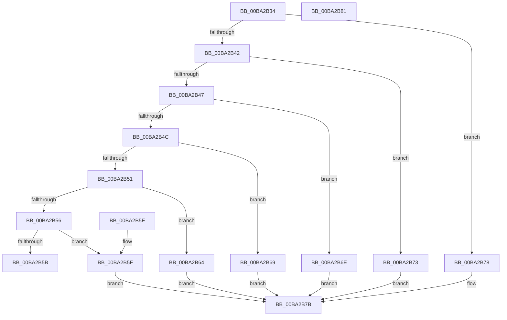

# IovUtilIsDeviceObjectMarked

- RVA: `0x00BA2B34`–`0x00BA2B82` (길이 `78` bytes)
- VA: `0x0000000140BA2B34`
- 실행 섹션: `PAGEVRFY`
- PDB 이름 있음: `예`; PDB Function 태그: `아니요`
- unwind 정보 RVA: `0x000DB714`
- 디코드: `32`개 명령, `78/78` bytes 표시
- 미해석 바이트: `0` (있으면 어셈블리에 `.byte`로 보존)

> 이 문서는 커널 이미지의 기계어와 PDB 기호를 분석해 생성했습니다. 4번과 5번은 함수 원형과 자료형을 바이너리 사용 방식에서 추정한 C 해석이며 원본 소스 복구 결과는 아닙니다.

## 1. Dependencies

- 직접 호출 지점: **0**; 고유 호출 대상: **0**
- 직접 호출자로 확인된 함수: **7**
- RIP 상대 이미지 참조: **0**

### Outgoing calls
- 직접 디코드된 call 명령이 없습니다.

### Direct callers
- [IovpCallDriver1](../B9/IovpCallDriver1_function_00B9CCA4.md) at `0x00B9D0AF`
- [IovpCallDriver1](../B9/IovpCallDriver1_function_00B9CCA4.md) at `0x00B9D0E2`
- [IovpCallDriver2](../B9/IovpCallDriver2_function_00B9D270.md) at `0x00B9D32A`
- [IovpCallDriver2](../B9/IovpCallDriver2_function_00B9D270.md) at `0x00B9D359`
- [VfIoDeleteDevice](VfIoDeleteDevice_function_00BA221C.md) at `0x00BA2260`
- [VfIrpLogRecordEvent](VfIrpLogRecordEvent_function_00BAB674.md) at `0x00BAB728`
- [VfPnpVerifyIrpStackDownward](../BB/VfPnpVerifyIrpStackDownward_function_00BB5750.md) at `0x00BB5866`
- [VfPnpVerifyIrpStackDownward](../BB/VfPnpVerifyIrpStackDownward_function_00BB5750.md) at `0x00BB5888`
- [VfPnpVerifyIrpStackUpward](../BB/VfPnpVerifyIrpStackUpward_function_00BB58E0.md) at `0x00BB5A9D`
- [ViPnpVerifyMinorWasProcessedProperly](../BB/ViPnpVerifyMinorWasProcessedProperly_function_00BB5BC0.md) at `0x00BB5CF0`

### Static image references
- 디코드된 RIP-relative 메모리 참조가 없습니다.

## 2. Other-region calls and transfers

- 다른 실행 섹션으로 향하는 call: **0**
- 별도 외부 분기/꼬리 이동을 확인하지 못했습니다.

## 3. Assembly (complete function range)

```asm
00BA2B34  48 8B 81 38 01 00 00            mov rax, qword ptr [rcx + 0x138]
00BA2B3B  8B 48 20                        mov ecx, dword ptr [rax + 0x20]
00BA2B3E  85 D2                           test edx, edx
00BA2B40  74 36                           je 0x140ba2b78
00BA2B42  83 EA 01                        sub edx, 1
00BA2B45  74 2C                           je 0x140ba2b73
00BA2B47  83 EA 01                        sub edx, 1
00BA2B4A  74 22                           je 0x140ba2b6e
00BA2B4C  83 EA 01                        sub edx, 1
00BA2B4F  74 18                           je 0x140ba2b69
00BA2B51  83 EA 01                        sub edx, 1
00BA2B54  74 0E                           je 0x140ba2b64
00BA2B56  83 FA 01                        cmp edx, 1
00BA2B59  74 04                           je 0x140ba2b5f
00BA2B5B  33 C0                           xor eax, eax
00BA2B5D  C3                              ret
00BA2B5E  CC                              int3
00BA2B5F  C1 E9 18                        shr ecx, 0x18
00BA2B62  EB 17                           jmp 0x140ba2b7b
00BA2B64  C1 E9 19                        shr ecx, 0x19
00BA2B67  EB 12                           jmp 0x140ba2b7b
00BA2B69  C1 E9 1B                        shr ecx, 0x1b
00BA2B6C  EB 0D                           jmp 0x140ba2b7b
00BA2B6E  C1 E9 1D                        shr ecx, 0x1d
00BA2B71  EB 08                           jmp 0x140ba2b7b
00BA2B73  C1 E9 1C                        shr ecx, 0x1c
00BA2B76  EB 03                           jmp 0x140ba2b7b
00BA2B78  C1 E9 1A                        shr ecx, 0x1a
00BA2B7B  83 E1 01                        and ecx, 1
00BA2B7E  8B C1                           mov eax, ecx
00BA2B80  C3                              ret
00BA2B81  CC                              int3
```

## 4. C-style interpretation (structured pseudocode)

```c
__int64 __fastcall IovUtilIsDeviceObjectMarked(__int64 a1, int a2)
{
    __int64 result;

    if (a2 == 0) goto loc_00BA2B78;
    a2 = (unsigned int)((a2) - (1));
    if (condition_is_equal) goto loc_00BA2B73;
    a2 = (unsigned int)((a2) - (1));
    if (condition_is_equal) goto loc_00BA2B6E;
    a2 = (unsigned int)((a2) - (1));
    if (condition_is_equal) goto loc_00BA2B69;
    a2 = (unsigned int)((a2) - (1));
    if (condition_is_equal) goto loc_00BA2B64;
    if (a2 == 1) goto loc_00BA2B5F;
    result = 0;
    return result;
loc_00BA2B5F:
    a1 = (unsigned int)(((unsigned int)(*(unsigned int *)(*(unsigned __int64 *)(a1 + 312) + 32))) >> (24));
    goto loc_00BA2B7B;
loc_00BA2B64:
    a1 = (unsigned int)((a1) >> (25));
    goto loc_00BA2B7B;
loc_00BA2B69:
    a1 = (unsigned int)((a1) >> (27));
    goto loc_00BA2B7B;
loc_00BA2B6E:
    a1 = (unsigned int)((a1) >> (29));
    goto loc_00BA2B7B;
loc_00BA2B73:
    a1 = (unsigned int)((a1) >> (28));
    goto loc_00BA2B7B;
loc_00BA2B78:
    a1 = (unsigned int)((a1) >> (26));
loc_00BA2B7B:
    a1 = (unsigned int)((a1) & (1));
    return (unsigned int)((unsigned int)(a1));
}
```

## 5. (Beta) C Style

```c
int64_t IovUtilIsDeviceObjectMarked(void *Arg1, int32_t Arg2)
{
    uint8_t *arg1 = (uint8_t *)Arg1;

    int64_t result;

    if (Arg2 == 0) goto loc_00BA2B78;
    Arg2 = (uint32_t)((Arg2) - (1));
    if (condition_is_equal) goto loc_00BA2B73;
    Arg2 = (uint32_t)((Arg2) - (1));
    if (condition_is_equal) goto loc_00BA2B6E;
    Arg2 = (uint32_t)((Arg2) - (1));
    if (condition_is_equal) goto loc_00BA2B69;
    Arg2 = (uint32_t)((Arg2) - (1));
    if (condition_is_equal) goto loc_00BA2B64;
    if (Arg2 == 1) goto loc_00BA2B5F;
    result = 0;
    return result;
loc_00BA2B5F:
    Arg1 = (uint32_t)(((uint32_t)(*(uint32_t *)(*(uint64_t *)(arg1 + 0x138) + 0x20))) >> (24));
    goto loc_00BA2B7B;
loc_00BA2B64:
    Arg1 = (uint32_t)((Arg1) >> (25));
    goto loc_00BA2B7B;
loc_00BA2B69:
    Arg1 = (uint32_t)((Arg1) >> (27));
    goto loc_00BA2B7B;
loc_00BA2B6E:
    Arg1 = (uint32_t)((Arg1) >> (29));
    goto loc_00BA2B7B;
loc_00BA2B73:
    Arg1 = (uint32_t)((Arg1) >> (28));
    goto loc_00BA2B7B;
loc_00BA2B78:
    Arg1 = (uint32_t)((Arg1) >> (26));
loc_00BA2B7B:
    Arg1 = (uint32_t)((Arg1) & (1));
    return (uint32_t)((uint32_t)(Arg1));
}
```

### 관측된 메모리 오프셋

구조체 형식이 확인되지 않은 접근은 인자 기준의 오프셋으로만 기록했습니다.

| 기준 인자 | 오프셋 표현 | 폭 (bit) | 접근 |
|---|---:|---:|---|
| `Arg1` | `+ 0x138` | `64` | `R` |

## 6. Execution-region graph

[열기: 2D/3D 그래프와 함수 탐색 컨트롤 패널](../../../control-panel.html?section=pagevrfy&rva=0x00BA2B34&view=graph)

- 2D 그래프는 위에서 아래로 흐르고, 3D 그래프는 빈 공간을 드래그해 회전합니다. Shift+드래그는 이동, 휠은 확대·축소, 함수 노드 선택은 대상 보고서 이동입니다.

### Static fallback


