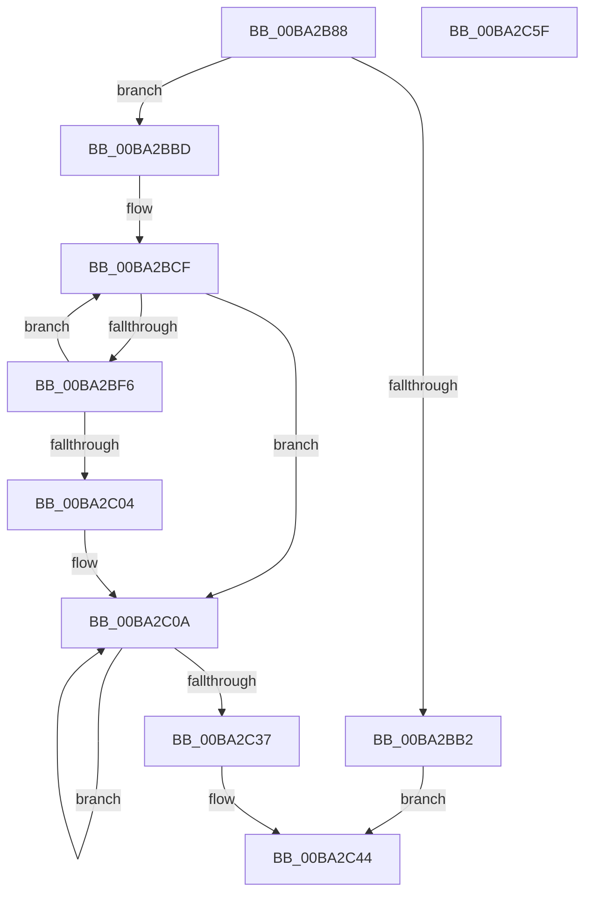

# IovUtilIsVerifiedDeviceStack

- RVA: `0x00BA2B88`–`0x00BA2C60` (길이 `216` bytes)
- VA: `0x0000000140BA2B88`
- 실행 섹션: `PAGEVRFY`
- PDB 이름 있음: `예`; PDB Function 태그: `아니요`
- unwind 정보 RVA: `0x0005E6B4`
- 디코드: `60`개 명령, `216/216` bytes 표시
- 미해석 바이트: `0` (있으면 어셈블리에 `.byte`로 보존)

> 이 문서는 커널 이미지의 기계어와 PDB 기호를 분석해 생성했습니다. 4번과 5번은 함수 원형과 자료형을 바이너리 사용 방식에서 추정한 C 해석이며 원본 소스 복구 결과는 아닙니다.

## 1. Dependencies

- 직접 호출 지점: **3**; 고유 호출 대상: **3**
- 직접 호출자로 확인된 함수: **2**
- RIP 상대 이미지 참조: **0**

### Outgoing calls
- `0x00BA2BC2` → [KeAcquireQueuedSpinLock](../../text/27/KeAcquireQueuedSpinLock_function_00273D80.md) (function, `0x00273D80`)
- `0x00BA2BE1` → [MmIsDriverVerifying](../../text/4A/MmIsDriverVerifying_function_004A8770.md) (function, `0x004A8770`)
- `0x00BA2C3D` → [KeReleaseQueuedSpinLock](../../text/27/KeReleaseQueuedSpinLock_function_00272540.md) (function, `0x00272540`)

### Direct callers
- [VfMajorTestStartedPdoStack](VfMajorTestStartedPdoStack_function_00BA30B0.md) at `0x00BA30BD`
- [IovpSessionDataCreate](IovpSessionDataCreate_function_00BAC6FC.md) at `0x00BAC71D`

### Static image references
- 디코드된 RIP-relative 메모리 참조가 없습니다.

## 2. Other-region calls and transfers

- 다른 실행 섹션으로 향하는 call: **3**
  - `0x00BA2BC2` → [KeAcquireQueuedSpinLock](../../text/27/KeAcquireQueuedSpinLock_function_00273D80.md) (`PAGEVRFY` → `.text`)
  - `0x00BA2BE1` → [MmIsDriverVerifying](../../text/4A/MmIsDriverVerifying_function_004A8770.md) (`PAGEVRFY` → `.text`)
  - `0x00BA2C3D` → [KeReleaseQueuedSpinLock](../../text/27/KeReleaseQueuedSpinLock_function_00272540.md) (`PAGEVRFY` → `.text`)
- 별도 외부 분기/꼬리 이동을 확인하지 못했습니다.

## 3. Assembly (complete function range)

```asm
00BA2B88  48 8B C4                        mov rax, rsp
00BA2B8B  48 89 58 08                     mov qword ptr [rax + 8], rbx
00BA2B8F  48 89 68 10                     mov qword ptr [rax + 0x10], rbp
00BA2B93  48 89 70 18                     mov qword ptr [rax + 0x18], rsi
00BA2B97  48 89 78 20                     mov qword ptr [rax + 0x20], rdi
00BA2B9B  41 56                           push r14
00BA2B9D  48 83 EC 20                     sub rsp, 0x20
00BA2BA1  48 8B 81 38 01 00 00            mov rax, qword ptr [rcx + 0x138]
00BA2BA8  48 8B F9                        mov rdi, rcx
00BA2BAB  8B 40 20                        mov eax, dword ptr [rax + 0x20]
00BA2BAE  85 C0                           test eax, eax
00BA2BB0  79 0B                           jns 0x140ba2bbd
00BA2BB2  C1 E8 1E                        shr eax, 0x1e
00BA2BB5  83 E0 01                        and eax, 1
00BA2BB8  E9 87 00 00 00                  jmp 0x140ba2c44
00BA2BBD  B9 0A 00 00 00                  mov ecx, 0xa
00BA2BC2  E8 B9 11 6D FF                  call 0x140273d80
00BA2BC7  33 DB                           xor ebx, ebx
00BA2BC9  44 8A F0                        mov r14b, al
00BA2BCC  8D 73 01                        lea esi, [rbx + 1]
00BA2BCF  48 8B 8F 38 01 00 00            mov rcx, qword ptr [rdi + 0x138]
00BA2BD6  48 8B EF                        mov rbp, rdi
00BA2BD9  48 8B 79 30                     mov rdi, qword ptr [rcx + 0x30]
00BA2BDD  48 8B 4D 08                     mov rcx, qword ptr [rbp + 8]
00BA2BE1  E8 8A 5B 90 FF                  call 0x1404a8770
00BA2BE6  85 C0                           test eax, eax
00BA2BE8  41 BA 00 00 00 40               mov r10d, 0x40000000
00BA2BEE  0F 45 DE                        cmovne ebx, esi
00BA2BF1  48 85 FF                        test rdi, rdi
00BA2BF4  74 14                           je 0x140ba2c0a
00BA2BF6  48 8B 87 38 01 00 00            mov rax, qword ptr [rdi + 0x138]
00BA2BFD  8B 48 20                        mov ecx, dword ptr [rax + 0x20]
00BA2C00  85 C9                           test ecx, ecx
00BA2C02  79 CB                           jns 0x140ba2bcf
00BA2C04  41 85 CA                        test r10d, ecx
00BA2C07  0F 45 DE                        cmovne ebx, esi
00BA2C0A  4C 8B 8D 38 01 00 00            mov r9, qword ptr [rbp + 0x138]
00BA2C11  45 8B 41 20                     mov r8d, dword ptr [r9 + 0x20]
00BA2C15  41 8B D0                        mov edx, r8d
00BA2C18  45 0B C2                        or r8d, r10d
00BA2C1B  0F BA F2 1E                     btr edx, 0x1e
00BA2C1F  85 DB                           test ebx, ebx
00BA2C21  44 0F 44 C2                     cmove r8d, edx
00BA2C25  41 0F BA E8 1F                  bts r8d, 0x1f
00BA2C2A  45 89 41 20                     mov dword ptr [r9 + 0x20], r8d
00BA2C2E  48 8B 6D 18                     mov rbp, qword ptr [rbp + 0x18]
00BA2C32  48 85 ED                        test rbp, rbp
00BA2C35  75 D3                           jne 0x140ba2c0a
00BA2C37  41 8A D6                        mov dl, r14b
00BA2C3A  8D 4D 0A                        lea ecx, [rbp + 0xa]
00BA2C3D  E8 FE F8 6C FF                  call 0x140272540
00BA2C42  8B C3                           mov eax, ebx
00BA2C44  48 8B 5C 24 30                  mov rbx, qword ptr [rsp + 0x30]
00BA2C49  48 8B 6C 24 38                  mov rbp, qword ptr [rsp + 0x38]
00BA2C4E  48 8B 74 24 40                  mov rsi, qword ptr [rsp + 0x40]
00BA2C53  48 8B 7C 24 48                  mov rdi, qword ptr [rsp + 0x48]
00BA2C58  48 83 C4 20                     add rsp, 0x20
00BA2C5C  41 5E                           pop r14
00BA2C5E  C3                              ret
00BA2C5F  CC                              int3
```

## 4. C-style interpretation (structured pseudocode)

```c
__int64 __fastcall IovUtilIsVerifiedDeviceStack(__int64 a1)
{
    __int64 result;
    __int64 v_rbx;
    __int64 v_rsp;
    unsigned __int64 v_stack_p10;
    unsigned __int64 v_stack_p18;
    unsigned __int64 v_stack_p20;
    unsigned __int64 v_stack_p8;

    *(unsigned __int64 *)(v_rsp + 8) = v_rbx;
    *(unsigned __int64 *)(v_rsp + 16) = v_rbp;
    *(unsigned __int64 *)(v_rsp + 24) = v_rsi;
    *(unsigned __int64 *)(v_rsp + 32) = v_rdi;
    v_rsp = (v_rsp) - (32);
    if (!sign_flag) goto loc_00BA2BBD;
    result = (unsigned int)(((unsigned int)(*(unsigned int *)(*(unsigned __int64 *)(a1 + 312) + 32))) >> (30));
    result = (unsigned int)((result) & (1));
    goto loc_00BA2C44;
loc_00BA2BBD:
    result = KeAcquireQueuedSpinLock(10, a2, a3, a4);
    v_rbx = 0;
loc_00BA2BCF:
    result = MmIsDriverVerifying(*(unsigned __int64 *)(a1 + 8), a2, a3, a4);
    if ((unsigned int)(result) != 0) { v_rbx = (unsigned int)(v_rbx + 1); }
    if (*(unsigned __int64 *)(*(unsigned __int64 *)(a1 + 312) + 48) == 0) goto loc_00BA2C0A;
    if (!sign_flag) goto loc_00BA2BCF;
    if ((((unsigned int)((unsigned int)(0x40000000ULL))) & ((unsigned int)((unsigned int)(*(unsigned int *)(*(unsigned __int64 *)(*(unsigned __int64 *)(*(unsigned __int64 *)(a1 + 312) + 48) + 312) + 32))))) != 0) { v_rbx = (unsigned int)(v_rbx + 1); }
loc_00BA2C0A:
    a3 = (unsigned int)(((unsigned int)(*(unsigned int *)(*(unsigned __int64 *)(a1 + 312) + 32))) | ((unsigned int)((unsigned int)(0x40000000ULL))));
    if ((unsigned int)(v_rbx) == 0) { a3 = (unsigned int)((unsigned int)((unsigned int)((unsigned int)(*(unsigned int *)(*(unsigned __int64 *)(a1 + 312) + 32))))); }
    *(unsigned int *)(*(unsigned __int64 *)(a1 + 312) + 32) = (unsigned int)(a3);
    if (*(unsigned __int64 *)(a1 + 24) != 0) goto loc_00BA2C0A;
    result = KeReleaseQueuedSpinLock(*(unsigned __int64 *)(a1 + 24) + 10, (unsigned __int8)((unsigned __int8)(result)), a3, *(unsigned __int64 *)(a1 + 312));
loc_00BA2C44:
    v_rsp = (v_rsp) + (32);
    return (unsigned int)((unsigned int)(v_rbx));
}
```

## 5. (Beta) C Style

```c
int64_t IovUtilIsVerifiedDeviceStack(void *Arg1)
{
    uint8_t *arg1 = (uint8_t *)Arg1;

    int64_t result;
    int64_t local_rbx;
    int64_t local_rsp;
    uint64_t v_stack_p10;
    uint64_t v_stack_p18;
    uint64_t v_stack_p20;
    uint64_t v_stack_p8;

    *(uint64_t *)(local_rsp + 0x8) = local_rbx;
    *(uint64_t *)(local_rsp + 0x10) = local_rbp;
    *(uint64_t *)(local_rsp + 0x18) = local_rsi;
    *(uint64_t *)(local_rsp + 0x20) = local_rdi;
    local_rsp = (local_rsp) - (32);
    if (!sign_flag) goto loc_00BA2BBD;
    result = (uint32_t)(((uint32_t)(*(uint32_t *)(*(uint64_t *)(arg1 + 0x138) + 0x20))) >> (30));
    result = (uint32_t)((result) & (1));
    goto loc_00BA2C44;
loc_00BA2BBD:
    result = KeAcquireQueuedSpinLock(10, a2, a3, a4);
    local_rbx = 0;
loc_00BA2BCF:
    result = MmIsDriverVerifying(*(uint64_t *)(arg1 + 0x8), a2, a3, a4);
    if ((uint32_t)(result) != 0) { local_rbx = (uint32_t)(local_rbx + 1); }
    if (*(uint64_t *)(*(uint64_t *)(arg1 + 0x138) + 0x30) == 0) goto loc_00BA2C0A;
    if (!sign_flag) goto loc_00BA2BCF;
    if ((((uint32_t)((uint32_t)(0x40000000ULL))) & ((uint32_t)((uint32_t)(*(uint32_t *)(*(uint64_t *)(*(uint64_t *)(*(uint64_t *)(arg1 + 0x138) + 0x30) + 0x138) + 0x20))))) != 0) { local_rbx = (uint32_t)(local_rbx + 1); }
loc_00BA2C0A:
    a3 = (uint32_t)(((uint32_t)(*(uint32_t *)(*(uint64_t *)(arg1 + 0x138) + 0x20))) | ((uint32_t)((uint32_t)(0x40000000ULL))));
    if ((uint32_t)(local_rbx) == 0) { a3 = (uint32_t)((uint32_t)((uint32_t)((uint32_t)(*(uint32_t *)(*(uint64_t *)(arg1 + 0x138) + 0x20))))); }
    *(uint32_t *)(*(uint64_t *)(arg1 + 0x138) + 0x20) = (uint32_t)(a3);
    if (*(uint64_t *)(arg1 + 0x18) != 0) goto loc_00BA2C0A;
    result = KeReleaseQueuedSpinLock(*(uint64_t *)(arg1 + 0x18) + 10, (uint8_t)((uint8_t)(result)), a3, *(uint64_t *)(arg1 + 0x138));
loc_00BA2C44:
    local_rsp = (local_rsp) + (32);
    return (uint32_t)((uint32_t)(local_rbx));
}
```

### 관측된 메모리 오프셋

구조체 형식이 확인되지 않은 접근은 인자 기준의 오프셋으로만 기록했습니다.

| 기준 인자 | 오프셋 표현 | 폭 (bit) | 접근 |
|---|---:|---:|---|
| `Arg1` | `+ 0x138` | `64` | `R` |

## 6. Execution-region graph

[열기: 2D/3D 그래프와 함수 탐색 컨트롤 패널](../../../control-panel.html?section=pagevrfy&rva=0x00BA2B88&view=graph)

- 2D 그래프는 위에서 아래로 흐르고, 3D 그래프는 빈 공간을 드래그해 회전합니다. Shift+드래그는 이동, 휠은 확대·축소, 함수 노드 선택은 대상 보고서 이동입니다.

### Static fallback


