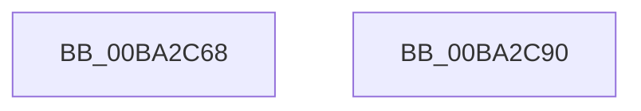

# IovUtilIsWdmStack

- RVA: `0x00BA2C68`–`0x00BA2C91` (길이 `41` bytes)
- VA: `0x0000000140BA2C68`
- 실행 섹션: `PAGEVRFY`
- PDB 이름 있음: `예`; PDB Function 태그: `아니요`
- unwind 정보 RVA: `0x0005CF00`
- 디코드: `13`개 명령, `41/41` bytes 표시
- 미해석 바이트: `0` (있으면 어셈블리에 `.byte`로 보존)

> 이 문서는 커널 이미지의 기계어와 PDB 기호를 분석해 생성했습니다. 4번과 5번은 함수 원형과 자료형을 바이너리 사용 방식에서 추정한 C 해석이며 원본 소스 복구 결과는 아닙니다.

## 1. Dependencies

- 직접 호출 지점: **3**; 고유 호출 대상: **3**
- 직접 호출자로 확인된 함수: **2**
- RIP 상대 이미지 참조: **0**

### Outgoing calls
- `0x00BA2C6E` → [IovUtilGetBottomDeviceObjectWithTag](IovUtilGetBottomDeviceObjectWithTag_function_00BA2A20.md) (function, `0x00BA2A20`)
- `0x00BA2C76` → [PpvUtilIsPdo](../B9/PpvUtilIsPdo_function_00B92C80.md) (function, `0x00B92C80`)
- `0x00BA2C83` → [ObfDereferenceObjectWithTag](../../text/2F/ObfDereferenceObjectWithTag_function_002F78E0.md) (function, `0x002F78E0`)

### Direct callers
- [VfPnpVerifyIrpStackDownward](../BB/VfPnpVerifyIrpStackDownward_function_00BB5750.md) at `0x00BB5784`
- [VfPnpVerifyIrpStackUpward](../BB/VfPnpVerifyIrpStackUpward_function_00BB58E0.md) at `0x00BB590C`

### Static image references
- 디코드된 RIP-relative 메모리 참조가 없습니다.

## 2. Other-region calls and transfers

- 다른 실행 섹션으로 향하는 call: **1**
  - `0x00BA2C83` → [ObfDereferenceObjectWithTag](../../text/2F/ObfDereferenceObjectWithTag_function_002F78E0.md) (`PAGEVRFY` → `.text`)
- 별도 외부 분기/꼬리 이동을 확인하지 못했습니다.

## 3. Assembly (complete function range)

```asm
00BA2C68  40 53                           push rbx
00BA2C6A  48 83 EC 20                     sub rsp, 0x20
00BA2C6E  E8 AD FD FF FF                  call 0x140ba2a20
00BA2C73  48 8B C8                        mov rcx, rax
00BA2C76  E8 05 00 FF FF                  call 0x140b92c80
00BA2C7B  BA 56 72 66 49                  mov edx, 0x49667256
00BA2C80  0F B6 D8                        movzx ebx, al
00BA2C83  E8 58 4C 75 FF                  call 0x1402f78e0
00BA2C88  8B C3                           mov eax, ebx
00BA2C8A  48 83 C4 20                     add rsp, 0x20
00BA2C8E  5B                              pop rbx
00BA2C8F  C3                              ret
00BA2C90  CC                              int3
```

## 4. C-style interpretation (structured pseudocode)

```c
__int64 __fastcall IovUtilIsWdmStack(void)
{
    __int64 result;
    __int64 v_rsp;

    v_rsp = (v_rsp) - (32);
    result = IovUtilGetBottomDeviceObjectWithTag(a1, a2, a3, a4);
    result = PpvUtilIsPdo(result, a2, a3, a4);
    result = ObfDereferenceObjectWithTag(result, (unsigned int)(0x49667256ULL), a3, a4);
    v_rsp = (v_rsp) + (32);
    return (unsigned int)((unsigned int)((unsigned __int8)(result)));
}
```

## 5. (Beta) C Style

```c
void IovUtilIsWdmStack(void)
{
    int64_t result;
    int64_t local_rsp;

    local_rsp = (local_rsp) - (32);
    result = IovUtilGetBottomDeviceObjectWithTag(a1, a2, a3, a4);
    result = PpvUtilIsPdo(result, a2, a3, a4);
    result = ObfDereferenceObjectWithTag(result, (uint32_t)(0x49667256ULL), a3, a4);
    local_rsp = (local_rsp) + (32);
    return (uint32_t)((uint32_t)((uint8_t)(result)));
}
```

## 6. Execution-region graph

[열기: 2D/3D 그래프와 함수 탐색 컨트롤 패널](../../../control-panel.html?section=pagevrfy&rva=0x00BA2C68&view=graph)

- 2D 그래프는 위에서 아래로 흐르고, 3D 그래프는 빈 공간을 드래그해 회전합니다. Shift+드래그는 이동, 휠은 확대·축소, 함수 노드 선택은 대상 보고서 이동입니다.

### Static fallback


