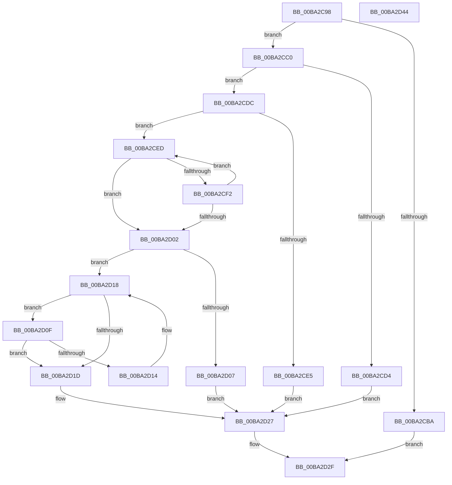

# IovUtilRelateDeviceObjects

- RVA: `0x00BA2C98`–`0x00BA2D45` (길이 `173` bytes)
- VA: `0x0000000140BA2C98`
- 실행 섹션: `PAGEVRFY`
- PDB 이름 있음: `예`; PDB Function 태그: `아니요`
- unwind 정보 RVA: `0x0005C954`
- 디코드: `53`개 명령, `173/173` bytes 표시
- 미해석 바이트: `0` (있으면 어셈블리에 `.byte`로 보존)

> 이 문서는 커널 이미지의 기계어와 PDB 기호를 분석해 생성했습니다. 4번과 5번은 함수 원형과 자료형을 바이너리 사용 방식에서 추정한 C 해석이며 원본 소스 복구 결과는 아닙니다.

## 1. Dependencies

- 직접 호출 지점: **2**; 고유 호출 대상: **2**
- 직접 호출자로 확인된 함수: **1**
- RIP 상대 이미지 참조: **0**

### Outgoing calls
- `0x00BA2CC7` → [KeAcquireQueuedSpinLock](../../text/27/KeAcquireQueuedSpinLock_function_00273D80.md) (function, `0x00273D80`)
- `0x00BA2D2A` → [KeReleaseQueuedSpinLock](../../text/27/KeReleaseQueuedSpinLock_function_00272540.md) (function, `0x00272540`)

### Direct callers
- [IovpExamineDevObjForwarding](../B9/IovpExamineDevObjForwarding_function_00B9D59C.md) at `0x00B9D5D9`

### Static image references
- 디코드된 RIP-relative 메모리 참조가 없습니다.

## 2. Other-region calls and transfers

- 다른 실행 섹션으로 향하는 call: **2**
  - `0x00BA2CC7` → [KeAcquireQueuedSpinLock](../../text/27/KeAcquireQueuedSpinLock_function_00273D80.md) (`PAGEVRFY` → `.text`)
  - `0x00BA2D2A` → [KeReleaseQueuedSpinLock](../../text/27/KeReleaseQueuedSpinLock_function_00272540.md) (`PAGEVRFY` → `.text`)
- 별도 외부 분기/꼬리 이동을 확인하지 못했습니다.

## 3. Assembly (complete function range)

```asm
00BA2C98  48 89 5C 24 08                  mov qword ptr [rsp + 8], rbx
00BA2C9D  48 89 6C 24 10                  mov qword ptr [rsp + 0x10], rbp
00BA2CA2  48 89 74 24 18                  mov qword ptr [rsp + 0x18], rsi
00BA2CA7  57                              push rdi
00BA2CA8  48 83 EC 20                     sub rsp, 0x20
00BA2CAC  49 8B F8                        mov rdi, r8
00BA2CAF  48 8B F2                        mov rsi, rdx
00BA2CB2  48 8B D9                        mov rbx, rcx
00BA2CB5  48 3B CA                        cmp rcx, rdx
00BA2CB8  75 06                           jne 0x140ba2cc0
00BA2CBA  41 83 20 00                     and dword ptr [r8], 0
00BA2CBE  EB 6F                           jmp 0x140ba2d2f
00BA2CC0  BD 0A 00 00 00                  mov ebp, 0xa
00BA2CC5  8B CD                           mov ecx, ebp
00BA2CC7  E8 B4 10 6D FF                  call 0x140273d80
00BA2CCC  8A D0                           mov dl, al
00BA2CCE  48 3B 5E 18                     cmp rbx, qword ptr [rsi + 0x18]
00BA2CD2  75 08                           jne 0x140ba2cdc
00BA2CD4  C7 07 01 00 00 00               mov dword ptr [rdi], 1
00BA2CDA  EB 4B                           jmp 0x140ba2d27
00BA2CDC  48 8B 4B 18                     mov rcx, qword ptr [rbx + 0x18]
00BA2CE0  48 3B CE                        cmp rcx, rsi
00BA2CE3  75 08                           jne 0x140ba2ced
00BA2CE5  C7 07 02 00 00 00               mov dword ptr [rdi], 2
00BA2CEB  EB 3A                           jmp 0x140ba2d27
00BA2CED  48 3B DE                        cmp rbx, rsi
00BA2CF0  74 10                           je 0x140ba2d02
00BA2CF2  48 8B 83 38 01 00 00            mov rax, qword ptr [rbx + 0x138]
00BA2CF9  48 8B 58 30                     mov rbx, qword ptr [rax + 0x30]
00BA2CFD  48 85 DB                        test rbx, rbx
00BA2D00  75 EB                           jne 0x140ba2ced
00BA2D02  48 85 DB                        test rbx, rbx
00BA2D05  74 11                           je 0x140ba2d18
00BA2D07  C7 07 03 00 00 00               mov dword ptr [rdi], 3
00BA2D0D  EB 18                           jmp 0x140ba2d27
00BA2D0F  48 3B CE                        cmp rcx, rsi
00BA2D12  74 09                           je 0x140ba2d1d
00BA2D14  48 8B 49 18                     mov rcx, qword ptr [rcx + 0x18]
00BA2D18  48 85 C9                        test rcx, rcx
00BA2D1B  75 F2                           jne 0x140ba2d0f
00BA2D1D  48 F7 D9                        neg rcx
00BA2D20  1B C0                           sbb eax, eax
00BA2D22  83 C0 05                        add eax, 5
00BA2D25  89 07                           mov dword ptr [rdi], eax
00BA2D27  48 8B CD                        mov rcx, rbp
00BA2D2A  E8 11 F8 6C FF                  call 0x140272540
00BA2D2F  48 8B 5C 24 30                  mov rbx, qword ptr [rsp + 0x30]
00BA2D34  48 8B 6C 24 38                  mov rbp, qword ptr [rsp + 0x38]
00BA2D39  48 8B 74 24 40                  mov rsi, qword ptr [rsp + 0x40]
00BA2D3E  48 83 C4 20                     add rsp, 0x20
00BA2D42  5F                              pop rdi
00BA2D43  C3                              ret
00BA2D44  CC                              int3
```

## 4. C-style interpretation (structured pseudocode)

```c
__int64 __fastcall IovUtilRelateDeviceObjects(__int64 a1, __int64 a2, __int64 a3)
{
    __int64 result;
    __int64 v_rsp;
    unsigned __int64 v_stack_p10;
    unsigned __int64 v_stack_p18;
    unsigned __int64 v_stack_p8;

    v_stack_p8 = v_rbx;
    v_stack_p10 = v_rbp;
    v_stack_p18 = v_rsi;
    v_rsp = (v_rsp) - (32);
    if (a1 != a2) goto loc_00BA2CC0;
    goto loc_00BA2D2F;
loc_00BA2CC0:
    result = KeAcquireQueuedSpinLock(10, a2, a3, a4);
    if (a1 != (*(unsigned __int64 *)(a2 + 24))) goto loc_00BA2CDC;
    *(unsigned int *)(a3) = 1;
    goto loc_00BA2D27;
loc_00BA2CDC:
    if ((*(unsigned __int64 *)(a1 + 24)) != a2) goto loc_00BA2CED;
    *(unsigned int *)(a3) = 2;
    goto loc_00BA2D27;
loc_00BA2CED:
    if (a1 == a2) goto loc_00BA2D02;
    if (*(unsigned __int64 *)(*(unsigned __int64 *)(a1 + 312) + 48) != 0) goto loc_00BA2CED;
loc_00BA2D02:
    if (*(unsigned __int64 *)(*(unsigned __int64 *)(a1 + 312) + 48) == 0) goto loc_00BA2D18;
    *(unsigned int *)(a3) = 3;
    goto loc_00BA2D27;
loc_00BA2D0F:
    if ((*(unsigned __int64 *)(a1 + 24)) == a2) goto loc_00BA2D1D;
loc_00BA2D18:
    if (*(unsigned __int64 *)(*(unsigned __int64 *)(a1 + 24) + 24) != 0) goto loc_00BA2D0F;
loc_00BA2D1D:
    a1 = -(*(unsigned __int64 *)(*(unsigned __int64 *)(a1 + 24) + 24));
    result = (unsigned int)((*(unsigned __int64 *)(a1 + 312)) + (5));
    *(unsigned int *)(a3) = (unsigned int)(result);
loc_00BA2D27:
    result = KeReleaseQueuedSpinLock(10, (unsigned __int8)(result), a3, a4);
loc_00BA2D2F:
    v_rsp = (v_rsp) + (32);
    return result;
}
```

## 5. (Beta) C Style

```c
int64_t IovUtilRelateDeviceObjects(int64_t Arg1, void *Arg2, void *Arg3)
{
    uint8_t *arg2 = (uint8_t *)Arg2;
    uint8_t *arg3 = (uint8_t *)Arg3;

    int64_t result;
    int64_t local_rsp;
    uint64_t v_stack_p10;
    uint64_t v_stack_p18;
    uint64_t v_stack_p8;

    v_stack_p8 = local_rbx;
    v_stack_p10 = local_rbp;
    v_stack_p18 = local_rsi;
    local_rsp = (local_rsp) - (32);
    if (Arg1 != Arg2) goto loc_00BA2CC0;
    goto loc_00BA2D2F;
loc_00BA2CC0:
    result = KeAcquireQueuedSpinLock(10, Arg2, Arg3, a4);
    if (Arg1 != (*(uint64_t *)(arg2 + 0x18))) goto loc_00BA2CDC;
    *(uint32_t *)(arg3) = 1;
    goto loc_00BA2D27;
loc_00BA2CDC:
    if ((*(uint64_t *)(Arg1 + 0x18)) != Arg2) goto loc_00BA2CED;
    *(uint32_t *)(arg3) = 2;
    goto loc_00BA2D27;
loc_00BA2CED:
    if (Arg1 == Arg2) goto loc_00BA2D02;
    if (*(uint64_t *)(*(uint64_t *)(Arg1 + 0x138) + 0x30) != 0) goto loc_00BA2CED;
loc_00BA2D02:
    if (*(uint64_t *)(*(uint64_t *)(Arg1 + 0x138) + 0x30) == 0) goto loc_00BA2D18;
    *(uint32_t *)(arg3) = 3;
    goto loc_00BA2D27;
loc_00BA2D0F:
    if ((*(uint64_t *)(Arg1 + 0x18)) == Arg2) goto loc_00BA2D1D;
loc_00BA2D18:
    if (*(uint64_t *)(*(uint64_t *)(Arg1 + 0x18) + 0x18) != 0) goto loc_00BA2D0F;
loc_00BA2D1D:
    Arg1 = -(*(uint64_t *)(*(uint64_t *)(Arg1 + 0x18) + 0x18));
    result = (uint32_t)((*(uint64_t *)(Arg1 + 0x138)) + (5));
    *(uint32_t *)(arg3) = (uint32_t)(result);
loc_00BA2D27:
    result = KeReleaseQueuedSpinLock(10, (uint8_t)(result), Arg3, a4);
loc_00BA2D2F:
    local_rsp = (local_rsp) + (32);
    return result;
}
```

### 관측된 메모리 오프셋

구조체 형식이 확인되지 않은 접근은 인자 기준의 오프셋으로만 기록했습니다.

| 기준 인자 | 오프셋 표현 | 폭 (bit) | 접근 |
|---|---:|---:|---|
| `Arg2` | `+ 0x18` | `64` | `R` |
| `Arg3` | `+ 0x0` | `32` | `R/W` |
| `Arg3` | `+ 0x0` | `32` | `W` |

## 6. Execution-region graph

[열기: 2D/3D 그래프와 함수 탐색 컨트롤 패널](../../../control-panel.html?section=pagevrfy&rva=0x00BA2C98&view=graph)

- 2D 그래프는 위에서 아래로 흐르고, 3D 그래프는 빈 공간을 드래그해 회전합니다. Shift+드래그는 이동, 휠은 확대·축소, 함수 노드 선택은 대상 보고서 이동입니다.

### Static fallback


