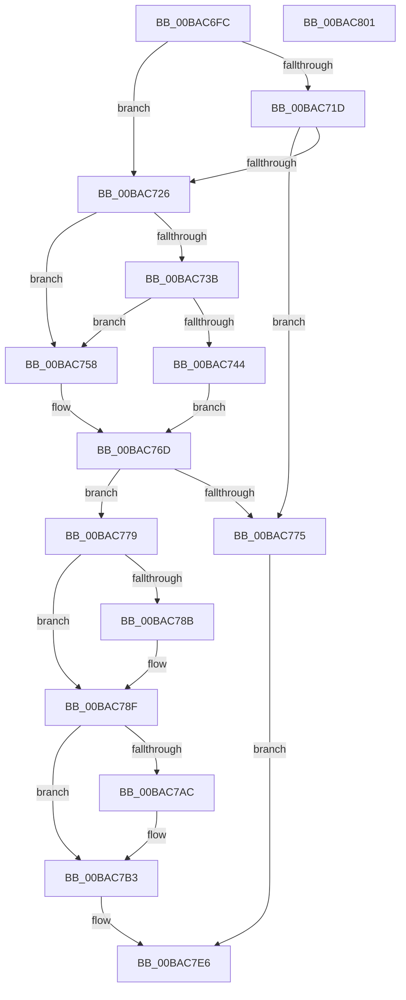

# IovpSessionDataCreate

- RVA: `0x00BAC6FC`–`0x00BAC802` (길이 `262` bytes)
- VA: `0x0000000140BAC6FC`
- 실행 섹션: `PAGEVRFY`
- PDB 이름 있음: `예`; PDB Function 태그: `아니요`
- unwind 정보 RVA: `0x0005E6B4`
- 디코드: `73`개 명령, `262/262` bytes 표시
- 미해석 바이트: `0` (있으면 어셈블리에 `.byte`로 보존)

> 이 문서는 커널 이미지의 기계어와 PDB 기호를 분석해 생성했습니다. 4번과 5번은 함수 원형과 자료형을 바이너리 사용 방식에서 추정한 C 해석이며 원본 소스 복구 결과는 아닙니다.

## 1. Dependencies

- 직접 호출 지점: **4**; 고유 호출 대상: **4**
- 직접 호출자로 확인된 함수: **1**
- RIP 상대 이미지 참조: **3**

### Outgoing calls
- `0x00BAC71D` → [IovUtilIsVerifiedDeviceStack](IovUtilIsVerifiedDeviceStack_function_00BA2B88.md) (function, `0x00BA2B88`)
- `0x00BAC751` → [ExAllocateFromNPagedLookasideList](../../text/38/ExAllocateFromNPagedLookasideList_function_0038E6C0.md) (function, `0x0038E6C0`)
- `0x00BAC768` → [ExAllocatePool2](../../poolcode/B8/ExAllocatePool2_function_00B820F0.md) (function, `0x00B820F0`)
- `0x00BAC781` → [memset](../../text/6C/memset_function_006C6C40.md) (function, `0x006C6C40`)

### Direct callers
- [IovpCallDriver1](../B9/IovpCallDriver1_function_00B9CCA4.md) at `0x00B9CDCB`

### Static image references
- `0x00BAC73B` → RVA `0x00FFDB08` (`PAGEVRFD`; read)
- `0x00BAC744` → RVA `0x00FFF680` (`PAGEVRFD`; read)
- `0x00BAC78F` → RVA `0x00F04A20` (`.data`; read)

## 2. Other-region calls and transfers

- 다른 실행 섹션으로 향하는 call: **3**
  - `0x00BAC751` → [ExAllocateFromNPagedLookasideList](../../text/38/ExAllocateFromNPagedLookasideList_function_0038E6C0.md) (`PAGEVRFY` → `.text`)
  - `0x00BAC768` → [ExAllocatePool2](../../poolcode/B8/ExAllocatePool2_function_00B820F0.md) (`PAGEVRFY` → `POOLCODE`)
  - `0x00BAC781` → [memset](../../text/6C/memset_function_006C6C40.md) (`PAGEVRFY` → `.text`)
- 별도 외부 분기/꼬리 이동을 확인하지 못했습니다.

## 3. Assembly (complete function range)

```asm
00BAC6FC  48 8B C4                        mov rax, rsp
00BAC6FF  48 89 58 08                     mov qword ptr [rax + 8], rbx
00BAC703  48 89 68 10                     mov qword ptr [rax + 0x10], rbp
00BAC707  48 89 70 18                     mov qword ptr [rax + 0x18], rsi
00BAC70B  48 89 78 20                     mov qword ptr [rax + 0x20], rdi
00BAC70F  41 56                           push r14
00BAC711  48 83 EC 20                     sub rsp, 0x20
00BAC715  48 8B FA                        mov rdi, rdx
00BAC718  45 85 C0                        test r8d, r8d
00BAC71B  75 09                           jne 0x140bac726
00BAC71D  E8 66 64 FF FF                  call 0x140ba2b88
00BAC722  85 C0                           test eax, eax
00BAC724  74 4F                           je 0x140bac775
00BAC726  48 8B 2F                        mov rbp, qword ptr [rdi]
00BAC729  0F BE 4D 42                     movsx ecx, byte ptr [rbp + 0x42]
00BAC72D  6B F1 78                        imul esi, ecx, 0x78
00BAC730  81 C6 C8 00 00 00               add esi, 0xc8
00BAC736  80 F9 14                        cmp cl, 0x14
00BAC739  7F 1D                           jg 0x140bac758
00BAC73B  83 3D C6 13 45 00 00            cmp dword ptr [rip + 0x4513c6], 0
00BAC742  74 14                           je 0x140bac758
00BAC744  48 8D 0D 35 2F 45 00            lea rcx, [rip + 0x452f35]
00BAC74B  41 BE 01 00 00 00               mov r14d, 1
00BAC751  E8 6A 1F 7E FF                  call 0x14038e6c0
00BAC756  EB 15                           jmp 0x140bac76d
00BAC758  45 33 F6                        xor r14d, r14d
00BAC75B  41 B8 49 72 70 73               mov r8d, 0x73707249
00BAC761  48 8B D6                        mov rdx, rsi
00BAC764  41 8D 4E 40                     lea ecx, [r14 + 0x40]
00BAC768  E8 83 59 FD FF                  call 0x140b820f0
00BAC76D  48 8B D8                        mov rbx, rax
00BAC770  48 85 C0                        test rax, rax
00BAC773  75 04                           jne 0x140bac779
00BAC775  33 C0                           xor eax, eax
00BAC777  EB 6D                           jmp 0x140bac7e6
00BAC779  4C 8B C6                        mov r8, rsi
00BAC77C  33 D2                           xor edx, edx
00BAC77E  48 8B CB                        mov rcx, rbx
00BAC781  E8 BA A4 B1 FF                  call 0x1406c6c40
00BAC786  45 85 F6                        test r14d, r14d
00BAC789  74 04                           je 0x140bac78f
00BAC78B  83 4B 20 04                     or dword ptr [rbx + 0x20], 4
00BAC78F  8B 05 8B 82 35 00               mov eax, dword ptr [rip + 0x35828b]
00BAC795  48 8D 4B 10                     lea rcx, [rbx + 0x10]
00BAC799  89 43 48                        mov dword ptr [rbx + 0x48], eax
00BAC79C  48 8D 47 40                     lea rax, [rdi + 0x40]
00BAC7A0  48 89 3B                        mov qword ptr [rbx], rdi
00BAC7A3  48 8B 10                        mov rdx, qword ptr [rax]
00BAC7A6  48 39 42 08                     cmp qword ptr [rdx + 8], rax
00BAC7AA  74 07                           je 0x140bac7b3
00BAC7AC  B9 03 00 00 00                  mov ecx, 3
00BAC7B1  CD 29                           int 0x29
00BAC7B3  48 89 41 08                     mov qword ptr [rcx + 8], rax
00BAC7B7  48 89 11                        mov qword ptr [rcx], rdx
00BAC7BA  48 89 4A 08                     mov qword ptr [rdx + 8], rcx
00BAC7BE  48 89 08                        mov qword ptr [rax], rcx
00BAC7C1  48 89 9F F0 00 00 00            mov qword ptr [rdi + 0xf0], rbx
00BAC7C8  8A 45 43                        mov al, byte ptr [rbp + 0x43]
00BAC7CB  88 87 B8 00 00 00               mov byte ptr [rdi + 0xb8], al
00BAC7D1  8B 47 38                        mov eax, dword ptr [rdi + 0x38]
00BAC7D4  25 2F FE FF FF                  and eax, 0xfffffe2f
00BAC7D9  83 C8 01                        or eax, 1
00BAC7DC  89 47 38                        mov dword ptr [rdi + 0x38], eax
00BAC7DF  48 8B C3                        mov rax, rbx
00BAC7E2  48 89 6B 40                     mov qword ptr [rbx + 0x40], rbp
00BAC7E6  48 8B 5C 24 30                  mov rbx, qword ptr [rsp + 0x30]
00BAC7EB  48 8B 6C 24 38                  mov rbp, qword ptr [rsp + 0x38]
00BAC7F0  48 8B 74 24 40                  mov rsi, qword ptr [rsp + 0x40]
00BAC7F5  48 8B 7C 24 48                  mov rdi, qword ptr [rsp + 0x48]
00BAC7FA  48 83 C4 20                     add rsp, 0x20
00BAC7FE  41 5E                           pop r14
00BAC800  C3                              ret
00BAC801  CC                              int3
```

## 4. C-style interpretation (structured pseudocode)

```c
__int64 __fastcall IovpSessionDataCreate(__int64 a1, __int64 a2, int a3)
{
    __int64 result;
    __int64 v_r14;
    __int64 v_rsi;
    __int64 v_rsp;
    unsigned __int64 v_stack_p10;
    unsigned __int64 v_stack_p18;
    unsigned __int64 v_stack_p20;
    unsigned __int64 v_stack_p8;

    *(unsigned __int64 *)(v_rsp + 8) = v_rbx;
    *(unsigned __int64 *)(v_rsp + 16) = v_rbp;
    *(unsigned __int64 *)(v_rsp + 24) = v_rsi;
    *(unsigned __int64 *)(v_rsp + 32) = v_rdi;
    v_rsp = (v_rsp) - (32);
    if (a3 != 0) goto loc_00BAC726;
    result = IovUtilIsVerifiedDeviceStack(a1, a2, a3, a4);
    if ((unsigned int)(result) == 0) goto loc_00BAC775;
loc_00BAC726:
    v_rsi = (unsigned int)((v_rsi) * ((unsigned int)((__int8)(*(unsigned __int8 *)(*(unsigned __int64 *)(a2) + 66)))));
    v_rsi = (unsigned int)((v_rsi) + (200));
    if (((unsigned __int8)((__int8)(*(unsigned __int8 *)(*(unsigned __int64 *)(a2) + 66)))) > 20) goto loc_00BAC758;
    if ((*(unsigned int *)(v_rip + 4527046)) == 0) goto loc_00BAC758;
    result = ExAllocateFromNPagedLookasideList(v_rip + 4534069, a2, a3, a4);
    goto loc_00BAC76D;
loc_00BAC758:
    v_r14 = 0;
    result = ExAllocatePool2(v_r14 + 64, v_rsi, (unsigned int)(0x73707249ULL), a4);
loc_00BAC76D:
    if (result != 0) goto loc_00BAC779;
loc_00BAC775:
    result = 0;
    goto loc_00BAC7E6;
loc_00BAC779:
    a2 = 0;
    result = memset(0, a2, v_rsi, a4);
    if (0 != 0) {
    }
    *(unsigned int *)(result + 72) = (unsigned int)((unsigned int)(*(unsigned int *)(v_rip + 3506827)));
    *(unsigned __int64 *)(result) = 0;
    if ((*(unsigned __int64 *)(*(unsigned __int64 *)(a2 + 64) + 8)) != (a2 + 64)) {
        a1 = 3;
    }
    *(unsigned __int64 *)(a1 + 8) = a2 + 64;
    *(unsigned __int64 *)(a1) = *(unsigned __int64 *)(a2 + 64);
    *(unsigned __int64 *)(*(unsigned __int64 *)(a2 + 64) + 8) = a1;
    *(unsigned __int64 *)(a2 + 64) = a1;
    *(unsigned __int64 *)(a2 + 240) = result;
    *(unsigned __int8 *)(a2 + 184) = (unsigned __int8)(*(unsigned __int8 *)(*(unsigned __int64 *)(a2) + 67));
    result = (unsigned int)(((unsigned int)(*(unsigned int *)(a2 + 56))) & (0xFFFFFE2FULL));
    result = (unsigned int)((result) | (1));
    *(unsigned int *)(a2 + 56) = (unsigned int)(result);
    *(unsigned __int64 *)(result + 64) = *(unsigned __int64 *)(a2);
loc_00BAC7E6:
    v_rsp = (v_rsp) + (32);
    return result;
}
```

## 5. (Beta) C Style

```c
int64_t IovpSessionDataCreate(int64_t Arg1, void *Arg2, int32_t Arg3)
{
    uint8_t *arg2 = (uint8_t *)Arg2;

    int64_t result;
    int64_t local_r14;
    int64_t local_rsi;
    int64_t local_rsp;
    uint64_t v_stack_p10;
    uint64_t v_stack_p18;
    uint64_t v_stack_p20;
    uint64_t v_stack_p8;

    *(uint64_t *)(local_rsp + 0x8) = local_rbx;
    *(uint64_t *)(local_rsp + 0x10) = local_rbp;
    *(uint64_t *)(local_rsp + 0x18) = local_rsi;
    *(uint64_t *)(local_rsp + 0x20) = local_rdi;
    local_rsp = (local_rsp) - (32);
    if (Arg3 != 0) goto loc_00BAC726;
    result = IovUtilIsVerifiedDeviceStack(Arg1, Arg2, Arg3, a4);
    if ((uint32_t)(result) == 0) goto loc_00BAC775;
loc_00BAC726:
    local_rsi = (uint32_t)((local_rsi) * ((uint32_t)((int8_t)(*(uint8_t *)(*(uint64_t *)(arg2) + 0x42)))));
    local_rsi = (uint32_t)((local_rsi) + (200));
    if (((uint8_t)((int8_t)(*(uint8_t *)(*(uint64_t *)(arg2) + 0x42)))) > 20) goto loc_00BAC758;
    if ((*(uint32_t *)(v_rip + 0x4513C6)) == 0) goto loc_00BAC758;
    result = ExAllocateFromNPagedLookasideList(v_rip + 4534069, Arg2, Arg3, a4);
    goto loc_00BAC76D;
loc_00BAC758:
    local_r14 = 0;
    result = ExAllocatePool2(local_r14 + 64, local_rsi, (uint32_t)(0x73707249ULL), a4);
loc_00BAC76D:
    if (result != 0) goto loc_00BAC779;
loc_00BAC775:
    result = 0;
    goto loc_00BAC7E6;
loc_00BAC779:
    Arg2 = 0;
    result = memset(0, Arg2, local_rsi, a4);
    if (0 != 0) {
    }
    *(uint32_t *)(result + 0x48) = (uint32_t)((uint32_t)(*(uint32_t *)(v_rip + 0x35828B)));
    *(uint64_t *)(result) = 0;
    if ((*(uint64_t *)(*(uint64_t *)(arg2 + 0x40) + 0x8)) != (Arg2 + 64)) {
        Arg1 = 3;
    }
    *(void **)(Arg1 + 0x8) = Arg2 + 64;
    *(uint64_t *)(Arg1) = *(uint64_t *)(arg2 + 0x40);
    *(uint64_t *)(*(uint64_t *)(arg2 + 0x40) + 0x8) = Arg1;
    *(uint64_t *)(arg2 + 0x40) = Arg1;
    *(uint64_t *)(arg2 + 0xF0) = result;
    *(uint8_t *)(arg2 + 0xB8) = (uint8_t)(*(uint8_t *)(*(uint64_t *)(arg2) + 0x43));
    result = (uint32_t)(((uint32_t)(*(uint32_t *)(arg2 + 0x38))) & (0xFFFFFE2FULL));
    result = (uint32_t)((result) | (1));
    *(uint32_t *)(arg2 + 0x38) = (uint32_t)(result);
    *(uint64_t *)(result + 0x40) = *(uint64_t *)(arg2);
loc_00BAC7E6:
    local_rsp = (local_rsp) + (32);
    return result;
}
```

### 관측된 메모리 오프셋

구조체 형식이 확인되지 않은 접근은 인자 기준의 오프셋으로만 기록했습니다.

| 기준 인자 | 오프셋 표현 | 폭 (bit) | 접근 |
|---|---:|---:|---|
| `Arg2` | `+ 0x0` | `64` | `R` |
| `Arg2` | `+ 0x0` | `64` | `W` |
| `Arg2` | `+ 0x38` | `32` | `R` |
| `Arg2` | `+ 0x38` | `32` | `W` |
| `Arg2` | `+ 0x40` | `64` | `R` |
| `Arg2` | `+ 0xB8` | `8` | `W` |
| `Arg2` | `+ 0xF0` | `64` | `W` |

## 6. Execution-region graph

[열기: 2D/3D 그래프와 함수 탐색 컨트롤 패널](../../../control-panel.html?section=pagevrfy&rva=0x00BAC6FC&view=graph)

- 2D 그래프는 위에서 아래로 흐르고, 3D 그래프는 빈 공간을 드래그해 회전합니다. Shift+드래그는 이동, 휠은 확대·축소, 함수 노드 선택은 대상 보고서 이동입니다.

### Static fallback


