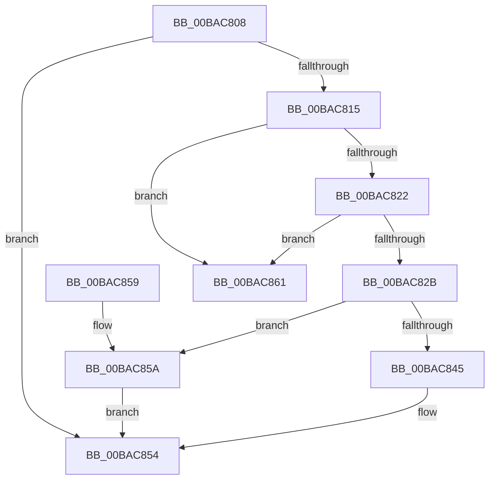

# IovpSessionDataDereference

- RVA: `0x00BAC808`–`0x00BAC868` (길이 `96` bytes)
- VA: `0x0000000140BAC808`
- 실행 섹션: `PAGEVRFY`
- PDB 이름 있음: `예`; PDB Function 태그: `아니요`
- unwind 정보 RVA: `0x00064C74`
- 디코드: `29`개 명령, `96/96` bytes 표시
- 미해석 바이트: `0` (있으면 어셈블리에 `.byte`로 보존)

> 이 문서는 커널 이미지의 기계어와 PDB 기호를 분석해 생성했습니다. 4번과 5번은 함수 원형과 자료형을 바이너리 사용 방식에서 추정한 C 해석이며 원본 소스 복구 결과는 아닙니다.

## 1. Dependencies

- 직접 호출 지점: **2**; 고유 호출 대상: **2**
- 직접 호출자로 확인된 함수: **3**
- RIP 상대 이미지 참조: **1**

### Outgoing calls
- `0x00BAC84F` → [ExFreeToNPagedLookasideList](../../text/38/ExFreeToNPagedLookasideList_function_0038D9D0.md) (function, `0x0038D9D0`)
- `0x00BAC85A` → [VfUtilFreePoolDispatchLevel](../../text/61/VfUtilFreePoolDispatchLevel_function_00612300.md) (function, `0x00612300`)

### Direct callers
- [IovpCallDriver2](../B9/IovpCallDriver2_function_00B9D270.md) at `0x00B9D4BA`
- [IovpCompleteRequest5](../BB/IovpCompleteRequest5_function_00BB6E40.md) at `0x00BB6E71`
- [sub_00BBBE00](../BB/Unknown_function_00BBBE00.md) at `0x00BBBFF4`

### Static image references
- `0x00BAC848` → RVA `0x00FFF680` (`PAGEVRFD`; read)

## 2. Other-region calls and transfers

- 다른 실행 섹션으로 향하는 call: **2**
  - `0x00BAC84F` → [ExFreeToNPagedLookasideList](../../text/38/ExFreeToNPagedLookasideList_function_0038D9D0.md) (`PAGEVRFY` → `.text`)
  - `0x00BAC85A` → [VfUtilFreePoolDispatchLevel](../../text/61/VfUtilFreePoolDispatchLevel_function_00612300.md) (`PAGEVRFY` → `.text`)
- 별도 외부 분기/꼬리 이동을 확인하지 못했습니다.

## 3. Assembly (complete function range)

```asm
00BAC808  48 83 EC 28                     sub rsp, 0x28
00BAC80C  83 69 08 01                     sub dword ptr [rcx + 8], 1
00BAC810  4C 8B 09                        mov r9, qword ptr [rcx]
00BAC813  75 3F                           jne 0x140bac854
00BAC815  48 8D 41 10                     lea rax, [rcx + 0x10]
00BAC819  48 8B 10                        mov rdx, qword ptr [rax]
00BAC81C  48 39 42 08                     cmp qword ptr [rdx + 8], rax
00BAC820  75 3F                           jne 0x140bac861
00BAC822  4C 8B 40 08                     mov r8, qword ptr [rax + 8]
00BAC826  49 39 00                        cmp qword ptr [r8], rax
00BAC829  75 36                           jne 0x140bac861
00BAC82B  49 89 10                        mov qword ptr [r8], rdx
00BAC82E  4C 89 42 08                     mov qword ptr [rdx + 8], r8
00BAC832  48 89 40 08                     mov qword ptr [rax + 8], rax
00BAC836  48 89 00                        mov qword ptr [rax], rax
00BAC839  F0 41 FF 49 14                  lock dec dword ptr [r9 + 0x14]
00BAC83E  8B 41 20                        mov eax, dword ptr [rcx + 0x20]
00BAC841  A8 04                           test al, 4
00BAC843  74 15                           je 0x140bac85a
00BAC845  48 8B D1                        mov rdx, rcx
00BAC848  48 8D 0D 31 2E 45 00            lea rcx, [rip + 0x452e31]
00BAC84F  E8 7C 11 7E FF                  call 0x14038d9d0
00BAC854  48 83 C4 28                     add rsp, 0x28
00BAC858  C3                              ret
00BAC859  CC                              int3
00BAC85A  E8 A1 5A A6 FF                  call 0x140612300
00BAC85F  EB F3                           jmp 0x140bac854
00BAC861  B9 03 00 00 00                  mov ecx, 3
00BAC866  CD 29                           int 0x29
```

## 4. C-style interpretation (structured pseudocode)

```c
__int64 __fastcall IovpSessionDataDereference(__int64 a1)
{
    __int64 result;
    __int64 v_rsp;

    v_rsp = (v_rsp) - (40);
    if (condition_is_not_equal) goto loc_00BAC854;
    if ((*(unsigned __int64 *)(*(unsigned __int64 *)(a1 + 16) + 8)) != (a1 + 16)) goto loc_00BAC861;
    if ((*(unsigned __int64 *)(*(unsigned __int64 *)(a1 + 16 + 8))) != (a1 + 16)) goto loc_00BAC861;
    *(unsigned __int64 *)(*(unsigned __int64 *)(a1 + 16 + 8)) = *(unsigned __int64 *)(a1 + 16);
    *(unsigned __int64 *)(*(unsigned __int64 *)(a1 + 16) + 8) = *(unsigned __int64 *)(a1 + 16 + 8);
    *(unsigned __int64 *)(a1 + 16 + 8) = a1 + 16;
    *(unsigned __int64 *)(a1 + 16) = a1 + 16;
    if ((((unsigned __int8)((unsigned int)(*(unsigned int *)(a1 + 32)))) & (4)) == 0) goto loc_00BAC85A;
    result = ExFreeToNPagedLookasideList(v_rip + 4533809, a1, *(unsigned __int64 *)(a1 + 16 + 8), *(unsigned __int64 *)(a1));
loc_00BAC854:
    v_rsp = (v_rsp) + (40);
    return result;
loc_00BAC85A:
    result = VfUtilFreePoolDispatchLevel(v_rip + 4533809, a1, *(unsigned __int64 *)(a1 + 16 + 8), *(unsigned __int64 *)(a1));
    goto loc_00BAC854;
loc_00BAC861:
    return result;
}
```

## 5. (Beta) C Style

```c
int64_t IovpSessionDataDereference(void *Arg1)
{
    uint8_t *arg1 = (uint8_t *)Arg1;

    int64_t result;
    int64_t local_rsp;

    local_rsp = (local_rsp) - (40);
    if (condition_is_not_equal) goto loc_00BAC854;
    if ((*(uint64_t *)(*(uint64_t *)(arg1 + 0x10) + 0x8)) != (Arg1 + 16)) goto loc_00BAC861;
    if ((*(uint64_t *)(*(uint64_t *)(arg1 + 0x10 + 0x8))) != (Arg1 + 16)) goto loc_00BAC861;
    *(uint64_t *)(*(uint64_t *)(arg1 + 0x10 + 0x8)) = *(uint64_t *)(arg1 + 0x10);
    *(uint64_t *)(*(uint64_t *)(arg1 + 0x10) + 0x8) = *(uint64_t *)(arg1 + 0x10 + 0x8);
    *(void **)(arg1 + 0x10 + 0x8) = Arg1 + 16;
    *(void **)(arg1 + 0x10) = Arg1 + 16;
    if ((((uint8_t)((uint32_t)(*(uint32_t *)(arg1 + 0x20)))) & (4)) == 0) goto loc_00BAC85A;
    result = ExFreeToNPagedLookasideList(v_rip + 4533809, Arg1, *(uint64_t *)(arg1 + 0x10 + 0x8), *(uint64_t *)(arg1));
loc_00BAC854:
    local_rsp = (local_rsp) + (40);
    return result;
loc_00BAC85A:
    result = VfUtilFreePoolDispatchLevel(v_rip + 4533809, Arg1, *(uint64_t *)(arg1 + 0x10 + 0x8), *(uint64_t *)(arg1));
    goto loc_00BAC854;
loc_00BAC861:
    return result;
}
```

### 관측된 메모리 오프셋

구조체 형식이 확인되지 않은 접근은 인자 기준의 오프셋으로만 기록했습니다.

| 기준 인자 | 오프셋 표현 | 폭 (bit) | 접근 |
|---|---:|---:|---|
| `Arg1` | `+ 0x0` | `64` | `R` |
| `Arg1` | `+ 0x0` | `64` | `W` |
| `Arg1` | `+ 0x8` | `32` | `R/W` |
| `Arg1` | `+ 0x8` | `64` | `R` |
| `Arg1` | `+ 0x8` | `64` | `W` |
| `Arg1` | `+ 0x10` | `64` | `R` |
| `Arg1` | `+ 0x20` | `32` | `R` |

## 6. Execution-region graph

[열기: 2D/3D 그래프와 함수 탐색 컨트롤 패널](../../../control-panel.html?section=pagevrfy&rva=0x00BAC808&view=graph)

- 2D 그래프는 위에서 아래로 흐르고, 3D 그래프는 빈 공간을 드래그해 회전합니다. Shift+드래그는 이동, 휠은 확대·축소, 함수 노드 선택은 대상 보고서 이동입니다.

### Static fallback


