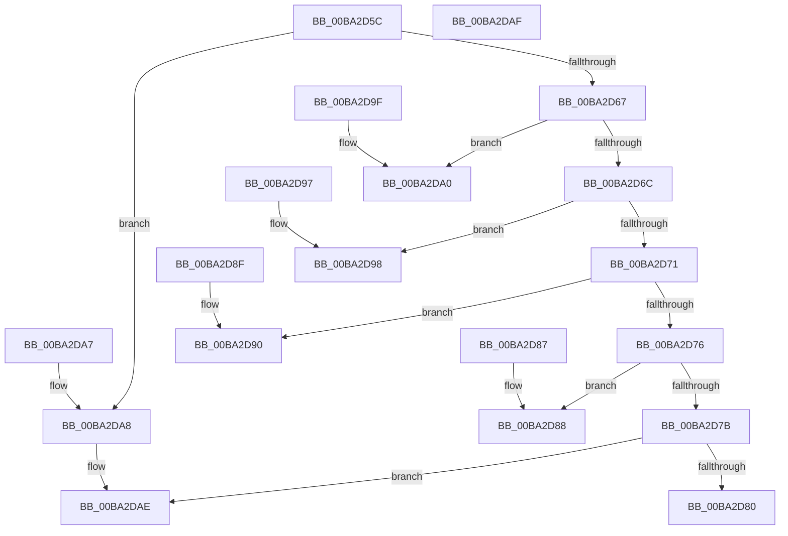

# IovpUtilMarkDeviceObject

- RVA: `0x00BA2D5C`–`0x00BA2DB0` (길이 `84` bytes)
- VA: `0x0000000140BA2D5C`
- 실행 섹션: `PAGEVRFY`
- PDB 이름 있음: `예`; PDB Function 태그: `아니요`
- unwind 정보 RVA: `0x000DB714`
- 디코드: `31`개 명령, `84/84` bytes 표시
- 미해석 바이트: `0` (있으면 어셈블리에 `.byte`로 보존)

> 이 문서는 커널 이미지의 기계어와 PDB 기호를 분석해 생성했습니다. 4번과 5번은 함수 원형과 자료형을 바이너리 사용 방식에서 추정한 C 해석이며 원본 소스 복구 결과는 아닙니다.

## 1. Dependencies

- 직접 호출 지점: **0**; 고유 호출 대상: **0**
- 직접 호출자로 확인된 함수: **1**
- RIP 상대 이미지 참조: **0**

### Outgoing calls
- 직접 디코드된 call 명령이 없습니다.

### Direct callers
- [IovUtilMarkDeviceObject](../../text/4B/IovUtilMarkDeviceObject_function_004B77B0.md) at `0x004B77C3`

### Static image references
- 디코드된 RIP-relative 메모리 참조가 없습니다.

## 2. Other-region calls and transfers

- 다른 실행 섹션으로 향하는 call: **0**
- 별도 외부 분기/꼬리 이동을 확인하지 못했습니다.

## 3. Assembly (complete function range)

```asm
00BA2D5C  4C 8B 81 38 01 00 00            mov r8, qword ptr [rcx + 0x138]
00BA2D63  85 D2                           test edx, edx
00BA2D65  74 41                           je 0x140ba2da8
00BA2D67  83 EA 01                        sub edx, 1
00BA2D6A  74 34                           je 0x140ba2da0
00BA2D6C  83 EA 01                        sub edx, 1
00BA2D6F  74 27                           je 0x140ba2d98
00BA2D71  83 EA 01                        sub edx, 1
00BA2D74  74 1A                           je 0x140ba2d90
00BA2D76  83 EA 01                        sub edx, 1
00BA2D79  74 0D                           je 0x140ba2d88
00BA2D7B  83 FA 01                        cmp edx, 1
00BA2D7E  75 2E                           jne 0x140ba2dae
00BA2D80  41 0F BA 68 20 18               bts dword ptr [r8 + 0x20], 0x18
00BA2D86  C3                              ret
00BA2D87  CC                              int3
00BA2D88  41 0F BA 68 20 19               bts dword ptr [r8 + 0x20], 0x19
00BA2D8E  C3                              ret
00BA2D8F  CC                              int3
00BA2D90  41 0F BA 68 20 1B               bts dword ptr [r8 + 0x20], 0x1b
00BA2D96  C3                              ret
00BA2D97  CC                              int3
00BA2D98  41 0F BA 68 20 1D               bts dword ptr [r8 + 0x20], 0x1d
00BA2D9E  C3                              ret
00BA2D9F  CC                              int3
00BA2DA0  41 0F BA 68 20 1C               bts dword ptr [r8 + 0x20], 0x1c
00BA2DA6  C3                              ret
00BA2DA7  CC                              int3
00BA2DA8  41 0F BA 68 20 1A               bts dword ptr [r8 + 0x20], 0x1a
00BA2DAE  C3                              ret
00BA2DAF  CC                              int3
```

## 4. C-style interpretation (structured pseudocode)

```c
void __fastcall IovpUtilMarkDeviceObject(__int64 a1, int a2)
{
    if (a2 == 0) goto loc_00BA2DA8;
    a2 = (unsigned int)((a2) - (1));
    if (condition_is_equal) goto loc_00BA2DA0;
    a2 = (unsigned int)((a2) - (1));
    if (condition_is_equal) goto loc_00BA2D98;
    a2 = (unsigned int)((a2) - (1));
    if (condition_is_equal) goto loc_00BA2D90;
    a2 = (unsigned int)((a2) - (1));
    if (condition_is_equal) goto loc_00BA2D88;
    if (a2 != 1) goto loc_00BA2DAE;
    return;
loc_00BA2D88:
    return;
loc_00BA2D90:
    return;
loc_00BA2D98:
    return;
loc_00BA2DA0:
    return;
loc_00BA2DA8:
loc_00BA2DAE:
    return;
}
```

## 5. (Beta) C Style

```c
void IovpUtilMarkDeviceObject(void *Arg1, int32_t Arg2)
{
    uint8_t *arg1 = (uint8_t *)Arg1;

    if (Arg2 == 0) goto loc_00BA2DA8;
    Arg2 = (uint32_t)((Arg2) - (1));
    if (condition_is_equal) goto loc_00BA2DA0;
    Arg2 = (uint32_t)((Arg2) - (1));
    if (condition_is_equal) goto loc_00BA2D98;
    Arg2 = (uint32_t)((Arg2) - (1));
    if (condition_is_equal) goto loc_00BA2D90;
    Arg2 = (uint32_t)((Arg2) - (1));
    if (condition_is_equal) goto loc_00BA2D88;
    if (Arg2 != 1) goto loc_00BA2DAE;
    return;
loc_00BA2D88:
    return;
loc_00BA2D90:
    return;
loc_00BA2D98:
    return;
loc_00BA2DA0:
    return;
loc_00BA2DA8:
loc_00BA2DAE:
    return;
}
```

### 관측된 메모리 오프셋

구조체 형식이 확인되지 않은 접근은 인자 기준의 오프셋으로만 기록했습니다.

| 기준 인자 | 오프셋 표현 | 폭 (bit) | 접근 |
|---|---:|---:|---|
| `Arg1` | `+ 0x138` | `64` | `R` |

## 6. Execution-region graph

[열기: 2D/3D 그래프와 함수 탐색 컨트롤 패널](../../../control-panel.html?section=pagevrfy&rva=0x00BA2D5C&view=graph)

- 2D 그래프는 위에서 아래로 흐르고, 3D 그래프는 빈 공간을 드래그해 회전합니다. Shift+드래그는 이동, 휠은 확대·축소, 함수 노드 선택은 대상 보고서 이동입니다.

### Static fallback


