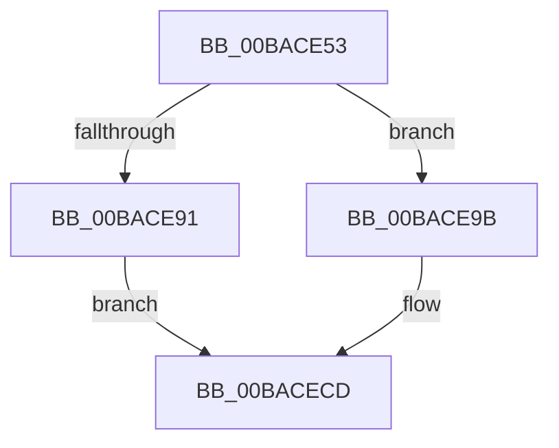

# sub_00BACE53

- RVA: `0x00BACE53`–`0x00BACED2` (길이 `127` bytes)
- VA: `0x0000000140BACE53`
- 실행 섹션: `PAGEVRFY`
- PDB 이름 있음: `아니요`; PDB Function 태그: `아니요`
- unwind 정보 RVA: `0x000D28B0`
- 디코드: `31`개 명령, `127/127` bytes 표시
- 미해석 바이트: `0` (있으면 어셈블리에 `.byte`로 보존)

> 이 문서는 커널 이미지의 기계어와 PDB 기호를 분석해 생성했습니다. 4번과 5번은 함수 원형과 자료형을 바이너리 사용 방식에서 추정한 C 해석이며 원본 소스 복구 결과는 아닙니다.

## 1. Dependencies

- 직접 호출 지점: **3**; 고유 호출 대상: **3**
- 직접 호출자로 확인된 함수: **0**
- RIP 상대 이미지 참조: **0**

### Outgoing calls
- `0x00BACE70` → [IoInitializeRemoveLockEx](../../text/4C/IoInitializeRemoveLockEx_function_004C8F10.md) (function, `0x004C8F10`)
- `0x00BACE83` → [IoAttachDeviceToDeviceStack](../../text/41/IoAttachDeviceToDeviceStack_function_00410530.md) (function, `0x00410530`)
- `0x00BACE94` → [IoDeleteDevice](../../text/26/IoDeleteDevice_function_0026FE90.md) (function, `0x0026FE90`)

### Direct callers
- 이 함수 시작 RVA로 연결되는 직접 call은 확인되지 않았습니다. 간접 호출은 완전히 역산할 수 없습니다.

### Static image references
- 디코드된 RIP-relative 메모리 참조가 없습니다.

## 2. Other-region calls and transfers

- 다른 실행 섹션으로 향하는 call: **3**
  - `0x00BACE70` → [IoInitializeRemoveLockEx](../../text/4C/IoInitializeRemoveLockEx_function_004C8F10.md) (`PAGEVRFY` → `.text`)
  - `0x00BACE83` → [IoAttachDeviceToDeviceStack](../../text/41/IoAttachDeviceToDeviceStack_function_00410530.md) (`PAGEVRFY` → `.text`)
  - `0x00BACE94` → [IoDeleteDevice](../../text/26/IoDeleteDevice_function_0026FE90.md) (`PAGEVRFY` → `.text`)
- 별도 외부 분기/꼬리 이동을 확인하지 못했습니다.

## 3. Assembly (complete function range)

```asm
00BACE53  48 89 7C 24 60                  mov qword ptr [rsp + 0x60], rdi
00BACE58  45 33 C0                        xor r8d, r8d
00BACE5B  BA 56 66 52 4C                  mov edx, 0x4c526656
00BACE60  C7 44 24 20 20 00 00 00         mov dword ptr [rsp + 0x20], 0x20
00BACE68  48 8B 7B 40                     mov rdi, qword ptr [rbx + 0x40]
00BACE6C  48 8D 4F 20                     lea rcx, [rdi + 0x20]
00BACE70  E8 9B C0 91 FF                  call 0x1404c8f10
00BACE75  48 8B D6                        mov rdx, rsi
00BACE78  48 C7 47 58 00 00 00 00         mov qword ptr [rdi + 0x58], 0
00BACE80  48 8B CB                        mov rcx, rbx
00BACE83  E8 A8 36 86 FF                  call 0x140410530
00BACE88  48 89 47 08                     mov qword ptr [rdi + 8], rax
00BACE8C  48 85 C0                        test rax, rax
00BACE8F  75 0A                           jne 0x140bace9b
00BACE91  48 8B CB                        mov rcx, rbx
00BACE94  E8 F7 2F 6C FF                  call 0x14026fe90
00BACE99  EB 32                           jmp 0x140bacecd
00BACE9B  8B 40 30                        mov eax, dword ptr [rax + 0x30]
00BACE9E  25 14 60 08 00                  and eax, 0x86014
00BACEA3  09 43 30                        or dword ptr [rbx + 0x30], eax
00BACEA6  48 8B 47 08                     mov rax, qword ptr [rdi + 8]
00BACEAA  8B 48 48                        mov ecx, dword ptr [rax + 0x48]
00BACEAD  89 4B 48                        mov dword ptr [rbx + 0x48], ecx
00BACEB0  48 8B 47 08                     mov rax, qword ptr [rdi + 8]
00BACEB4  8B 48 34                        mov ecx, dword ptr [rax + 0x34]
00BACEB7  89 4B 34                        mov dword ptr [rbx + 0x34], ecx
00BACEBA  81 63 30 7F FF FF FF            and dword ptr [rbx + 0x30], 0xffffff7f
00BACEC1  48 89 5F 10                     mov qword ptr [rdi + 0x10], rbx
00BACEC5  48 89 37                        mov qword ptr [rdi], rsi
00BACEC8  F0 83 4F 64 01                  lock or dword ptr [rdi + 0x64], 1
00BACECD  48 8B 7C 24 60                  mov rdi, qword ptr [rsp + 0x60]
```

## 4. C-style interpretation (structured pseudocode)

```c
__int64 __fastcall sub_00BACE53(__int64 a1, __int64 a2, int a3, __int64 a4, __int64 a5, __int64 a6, __int64 a7, __int64 a8, __int64 a9, __int64 a10, __int64 a11, __int64 a12)
{
    __int64 result;
    unsigned int v_stack_p20;
    unsigned __int64 v_stack_p60;

    v_stack_p60 = v_rdi;
    a3 = 0;
    v_stack_p20 = 32;
    result = IoInitializeRemoveLockEx(*(unsigned __int64 *)(v_rbx + 64) + 32, (unsigned int)(0x4C526656ULL), a3, a4);
    *(unsigned __int64 *)(*(unsigned __int64 *)(v_rbx + 64) + 88) = 0;
    result = IoAttachDeviceToDeviceStack(v_rbx, v_rsi, a3, a4);
    *(unsigned __int64 *)(*(unsigned __int64 *)(v_rbx + 64) + 8) = result;
    if (result != 0) goto loc_00BACE9B;
    result = IoDeleteDevice(v_rbx, v_rsi, a3, a4);
    goto loc_00BACECD;
loc_00BACE9B:
    result = (unsigned int)(((unsigned int)(*(unsigned int *)(result + 48))) & (0x86014ULL));
    *(unsigned int *)(v_rbx + 72) = (unsigned int)((unsigned int)(*(unsigned int *)(*(unsigned __int64 *)(*(unsigned __int64 *)(v_rbx + 64) + 8) + 72)));
    *(unsigned int *)(v_rbx + 52) = (unsigned int)((unsigned int)(*(unsigned int *)(*(unsigned __int64 *)(*(unsigned __int64 *)(v_rbx + 64) + 8) + 52)));
    *(unsigned __int64 *)(*(unsigned __int64 *)(v_rbx + 64) + 16) = v_rbx;
    *(unsigned __int64 *)(*(unsigned __int64 *)(v_rbx + 64)) = v_rsi;
loc_00BACECD:
    return *(unsigned __int64 *)(*(unsigned __int64 *)(v_rbx + 64) + 8);
}
```

## 5. (Beta) C Style

```c
int64_t sub_00BACE53(int64_t Arg1, int64_t Arg2, int32_t Arg3, int64_t Arg4, uint64_t Arg5, uint64_t Arg6, uint64_t Arg7, uint64_t Arg8, uint64_t Arg9, uint64_t Arg10, uint64_t Arg11, int64_t Arg12)
{
    int64_t result;
    uint32_t v_stack_p20;
    uint64_t v_stack_p60;

    v_stack_p60 = local_rdi;
    Arg3 = 0;
    v_stack_p20 = 32;
    result = IoInitializeRemoveLockEx(*(uint64_t *)(local_rbx + 0x40) + 32, (uint32_t)(0x4C526656ULL), Arg3, Arg4);
    *(uint64_t *)(*(uint64_t *)(local_rbx + 0x40) + 0x58) = 0;
    result = IoAttachDeviceToDeviceStack(local_rbx, local_rsi, Arg3, Arg4);
    *(uint64_t *)(*(uint64_t *)(local_rbx + 0x40) + 0x8) = result;
    if (result != 0) goto loc_00BACE9B;
    result = IoDeleteDevice(local_rbx, local_rsi, Arg3, Arg4);
    goto loc_00BACECD;
loc_00BACE9B:
    result = (uint32_t)(((uint32_t)(*(uint32_t *)(result + 0x30))) & (0x86014ULL));
    *(uint32_t *)(local_rbx + 0x48) = (uint32_t)((uint32_t)(*(uint32_t *)(*(uint64_t *)(*(uint64_t *)(local_rbx + 0x40) + 0x8) + 0x48)));
    *(uint32_t *)(local_rbx + 0x34) = (uint32_t)((uint32_t)(*(uint32_t *)(*(uint64_t *)(*(uint64_t *)(local_rbx + 0x40) + 0x8) + 0x34)));
    *(uint64_t *)(*(uint64_t *)(local_rbx + 0x40) + 0x10) = local_rbx;
    *(uint64_t *)(*(uint64_t *)(local_rbx + 0x40)) = local_rsi;
loc_00BACECD:
    return *(uint64_t *)(*(uint64_t *)(local_rbx + 0x40) + 0x8);
}
```

## 6. Execution-region graph

[열기: 2D/3D 그래프와 함수 탐색 컨트롤 패널](../../../control-panel.html?section=pagevrfy&rva=0x00BACE53&view=graph)

- 2D 그래프는 위에서 아래로 흐르고, 3D 그래프는 빈 공간을 드래그해 회전합니다. Shift+드래그는 이동, 휠은 확대·축소, 함수 노드 선택은 대상 보고서 이동입니다.

### Static fallback


