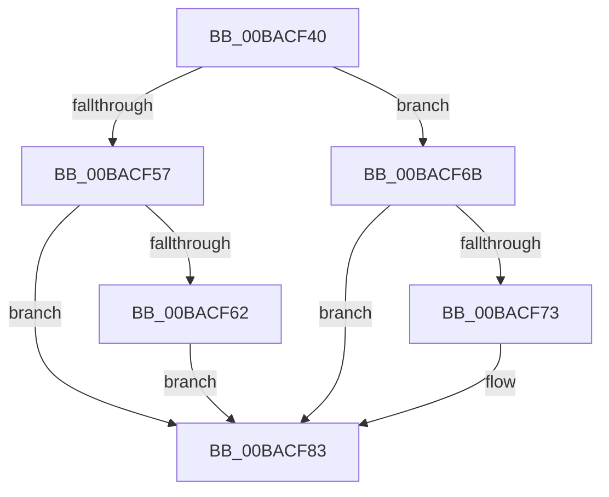

# sub_00BACF40

- RVA: `0x00BACF40`–`0x00BACF95` (길이 `85` bytes)
- VA: `0x0000000140BACF40`
- 실행 섹션: `PAGEVRFY`
- PDB 이름 있음: `아니요`; PDB Function 태그: `아니요`
- unwind 정보 RVA: `0x000D2844`
- 디코드: `23`개 명령, `85/85` bytes 표시
- 미해석 바이트: `0` (있으면 어셈블리에 `.byte`로 보존)

> 이 문서는 커널 이미지의 기계어와 PDB 기호를 분석해 생성했습니다. 4번과 5번은 함수 원형과 자료형을 바이너리 사용 방식에서 추정한 C 해석이며 원본 소스 복구 결과는 아닙니다.

## 1. Dependencies

- 직접 호출 지점: **2**; 고유 호출 대상: **2**
- 직접 호출자로 확인된 함수: **0**
- RIP 상대 이미지 참조: **0**

### Outgoing calls
- `0x00BACF45` → [KeAcquireSpinLockRaiseToDpc](../../text/20/KeAcquireSpinLockRaiseToDpc_function_00208470.md) (function, `0x00208470`)
- `0x00BACF8B` → [KeReleaseSpinLock](../../text/39/KeReleaseSpinLock_function_00392BA0.md) (function, `0x00392BA0`)

### Direct callers
- 이 함수 시작 RVA로 연결되는 직접 call은 확인되지 않았습니다. 간접 호출은 완전히 역산할 수 없습니다.

### Static image references
- 디코드된 RIP-relative 메모리 참조가 없습니다.

## 2. Other-region calls and transfers

- 다른 실행 섹션으로 향하는 call: **2**
  - `0x00BACF45` → [KeAcquireSpinLockRaiseToDpc](../../text/20/KeAcquireSpinLockRaiseToDpc_function_00208470.md) (`PAGEVRFY` → `.text`)
  - `0x00BACF8B` → [KeReleaseSpinLock](../../text/39/KeReleaseSpinLock_function_00392BA0.md) (`PAGEVRFY` → `.text`)
- 별도 외부 분기/꼬리 이동을 확인하지 못했습니다.

## 3. Assembly (complete function range)

```asm
00BACF40  4C 89 74 24 30                  mov qword ptr [rsp + 0x30], r14
00BACF45  E8 26 B5 65 FF                  call 0x140208470
00BACF4A  80 7B 08 00                     cmp byte ptr [rbx + 8], 0
00BACF4E  44 0F B6 C0                     movzx r8d, al
00BACF52  8B 47 60                        mov eax, dword ptr [rdi + 0x60]
00BACF55  74 14                           je 0x140bacf6b
00BACF57  8D 48 01                        lea ecx, [rax + 1]
00BACF5A  89 4F 60                        mov dword ptr [rdi + 0x60], ecx
00BACF5D  83 F9 01                        cmp ecx, 1
00BACF60  75 21                           jne 0x140bacf83
00BACF62  81 66 30 FF DF FF FF            and dword ptr [rsi + 0x30], 0xffffdfff
00BACF69  EB 18                           jmp 0x140bacf83
00BACF6B  83 E8 01                        sub eax, 1
00BACF6E  89 47 60                        mov dword ptr [rdi + 0x60], eax
00BACF71  75 10                           jne 0x140bacf83
00BACF73  48 8B 47 08                     mov rax, qword ptr [rdi + 8]
00BACF77  8B 50 30                        mov edx, dword ptr [rax + 0x30]
00BACF7A  81 E2 00 20 00 00               and edx, 0x2000
00BACF80  09 56 30                        or dword ptr [rsi + 0x30], edx
00BACF83  41 0F B6 D0                     movzx edx, r8b
00BACF87  48 8D 4F 58                     lea rcx, [rdi + 0x58]
00BACF8B  E8 10 5C 7E FF                  call 0x140392ba0
00BACF90  4C 8B 74 24 30                  mov r14, qword ptr [rsp + 0x30]
```

## 4. C-style interpretation (structured pseudocode)

```c
__int64 __fastcall sub_00BACF40(__int64 a1, __int64 a2, __int64 a3, __int64 a4, __int64 a5, __int64 a6)
{
    __int64 result;
    unsigned __int64 v_stack_p30;

    v_stack_p30 = v_r14;
    result = KeAcquireSpinLockRaiseToDpc(a1, a2, a3, a4);
    if ((*(unsigned __int8 *)(v_rbx + 8)) == 0) goto loc_00BACF6B;
    *(unsigned int *)(v_rdi + 96) = (unsigned int)((unsigned int)(*(unsigned int *)(v_rdi + 96)) + 1);
    if (((unsigned int)((unsigned int)(*(unsigned int *)(v_rdi + 96)) + 1)) != 1) goto loc_00BACF83;
    goto loc_00BACF83;
loc_00BACF6B:
    result = (unsigned int)(((unsigned int)(*(unsigned int *)(v_rdi + 96))) - (1));
    *(unsigned int *)(v_rdi + 96) = (unsigned int)(result);
    if (!(condition_is_not_equal)) {
        result = *(unsigned __int64 *)(v_rdi + 8);
        a2 = *(unsigned int *)(result + 48);
        a2 = (unsigned int)((a2) & (0x2000ULL));
    }
    result = KeReleaseSpinLock(v_rdi + 88, (unsigned __int8)((unsigned __int8)(result)), (unsigned __int8)(result), a4);
    return result;
}
```

## 5. (Beta) C Style

```c
int64_t sub_00BACF40(int64_t Arg1, int64_t Arg2, int64_t Arg3, int64_t Arg4, uint64_t Arg5, int64_t Arg6)
{
    int64_t result;
    uint64_t v_stack_p30;

    v_stack_p30 = local_r14;
    result = KeAcquireSpinLockRaiseToDpc(Arg1, Arg2, Arg3, Arg4);
    if ((*(uint8_t *)(local_rbx + 0x8)) == 0) goto loc_00BACF6B;
    *(uint32_t *)(local_rdi + 0x60) = (uint32_t)((uint32_t)(*(uint32_t *)(local_rdi + 0x60)) + 1);
    if (((uint32_t)((uint32_t)(*(uint32_t *)(local_rdi + 0x60)) + 1)) != 1) goto loc_00BACF83;
    goto loc_00BACF83;
loc_00BACF6B:
    result = (uint32_t)(((uint32_t)(*(uint32_t *)(local_rdi + 0x60))) - (1));
    *(uint32_t *)(local_rdi + 0x60) = (uint32_t)(result);
    if (!(condition_is_not_equal)) {
        result = *(uint64_t *)(local_rdi + 0x8);
        Arg2 = *(uint32_t *)(result + 0x30);
        Arg2 = (uint32_t)((Arg2) & (0x2000ULL));
    }
    result = KeReleaseSpinLock(local_rdi + 88, (uint8_t)((uint8_t)(result)), (uint8_t)(result), Arg4);
    return result;
}
```

## 6. Execution-region graph

[열기: 2D/3D 그래프와 함수 탐색 컨트롤 패널](../../../control-panel.html?section=pagevrfy&rva=0x00BACF40&view=graph)

- 2D 그래프는 위에서 아래로 흐르고, 3D 그래프는 빈 공간을 드래그해 회전합니다. Shift+드래그는 이동, 휠은 확대·축소, 함수 노드 선택은 대상 보고서 이동입니다.

### Static fallback


