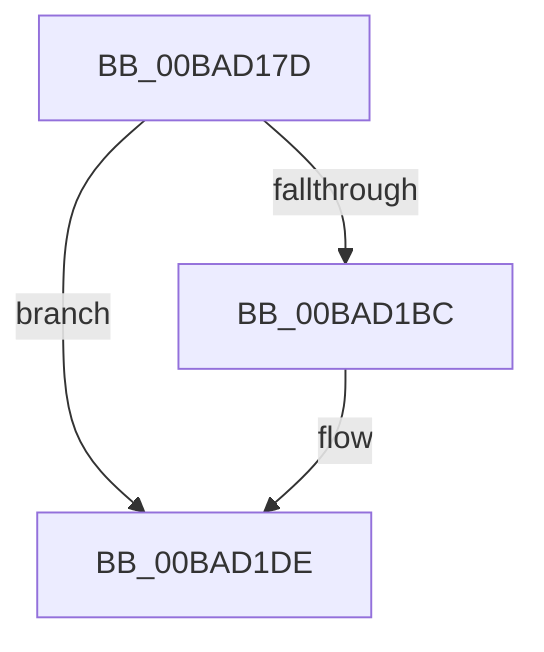

# sub_00BAD17D

- RVA: `0x00BAD17D`–`0x00BAD218` (길이 `155` bytes)
- VA: `0x0000000140BAD17D`
- 실행 섹션: `PAGEVRFY`
- PDB 이름 있음: `아니요`; PDB Function 태그: `아니요`
- unwind 정보 RVA: `0x000D287C`
- 디코드: `38`개 명령, `155/155` bytes 표시
- 미해석 바이트: `0` (있으면 어셈블리에 `.byte`로 보존)

> 이 문서는 커널 이미지의 기계어와 PDB 기호를 분석해 생성했습니다. 4번과 5번은 함수 원형과 자료형을 바이너리 사용 방식에서 추정한 C 해석이며 원본 소스 복구 결과는 아닙니다.

## 1. Dependencies

- 직접 호출 지점: **7**; 고유 호출 대상: **7**
- 직접 호출자로 확인된 함수: **0**
- RIP 상대 이미지 참조: **1**

### Outgoing calls
- `0x00BAD184` → [KeInitializeEvent](../../text/40/KeInitializeEvent_function_0040DD10.md) (function, `0x0040DD10`)
- `0x00BAD1AE` → [IofCallDriver](../../text/29/IofCallDriver_function_0029B4B0.md) (function, `0x0029B4B0`)
- `0x00BAD1D6` → [KeWaitForSingleObject](../../text/20/KeWaitForSingleObject_function_0020E6B0.md) (function, `0x0020E6B0`)
- `0x00BAD1F0` → [IoReleaseRemoveLockAndWaitEx](../../text/4B/IoReleaseRemoveLockAndWaitEx_function_004B17B0.md) (function, `0x004B17B0`)
- `0x00BAD1F8` → [IoDetachDevice](../../text/26/IoDetachDevice_function_0026FA10.md) (function, `0x0026FA10`)
- `0x00BAD200` → [IoDeleteDevice](../../text/26/IoDeleteDevice_function_0026FE90.md) (function, `0x0026FE90`)
- `0x00BAD20A` → [IofCompleteRequest](../../text/29/IofCompleteRequest_function_0029B5C0.md) (function, `0x0029B5C0`)

### Direct callers
- 이 함수 시작 RVA로 연결되는 직접 call은 확인되지 않았습니다. 간접 호출은 완전히 역산할 수 없습니다.

### Static image references
- `0x00BAD190` → RVA `0x00BAD500` (`ViFilterRemoveNotificationCompletion`; read)

## 2. Other-region calls and transfers

- 다른 실행 섹션으로 향하는 call: **7**
  - `0x00BAD184` → [KeInitializeEvent](../../text/40/KeInitializeEvent_function_0040DD10.md) (`PAGEVRFY` → `.text`)
  - `0x00BAD1AE` → [IofCallDriver](../../text/29/IofCallDriver_function_0029B4B0.md) (`PAGEVRFY` → `.text`)
  - `0x00BAD1D6` → [KeWaitForSingleObject](../../text/20/KeWaitForSingleObject_function_0020E6B0.md) (`PAGEVRFY` → `.text`)
  - `0x00BAD1F0` → [IoReleaseRemoveLockAndWaitEx](../../text/4B/IoReleaseRemoveLockAndWaitEx_function_004B17B0.md) (`PAGEVRFY` → `.text`)
  - `0x00BAD1F8` → [IoDetachDevice](../../text/26/IoDetachDevice_function_0026FA10.md) (`PAGEVRFY` → `.text`)
  - `0x00BAD200` → [IoDeleteDevice](../../text/26/IoDeleteDevice_function_0026FE90.md) (`PAGEVRFY` → `.text`)
  - `0x00BAD20A` → [IofCompleteRequest](../../text/29/IofCompleteRequest_function_0029B5C0.md) (`PAGEVRFY` → `.text`)
- call이 아닌 외부 분기/꼬리 이동: **1**
  - `0x00BAD216` → [sub_00BAD218 + 0x2A](Unknown_function_00BAD218.md) (`tail-transfer`)

## 3. Assembly (complete function range)

```asm
00BAD17D  48 89 74 24 48                  mov qword ptr [rsp + 0x48], rsi
00BAD182  33 D2                           xor edx, edx
00BAD184  E8 87 0B 86 FF                  call 0x14040dd10
00BAD189  48 8B 83 B8 00 00 00            mov rax, qword ptr [rbx + 0xb8]
00BAD190  48 8D 0D 69 03 00 00            lea rcx, [rip + 0x369]
00BAD197  48 8B D3                        mov rdx, rbx
00BAD19A  48 89 48 F0                     mov qword ptr [rax - 0x10], rcx
00BAD19E  48 8D 4C 24 40                  lea rcx, [rsp + 0x40]
00BAD1A3  48 89 48 F8                     mov qword ptr [rax - 8], rcx
00BAD1A7  48 8B CF                        mov rcx, rdi
00BAD1AA  C6 40 BB E0                     mov byte ptr [rax - 0x45], 0xe0
00BAD1AE  E8 FD E2 6E FF                  call 0x14029b4b0
00BAD1B3  8B F0                           mov esi, eax
00BAD1B5  3D 03 01 00 00                  cmp eax, 0x103
00BAD1BA  75 22                           jne 0x140bad1de
00BAD1BC  48 8B 4C 24 40                  mov rcx, qword ptr [rsp + 0x40]
00BAD1C1  45 33 C9                        xor r9d, r9d
00BAD1C4  48 83 C1 40                     add rcx, 0x40
00BAD1C8  48 C7 44 24 20 00 00 00 00      mov qword ptr [rsp + 0x20], 0
00BAD1D1  45 33 C0                        xor r8d, r8d
00BAD1D4  33 D2                           xor edx, edx
00BAD1D6  E8 D5 14 66 FF                  call 0x14020e6b0
00BAD1DB  8B 73 30                        mov esi, dword ptr [rbx + 0x30]
00BAD1DE  48 8B 4C 24 40                  mov rcx, qword ptr [rsp + 0x40]
00BAD1E3  41 B8 20 00 00 00               mov r8d, 0x20
00BAD1E9  48 83 C1 20                     add rcx, 0x20
00BAD1ED  48 8B D3                        mov rdx, rbx
00BAD1F0  E8 BB 45 90 FF                  call 0x1404b17b0
00BAD1F5  48 8B CF                        mov rcx, rdi
00BAD1F8  E8 13 28 6C FF                  call 0x14026fa10
00BAD1FD  48 8B CD                        mov rcx, rbp
00BAD200  E8 8B 2C 6C FF                  call 0x14026fe90
00BAD205  33 D2                           xor edx, edx
00BAD207  48 8B CB                        mov rcx, rbx
00BAD20A  E8 B1 E3 6E FF                  call 0x14029b5c0
00BAD20F  8B C6                           mov eax, esi
00BAD211  48 8B 74 24 48                  mov rsi, qword ptr [rsp + 0x48]
00BAD216  EB 2A                           jmp 0x140bad242
```

## 4. C-style interpretation (structured pseudocode)

```c
__int64 __fastcall sub_00BAD17D(__int64 a1, int a2, int a3, int a4, __int64 a5, __int64 a6, __int64 a7, __int64 a8, __int64 a9)
{
    __int64 result;
    __int64 v_rsi;
    unsigned __int64 v_stack_p20;
    unsigned __int64 v_stack_p48;

    v_stack_p48 = v_rsi;
    a2 = 0;
    result = KeInitializeEvent(a1, a2, a3, a4);
    *(unsigned __int64 *)(*(unsigned __int64 *)(v_rbx + 184) - 16) = v_rip + 873;
    *(unsigned __int64 *)(*(unsigned __int64 *)(v_rbx + 184) - 8) = a8;
    *(unsigned __int8 *)(*(unsigned __int64 *)(v_rbx + 184) - 69) = 224;
    result = IofCallDriver(v_rdi, v_rbx, a3, a4);
    v_rsi = (unsigned int)((unsigned int)(result));
    if (((unsigned int)(result)) == 259) {
        a1 = a8;
        a4 = 0;
        a1 = (a1) + (64);
        v_stack_p20 = 0;
        a3 = 0;
        a2 = 0;
        result = KeWaitForSingleObject(a1, a2, a3, a4);
        v_rsi = *(unsigned int *)(v_rbx + 48);
    }
    a1 = (a8) + (32);
    result = IoReleaseRemoveLockAndWaitEx(a1, v_rbx, 32, a4);
    result = IoDetachDevice(v_rdi, v_rbx, 32, a4);
    result = IoDeleteDevice(v_rbp, v_rbx, 32, a4);
    a2 = 0;
    result = IofCompleteRequest(v_rbx, a2, 32, a4);
}
```

## 5. (Beta) C Style

```c
int64_t sub_00BAD17D(int64_t Arg1, int32_t Arg2, int32_t Arg3, int32_t Arg4, uint64_t Arg5, uint64_t Arg6, uint64_t Arg7, int64_t Arg8, int64_t Arg9)
{
    int64_t result;
    int64_t local_rsi;
    uint64_t v_stack_p20;
    uint64_t v_stack_p48;

    v_stack_p48 = local_rsi;
    Arg2 = 0;
    result = KeInitializeEvent(Arg1, Arg2, Arg3, Arg4);
    *(uint64_t *)(*(uint64_t *)(local_rbx + 0xB8) - 0x10) = v_rip + 873;
    *(uint64_t *)(*(uint64_t *)(local_rbx + 0xB8) - 0x8) = Arg8;
    *(uint8_t *)(*(uint64_t *)(local_rbx + 0xB8) - 0x45) = 224;
    result = IofCallDriver(local_rdi, local_rbx, Arg3, Arg4);
    local_rsi = (uint32_t)((uint32_t)(result));
    if (((uint32_t)(result)) == 259) {
        Arg1 = Arg8;
        Arg4 = 0;
        Arg1 = (Arg1) + (64);
        v_stack_p20 = 0;
        Arg3 = 0;
        Arg2 = 0;
        result = KeWaitForSingleObject(Arg1, Arg2, Arg3, Arg4);
        local_rsi = *(uint32_t *)(local_rbx + 0x30);
    }
    Arg1 = (Arg8) + (32);
    result = IoReleaseRemoveLockAndWaitEx(Arg1, local_rbx, 32, Arg4);
    result = IoDetachDevice(local_rdi, local_rbx, 32, Arg4);
    result = IoDeleteDevice(local_rbp, local_rbx, 32, Arg4);
    Arg2 = 0;
    result = IofCompleteRequest(local_rbx, Arg2, 32, Arg4);
}
```

## 6. Execution-region graph

[열기: 2D/3D 그래프와 함수 탐색 컨트롤 패널](../../../control-panel.html?section=pagevrfy&rva=0x00BAD17D&view=graph)

- 2D 그래프는 위에서 아래로 흐르고, 3D 그래프는 빈 공간을 드래그해 회전합니다. Shift+드래그는 이동, 휠은 확대·축소, 함수 노드 선택은 대상 보고서 이동입니다.

### Static fallback


