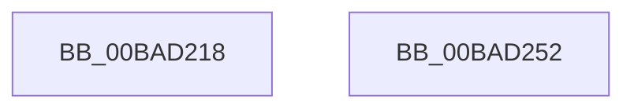

# sub_00BAD218

- RVA: `0x00BAD218`–`0x00BAD253` (길이 `59` bytes)
- VA: `0x0000000140BAD218`
- 실행 섹션: `PAGEVRFY`
- PDB 이름 있음: `아니요`; PDB Function 태그: `아니요`
- unwind 정보 RVA: `0x000D2890`
- 디코드: `15`개 명령, `59/59` bytes 표시
- 미해석 바이트: `0` (있으면 어셈블리에 `.byte`로 보존)

> 이 문서는 커널 이미지의 기계어와 PDB 기호를 분석해 생성했습니다. 4번과 5번은 함수 원형과 자료형을 바이너리 사용 방식에서 추정한 C 해석이며 원본 소스 복구 결과는 아닙니다.

## 1. Dependencies

- 직접 호출 지점: **1**; 고유 호출 대상: **1**
- 직접 호출자로 확인된 함수: **0**
- RIP 상대 이미지 참조: **1**

### Outgoing calls
- `0x00BAD23D` → [IofCallDriver](../../text/29/IofCallDriver_function_0029B4B0.md) (function, `0x0029B4B0`)

### Direct callers
- 이 함수 시작 RVA로 연결되는 직접 call은 확인되지 않았습니다. 간접 호출은 완전히 역산할 수 없습니다.

### Static image references
- `0x00BAD21F` → RVA `0x00BAD530` (`ViFilterStartCompletionRoutine`; read)

## 2. Other-region calls and transfers

- 다른 실행 섹션으로 향하는 call: **1**
  - `0x00BAD23D` → [IofCallDriver](../../text/29/IofCallDriver_function_0029B4B0.md) (`PAGEVRFY` → `.text`)
- 별도 외부 분기/꼬리 이동을 확인하지 못했습니다.

## 3. Assembly (complete function range)

```asm
00BAD218  48 8B 83 B8 00 00 00            mov rax, qword ptr [rbx + 0xb8]
00BAD21F  48 8D 0D 0A 03 00 00            lea rcx, [rip + 0x30a]
00BAD226  48 8B D3                        mov rdx, rbx
00BAD229  C6 40 BB E0                     mov byte ptr [rax - 0x45], 0xe0
00BAD22D  48 89 48 F0                     mov qword ptr [rax - 0x10], rcx
00BAD231  48 8D 4C 24 40                  lea rcx, [rsp + 0x40]
00BAD236  48 89 48 F8                     mov qword ptr [rax - 8], rcx
00BAD23A  48 8B CF                        mov rcx, rdi
00BAD23D  E8 6E E2 6E FF                  call 0x14029b4b0
00BAD242  48 8B 5C 24 50                  mov rbx, qword ptr [rsp + 0x50]
00BAD247  48 8B 6C 24 58                  mov rbp, qword ptr [rsp + 0x58]
00BAD24C  48 83 C4 30                     add rsp, 0x30
00BAD250  5F                              pop rdi
00BAD251  C3                              ret
00BAD252  CC                              int3
```

## 4. C-style interpretation (structured pseudocode)

```c
__int64 __fastcall sub_00BAD218(__int64 a1, __int64 a2, __int64 a3, __int64 a4, __int64 a5, __int64 a6, __int64 a7, __int64 a8, __int64 a9, __int64 a10, __int64 a11)
{
    __int64 result;
    __int64 v_rsp;

    *(unsigned __int8 *)(*(unsigned __int64 *)(v_rbx + 184) - 69) = 224;
    *(unsigned __int64 *)(*(unsigned __int64 *)(v_rbx + 184) - 16) = v_rip + 778;
    *(unsigned __int64 *)(*(unsigned __int64 *)(v_rbx + 184) - 8) = a8;
    result = IofCallDriver(v_rdi, v_rbx, a3, a4);
    v_rsp = (v_rsp) + (48);
    return result;
}
```

## 5. (Beta) C Style

```c
int64_t sub_00BAD218(int64_t Arg1, int64_t Arg2, int64_t Arg3, int64_t Arg4, uint64_t Arg5, uint64_t Arg6, uint64_t Arg7, int64_t Arg8, uint64_t Arg9, int64_t Arg10, int64_t Arg11)
{
    int64_t result;
    int64_t local_rsp;

    *(uint8_t *)(*(uint64_t *)(local_rbx + 0xB8) - 0x45) = 224;
    *(uint64_t *)(*(uint64_t *)(local_rbx + 0xB8) - 0x10) = v_rip + 778;
    *(uint64_t *)(*(uint64_t *)(local_rbx + 0xB8) - 0x8) = Arg8;
    result = IofCallDriver(local_rdi, local_rbx, Arg3, Arg4);
    local_rsp = (local_rsp) + (48);
    return result;
}
```

## 6. Execution-region graph

[열기: 2D/3D 그래프와 함수 탐색 컨트롤 패널](../../../control-panel.html?section=pagevrfy&rva=0x00BAD218&view=graph)

- 2D 그래프는 위에서 아래로 흐르고, 3D 그래프는 빈 공간을 드래그해 회전합니다. Shift+드래그는 이동, 휠은 확대·축소, 함수 노드 선택은 대상 보고서 이동입니다.

### Static fallback


