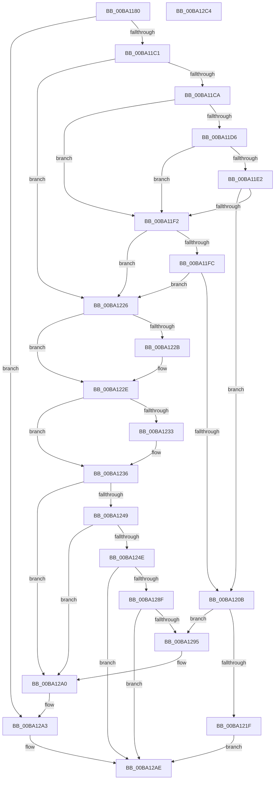

# VerifierExAllocatePool2

- RVA: `0x00BA1180`–`0x00BA12C5` (길이 `325` bytes)
- VA: `0x0000000140BA1180`
- 실행 섹션: `PAGEVRFY`
- PDB 이름 있음: `예`; PDB Function 태그: `아니요`
- unwind 정보 RVA: `0x000BE9D0`
- 디코드: `91`개 명령, `325/325` bytes 표시
- 미해석 바이트: `0` (있으면 어셈블리에 `.byte`로 보존)

> 이 문서는 커널 이미지의 기계어와 PDB 기호를 분석해 생성했습니다. 4번과 5번은 함수 원형과 자료형을 바이너리 사용 방식에서 추정한 C 해석이며 원본 소스 복구 결과는 아닙니다.

## 1. Dependencies

- 직접 호출 지점: **7**; 고유 호출 대상: **6**
- 직접 호출자로 확인된 함수: **0**
- RIP 상대 이미지 참조: **6**

### Outgoing calls
- `0x00BA11B4` → [ExpPoolFlagsToPoolType](../../poolcode/B8/ExpPoolFlagsToPoolType_function_00B84080.md) (function, `0x00B84080`)
- `0x00BA11E9` → [guard_dispatch_icall](../../text/6B/guard_dispatch_icall_function_006BAAD0.md) (function, `0x006BAAD0`)
- `0x00BA1202` → [VfFaultsInjectPoolAllocationFailure](VfFaultsInjectPoolAllocationFailure_function_00BA6480.md) (function, `0x00BA6480`)
- `0x00BA1215` → [ViPtLogPoolTraceWrapper](../B9/ViPtLogPoolTraceWrapper_function_00B92100.md) (function, `0x00B92100`)
- `0x00BA1285` → [guard_dispatch_icall](../../text/6B/guard_dispatch_icall_function_006BAAD0.md) (function, `0x006BAAD0`)
- `0x00BA129A` → [RtlRaiseStatus](../../text/2F/RtlRaiseStatus_function_002F6A50.md) (function, `0x002F6A50`)
- `0x00BA12A9` → [ExAllocatePool2](../../poolcode/B8/ExAllocatePool2_function_00B820F0.md) (function, `0x00B820F0`)

### Direct callers
- 이 함수 시작 RVA로 연결되는 직접 call은 확인되지 않았습니다. 간접 호출은 완전히 역산할 수 없습니다.

### Static image references
- `0x00BA11CA` → RVA `0x00E681A0` (`.data`; read)
- `0x00BA11D6` → RVA `0x00FFDA10` (`PAGEVRFD`; read)
- `0x00BA11E2` → RVA `0x00BBA860` (` ?? ::JKADOLAD::`string'`; read)
- `0x00BA1236` → RVA `0x00FF4030` (`PAGEVRFD`; read)
- `0x00BA123D` → RVA `0x00BA0FB0` (`VfExAllocPoolInternal`; read)
- `0x00BA1253` → RVA `0x00BB8A90` (`VfHandlePoolAlloc`; read)

## 2. Other-region calls and transfers

- 다른 실행 섹션으로 향하는 call: **5**
  - `0x00BA11B4` → [ExpPoolFlagsToPoolType](../../poolcode/B8/ExpPoolFlagsToPoolType_function_00B84080.md) (`PAGEVRFY` → `POOLCODE`)
  - `0x00BA11E9` → [guard_dispatch_icall](../../text/6B/guard_dispatch_icall_function_006BAAD0.md) (`PAGEVRFY` → `.text`)
  - `0x00BA1285` → [guard_dispatch_icall](../../text/6B/guard_dispatch_icall_function_006BAAD0.md) (`PAGEVRFY` → `.text`)
  - `0x00BA129A` → [RtlRaiseStatus](../../text/2F/RtlRaiseStatus_function_002F6A50.md) (`PAGEVRFY` → `.text`)
  - `0x00BA12A9` → [ExAllocatePool2](../../poolcode/B8/ExAllocatePool2_function_00B820F0.md) (`PAGEVRFY` → `POOLCODE`)
- 별도 외부 분기/꼬리 이동을 확인하지 못했습니다.

## 3. Assembly (complete function range)

```asm
00BA1180  4C 8B DC                        mov r11, rsp
00BA1183  49 89 5B 08                     mov qword ptr [r11 + 8], rbx
00BA1187  49 89 6B 10                     mov qword ptr [r11 + 0x10], rbp
00BA118B  49 89 73 18                     mov qword ptr [r11 + 0x18], rsi
00BA118F  57                              push rdi
00BA1190  48 83 EC 60                     sub rsp, 0x60
00BA1194  83 64 24 54 00                  and dword ptr [rsp + 0x54], 0
00BA1199  49 8D 43 20                     lea rax, [r11 + 0x20]
00BA119D  41 8B F8                        mov edi, r8d
00BA11A0  49 89 43 B8                     mov qword ptr [r11 - 0x48], rax
00BA11A4  48 8B EA                        mov rbp, rdx
00BA11A7  4D 8D 43 EC                     lea r8, [r11 - 0x14]
00BA11AB  33 D2                           xor edx, edx
00BA11AD  4D 8D 4B E8                     lea r9, [r11 - 0x18]
00BA11B1  48 8B F1                        mov rsi, rcx
00BA11B4  E8 C7 2E FE FF                  call 0x140b84080
00BA11B9  85 C0                           test eax, eax
00BA11BB  0F 88 E2 00 00 00               js 0x140ba12a3
00BA11C1  8B 5C 24 54                     mov ebx, dword ptr [rsp + 0x54]
00BA11C5  F6 C3 02                        test bl, 2
00BA11C8  75 5C                           jne 0x140ba1226
00BA11CA  F7 05 CC 6F 2C 00 00 00 04 00   test dword ptr [rip + 0x2c6fcc], 0x40000
00BA11D4  74 1C                           je 0x140ba11f2
00BA11D6  48 8B 05 33 C8 45 00            mov rax, qword ptr [rip + 0x45c833]
00BA11DD  48 85 C0                        test rax, rax
00BA11E0  74 10                           je 0x140ba11f2
00BA11E2  48 8D 0D 77 96 01 00            lea rcx, [rip + 0x19677]
00BA11E9  E8 E2 98 B1 FF                  call 0x1406baad0
00BA11EE  84 C0                           test al, al
00BA11F0  75 19                           jne 0x140ba120b
00BA11F2  8B 05 A8 6F 2C 00               mov eax, dword ptr [rip + 0x2c6fa8]
00BA11F8  A8 04                           test al, 4
00BA11FA  74 2A                           je 0x140ba1226
00BA11FC  8B CF                           mov ecx, edi
00BA11FE  0F BA F1 1F                     btr ecx, 0x1f
00BA1202  E8 79 52 00 00                  call 0x140ba6480
00BA1207  85 C0                           test eax, eax
00BA1209  74 1B                           je 0x140ba1226
00BA120B  45 33 C9                        xor r9d, r9d
00BA120E  4C 8B C5                        mov r8, rbp
00BA1211  8B D7                           mov edx, edi
00BA1213  33 C9                           xor ecx, ecx
00BA1215  E8 E6 0E FF FF                  call 0x140b92100
00BA121A  F6 C3 10                        test bl, 0x10
00BA121D  75 76                           jne 0x140ba1295
00BA121F  33 C0                           xor eax, eax
00BA1221  E9 88 00 00 00                  jmp 0x140ba12ae
00BA1226  F6 C3 08                        test bl, 8
00BA1229  74 03                           je 0x140ba122e
00BA122B  83 E3 F7                        and ebx, 0xfffffff7
00BA122E  F6 C3 10                        test bl, 0x10
00BA1231  74 03                           je 0x140ba1236
00BA1233  83 E3 EF                        and ebx, 0xffffffef
00BA1236  48 8B 05 F3 2D 45 00            mov rax, qword ptr [rip + 0x452df3]
00BA123D  48 8D 0D 6C FD FF FF            lea rcx, [rip - 0x294]
00BA1244  48 3B C8                        cmp rcx, rax
00BA1247  74 57                           je 0x140ba12a0
00BA1249  48 85 C0                        test rax, rax
00BA124C  74 52                           je 0x140ba12a0
00BA124E  48 8B 54 24 68                  mov rdx, qword ptr [rsp + 0x68]
00BA1253  48 8D 0D 36 78 01 00            lea rcx, [rip + 0x17836]
00BA125A  48 89 4C 24 40                  mov qword ptr [rsp + 0x40], rcx
00BA125F  0F BA EB 07                     bts ebx, 7
00BA1263  48 89 54 24 38                  mov qword ptr [rsp + 0x38], rdx
00BA1268  44 8B CF                        mov r9d, edi
00BA126B  83 64 24 30 00                  and dword ptr [rsp + 0x30], 0
00BA1270  4C 8B C5                        mov r8, rbp
00BA1273  48 83 64 24 28 00               and qword ptr [rsp + 0x28], 0
00BA1279  33 D2                           xor edx, edx
00BA127B  8B CB                           mov ecx, ebx
00BA127D  C7 44 24 20 20 00 00 00         mov dword ptr [rsp + 0x20], 0x20
00BA1285  E8 46 98 B1 FF                  call 0x1406baad0
00BA128A  48 85 C0                        test rax, rax
00BA128D  75 1F                           jne 0x140ba12ae
00BA128F  40 F6 C6 20                     test sil, 0x20
00BA1293  74 19                           je 0x140ba12ae
00BA1295  B9 9A 00 00 C0                  mov ecx, 0xc000009a
00BA129A  E8 B1 57 75 FF                  call 0x1402f6a50
00BA129F  CC                              int3
00BA12A0  48 8B CE                        mov rcx, rsi
00BA12A3  44 8B C7                        mov r8d, edi
00BA12A6  48 8B D5                        mov rdx, rbp
00BA12A9  E8 42 0E FE FF                  call 0x140b820f0
00BA12AE  4C 8D 5C 24 60                  lea r11, [rsp + 0x60]
00BA12B3  49 8B 5B 10                     mov rbx, qword ptr [r11 + 0x10]
00BA12B7  49 8B 6B 18                     mov rbp, qword ptr [r11 + 0x18]
00BA12BB  49 8B 73 20                     mov rsi, qword ptr [r11 + 0x20]
00BA12BF  49 8B E3                        mov rsp, r11
00BA12C2  5F                              pop rdi
00BA12C3  C3                              ret
00BA12C4  CC                              int3
```

## 4. C-style interpretation (structured pseudocode)

```c
__int64 __fastcall VerifierExAllocatePool2(__int64 a1, __int64 a2, int a3)
{
    __int64 result;
    __int64 v_rbx;
    __int64 v_rsp;
    unsigned int v_stack_m14;
    unsigned __int64 v_stack_m28;
    unsigned __int64 v_stack_m30;
    unsigned int v_stack_m38;
    unsigned __int64 v_stack_m40;
    unsigned int v_stack_m48;
    unsigned __int64 v_stack_m8;
    unsigned __int64 v_stack_p0;

    *(unsigned __int64 *)(v_rsp + 8) = v_rbx;
    *(unsigned __int64 *)(v_rsp + 16) = v_rbp;
    *(unsigned __int64 *)(v_rsp + 24) = v_rsi;
    v_rsp = (v_rsp) - (96);
    *(unsigned __int64 *)(v_rsp - 72) = v_rsp + 32;
    a2 = 0;
    result = ExpPoolFlagsToPoolType(a1, a2, v_rsp - 20, v_rsp - 24);
    if (sign_flag) goto loc_00BA12A3;
    if ((((unsigned __int8)((unsigned int)(v_stack_m14))) & (2)) != 0) goto loc_00BA1226;
    if (((*(unsigned int *)(v_rip + 2912204)) & (0x40000ULL)) == 0) goto loc_00BA11F2;
    if (*(unsigned __int64 *)(v_rip + 4573235) == 0) goto loc_00BA11F2;
    result = guard_dispatch_icall(v_rip + 104055, a2, v_rsp - 20, v_rsp - 24);
    if ((unsigned __int8)(result) != 0) goto loc_00BA120B;
loc_00BA11F2:
    if ((((unsigned __int8)((unsigned int)(*(unsigned int *)(v_rip + 2912168)))) & (4)) == 0) goto loc_00BA1226;
    result = VfFaultsInjectPoolAllocationFailure((unsigned int)((unsigned int)((unsigned int)(a3))), a2, v_rsp - 20, v_rsp - 24);
    if ((unsigned int)(result) == 0) goto loc_00BA1226;
loc_00BA120B:
    a4 = 0;
    a1 = 0;
    result = ViPtLogPoolTraceWrapper(a1, (unsigned int)((unsigned int)((unsigned int)(a3))), 0, a4);
    if ((((unsigned __int8)((unsigned int)(v_stack_m14))) & (16)) != 0) goto loc_00BA1295;
    result = 0;
    goto loc_00BA12AE;
loc_00BA1226:
    v_rbx = (unsigned int)(v_stack_m14);
    if ((((unsigned __int8)((unsigned int)(v_stack_m14))) & (8)) != 0) {
        v_rbx = (unsigned int)(((unsigned int)(v_stack_m14)) & (0xFFFFFFF7ULL));
    }
    if ((((unsigned __int8)(v_rbx)) & (16)) != 0) {
        v_rbx = (unsigned int)((v_rbx) & (0xFFFFFFEFULL));
    }
    if ((v_rip - 660) == (*(unsigned __int64 *)(v_rip + 4533747))) goto loc_00BA12A0;
    if (*(unsigned __int64 *)(v_rip + 4533747) == 0) goto loc_00BA12A0;
    v_stack_m28 = v_rip + 96310;
    v_stack_m30 = v_stack_p0;
    a2 = 0;
    v_stack_m48 = 32;
    result = guard_dispatch_icall((unsigned int)((unsigned int)(v_rbx)), a2, 0, (unsigned int)((unsigned int)((unsigned int)(a3))));
    if (result != 0) goto loc_00BA12AE;
    if (((0) & (32)) == 0) goto loc_00BA12AE;
loc_00BA1295:
    result = RtlRaiseStatus((unsigned int)(0xC000009AULL), a2, 0, (unsigned int)((unsigned int)((unsigned int)(a3))));
loc_00BA12A0:
loc_00BA12A3:
    result = ExAllocatePool2(0, 0, (unsigned int)((unsigned int)((unsigned int)(a3))), (unsigned int)((unsigned int)((unsigned int)(a3))));
loc_00BA12AE:
    return result;
}
```

## 5. (Beta) C Style

```c
int64_t VerifierExAllocatePool2(int64_t Arg1, int64_t Arg2, int32_t Arg3)
{
    int64_t result;
    int64_t local_rbx;
    int64_t local_rsp;
    uint32_t v_stack_m14;
    uint64_t v_stack_m28;
    uint64_t v_stack_m30;
    uint32_t v_stack_m38;
    uint64_t v_stack_m40;
    uint32_t v_stack_m48;
    uint64_t v_stack_m8;
    uint64_t v_stack_p0;

    *(uint64_t *)(local_rsp + 0x8) = local_rbx;
    *(uint64_t *)(local_rsp + 0x10) = local_rbp;
    *(uint64_t *)(local_rsp + 0x18) = local_rsi;
    local_rsp = (local_rsp) - (96);
    *(uint64_t *)(local_rsp - 0x48) = local_rsp + 32;
    Arg2 = 0;
    result = ExpPoolFlagsToPoolType(Arg1, Arg2, local_rsp - 20, local_rsp - 24);
    if (sign_flag) goto loc_00BA12A3;
    if ((((uint8_t)((uint32_t)(v_stack_m14))) & (2)) != 0) goto loc_00BA1226;
    if (((*(uint32_t *)(v_rip + 0x2C6FCC)) & (0x40000ULL)) == 0) goto loc_00BA11F2;
    if (*(uint64_t *)(v_rip + 0x45C833) == 0) goto loc_00BA11F2;
    result = guard_dispatch_icall(v_rip + 104055, Arg2, local_rsp - 20, local_rsp - 24);
    if ((uint8_t)(result) != 0) goto loc_00BA120B;
loc_00BA11F2:
    if ((((uint8_t)((uint32_t)(*(uint32_t *)(v_rip + 0x2C6FA8)))) & (4)) == 0) goto loc_00BA1226;
    result = VfFaultsInjectPoolAllocationFailure((uint32_t)((uint32_t)((uint32_t)(Arg3))), Arg2, local_rsp - 20, local_rsp - 24);
    if ((uint32_t)(result) == 0) goto loc_00BA1226;
loc_00BA120B:
    a4 = 0;
    Arg1 = 0;
    result = ViPtLogPoolTraceWrapper(Arg1, (uint32_t)((uint32_t)((uint32_t)(Arg3))), 0, a4);
    if ((((uint8_t)((uint32_t)(v_stack_m14))) & (16)) != 0) goto loc_00BA1295;
    result = 0;
    goto loc_00BA12AE;
loc_00BA1226:
    local_rbx = (uint32_t)(v_stack_m14);
    if ((((uint8_t)((uint32_t)(v_stack_m14))) & (8)) != 0) {
        local_rbx = (uint32_t)(((uint32_t)(v_stack_m14)) & (0xFFFFFFF7ULL));
    }
    if ((((uint8_t)(local_rbx)) & (16)) != 0) {
        local_rbx = (uint32_t)((local_rbx) & (0xFFFFFFEFULL));
    }
    if ((v_rip - 660) == (*(uint64_t *)(v_rip + 0x452DF3))) goto loc_00BA12A0;
    if (*(uint64_t *)(v_rip + 0x452DF3) == 0) goto loc_00BA12A0;
    v_stack_m28 = v_rip + 96310;
    v_stack_m30 = v_stack_p0;
    Arg2 = 0;
    v_stack_m48 = 32;
    result = guard_dispatch_icall((uint32_t)((uint32_t)(local_rbx)), Arg2, 0, (uint32_t)((uint32_t)((uint32_t)(Arg3))));
    if (result != 0) goto loc_00BA12AE;
    if (((0) & (32)) == 0) goto loc_00BA12AE;
loc_00BA1295:
    result = RtlRaiseStatus((uint32_t)(0xC000009AULL), Arg2, 0, (uint32_t)((uint32_t)((uint32_t)(Arg3))));
loc_00BA12A0:
loc_00BA12A3:
    result = ExAllocatePool2(0, 0, (uint32_t)((uint32_t)((uint32_t)(Arg3))), (uint32_t)((uint32_t)((uint32_t)(Arg3))));
loc_00BA12AE:
    return result;
}
```

## 6. Execution-region graph

[열기: 2D/3D 그래프와 함수 탐색 컨트롤 패널](../../../control-panel.html?section=pagevrfy&rva=0x00BA1180&view=graph)

- 2D 그래프는 위에서 아래로 흐르고, 3D 그래프는 빈 공간을 드래그해 회전합니다. Shift+드래그는 이동, 휠은 확대·축소, 함수 노드 선택은 대상 보고서 이동입니다.

### Static fallback


