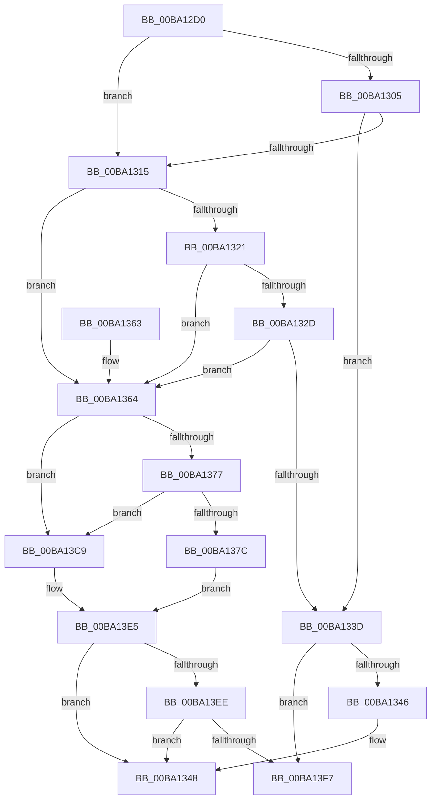

# VerifierExAllocatePool3

- RVA: `0x00BA12D0`–`0x00BA1402` (길이 `306` bytes)
- VA: `0x0000000140BA12D0`
- 실행 섹션: `PAGEVRFY`
- PDB 이름 있음: `예`; PDB Function 태그: `아니요`
- unwind 정보 RVA: `0x000D24D8`
- 디코드: `79`개 명령, `306/306` bytes 표시
- 미해석 바이트: `0` (있으면 어셈블리에 `.byte`로 보존)

> 이 문서는 커널 이미지의 기계어와 PDB 기호를 분석해 생성했습니다. 4번과 5번은 함수 원형과 자료형을 바이너리 사용 방식에서 추정한 C 해석이며 원본 소스 복구 결과는 아닙니다.

## 1. Dependencies

- 직접 호출 지점: **5**; 고유 호출 대상: **4**
- 직접 호출자로 확인된 함수: **0**
- RIP 상대 이미지 참조: **6**

### Outgoing calls
- `0x00BA130C` → [VfFaultsInjectPoolAllocationFailure](VfFaultsInjectPoolAllocationFailure_function_00BA6480.md) (function, `0x00BA6480`)
- `0x00BA1334` → [guard_dispatch_icall](../../text/6B/guard_dispatch_icall_function_006BAAD0.md) (function, `0x006BAAD0`)
- `0x00BA13C2` → [guard_dispatch_icall](../../text/6B/guard_dispatch_icall_function_006BAAD0.md) (function, `0x006BAAD0`)
- `0x00BA13E0` → [ExAllocatePool3](../../poolcode/B8/ExAllocatePool3_function_00B84270.md) (function, `0x00B84270`)
- `0x00BA13FC` → [RtlRaiseStatus](../../text/2F/RtlRaiseStatus_function_002F6A50.md) (function, `0x002F6A50`)

### Direct callers
- 이 함수 시작 RVA로 연결되는 직접 call은 확인되지 않았습니다. 간접 호출은 완전히 역산할 수 없습니다.

### Static image references
- `0x00BA12E9` → RVA `0x00E681A0` (`.data`; read)
- `0x00BA1321` → RVA `0x00FFDA10` (`PAGEVRFD`; read)
- `0x00BA132D` → RVA `0x00BBA880` (` ?? ::JKADOLAD::`string'`; read)
- `0x00BA1364` → RVA `0x00FF4038` (`PAGEVRFD`; read)
- `0x00BA136B` → RVA `0x00BA0FB0` (`VfExAllocPoolInternal`; read)
- `0x00BA1381` → RVA `0x00BB8A90` (`VfHandlePoolAlloc`; read)

## 2. Other-region calls and transfers

- 다른 실행 섹션으로 향하는 call: **4**
  - `0x00BA1334` → [guard_dispatch_icall](../../text/6B/guard_dispatch_icall_function_006BAAD0.md) (`PAGEVRFY` → `.text`)
  - `0x00BA13C2` → [guard_dispatch_icall](../../text/6B/guard_dispatch_icall_function_006BAAD0.md) (`PAGEVRFY` → `.text`)
  - `0x00BA13E0` → [ExAllocatePool3](../../poolcode/B8/ExAllocatePool3_function_00B84270.md) (`PAGEVRFY` → `POOLCODE`)
  - `0x00BA13FC` → [RtlRaiseStatus](../../text/2F/RtlRaiseStatus_function_002F6A50.md) (`PAGEVRFY` → `.text`)
- 별도 외부 분기/꼬리 이동을 확인하지 못했습니다.

## 3. Assembly (complete function range)

```asm
00BA12D0  48 8B C4                        mov rax, rsp
00BA12D3  48 89 58 08                     mov qword ptr [rax + 8], rbx
00BA12D7  48 89 68 10                     mov qword ptr [rax + 0x10], rbp
00BA12DB  48 89 70 18                     mov qword ptr [rax + 0x18], rsi
00BA12DF  48 89 78 20                     mov qword ptr [rax + 0x20], rdi
00BA12E3  41 56                           push r14
00BA12E5  48 83 EC 50                     sub rsp, 0x50
00BA12E9  8B 05 B1 6E 2C 00               mov eax, dword ptr [rip + 0x2c6eb1]
00BA12EF  48 8B D9                        mov rbx, rcx
00BA12F2  83 E3 20                        and ebx, 0x20
00BA12F5  49 8B E9                        mov rbp, r9
00BA12F8  41 8B F0                        mov esi, r8d
00BA12FB  4C 8B F2                        mov r14, rdx
00BA12FE  48 8B F9                        mov rdi, rcx
00BA1301  A8 04                           test al, 4
00BA1303  74 10                           je 0x140ba1315
00BA1305  41 8B C8                        mov ecx, r8d
00BA1308  0F BA F1 1F                     btr ecx, 0x1f
00BA130C  E8 6F 51 00 00                  call 0x140ba6480
00BA1311  85 C0                           test eax, eax
00BA1313  75 28                           jne 0x140ba133d
00BA1315  F7 05 81 6E 2C 00 00 00 04 00   test dword ptr [rip + 0x2c6e81], 0x40000
00BA131F  74 43                           je 0x140ba1364
00BA1321  48 8B 05 E8 C6 45 00            mov rax, qword ptr [rip + 0x45c6e8]
00BA1328  48 85 C0                        test rax, rax
00BA132B  74 37                           je 0x140ba1364
00BA132D  48 8D 0D 4C 95 01 00            lea rcx, [rip + 0x1954c]
00BA1334  E8 97 97 B1 FF                  call 0x1406baad0
00BA1339  84 C0                           test al, al
00BA133B  74 27                           je 0x140ba1364
00BA133D  48 85 DB                        test rbx, rbx
00BA1340  0F 85 B1 00 00 00               jne 0x140ba13f7
00BA1346  33 C0                           xor eax, eax
00BA1348  48 8B 5C 24 60                  mov rbx, qword ptr [rsp + 0x60]
00BA134D  48 8B 6C 24 68                  mov rbp, qword ptr [rsp + 0x68]
00BA1352  48 8B 74 24 70                  mov rsi, qword ptr [rsp + 0x70]
00BA1357  48 8B 7C 24 78                  mov rdi, qword ptr [rsp + 0x78]
00BA135C  48 83 C4 50                     add rsp, 0x50
00BA1360  41 5E                           pop r14
00BA1362  C3                              ret
00BA1363  CC                              int3
00BA1364  48 8B 05 CD 2C 45 00            mov rax, qword ptr [rip + 0x452ccd]
00BA136B  48 8D 0D 3E FC FF FF            lea rcx, [rip - 0x3c2]
00BA1372  48 3B C8                        cmp rcx, rax
00BA1375  74 52                           je 0x140ba13c9
00BA1377  48 85 C0                        test rax, rax
00BA137A  74 4D                           je 0x140ba13c9
00BA137C  48 8B 4C 24 58                  mov rcx, qword ptr [rsp + 0x58]
00BA1381  4C 8D 05 08 77 01 00            lea r8, [rip + 0x17708]
00BA1388  4C 89 44 24 40                  mov qword ptr [rsp + 0x40], r8
00BA138D  48 8B D7                        mov rdx, rdi
00BA1390  48 89 4C 24 38                  mov qword ptr [rsp + 0x38], rcx
00BA1395  48 83 E2 DF                     and rdx, 0xffffffffffffffdf
00BA1399  8B 8C 24 80 00 00 00            mov ecx, dword ptr [rsp + 0x80]
00BA13A0  48 85 DB                        test rbx, rbx
00BA13A3  89 4C 24 30                     mov dword ptr [rsp + 0x30], ecx
00BA13A7  44 8B CE                        mov r9d, esi
00BA13AA  48 0F 44 D7                     cmove rdx, rdi
00BA13AE  48 89 6C 24 28                  mov qword ptr [rsp + 0x28], rbp
00BA13B3  83 64 24 20 00                  and dword ptr [rsp + 0x20], 0
00BA13B8  48 0F BA EA 09                  bts rdx, 9
00BA13BD  4D 8B C6                        mov r8, r14
00BA13C0  33 C9                           xor ecx, ecx
00BA13C2  E8 09 97 B1 FF                  call 0x1406baad0
00BA13C7  EB 1C                           jmp 0x140ba13e5
00BA13C9  8B 84 24 80 00 00 00            mov eax, dword ptr [rsp + 0x80]
00BA13D0  4C 8B CD                        mov r9, rbp
00BA13D3  44 8B C6                        mov r8d, esi
00BA13D6  89 44 24 20                     mov dword ptr [rsp + 0x20], eax
00BA13DA  49 8B D6                        mov rdx, r14
00BA13DD  48 8B CF                        mov rcx, rdi
00BA13E0  E8 8B 2E FE FF                  call 0x140b84270
00BA13E5  48 85 C0                        test rax, rax
00BA13E8  0F 85 5A FF FF FF               jne 0x140ba1348
00BA13EE  48 85 DB                        test rbx, rbx
00BA13F1  0F 84 51 FF FF FF               je 0x140ba1348
00BA13F7  B9 9A 00 00 C0                  mov ecx, 0xc000009a
00BA13FC  E8 4F 56 75 FF                  call 0x1402f6a50
00BA1401  CC                              int3
```

## 4. C-style interpretation (structured pseudocode)

```c
__int64 __fastcall VerifierExAllocatePool3(__int64 a1, __int64 a2, int a3, __int64 a4, unsigned int a5)
{
    __int64 result;
    __int64 v_rbx;
    __int64 v_rsp;
    unsigned __int64 v_stack_p10;
    unsigned __int64 v_stack_p18;
    unsigned __int64 v_stack_p20;
    unsigned __int64 v_stack_p28;
    unsigned int v_stack_p30;
    unsigned __int64 v_stack_p38;
    unsigned __int64 v_stack_p40;
    unsigned __int64 v_stack_p58;
    unsigned __int64 v_stack_p8;

    *(unsigned __int64 *)(v_rsp + 8) = v_rbx;
    *(unsigned __int64 *)(v_rsp + 16) = v_rbp;
    *(unsigned __int64 *)(v_rsp + 24) = v_rsi;
    *(unsigned __int64 *)(v_rsp + 32) = v_rdi;
    v_rsp = (v_rsp) - (80);
    v_rbx = (unsigned int)((a1) & (32));
    if ((((unsigned __int8)((unsigned int)(*(unsigned int *)(v_rip + 2911921)))) & (4)) == 0) goto loc_00BA1315;
    result = VfFaultsInjectPoolAllocationFailure((unsigned int)(a3), a2, a3, a4);
    if ((unsigned int)(result) != 0) goto loc_00BA133D;
loc_00BA1315:
    if (((*(unsigned int *)(v_rip + 2911873)) & (0x40000ULL)) == 0) goto loc_00BA1364;
    if (*(unsigned __int64 *)(v_rip + 4572904) == 0) goto loc_00BA1364;
    result = guard_dispatch_icall(v_rip + 103756, a2, a3, a4);
    if ((unsigned __int8)(result) == 0) goto loc_00BA1364;
loc_00BA133D:
    if (v_rbx != 0) goto loc_00BA13F7;
    result = 0;
loc_00BA1348:
    v_rsp = (v_rsp) + (80);
    return result;
loc_00BA1364:
    if ((v_rip - 962) == (*(unsigned __int64 *)(v_rip + 4533453))) goto loc_00BA13C9;
    if (*(unsigned __int64 *)(v_rip + 4533453) == 0) goto loc_00BA13C9;
    v_stack_p40 = v_rip + 96008;
    v_stack_p38 = v_stack_p58;
    a2 = (v_stack_p20) & (-33);
    v_stack_p30 = (unsigned int)((unsigned int)(a5));
    if (v_stack_p8 == 0) { a2 = v_stack_p20; }
    v_stack_p28 = v_stack_p10;
    a1 = 0;
    result = guard_dispatch_icall(a1, a2, a2, (unsigned int)((unsigned int)(v_stack_p18)));
    goto loc_00BA13E5;
loc_00BA13C9:
    v_stack_p20 = (unsigned int)((unsigned int)(a5));
    result = ExAllocatePool3(v_stack_p20, a2, (unsigned int)((unsigned int)(v_stack_p18)), v_stack_p10);
loc_00BA13E5:
    if (result != 0) goto loc_00BA1348;
    if (v_stack_p8 == 0) goto loc_00BA1348;
loc_00BA13F7:
    result = RtlRaiseStatus((unsigned int)(0xC000009AULL), a2, (unsigned int)((unsigned int)(v_stack_p18)), v_stack_p10);
    return result;
}
```

## 5. (Beta) C Style

```c
int64_t VerifierExAllocatePool3(int64_t Arg1, int64_t Arg2, int32_t Arg3, int64_t Arg4, uint32_t Arg5)
{
    int64_t result;
    int64_t local_rbx;
    int64_t local_rsp;
    uint64_t v_stack_p10;
    uint64_t v_stack_p18;
    uint64_t v_stack_p20;
    uint64_t v_stack_p28;
    uint32_t v_stack_p30;
    uint64_t v_stack_p38;
    uint64_t v_stack_p40;
    uint64_t v_stack_p58;
    uint64_t v_stack_p8;

    *(uint64_t *)(local_rsp + 0x8) = local_rbx;
    *(uint64_t *)(local_rsp + 0x10) = local_rbp;
    *(uint64_t *)(local_rsp + 0x18) = local_rsi;
    *(uint64_t *)(local_rsp + 0x20) = local_rdi;
    local_rsp = (local_rsp) - (80);
    local_rbx = (uint32_t)((Arg1) & (32));
    if ((((uint8_t)((uint32_t)(*(uint32_t *)(v_rip + 0x2C6EB1)))) & (4)) == 0) goto loc_00BA1315;
    result = VfFaultsInjectPoolAllocationFailure((uint32_t)(Arg3), Arg2, Arg3, Arg4);
    if ((uint32_t)(result) != 0) goto loc_00BA133D;
loc_00BA1315:
    if (((*(uint32_t *)(v_rip + 0x2C6E81)) & (0x40000ULL)) == 0) goto loc_00BA1364;
    if (*(uint64_t *)(v_rip + 0x45C6E8) == 0) goto loc_00BA1364;
    result = guard_dispatch_icall(v_rip + 103756, Arg2, Arg3, Arg4);
    if ((uint8_t)(result) == 0) goto loc_00BA1364;
loc_00BA133D:
    if (local_rbx != 0) goto loc_00BA13F7;
    result = 0;
loc_00BA1348:
    local_rsp = (local_rsp) + (80);
    return result;
loc_00BA1364:
    if ((v_rip - 962) == (*(uint64_t *)(v_rip + 0x452CCD))) goto loc_00BA13C9;
    if (*(uint64_t *)(v_rip + 0x452CCD) == 0) goto loc_00BA13C9;
    v_stack_p40 = v_rip + 96008;
    v_stack_p38 = v_stack_p58;
    Arg2 = (v_stack_p20) & (-33);
    v_stack_p30 = (uint32_t)((uint32_t)(Arg5));
    if (v_stack_p8 == 0) { Arg2 = v_stack_p20; }
    v_stack_p28 = v_stack_p10;
    Arg1 = 0;
    result = guard_dispatch_icall(Arg1, Arg2, Arg2, (uint32_t)((uint32_t)(v_stack_p18)));
    goto loc_00BA13E5;
loc_00BA13C9:
    v_stack_p20 = (uint32_t)((uint32_t)(Arg5));
    result = ExAllocatePool3(v_stack_p20, Arg2, (uint32_t)((uint32_t)(v_stack_p18)), v_stack_p10);
loc_00BA13E5:
    if (result != 0) goto loc_00BA1348;
    if (v_stack_p8 == 0) goto loc_00BA1348;
loc_00BA13F7:
    result = RtlRaiseStatus((uint32_t)(0xC000009AULL), Arg2, (uint32_t)((uint32_t)(v_stack_p18)), v_stack_p10);
    return result;
}
```

## 6. Execution-region graph

[열기: 2D/3D 그래프와 함수 탐색 컨트롤 패널](../../../control-panel.html?section=pagevrfy&rva=0x00BA12D0&view=graph)

- 2D 그래프는 위에서 아래로 흐르고, 3D 그래프는 빈 공간을 드래그해 회전합니다. Shift+드래그는 이동, 휠은 확대·축소, 함수 노드 선택은 대상 보고서 이동입니다.

### Static fallback


